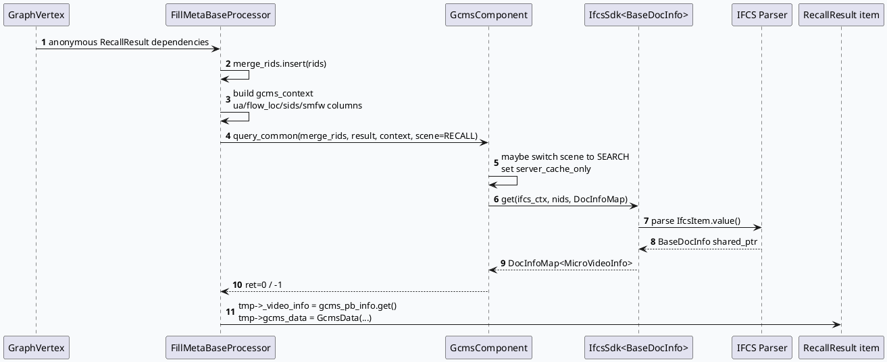

# 2026-06-09 基础库代码理解：IFCS → GCMS 正排 → FillMeta 注入链路

> 今日主题来源：未找到 daily-plan 文件，本次按近期 GRC 正排链路 fallback 选题。内网 KU 未参与检索，若需对齐业务背景需人工补充。

<style>.arch{font-family:-apple-system,BlinkMacSystemFont,"Segoe UI",sans-serif;background:#f8fafc;border:1px solid #dbe4ef;border-radius:18px;padding:18px;margin:16px 0;color:#1f2937}.arch-title{font-weight:800;font-size:22px;margin-bottom:12px}.arch-row{display:grid;grid-template-columns:1.1fr .9fr 1fr;gap:12px}.arch-layer{background:white;border:1px solid #e5e7eb;border-radius:14px;padding:12px}.arch-layer h3{margin:0 0 10px;font-size:15px;color:#334155}.arch-box{border-radius:10px;padding:9px;margin:7px 0;background:#eef6ff;border-left:4px solid #3d5a80;font-size:13px}.arch-box.hot{background:#fff7ed;border-left-color:#c2410c}.arch-box.data{background:#ecfdf5;border-left-color:#047857}.arch-arrow{text-align:center;color:#64748b;font-weight:700;margin:8px 0}.card{font-family:-apple-system,BlinkMacSystemFont,"Segoe UI",sans-serif;background:#f5f7fa;border:1px solid #dbe4ef;border-radius:18px;padding:20px;margin:18px 0;color:#243042}.card-meta{font-size:12px;letter-spacing:.08em;text-transform:uppercase;color:#3d5a80;font-weight:800}.card-title{font-size:25px;font-weight:850;margin:8px 0 10px}.card-grid{display:grid;grid-template-columns:1.5fr 1fr;gap:14px}.card-panel{background:white;border-top:4px solid #3d5a80;border-radius:12px;padding:12px;line-height:1.65}.card-panel b{color:#243042}</style>
<div class="arch"><div class="arch-title">架构全景：FillMeta 的“召回结果补正排”基础链路</div><div class="arch-row"><div class="arch-layer"><h3>Graph / Processor 层</h3><div class="arch-box hot">FillMetaBaseProcessor::setup<br/>声明匿名 RecallResult 依赖，绑定 SidInfo / RecallResultWithMeta</div><div class="arch-box hot">FillMetaBaseProcessor::process<br/>合并多路 rids，构造 GCMS Context</div></div><div class="arch-layer"><h3>组件适配层</h3><div class="arch-box">GcmsComponent::query_common<br/>将 GRC Context 转为 IFCS Context</div><div class="arch-box">Scene 路由<br/>RECALL 默认；搜索 UA/flow_loc 切 SEARCH</div></div><div class="arch-layer"><h3>IFCS / Parser / Data 层</h3><div class="arch-box data">IfcsSdk&lt;BaseDocInfo&gt;::get<br/>按 scene/accessor 查询多 shard</div><div class="arch-box data">MvRecallDocParser / MvNewsDocParser<br/>PB → MicroVideoInfo / NewsInfo</div><div class="arch-box data">DocInfoMap&lt;MicroVideoInfo&gt;<br/>回填 tmp->_video_info 与 gcms_data</div></div></div></div>

## 核心结论

- `fill_meta.cpp:191-245` 先把匿名依赖中的多路召回 `rids` 汇总到 `merge_rids`，再一次性调用 `GcmsComponent::query_common`，避免逐队列/逐 item 访问正排。
- `gcms_component.cpp:40-78` 是 GCMS→IFCS 的关键适配点：根据 UA、flow_loc 和 SID 把 scene 从 `GCMS_SECNE_RECALL` 切到 `GCMS_SECNE_SEARCH`，并设置 `server_cache_only=false`。
- `ifcs_component.cpp:19-58` 的宏封装了字段拷贝约束：repeated 字段会先 `reserve()`，降低字段解析时 vector 扩容成本。
- `ifcs_component.cpp:850-858` 通过 Babylon 注册 `MvRecallDocParser` 与 `MvNewsDocParser`，配置中的 parser 名称最终绑定到这些组件。

## 核心流程图



## 配置结构信息图

```infographic
infographic list-grid-badge-card
data
  title IFCS accessor 配置结构
  desc ifcs_sdk.conf 将业务 scene 绑定到 parser 与 shard 集群
  items
    - label recall accessor
      desc scene 0 / parser MvRecallDocParser / 10 个 query+hot_meta shard
      icon mdi/database-search
    - label search accessor
      desc scene 3 / 搜索场景命中后 server_cache_only=false
      icon mdi/magnify
    - label news accessor
      desc scene 1 / parser MvNewsDocParser / 新闻字段 merge
      icon mdi/newspaper-variant-outline
    - label hot_cache
      desc max_update_interval_s=1200，recall/news 最大 600000 条
      icon mdi/cached
theme
  palette #3d5a80 #2d6a4f #c2410c
```

## 关键代码解读

### 1. FillMeta 的依赖声明与输出

`fill_meta.cpp:126-155` 中，processor 在 `setup` 阶段：

- 检查 `handle_name`，并生成监控名 `${handle_name}_gcms_monitor`；
- 遍历所有匿名依赖，声明为 `RecallResult` 且可变；
- 绑定 `SidInfo`、`RecallResultWithMeta`、关注作者/媒体号集合等 named dependency。

这意味着 FillMeta 不是单输入节点，而是一个“多召回队列汇聚 + 统一正排补齐”的节点。

### 2. IFCS scene 切换逻辑

`gcms_component.cpp:48-72` 中默认 `server_cache_only=true`，但当 UA/flow_loc 命中搜索条件时：

- scene 改为 `GCMS_SECNE_SEARCH`；
- `server_cache_only=false`；
- `gcms_context.sids_str_vec` 被转成 `ifcs_ctx.sids`，支持小流量/SMFW 字段覆盖。

这个分支解释了为什么同一批 nid 在普通推荐和搜索承接场景可能走不同 accessor/cache 策略。

### 3. 字段解析的性能形态

`ifcs_component.cpp:29-43` 的 repeated 字段宏会根据 PB 数量先 `reserve()` 再 `emplace_back()`；`ifcs_component.cpp:131-138` 对 map/list 混合结构也避免了无界临时扩容。这里属于基础库性能热点：字段越多，parser 的内存分配和 move/copy 细节越关键。

<div class="card"><div class="card-meta">Pitfalls</div><div class="card-title">排查 FillMeta 正排缺失时，先分清“查不到”和“没回填”</div><div class="card-grid"><div class="card-panel"><b>查不到：</b>关注 `query_common` 返回值、IFCS scene、shard/hot_cache 配置和 `server_cache_only`。如果 `gcms_common_pb_meta_map.size()` 显著小于 `merge_rids.size()`，优先看 IFCS 侧。</div><div class="card-panel"><b>没回填：</b>关注 `_card_no_gcms_mark`、`gcms_pb_info == nullptr`、以及后续 AB 分支是否复制 `_video_info_copy` 后重绑 `gcms_data`。</div></div></div>

## 调试 checklist

```infographic
infographic list-column-done-list
data
  title FillMeta / IFCS 调试 checklist
  items
    - label 确认 handle_name 与监控名
      desc 查看日志中的 fill_meta_start 与 *_fill_meta_gcms_pb_rpc
      done true
    - label 比较 merge_rids 与返回 map size
      desc open_gcms_statistics 打开后可采样 no nids
      done true
    - label 核对 scene 与 server_cache_only
      desc 搜索 UA/flow_loc 命中时不应继续只读 server cache
      done true
    - label 检查 parser 注册名
      desc ifcs_sdk.conf parser 必须与 BABYLON_REGISTER_COMPONENT 名称一致
      done true
    - label 检查字段是否在 parser 中落地
      desc PB 新字段只配入 IFCS 不等于业务结构已可读
      done true
theme
  palette #3d5a80 #2d6a4f #c2410c
```

## 证据来源

- `src/processor/fill_meta.cpp:126-155`：FillMeta setup 依赖声明
- `src/processor/fill_meta.cpp:191-245`：汇总 rids 并调用 `query_common`
- `src/processor/fill_meta.cpp:306-317`：正排回填到 `RidTmpInfo`
- `src/plugin/gcms_component.cpp:40-78`：IFCS Context 构造与查询
- `src/plugin/ifcs_component.cpp:19-58`：字段拷贝宏与 repeated reserve
- `src/plugin/ifcs_component.cpp:850-858`：IFCS parser 注册
- `conf/ifcs_sdk.conf:6-154`：recall/search/news accessor 配置
