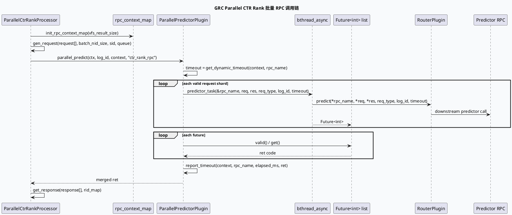

# 2026-06-10 基础库代码理解：bthread_async + Future 批量 RPC 模式

> 今日主题来源：`daily-plan-20260529.json` 只覆盖 2026-06-01 周，本次按周三推荐主题 fallback：`bthread_async 批量并行模式与捕获安全`。内网 KU 未参与检索，需人工补充相关规范文档；本笔记以代码库检索结果为准。

## 架构全景图

<style>.arch-bthread{font-family:-apple-system,BlinkMacSystemFont,"Segoe UI",sans-serif;border:1px solid #d7dee8;border-radius:18px;padding:18px;background:#f8fafc;color:#1f2937}.arch-bthread .title{font-size:22px;font-weight:800;margin-bottom:6px}.arch-bthread .sub{font-size:13px;color:#64748b;margin-bottom:16px}.arch-bthread .layer{border:1px solid #dbeafe;border-radius:14px;background:#fff;margin:10px 0;padding:12px}.arch-bthread .layer h3{margin:0 0 8px;font-size:15px;color:#1d4ed8}.arch-bthread .grid{display:grid;grid-template-columns:repeat(4,minmax(0,1fr));gap:10px}.arch-bthread .box{border-radius:12px;padding:10px;border:1px solid #e5e7eb;background:#f9fafb;min-height:58px}.arch-bthread .box b{display:block;font-size:13px;margin-bottom:4px}.arch-bthread .box span{font-size:12px;color:#64748b}.arch-bthread .hot{background:#eff6ff;border-color:#93c5fd}.arch-bthread .flow{font-size:13px;color:#334155;margin-top:10px;padding:10px;border-left:4px solid #3b82f6;background:#eef6ff;border-radius:8px}</style><div class="arch-bthread"><div class="title">GRC 批量预测 RPC 并行框架</div><div class="sub">从 GraphVertex 输入集合拆 batch，到 bthread_async 执行，再用 Future 聚合返回码与耗时上报。</div><div class="layer"><h3>1. Graph Processor 层</h3><div class="grid"><div class="box hot"><b>ParallelCtrRankProcessor</b><span>读取 `VfsCopyResult`，按队列构造 `rpc_context_map`</span></div><div class="box"><b>Batch Planner</b><span>`batch_nid_size=600`，按结果数拆多个请求</span></div><div class="box"><b>Request Builder</b><span>填充 cuid/uid/bid、sid、queue、token</span></div><div class="box"><b>Response Parser</b><span>回写分数并 ref 原始候选列表</span></div></div></div><div class="layer"><h3>2. 并行执行层</h3><div class="grid"><div class="box hot"><b>ParallelPredictorPlugin</b><span>统一入口：`parallel_predict` / `predict`</span></div><div class="box"><b>Future List</b><span>预留容量，承载每个 RPC 子任务 Future</span></div><div class="box"><b>bthread_async</b><span>异步调用 `predictor_task`</span></div><div class="box"><b>RouterPlugin</b><span>实际执行下游 predictor RPC</span></div></div></div><div class="layer"><h3>3. 观测与风险层</h3><div class="grid"><div class="box"><b>Dynamic Timeout</b><span>`Util::get_dynamic_timeout(context, rpc_name)`</span></div><div class="box"><b>Validity Guard</b><span>Future valid 判断与非 0 返回码聚合</span></div><div class="box"><b>SIA</b><span>processor 内围绕 RPC 和 vertex 打点</span></div><div class="box"><b>Capture Safety</b><span>`&rpc_name` 指针跨异步任务依赖外层生命周期</span></div></div></div><div class="flow">核心形态：构造 N 个请求 → `bthread_async` 启 N 个 `predictor_task` → 顺序 `Future::get()` 汇总 → `report_timeout`/SIA 归因。</div></div>

## 核心流程图



## 结构信息图

```infographic list-grid-badge-card
data
  title 批量并行模式的关键结构
  desc 代码中实际出现的并发、批量、聚合与观测要素
  items
    - label Future 预分配
      desc `future_list.reserve(paral_size)` 降低 vector 扩容扰动
      icon mdi/vector-line
    - label 请求分片
      desc `batch_nid_size=600`，按候选数拆为多个 PredictorRequest
      icon mdi/source-branch
    - label 统一任务函数
      desc `predictor_task` 内从 ApplicationContext 获取 RouterPlugin
      icon mdi/function-variant
    - label 返回码聚合
      desc 多个 Future 的返回码用 OR 汇总，invalid 视为失败
      icon mdi/check-network
    - label 超时归因
      desc RPC 前取动态 timeout，Future 聚合后 report_timeout
      icon mdi/timer-outline
    - label 上游 SIA
      desc Processor 级 `feed_ctr_predictor_rpc` 与 vertex 耗时包围
      icon mdi/chart-timeline-variant
```

## 关键结论

- `ParallelPredictorPlugin::parallel_predict` 是新式批量 RPC 并行模板：先按请求维度展开任务，再以 `Future<int>` 汇聚结果。
- `ParallelCtrRankProcessor` 是该模板的具体业务接入点：候选列表越长，拆出的 request 数越多，并行度随 batch 数增长。
- 该模板只并行 RPC 调用，Future 聚合和 response 解析仍在调用线程串行完成；慢尾主要体现在 `get()` 等待窗口。
- 捕获风险点是 `bthread_async` 传入 `&rpc_name`：当前调用在函数内等待全部 Future，生命周期闭合；若未来改为 fire-and-forget 或跨函数返回，会变成悬挂指针风险。
- 内网检索不可用，需人工补充 Babylon `bthread_async`/Future 推荐用法、超时策略和失败码约定。

## Pitfalls 卡片

<style>.pit-bthread{font-family:-apple-system,BlinkMacSystemFont,"Segoe UI",sans-serif;max-width:980px;border-radius:20px;background:#fff7ed;border:1px solid #fed7aa;padding:20px;color:#431407}.pit-bthread .meta{font-size:12px;letter-spacing:.08em;text-transform:uppercase;color:#9a3412;font-weight:800}.pit-bthread .headline{font-size:28px;line-height:1.15;font-weight:900;margin:8px 0 12px}.pit-bthread .grid{display:grid;grid-template-columns:1.4fr .9fr;gap:14px}.pit-bthread .panel{background:#fffbeb;border-top:4px solid #f97316;border-radius:12px;padding:12px}.pit-bthread .panel b{display:block;margin-bottom:6px}.pit-bthread .panel p{margin:0;font-size:14px;line-height:1.65;color:#7c2d12}.pit-bthread .end{margin-top:12px;font-weight:900;color:#c2410c}</style><div class="pit-bthread"><div class="meta">pitfall · async rpc</div><div class="headline">并行模板最怕“生命周期被后续优化悄悄拉长”</div><div class="grid"><div class="panel"><b>指针参数不是天然安全</b><p>`predictor_task` 接收 `const std::string* rpc_name`，安全性依赖当前函数内同步等待所有 Future。一旦未来把 Future 外传、提前返回、或把等待放到别的阶段，就必须改成值拷贝或稳定存储。</p></div><div class="panel"><b>慢尾不等于平均耗时</b><p>多个 RPC 并发后，整体耗时接近最慢 shard。排查延迟时应按 request shard、queue、req_type 拆开看，而不是只看 processor 总耗时。</p></div></div><div class="end">∎ 调试时同时看 batch 数、invalid Future、ret 聚合与下游 timeout。</div></div>

## 调试 checklist

```infographic list-column-done-list
data
  title bthread_async 批 RPC 排查清单
  desc 从输入规模、任务创建、Future 等待到响应解析逐层定位
  items
    - label 确认候选规模
      desc 检查 `vfs_copy_result->size()` 与拆分出的 request 数是否符合预期
      done true
    - label 检查 batch 规划
      desc 关注 `batch_nid_size`、`req_batch_size` 和每个 req_type 后缀
      done true
    - label 确认任务有效性
      desc 搜索 `bthread failed` 与 invalid Future 日志
      done true
    - label 对齐 timeout
      desc 对比 `get_dynamic_timeout` 输入 rpc_name 与下游 RPC 超时
      done true
    - label 分析慢尾
      desc 按 `req_type_i` 或 queue 拆分响应解析失败与耗时
      done false
    - label 审核生命周期
      desc 若修改等待位置，优先替换 `&rpc_name` 为值传递
      done false
```

## 证据来源

- `src/plugin/parallel_predictor.cpp:26-72`：`bthread_async`、`Future<int>`、`future_list.reserve` 与 `get()` 聚合主逻辑。
- `src/plugin/parallel_predictor.cpp:99-146`：`parallel_predict` 按 request/response/req_type 三数组展开并行任务。
- `src/plugin/parallel_predictor.cpp:148-167`：`predictor_task` 从 `ApplicationContext` 获取 `RouterPlugin` 并调用 predictor。
- `src/processor/parallel_ctr_rank.cpp:34-56`：按候选规模和 `batch_nid_size=600` 初始化多 batch RPC context。
- `src/processor/parallel_ctr_rank.cpp:58-160`：processor 调用 `parallel_predict`，再解析 response 并 emit 结果。
- `src/processor/parallel_ctr_rank.cpp:162-220`：请求构造阶段填充用户标识、sid、queue、token。