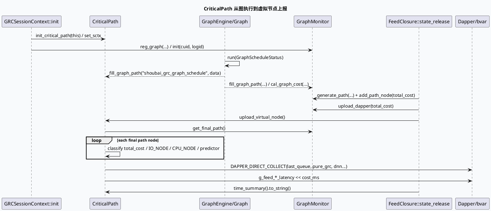

# 2026-06-11 基础库代码理解：CriticalPath 图执行观测与虚拟节点上报

> 今日主题来源：未发现可用 daily-plan 文件，本次按周四 fallback 选择 `CriticalPath 图执行观测与 Dapper 虚拟节点`。内网 KU 未参与检索，需人工补充 GRC 图监控规范；本笔记以代码库检索结果为准。

## 架构全景图

<style>.arch-critical{font-family:-apple-system,BlinkMacSystemFont,"Segoe UI",sans-serif;border:1px solid #cbd5e1;border-radius:18px;padding:18px;background:#f8fafc;color:#1f2937}.arch-critical .title{font-size:22px;font-weight:900;margin-bottom:6px}.arch-critical .sub{font-size:13px;color:#64748b;margin-bottom:16px}.arch-critical .layers{display:grid;grid-template-columns:1fr;gap:10px}.arch-critical .layer{border:1px solid #dbeafe;border-radius:14px;background:#fff;padding:12px}.arch-critical .layer h3{margin:0 0 8px;font-size:15px;color:#1d4ed8}.arch-critical .grid{display:grid;grid-template-columns:repeat(4,minmax(0,1fr));gap:10px}.arch-critical .box{border-radius:12px;padding:10px;border:1px solid #e5e7eb;background:#f9fafb;min-height:62px}.arch-critical .box b{display:block;font-size:13px;margin-bottom:4px}.arch-critical .box span{font-size:12px;color:#64748b;line-height:1.45}.arch-critical .hot{background:#eff6ff;border-color:#93c5fd}.arch-critical .flow{font-size:13px;color:#334155;margin-top:12px;padding:10px;border-left:4px solid #3b82f6;background:#eef6ff;border-radius:8px}</style><div class="arch-critical"><div class="title">GRC CriticalPath 观测分层</div><div class="sub">CriticalPath 不是调度器本身，而是在 GraphEngine、GraphMonitor、Dapper/bvar 之间补齐关键路径、虚拟节点和动态 graph json 的观测面。</div><div class="layers"><div class="layer"><h3>1. 会话初始化层</h3><div class="grid"><div class="box hot"><b>GRCSessionContext</b><span>`init_critical_path(this)` 绑定会话指针</span></div><div class="box"><b>GraphMonitor</b><span>注册 `shoubai_grc_graph_schedule` 与 GRG stage graph</span></div><div class="box"><b>TimeRecorder</b><span>提供 total cost 与阶段 cost line</span></div><div class="box"><b>CommonInfo</b><span>提供 cuid、logid、channel_id、refresh_state</span></div></div></div><div class="layer"><h3>2. 图运行采集层</h3><div class="grid"><div class="box hot"><b>Feed Graph</b><span>主图执行后调用 `fill_graph_path`</span></div><div class="box"><b>Recall Subgraph</b><span>RecallProcessor 透传真实 graph_name</span></div><div class="box"><b>RecallData Subgraph</b><span>数据子图完成后补齐路径</span></div><div class="box"><b>GraphJsonBuilder</b><span>按开关生成 graph edge JSON</span></div></div></div><div class="layer"><h3>3. 汇总上报层</h3><div class="grid"><div class="box hot"><b>upload_virtual_node</b><span>遍历 final_path 计算 last_queue、dnn、pure_grc</span></div><div class="box"><b>Dapper</b><span>`DAPPER_DIRECT_COLLECT` 上传虚拟节点</span></div><div class="box"><b>bvar latency</b><span>feed / pure_grc / last_node 分维度打点</span></div><div class="box"><b>TimeSummary</b><span>拼接到 response trace 日志</span></div></div></div></div><div class="flow">会话初始化 → 图执行完成填路径 → release 阶段生成 final_path → CriticalPath 上传虚拟节点 → trace 与 Dapper 可观测。</div></div>

## 核心流程图



## 结构信息图

```infographic list-grid-badge-card
data
  title CriticalPath 输出信号
  desc 这些信号分别落到 Dapper、bvar、trace 日志和 feed_meta_info
  items
    - label graph_dynamic_json
      desc `open_print_graph_json` 开启后，每个 graph/channel 只上传一次 edge JSON
      icon mdi/graph-outline
    - label last_queue
      desc 识别名称含 `Fork` 或 `UniQueIONode` 的 IO_NODE，记录最后队列耗时
      icon mdi/source-fork
    - label dnn
      desc 通过 PredictorData/CVRPredictorData/DppData/LiveCVRPredictorData 判断 predictor 节点
      icon mdi/brain
    - label pure_grc
      desc 汇总 CPU_NODE cost，并对 total_cost-last_queue 构造纯 GRC 口径
      icon mdi/timer-cog-outline
    - label dnn/nodnn 分流
      desc `SlowRecallFunnelDone` 命中后上报 dnn_*，否则上报 nodnn_*
      icon mdi/call-split
    - label TimeSummary
      desc `[pure_grc_cost_ms:...]` 等字段追加进最终日志
      icon mdi/text-box-search-outline
```

## 关键结论

- `CriticalPath` 是会话级观测适配器：生命周期由 `GRCSessionContext::init` 绑定，数据来源依赖 `GraphMonitor::get_final_path()`。
- `fill_graph_path` 的动态图 JSON 是强开关能力：只有 `open_print_graph_json` 开启且 graph/channel 首次命中时才写入 `graph_dynamic_json`。
- `upload_virtual_node` 用节点名称和 Dapper NodeType 推导业务语义，关键规则包括 `Fork/UniQueIONode`、`PredictorData` 和 `SlowRecallFunnelDone`。
- `pure_grc_cost` 不是简单 CPU 汇总：日志中同时存在 `pure_total_cost_us` 与 `total_cost_us - last_queue_cost_us` 两套口径，排查时必须区分。
- 内网规范不可用，需人工补充 Dapper 虚拟节点命名、`SlowRecallFunnelDone` 判断口径和 graph json 开关使用边界。

## Pitfalls 卡片

<style>.pit-critical{font-family:-apple-system,BlinkMacSystemFont,"Segoe UI",sans-serif;max-width:980px;border-radius:20px;background:#f4f8fb;border:1px solid #c7d2fe;padding:20px;color:#1e293b}.pit-critical .meta{font-size:12px;letter-spacing:.08em;text-transform:uppercase;color:#1d4ed8;font-weight:900}.pit-critical .headline{font-size:28px;line-height:1.15;font-weight:900;margin:8px 0 12px}.pit-critical .grid{display:grid;grid-template-columns:1.2fr .9fr;gap:14px}.pit-critical .panel{background:#fff;border-top:4px solid #3b82f6;border-radius:12px;padding:12px}.pit-critical .panel b{display:block;margin-bottom:6px}.pit-critical .panel p{margin:0;font-size:14px;line-height:1.65;color:#334155}.pit-critical .end{margin-top:12px;font-weight:900;color:#1d4ed8}</style><div class="pit-critical"><div class="meta">pitfall · observability</div><div class="headline">CriticalPath 的“关键路径”来自约定，不是编译期类型系统</div><div class="grid"><div class="panel"><b>节点命名会影响归因</b><p>last_queue、predictor、dnn/nodnn 都依赖节点名、last_emit_data 和 NodeType。新增图节点时如果命名不符合约定，Dapper 虚拟节点会被错误归类或缺失。</p></div><div class="panel"><b>两套 pure 口径容易混淆</b><p>`pure_total_cost_us` 汇总 CPU_NODE；`pure_grc_cost_ms` 用 total 减 last_queue。看板、日志、Dapper 对账时要先确认使用哪套口径。</p></div></div><div class="end">∎ 排查延迟先对齐 final_path，再看虚拟节点归类规则。</div></div>

## 调试 checklist

```infographic list-column-done-list
data
  title CriticalPath 排查清单
  desc 从图注册、路径填充、final_path 生成到 Dapper/bvar 上报逐层确认
  items
    - label 确认初始化
      desc 检查 `init_critical_path(this)` 是否在 session init 中执行
      done true
    - label 确认图注册
      desc 检查 GraphMonitor 是否注册主图、召回节点和 GRG stage graph
      done true
    - label 检查填路径调用
      desc 主图、RecallProcessor、RecallDataGraphProcessor 都应调用 `fill_graph_path`
      done true
    - label 对齐 final_path
      desc release 阶段是否执行 `generate_path`、`add_path_node(total_cost)`
      done true
    - label 检查虚拟节点归因
      desc 重点核对 `last_emit_data`、NodeType、节点名是否符合规则
      done false
    - label 检查开关副作用
      desc `open_print_graph_json` 打开时确认 graph/channel 注册与一次性上传逻辑
      done false
```

## 证据来源

- `src/common/session_context.cc:259`：会话初始化时调用 `init_critical_path(this)`。
- `src/common/session_context.cc:260`：GraphMonitor 注册主图 `shoubai_grc_graph_schedule`。
- `src/common/session_context.cc:272-273`：注册 GRG stage graph 并用 cuid/logid 初始化 GraphMonitor。
- `src/service/feed.cc:665-670`：主图 run 完后分别调用 CriticalPath 与 GraphMonitor 的 `fill_graph_path`。
- `src/graph_schedule/recall_processor.cpp:120-128`：召回子图执行后透传 `graph_name` 到 CriticalPath。
- `src/graph_schedule/recall_data_processor.cpp:116-118`：RecallData 子图完成后填充图路径。
- `src/service/feed.cc:1558-1574`：release 阶段生成 final_path、上传 Dapper、调用 `upload_virtual_node`。
- `src/service/feed.cc:1927-1929`：最终日志拼接 `time_summary().to_string()`。
- `src/processor/critical_path/critical_path.cc:36-68`：动态 graph JSON 开关、一次性 channel 上传和 `graph_dynamic_json` 写入。
- `src/processor/critical_path/critical_path.cc:71-180`：遍历 final_path、计算 last_queue/dnn/pure_grc 并上报 Dapper/bvar。
