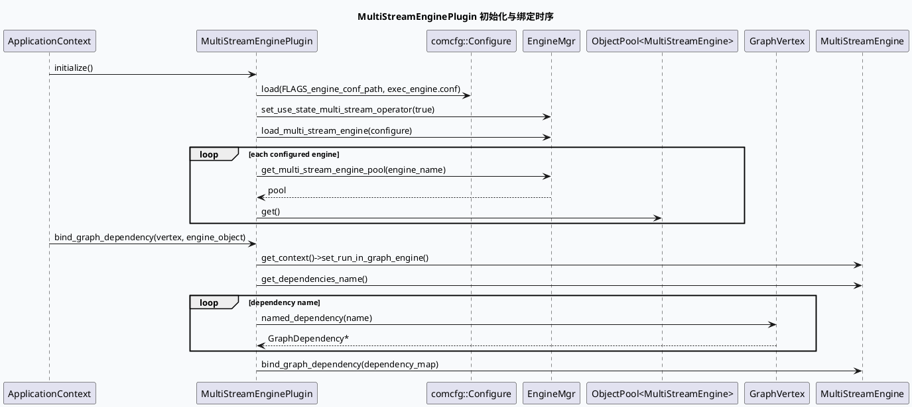

# 2026-06-13 基础库代码理解：MultiStreamEnginePlugin 依赖绑定与对象池生命周期

> 今日主题来源：未发现本机 daily-plan 文件；按周六 fallback 选择 `MultiStreamEnginePlugin` 作为基础库主题，解释配置装载、EngineMgr 对象池、GraphDependency 绑定与业务 vertex 的接入边界。内网 KU 未提供 URL/doc-id，需人工补充平台规范；本笔记以代码库检索结果为准。

## 架构全景图

<style>.arch-ms{font-family:-apple-system,BlinkMacSystemFont,"Segoe UI",sans-serif;border:1px solid #cbd5e1;border-radius:18px;padding:18px;background:#f8fafc;color:#1f2937}.arch-ms .title{font-size:22px;font-weight:900;margin-bottom:6px}.arch-ms .sub{font-size:13px;color:#64748b;margin-bottom:16px}.arch-ms .grid{display:grid;grid-template-columns:1fr 1.15fr 1fr;gap:12px}.arch-ms .lane{background:#fff;border:1px solid #dbeafe;border-radius:14px;padding:12px}.arch-ms h3{margin:0 0 10px;font-size:15px;color:#1d4ed8}.arch-ms .box{border-radius:12px;padding:10px;margin:8px 0;border:1px solid #e5e7eb;background:#f9fafb}.arch-ms .box b{display:block;font-size:13px;margin-bottom:4px}.arch-ms .box span{font-size:12px;color:#64748b;line-height:1.45}.arch-ms .hot{background:#eff6ff;border-color:#93c5fd}.arch-ms .note{margin-top:12px;padding:10px;border-radius:10px;background:#eef6ff;border-left:4px solid #3b82f6;font-size:13px;color:#334155}</style><div class="arch-ms"><div class="title">MultiStreamEnginePlugin 基础库接入全景</div><div class="sub">插件只负责把配置里的 engine 装入 EngineMgr，并在业务 vertex 初始化时把 GraphDependency 指针绑定进 engine context。</div><div class="grid"><div class="lane"><h3>配置层</h3><div class="box hot"><b>exec_engine.conf</b><span>`@engine` 声明可装载的多流引擎配置。</span></div><div class="box"><b>multi_stream_diversity.conf</b><span>声明 dependency_schema、stream、executor、operator 与 depend 列表。</span></div></div><div class="lane"><h3>基础插件层</h3><div class="box hot"><b>MultiStreamEnginePlugin::initialize</b><span>加载 engine conf，开启 state operator，并调用 `EngineMgr::load_multi_stream_engine`。</span></div><div class="box"><b>ObjectPool&lt;MultiStreamEngine&gt;</b><span>按 conf 名称从 EngineMgr 取池，初始化阶段验证每个 engine 可 get。</span></div><div class="box"><b>bind_graph_dependency</b><span>把 engine 依赖名映射成 vertex.named_dependency 指针，再交给 engine。</span></div></div><div class="lane"><h3>业务 Vertex 层</h3><div class="box hot"><b>GraphVertex option</b><span>`plugin: multi_stream_engine_plugin` + `conf: multi_stream_diversity.conf`。</span></div><div class="box"><b>DiversityMergeFunction::init</b><span>从 EngineMgr 取 `_diversity_engine`，注入自定义 context，调用插件绑定依赖。</span></div></div></div><div class="note">边界判断：engine 的执行语义属于 exec_engine；插件层不跑多样性，只负责配置装载、对象池获取和图依赖透传。</div></div>

## 核心流程图



## 配置/结构信息图

```infographic hierarchy-structure
data
  title MultiStreamEngine 配置到运行对象的映射
  desc 配置文件决定 engine 集合，基础插件负责装载，业务 vertex 决定使用哪一个 engine conf
  items
    - label exec_engine.conf
      desc `@engine: multi_stream_diversity.conf` / `multi_stream_diversity_new.conf` / `news_diversity.conf`
      children
        - label EngineMgr
          desc `load_multi_stream_engine(configure)` 生成按 conf 名称索引的对象池
          children
            - label MultiStreamEnginePlugin
              desc `get_engine_object` 或业务 init 中调用 `bind_graph_dependency`
              children
                - label GraphVertex
                  desc `named_dependency(name)` 提供图运行时 dependency 指针
                - label MultiStreamEngine
                  desc `set_run_in_graph_engine` 后通过 dependency_map 读写图依赖
```

## 关键结论

- `MultiStreamEnginePlugin::initialize()` 是冷启动装载点：加载 `exec_engine.conf`，打开 state multi stream operator，再把多流引擎配置交给 `EngineMgr`。
- 业务 vertex 配置中的 `plugin` 和 `conf` 是两条线：`plugin` 找基础库插件，`conf` 找 EngineMgr 中的 engine pool。
- `bind_graph_dependency()` 不复制依赖数据，只把 dependency name 转成 `GraphDependency*` map；因此配置名、vertex dependency 名和 engine depend 名必须一致。
- `set_run_in_graph_engine()` 是重要运行模式标记，说明 engine context 之后按 GraphEngine dependency 方式取上下文。
- 初始化验证只检查 engine pool 能否 get；具体输入 stream 容器、loop_num、输出 container 都在业务 `process()` 阶段完成。

## Pitfalls 卡片

<style>.pit-ms{font-family:-apple-system,BlinkMacSystemFont,"Segoe UI",sans-serif;max-width:980px;border-radius:20px;background:#f5f7fa;border:1px solid #c7d2fe;padding:20px;color:#1e293b}.pit-ms .meta{font-size:12px;letter-spacing:.08em;text-transform:uppercase;color:#1d4ed8;font-weight:900}.pit-ms .headline{font-size:28px;line-height:1.15;font-weight:900;margin:8px 0 12px}.pit-ms .grid{display:grid;grid-template-columns:1.2fr .9fr;gap:14px}.pit-ms .panel{background:#fff;border-top:4px solid #3b82f6;border-radius:12px;padding:12px}.pit-ms .panel b{display:block;margin-bottom:6px}.pit-ms .panel p{margin:0;font-size:14px;line-height:1.65;color:#334155}.pit-ms .end{margin-top:12px;font-weight:900;color:#1d4ed8}</style><div class="pit-ms"><div class="meta">pitfall · exec engine</div><div class="headline">多流引擎报空时，先分清是“配置没装载”还是“图依赖没绑定”</div><div class="grid"><div class="panel"><b>配置没装载</b><p>`get_multi_stream_engine_pool(conf)` 为空，通常是 `exec_engine.conf` 没包含目标 conf，或 `FLAGS_engine_conf_path`/`FLAGS_multi_stream_engine_conf_file` 指错。</p></div><div class="panel"><b>依赖没绑定</b><p>engine 能取到但运行期读取 dependency 异常，优先核对 `get_dependencies_name()` 与 vertex 中的 named dependency 是否同名。</p></div></div><div class="end">∎ 先看 pool，再看 dependency_map。</div></div>

## 调试 checklist

```infographic list-column-done-list
data
  title MultiStreamEnginePlugin 排查清单
  desc 按启动配置、对象池、vertex option、依赖绑定、运行输入逐层确认
  items
    - label 检查 engine conf 入口
      desc `conf/plugins/exec_engine/exec_engine.conf` 是否包含目标 `@engine`
      done true
    - label 检查插件装载参数
      desc `FLAGS_engine_conf_path` 与 `FLAGS_multi_stream_engine_conf_file` 是否指向 exec_engine 配置目录
      done true
    - label 检查对象池
      desc `EngineMgr::instance().get_multi_stream_engine_pool(conf)` 是否非空且可 get
      done true
    - label 检查 vertex option
      desc `plugin` 必须是 `multi_stream_engine_plugin`，`conf` 必须是已装载的 engine conf
      done true
    - label 检查 dependency 名
      desc engine depend 名必须能被 `vertex.named_dependency(name)` 找到
      done false
    - label 检查业务上下文
      desc 自定义 `BaseStreamContext` 必须在 init 中 ref 到 `exec_context->custom_context`
      done false
```

## 证据来源

- `src/plugin/multi_stream_engine.cpp:28-48`（common-processor）：加载 `exec_engine.conf`、开启 state operator、调用 `load_multi_stream_engine` 并验证 engine pool。
- `src/plugin/multi_stream_engine.cpp:55-64`（common-processor）：通过 pool 获取 engine，并导出 `get_dependencies_name()`。
- `src/plugin/multi_stream_engine.cpp:67-75`（common-processor）：`get_engine_object()` 从 EngineMgr 取对象并立即绑定图依赖。
- `src/plugin/multi_stream_engine.cpp:78-90`（common-processor）：`set_run_in_graph_engine()`、`vertex.named_dependency()`、`bind_graph_dependency(dependency_map)` 三步完成 GraphEngine 绑定。
- `src/plugin/exec_engine.h:60-68`（common-processor）：`MultiStreamEnginePlugin` 对外暴露 `get_engine_object` 与 `bind_graph_dependency`。
- `conf/plugins/exec_engine/exec_engine.conf:1-4`（GRG）：声明 `multi_stream_diversity.conf`、`multi_stream_diversity_new.conf`、`news_diversity.conf` 三个 engine。
- `conf/plugins/graph/short_micro_video/vertex.conf:933-935`（GRG）：业务 vertex option 指定 `multi_stream_engine_plugin` 与 `multi_stream_diversity.conf`。
- `src/process/diversity_merge.cpp:65-90`（GRG）：业务 init 读取 plugin/conf、取 engine、绑定自定义 context、调用基础插件绑定依赖。
