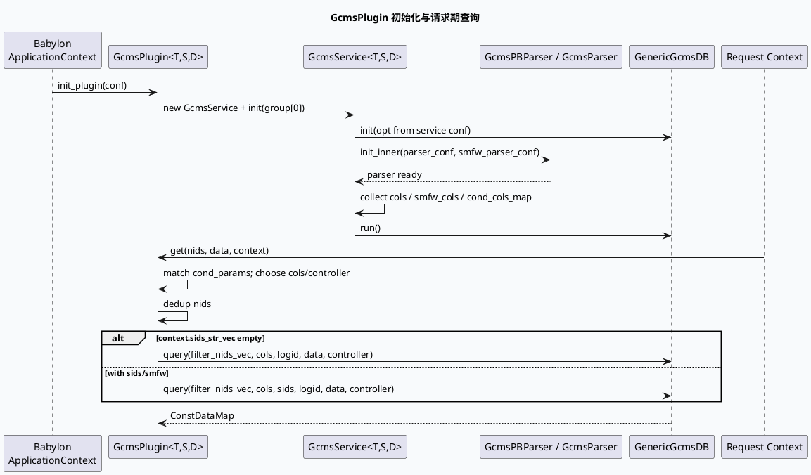

# GcmsPlugin：配置化正排字段、Parser 与查询控制器

> 今日主题来源：未发现本机 daily-plan 文件；按周一 fallback 选择 GRC 正排基础库主题：`common-component` 的 `GcmsPlugin` 如何把配置字段解析为列集合、按条件扩展字段/Controller，并在请求期完成去重查询与小流量字段合并。内网 KU 未提供可检索 URL/doc-id；需人工补充平台规范，本篇以代码库检索结果为准。

## 架构全景图

<style>.gcms-arch{font-family:Inter,Arial,sans-serif;background:#f8fafc;border:1px solid #dbe4ef;border-radius:18px;padding:18px;margin:16px 0;color:#1f2937}.gcms-arch .title{font-size:22px;font-weight:800;margin-bottom:4px}.gcms-arch .sub{font-size:13px;color:#64748b;margin-bottom:16px}.gcms-arch .layer{border-radius:14px;padding:14px;margin:12px 0;border:1px solid #cbd5e1;background:white}.gcms-arch .layer h3{margin:0 0 10px 0;font-size:15px;color:#334155}.gcms-arch .grid{display:grid;grid-template-columns:repeat(3,1fr);gap:10px}.gcms-arch .box{border-radius:12px;padding:10px;border:1px solid #d7dee8;background:#f8fbff;font-size:13px;line-height:1.45}.gcms-arch .box b{display:block;color:#1e3a8a;margin-bottom:4px}.gcms-arch .highlight{background:#eef6ff;border-color:#7aa7d9}.gcms-arch .arrow{font-size:12px;color:#64748b;text-align:center;margin:4px 0}</style><div class="gcms-arch"><div class="title">GcmsPlugin 配置 → Parser → Query Runtime</div><div class="sub">一个 conf 文件对应一个 plugin/cache；基础库负责字段列裁剪、条件控制器、小流量 merge 和去重查询。</div><div class="layer"><h3>配置入口</h3><div class="grid"><div class="box highlight"><b>group/service</b>service_name、timeoutms、req_batch_size、req_max_concurrency、cache/source 参数</div><div class="box"><b>parser.field</b>从 pb_field/json_field 提取一级列名，去重后形成 cols</div><div class="box"><b>cond_params</b>按实验条件追加 cols，并覆写 req_type/timeout/sub_service</div></div></div><div class="arrow">↓ init_plugin() / GcmsService::init()</div><div class="layer"><h3>解析器层</h3><div class="grid"><div class="box"><b>GcmsPBParser</b>ContentFeature → DynamicStruct → 业务 T/S 结构</div><div class="box"><b>GcmsParser</b>ReusableDoc(JSON) → DynamicStruct → 业务 T/S 结构</div><div class="box highlight"><b>merge()</b>base + smfw_vec，支持小流量字段叠加</div></div></div><div class="arrow">↓ get()</div><div class="layer"><h3>查询运行期</h3><div class="grid"><div class="box"><b>条件命中</b>experiment.get(cond_path, cond_params) 选择字段/Controller</div><div class="box highlight"><b>请求去重</b>filter_nids_vec/filter_nids_set 防止重复 nid 打爆 query</div><div class="box"><b>DB query</b>无 sids 走默认列；有 sids 走小流量列合并</div></div></div></div>

## 核心调用链



## 配置/结构信息图

```infographic
infographic list-grid-badge-card
data
  title GcmsPlugin 配置面
  desc 字段裁剪、Controller、SMFW 与条件参数分别在不同阶段生效
  items
    - label service
      desc service_name / timeoutms / batch / concurrency / cache / data_source
      icon mdi/server-network
    - label parser.field
      desc pb_field 或 json_field 提取一级列名，构造 cols
      icon mdi/file-tree
    - label smfw_parser.field
      desc 小流量字段列集合，命中后 merge_smfw
      icon mdi/source-branch
    - label cond_params
      desc 条件追加字段与 Controller 覆写
      icon mdi/tune-variant
    - label controller
      desc io_async / unique_id / sub_service_name 默认控制项
      icon mdi/gamepad-circle
    - label context
      desc cond_params / sids_str_vec / custom service_name 请求期介入
      icon mdi/account-cog
theme
  palette #3D5A80 #6B7280 #2D6A4F
```

## 关键机制拆解

### 1. Parser 类型由数据载体决定

`gcms_plugin.h:76-97` 使用 `std::enable_if` 区分 `ContentFeature` 与非 `ContentFeature`：

- `ContentFeature` → `GcmsPBParser<T,S>`，字段名使用 `pb_field`；
- 非 PB 文档 → `GcmsParser<T,S>`，字段名使用 `json_field`；
- 两者都通过 `DynamicStruct::struct_to_dynamic()` 把 GCMS 文档解析到业务结构。

对应实现见 `gcms_plugin.hpp:24-68`、`gcms_plugin.hpp:110-150`。

### 2. 字段列不是手写 list，而是从 parser 配置推导

初始化期 `gcms_plugin.hpp:269-323` 会读取 `parser.field` 和 `smfw_parser.field`：

- 对每个字段按 `.` 切分，只保留一级列名；
- 使用 set 去重，写入 `cols` 或 `smfw_cols`；
- `front_parser` 还会补充正解 parser 的字段。

这解释了为什么配置字段变更会直接影响正排拉取列集合，也意味着字段名拼错不一定在编译期暴露。

### 3. cond_params 是“字段 + Controller”的运行期开关

`gcms_plugin.hpp:335-360` 把每个条件名绑定到：

- `cond_cols_map`：默认 cols + 条件追加列；
- `cond_controller_map`：`req_type`、`timeout_ms`、`service_name`、`sub_service_name` 等请求控制项。

请求期 `gcms_plugin.hpp:397-428` 通过实验配置命中第一个条件，并切换字段集合/Controller。

### 4. 请求期先去重，再决定是否带 sids 查询

`gcms_plugin.hpp:452-480` 会把输入 nids 去重后再调用 `_db.query()`：

- 没有 `context.sids_str_vec`：按默认字段查询；
- 有 `context.sids_str_vec`：带 sids 走小流量字段合并；
- `context.gcms_smfw_columns_str_vec` 不为空时，会设置 `small_flow_id`、`smfw_columns` 和 `merge_smfw=true`（`gcms_plugin.hpp:445-451`）。

## Pitfalls 卡片

<style>.gcms-card{font-family:Inter,Arial,sans-serif;background:#F5F7FA;border-left:7px solid #3D5A80;border-radius:16px;padding:18px 20px;margin:18px 0;color:#1f2937;box-shadow:0 8px 24px rgba(31,41,55,.08)}.gcms-card .meta{font-size:12px;letter-spacing:.08em;text-transform:uppercase;color:#64748b;font-weight:800}.gcms-card h3{font-size:24px;line-height:1.15;margin:6px 0 12px}.gcms-card ul{margin:8px 0 0 18px;line-height:1.65}.gcms-card li{margin:4px 0}.gcms-card code{background:#e8edf3;border-radius:5px;padding:1px 5px}</style><div class="gcms-card"><div class="meta">Pitfalls / GcmsPlugin</div><h3>正排问题通常不是“RPC 没返回”，而是字段面、条件面或小流量面选错。</h3><ul><li><b>字段一级列裁剪：</b><code>pb_field=a.b.c</code> 最终请求列只保留 <code>a</code>，字段组过大可能放大响应成本。</li><li><b>cond 只取第一个命中：</b><code>cond_name_vec[0]</code> 决定字段/Controller，多条件命中时要确认优先级。</li><li><b>Controller 是 thread_local：</b>条件覆盖后应关注未覆盖字段是否残留默认值语义。</li><li><b>SMFW 全量列：</b>代码注释说明无论是否命中小流量都取全量小流量字段以提升 cache 命中，排查成本时别只看命中 sid。</li><li><b>配置空字段是 FATAL：</b><code>parser.field</code> 为空会初始化失败，不是运行期 graceful degrade。</li></ul></div>

## 调试 checklist

```infographic
infographic list-column-done-list
data
  title GcmsPlugin 调试顺序
  desc 从初始化配置到请求上下文逐层排查
  items
    - label 确认插件 conf 只含一个 group
      desc init_plugin 要求 group size == 1
      done true
    - label 检查 parser.field 是否非空
      desc 字段缺失会直接初始化失败
      done true
    - label 打印 cols / smfw_cols
      desc 确认一级列名符合预期
      done true
    - label 检查 cond_params 命中顺序
      desc 只使用 cond_name_vec[0]
      done true
    - label 检查 context.sids_str_vec
      desc 决定是否走带 sids 的 query
      done true
    - label 对比输入 nids 与 filter_nids_vec
      desc 排除重复 nid 导致的统计偏差
      done true
theme
  palette #3D5A80 #94A3B8 #2D6A4F
```

## 证据来源

- `common-component/src/plugin/gcms_plugin.h:66-169`：`GcmsService` / `GcmsPluginInterface` / `GcmsPlugin` 主结构。
- `common-component/src/plugin/gcms_plugin.h:171-228`：注册宏，支持 JSON/PB plugin 与自定义 conf。
- `common-component/src/plugin/gcms_plugin.hpp:24-68`：PB parser 初始化与解析。
- `common-component/src/plugin/gcms_plugin.hpp:110-150`：JSON parser 初始化与解析。
- `common-component/src/plugin/gcms_plugin.hpp:186-267`：service option 从配置写入 GCMS DB options。
- `common-component/src/plugin/gcms_plugin.hpp:269-365`：字段列、SMFW 列、cond_params、controller 初始化。
- `common-component/src/plugin/gcms_plugin.hpp:389-496`：请求期条件命中、去重、query 与 bvar 统计。

## 需人工补充

- KU 文档 `gcms_common_pb_plugin.conf` 注释指向的正排字段开发规范无法在本 cron 环境内展开检索；字段命名、上线流程与 IFCS/GCMS 平台侧约束需人工补充。
