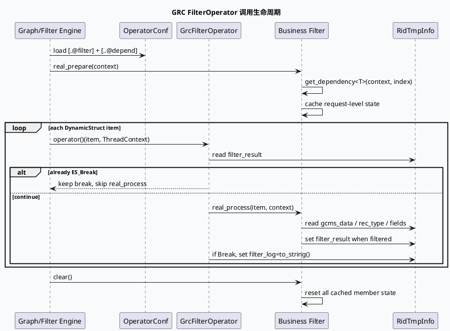

# GRC FilterOperator 状态生命周期与依赖绑定

> 今日主题来源：未找到显式 `daily-plan-20260617.json`，按近期双 Markdown 工作流 fallback 到代码库新增/最近活跃的 lite-grc 过滤算子。内网 KU 未提供可检索 URL/doc-id，需人工补充业务背景；本文以 lite-grc 代码与配置为证据，聚焦 `real_prepare → real_process → clear` 的基础库状态模型。

## 架构全景图

<style>.flt-arch{font-family:Inter,Arial,sans-serif;background:#f8fafc;border:1px solid #dbe4ef;border-radius:18px;padding:18px;margin:16px 0;color:#1f2937}.flt-arch .title{font-size:22px;font-weight:850;margin-bottom:4px}.flt-arch .sub{font-size:13px;color:#64748b;margin-bottom:16px}.flt-arch .grid{display:grid;grid-template-columns:1fr 1.15fr 1fr;gap:12px}.flt-arch .layer{background:#fff;border:1px solid #dbe4ef;border-radius:14px;padding:14px}.flt-arch h3{margin:0 0 10px;font-size:15px;color:#315072}.flt-arch .box{background:#f8fbff;border:1px solid #e2e8f0;border-radius:10px;padding:10px;margin:8px 0;font-size:13px;line-height:1.45}.flt-arch .hot{background:#fff7ed;border-color:#f59e0b}.flt-arch .ok{background:#eef6ff;border-color:#7aa7d9}.flt-arch .arrow{text-align:center;color:#64748b;font-size:12px;font-weight:800;margin:8px 0}</style><div class="flt-arch"><div class="title">FilterOperator 状态生命周期：请求级 prepare，候选级 process，结束后 clear</div><div class="sub">基础框架把算子实例、依赖顺序、过滤状态和日志归因串起来；业务算子只应在 item 热循环中使用已准备好的轻量状态。</div><div class="grid"><div class="layer"><h3>配置层</h3><div class="box ok">filter_main_auto_play.conf 声明 filter 与 depend 顺序</div><div class="box">条件：UA/FLOW_LOC/SID valid</div><div class="box hot">依赖顺序必须与 get_dependency 下标一致</div></div><div class="layer"><h3>框架层</h3><div class="box">GrcFilterOperator::operator()</div><div class="arrow">读取 rid_info->filter_result</div><div class="box hot">非 ES_Break 才调用 real_process()</div><div class="box">命中 Break 写 filter_log=to_string()</div></div><div class="layer"><h3>业务算子层</h3><div class="box ok">real_prepare：读取 CommonInfo/SidInfo/UaStrResultWithMeta</div><div class="box hot">成员状态：scene flags / trigger cate / thresholds</div><div class="box ok">clear：重置状态，避免跨请求污染</div></div></div></div>

## 核心流程图



## 配置/结构信息图

```infographic
infographic hierarchy-structure
data
  title FilterOperator 三层结构
  desc 关注配置依赖、基类包装、业务状态三个面
  items
    - label 配置依赖
      desc [.@filter] name/condition/valid + [..@depend] 顺序
      children
        - label CommonInfo
          desc UA、FLOW_LOC、device_info
        - label SidInfo
          desc 实验与 valid 控制
        - label UaStrResultWithMeta
          desc 入口资源队列，例如 2356
    - label 基类包装
      desc GrcFilterOperator::operator 控制 skip、调用与日志
      children
        - label ES_Break 短路
          desc 已过滤 item 不重复执行后续算子逻辑
        - label filter_log
          desc Break 时写入算子名，UniqSpecial 会拼 fork_type
    - label 业务状态
      desc real_prepare 缓存，real_process 使用，clear 重置
      children
        - label scene flag
          desc is_hit_main_scene / is_pad_related_scene
        - label thresholds
          desc sv_duration_thres / lianbo duration
        - label trigger fields
          desc trigger_id_cate / is_lianbo_vid_heji
theme
  palette #3D5A80 #F59E0B #2D6A4F
```

## 关键机制拆解

### 1. 基类明确了“已过滤 item 短路”语义

`src/processor/filter/grc_filter_base.h:72-101` 中，`GrcFilterOperator::operator()` 会先读 `rid_info->filter_result`：如果当前 item 已经是 `ES_Break`，则不再调用业务算子的 `real_process()`；只有非 Break 才进入业务逻辑。这个设计让过滤链天然支持前序算子短路，降低后续无效计算。

### 2. Break 时日志归因由基类统一写入

同一段基类代码在 `status == ES_Break` 时写入 `rid_info->filter_log = to_string()`。`UniqSpecialFilterOperator` 还会在 `fork_type` 包含 `uniq` 时拼接 `fork_type + '-' + to_string()`（`src/processor/filter/grc_filter_base.h:105-121`）。因此业务算子不需要自行处理通用过滤日志，但要保证算子名可读、配置可定位。

### 3. 状态算子必须实现 clear，否则会出现跨请求污染

基类注释 `src/processor/filter/grc_filter_base.h:60-69` 明确提醒：使用自定义状态参数时，必须在 `clear()` 中初始化。`RelatedSceneFilterOperator` 在 `src/processor/filter/related_scene_filter_operator.cc:96-100` 重置 `is_pad_related_scene`、`is_hit_heji_filter`、`trigger_id_cate`；`HejiLbFilterOperator` 在 `src/processor/filter/heji_lb_filter_operator.cc:96-101` 重置场景命中、合集标记、时长阈值。这个模式是基础库层面的硬约束。

### 4. 依赖下标是“配置顺序协议”，不是类型自动发现

`ContentQualityScoreFilterOperator` 注释写明 `get_dependency 0,1,2` 顺序需要与 `conf/plugins/graph/micro_frame/filter_main.conf` 顺序一致（`src/processor/filter/content_quality_score_filter_operator.cc:17-24`）。`filter_main_auto_play.conf:70-94` 中 `HejiLbFilterOperator` 和 `RelatedSceneFilterOperator` 依次声明 `CommonInfo`、`SidInfo`、`UaStrResultWithMeta`，代码中也按 0/1/2 读取（`heji_lb_filter_operator.cc:11-16`、`related_scene_filter_operator.cc:11-16`）。新增依赖时必须同步修改配置和代码下标。

### 5. real_prepare 是请求级缓存边界，real_process 是候选级热路径

两个新场景算子都把入口资源、设备场景、触发类目等请求级信息放到 `real_prepare()`：`RelatedSceneFilterOperator` 在 `related_scene_filter_operator.cc:19-54` 计算 pad 相关推荐场景与触发类目；`HejiLbFilterOperator` 在 `heji_lb_filter_operator.cc:19-56` 计算 a0/i0 场景、入口资源时长、入口是否短剧/漫剧。`real_process()` 只对每个候选读取少量字段并设置 `filter_result`，这是过滤算子性能模型的关键。

## Pitfalls 卡片

<style>.flt-card{font-family:Inter,Arial,sans-serif;background:#F5F7FA;border-radius:18px;padding:20px;margin:18px 0;border-left:8px solid #3D5A80;color:#1f2937;box-shadow:0 10px 26px rgba(31,41,55,.08)}.flt-card .meta{font-size:12px;letter-spacing:.08em;text-transform:uppercase;color:#64748b;font-weight:800}.flt-card h3{font-size:25px;line-height:1.15;margin:8px 0 12px}.flt-card .grid{display:grid;grid-template-columns:2fr 1fr;gap:14px}.flt-card p,.flt-card li{font-size:14px;line-height:1.65}.flt-card ul{margin:0 0 0 18px}.flt-card .side{border-left:3px solid #F59E0B;padding-left:12px;color:#374151}.flt-card code{background:#e8edf3;border-radius:5px;padding:1px 5px}</style><div class="flt-card"><div class="meta">Pitfalls / State Lifecycle</div><h3>过滤算子的成员变量不是“普通缓存”，而是请求级状态；忘记 clear 就可能串请求。</h3><div class="grid"><div><ul><li><b>依赖顺序错位：</b><code>get_dependency&lt;T&gt;(context, n)</code> 必须与配置中的 <code>[..@depend]</code> 顺序一致。</li><li><b>热循环污染：</b>实验读取、队列扫描、入口资源分析应放在 <code>real_prepare</code>，不要放进 <code>real_process</code>。</li><li><b>已 Break 短路：</b>后序算子不会对已过滤 item 重新处理，排查时要看前序 filter_log。</li><li><b>日志放大：</b>每 item 的 DEBUG 拼接在大流量下仍可能形成 CPU/IO 噪声。</li></ul></div><div class="side">评审口径：每新增一个成员变量，都要同时检查 prepare 写入点、process 读取点、clear 重置点和配置依赖顺序。</div></div></div>

## 调试 checklist

```infographic
infographic list-column-done-list
data
  title FilterOperator 调试 checklist
  desc 从配置、依赖、状态、日志四个维度排查
  items
    - label 校验 filter 是否被配置加载
      desc 检查 conf/plugins/graph/* 中 [.@filter] name 与 FACTORY_REG_STATE_OPERATOR_CONF 名称一致
      done true
    - label 校验 condition 与 valid
      desc UA/FLOW_LOC/SID 是否命中，default 是否符合预期
      done true
    - label 校验 depend 顺序
      desc 配置 [..@depend] 顺序必须匹配 get_dependency 下标
      done true
    - label 校验 real_prepare 返回值
      desc 缺 CommonInfo/request_ptr/SidInfo 时是否正确返回或降级
      done true
    - label 校验 clear 覆盖所有成员变量
      desc bool/string/threshold/vector 都必须回到默认状态
      done true
    - label 校验 filter_log 来源
      desc 已 Break 时看前序算子；UniqSpecial 看 fork_type 拼接
      done true
theme
  palette #3D5A80 #F59E0B #2D6A4F
```

## 证据来源

- `src/processor/filter/grc_filter_base.h:36-69`：基类接口、状态清理约束。
- `src/processor/filter/grc_filter_base.h:72-101`：短路、调用 `real_process()` 与 `filter_log` 逻辑。
- `src/processor/filter/grc_filter_base.h:105-121`：`UniqSpecialFilterOperator` 日志拼接。
- `src/processor/filter/related_scene_filter_operator.cc:11-54`：相关推荐场景 `real_prepare()` 状态计算。
- `src/processor/filter/related_scene_filter_operator.cc:59-100`：候选过滤与 `clear()`。
- `src/processor/filter/heji_lb_filter_operator.cc:11-56`：播后推合集/时长 `real_prepare()`。
- `src/processor/filter/heji_lb_filter_operator.cc:61-101`：候选过滤与 `clear()`。
- `src/processor/filter/content_quality_score_filter_operator.cc:17-24`：依赖顺序注释与下标读取。
- `conf/plugins/graph/micro_frame/filter_main_auto_play.conf:70-94`：两个新场景算子的配置依赖。
