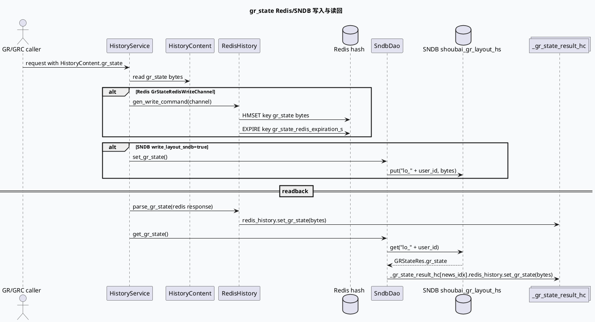

# 2026-06-21 基础库代码理解：HS gr_state Redis/SNDB 双通道门禁与状态透传

> 今日主题来源：本机未发现可用 `daily-plan` 文件；按周日 fallback 继续 History Service 点展状态主题，聚焦 `gr_state` 在 Redis 与 SNDB 两条基础设施路径中的写入、读回、门禁和易错点。  
> 内网 KU：本次任务未提供 KU URL/doc-id；未执行如流知识库查询，线上产品口径需人工补充。本文以代码库证据为准。  
> 范围：History Service 入口、`HistoryContent.gr_state` 协议、`RedisHistory::parse_gr_state()`、`RedisHistory::gen_write_command()`、`SndbDao::set_gr_state()` / `get_gr_state()`、读写 tree 与 gflags 配置。

## 架构全景图

<style>.arch-gs{font-family:-apple-system,BlinkMacSystemFont,"Segoe UI",sans-serif;background:#f8fafc;border:1px solid #cbd5e1;border-radius:20px;padding:18px;color:#1e293b}.arch-gs .title{font-size:24px;font-weight:900;margin-bottom:6px}.arch-gs .sub{font-size:13px;color:#64748b;margin-bottom:16px}.arch-gs .grid{display:grid;grid-template-columns:1fr 1.15fr 1fr;gap:12px}.arch-gs .lane{background:#fff;border:1px solid #dbeafe;border-radius:16px;padding:12px}.arch-gs h3{font-size:15px;margin:0 0 10px;color:#1d4ed8}.arch-gs .box{background:#f9fafb;border:1px solid #e5e7eb;border-radius:12px;padding:10px;margin:8px 0}.arch-gs .box b{display:block;font-size:13px;margin-bottom:4px}.arch-gs .box span{font-size:12px;color:#64748b;line-height:1.5}.arch-gs .hot{background:#eff6ff;border-color:#93c5fd}.arch-gs .note{margin-top:12px;border-left:4px solid #3b82f6;background:#eef6ff;border-radius:10px;padding:10px;font-size:13px;color:#334155}</style><div class="arch-gs"><div class="title">HS gr_state 基础链路全景</div><div class="sub">gr_state 不是普通 issued_items 字段，而是序列化 NewsMessage bytes；Redis 路径写 hash field，SNDB 路径写 layout group，读回后落到 _gr_state_result_hc。</div><div class="grid"><div class="lane"><h3>入口与协议</h3><div class="box hot"><b>HistoryService</b><span>`main.cc` 注册 brpc service，gflags 中打开 `-is_open_gr_state=true`。</span></div><div class="box"><b>HistoryContent.gr_state</b><span>`history_service.proto` 字段 9，写请求/读响应都以 bytes 承载状态。</span></div><div class="box"><b>NewsMessage.state[]</b><span>`redisprotocol.proto` 字段 129，与 `nids[]` 并行表达点展状态。</span></div></div><div class="lane"><h3>存取执行层</h3><div class="box hot"><b>GrState Redis</b><span>`gen_write_command()` 遇到 `GrStateRedisWriteChannel` 只写 hash field `gr_state`，TTL 使用 `gr_state_redis_expiration_s`。</span></div><div class="box hot"><b>GrState SNDB</b><span>`SndbDao` 使用 `shoubai_gr_layout_hs` group，key 为 `lo_ + user_id`。</span></div><div class="box"><b>Tree handlers</b><span>`sndb_gr_state_get/set_pre_handler` 直接调用 DAO 后返回 -1，跳过通用 IO。</span></div></div><div class="lane"><h3>读回与合并边界</h3><div class="box hot"><b>parse_gr_state()</b><span>从 Redis HGETALL 结果中只识别 `gr_state` field，并写入 `redis_history.gr_state`。</span></div><div class="box"><b>_gr_state_result_hc</b><span>SNDB get 命中后为 news_idx 单独创建 HistoryContext，不混入普通 `_result_hc`。</span></div><div class="box"><b>业务门禁</b><span>读 SNDB 要求 provider 为 `shoubai-gr` 且请求里存在 `ne_` prefix。</span></div></div></div><div class="note">结论：排查 gr_state 先看开关、provider、prefix 与通道名，再看 bytes 是否能解析为 NewsMessage。</div></div>

## 核心流程图



## 配置/结构信息图

```infographic hierarchy-structure
data
  title gr_state 基础配置映射
  desc gflag、tree node、DAO、Redis field 与 SNDB group 共同决定状态是否可读写
  items
    - label gflags.conf
      desc `-is_open_gr_state=true` 打开 SNDB gr_state 读门禁；`-write_layout_sndb=false` 默认不写 SNDB layout
      children
        - label main.cc
          desc `DEFINE_bool(is_open_gr_state,false)`，实际值由 `conf/gflags.conf` 覆盖
    - label set_data_tree.conf
      desc `GrStateSndbSetIONode` 使用 `sndb_gr_state_set_pre_handler`
      children
        - label SndbDao::set_gr_state
          desc 找到非空 `HistoryContent.gr_state` 后写 `shoubai_gr_layout_hs`
    - label get_data_tree.conf
      desc `StateMergeNode` 下挂 `GrStateSndbGetIONode`，先读状态再执行历史 merge
      children
        - label SndbDao::get_gr_state
          desc 需要 `is_open_gr_state`、provider=`shoubai-gr`、prefix=`ne_`
    - label RedisHistory
      desc `GrStateRedisWriteChannel` 只写 field `gr_state`，`parse_gr_state()` 只读该 field
```

## 关键结论

- `HistoryContent.gr_state` 是唯一稳定的基础库存取入口：协议字段位于 `history_service.proto:165-175`，不是 `IssuedItem.show_tss/click_tss`。
- Redis 写入逻辑对 `GrStateRedisWriteChannel` 有专门分支：只写 `gr_state` field，不走普通 `issued_items/other` 组合，并用 `gr_state_redis_expiration_s` 设置 TTL。
- SNDB 写路径受两个条件影响：tree 中有 `GrStateSndbSetIONode`，但 handler 还要检查 `FLAGS_write_layout_sndb`；当前 `gflags.conf:9-10` 显示默认 `write_layout_sndb=false`。
- SNDB 读路径比 Redis 更严格：`get_gr_state()` 要求 `FLAGS_is_open_gr_state`、provider 为 `shoubai-gr`，并在请求 `history_contents` 中找到 `prefix_key == "ne_"`。
- SNDB 读回不写普通 `_result_hc`，而是创建 `_gr_state_result_hc[news_idx]`，因此从普通历史 merge 结果里找不到 gr_state 并不等于没有状态。

## Pitfalls 卡片

<style>.pit-gs{font-family:-apple-system,BlinkMacSystemFont,"Segoe UI",sans-serif;max-width:1000px;border-radius:20px;background:#f5f7fa;border:1px solid #c7d2fe;padding:20px;color:#1e293b}.pit-gs .meta{font-size:12px;letter-spacing:.08em;text-transform:uppercase;color:#1d4ed8;font-weight:900}.pit-gs .headline{font-size:28px;line-height:1.15;font-weight:900;margin:8px 0 12px}.pit-gs .grid{display:grid;grid-template-columns:1.2fr .9fr;gap:14px}.pit-gs .panel{background:#fff;border-top:4px solid #3b82f6;border-radius:12px;padding:12px}.pit-gs .panel b{display:block;margin-bottom:6px}.pit-gs .panel p{margin:0;font-size:14px;line-height:1.65;color:#334155}.pit-gs .end{margin-top:12px;font-weight:900;color:#1d4ed8}</style><div class="pit-gs"><div class="meta">pitfall · history service</div><div class="headline">打开 is_open_gr_state，不代表 SNDB 一定写入</div><div class="grid"><div class="panel"><b>读开关与写开关不是一个</b><p>`is_open_gr_state` 保护 SNDB 读门禁；写路径 handler 还检查 `write_layout_sndb`。只看一个 gflag 很容易误判双通道状态。</p></div><div class="panel"><b>普通历史容器不承载状态</b><p>gr_state 读回放在 `_gr_state_result_hc`，不是普通 `_result_hc`。调试时要看专用容器和 `redis_history.gr_state`。</p></div></div><div class="end">∎ 先判通道，再判开关，最后解析 bytes。</div></div>

## 调试 checklist

```infographic list-column-done-list
data
  title gr_state 基础链路排查清单
  items
    - label 确认服务入口加载 gflags
      desc `main.cc:39-44` 解析命令行并加载 `conf/gflags.conf`
      done true
    - label 确认读开关
      desc `gflags.conf:35` 是否为 `-is_open_gr_state=true`
      done true
    - label 确认写开关
      desc `gflags.conf:9-10` 是否打开 `-write_layout_sndb=true`
      done false
    - label 确认请求前缀
      desc SNDB get 需要 `prefix_key == "ne_"`
      done false
    - label 确认 provider
      desc `SndbDao::get_gr_state` 只接受 `shoubai-gr`
      done false
    - label 确认 bytes 可解析
      desc 用 `NewsMessage.ParseFromString(gr_state)` 检查 `nids[]/state[]` 对齐
      done false
```

## 证据来源

- `src/main.cc:32-44`：`is_open_gr_state` gflag 定义与 `conf/gflags.conf` 加载。
- `conf/gflags.conf:9-35`：`write_layout_sndb=false`、`is_open_gr_state=true` 等运行开关。
- `proto/history_service.proto:22-28`：`ShowClkState` 枚举。
- `proto/history_service.proto:31-175`：`IssuedItem` 与 `HistoryContent.gr_state` 协议字段。
- `proto/redisprotocol.proto:238-307`：`show_state/show_tss` 不存 Redis 注释与 `NewsMessage.state[]` 字段 129。
- `src/history/redis_history.cc:86-143`：`parse_gr_state()` 从 Redis field `gr_state` 读 bytes。
- `src/history/redis_history.cc:605-681`：`GrStateRedisWriteChannel` 专用写入与 TTL 选择。
- `src/dao/sndb_dao.cc:96-121`：`set_gr_state()` 写 `shoubai_gr_layout_hs`。
- `src/dao/sndb_dao.cc:234-273`：`get_gr_state()` 的 provider/prefix 门禁与 `_gr_state_result_hc` 写回。
- `src/handler/sndb_handler.cc:50-82`：SNDB gr_state get/set handler 直接调用 DAO 并跳过通用 IO。
- `conf/get_data_tree.conf:1-54`：`StateMergeNode` 与 `GrStateSndbGetIONode` 编排。
- `conf/set_data_tree.conf:1-48`：`GrStateSndbSetIONode` 编排。
