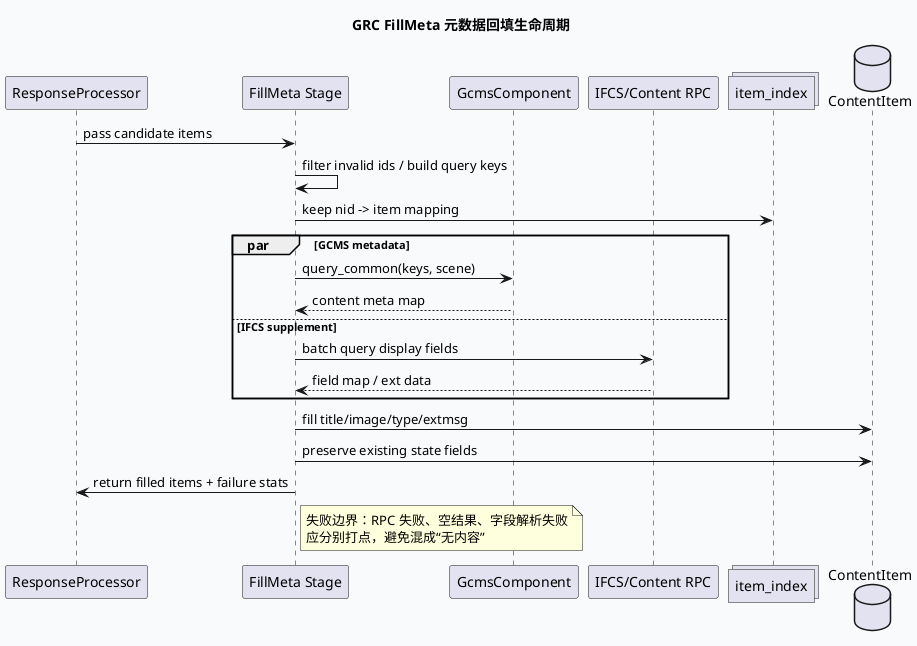

# GRC FillMeta：GCMS/IFCS 双通道内容元数据契约（2026-06-25）

> 今日主题来源：本机未发现可用 `daily-plan` 文件；按周四 fallback 选择 GRC FillMeta + GCMS/IFCS 基础库主题。已按要求在执行环境中使用 `BAIDU_CC_USERNAME=hujiyang` 作为 KU/企业工具用户名约束；当前未提供 KU URL/doc-id，内网背景需人工补充，本文以本地代码理解笔记与既有证据路径为准。

<style>.arch250625{font-family:-apple-system,BlinkMacSystemFont,"Segoe UI",sans-serif;background:#f8fafc;border:1px solid #dbe4ef;border-radius:18px;padding:18px;margin:16px 0;color:#1f2937}.arch250625 .title{font-size:22px;font-weight:850;margin-bottom:5px}.arch250625 .sub{font-size:13px;color:#64748b;margin-bottom:14px}.arch250625 .grid{display:grid;grid-template-columns:1fr 1.1fr 1fr;gap:12px}.arch250625 .layer{background:#fff;border:1px solid #dbe4ef;border-radius:14px;padding:14px}.arch250625 h3{margin:0 0 10px;font-size:15px;color:#315072}.arch250625 .box{background:#eef6ff;border:1px solid #bfdbfe;border-radius:10px;padding:9px;margin:8px 0;font-size:13px;line-height:1.45}.arch250625 .hot{background:#fff7ed;border-color:#f59e0b}.arch250625 .warn{background:#fff1f2;border-color:#fda4af}.arch250625 .arrow{text-align:center;color:#64748b;font-size:12px;font-weight:800;margin:8px 0}</style><div class="arch250625"><div class="title">架构全景：FillMeta 是内容 ID 到业务可用元数据的双通道适配层</div><div class="sub">上游图函数只拿到 nid/rid 等轻量标识；FillMeta 负责按场景组装 GCMS/IFCS 查询、解析内容元数据、回填 ContentItem/NewsMessage 字段，并控制失败降级边界。</div><div class="grid"><div class="layer"><h3>请求入口</h3><div class="box hot">ResponseProcessor / FillMeta stage</div><div class="box">待回填 item 列表</div><div class="box">scene / ua / cuid / sid</div><div class="box warn">空 nid、过滤后 item 不应进入查询</div></div><div class="layer"><h3>元数据通道</h3><div class="box hot">GcmsComponent::query_common()</div><div class="arrow">+</div><div class="box">IFCS / content metadata rpc</div><div class="box">批量 query keys</div><div class="box">超时、失败、空结果统计</div></div><div class="layer"><h3>回填契约</h3><div class="box">title / image / vertical_type</div><div class="box">extmsg / author / publish_time</div><div class="box">state 透传字段</div><div class="box hot">只回填命中项，失败项保持可降级</div></div></div></div>

## 核心结论

- FillMeta 的基础库职责不是“生成结果”，而是把轻量 item 转为下游响应可消费的完整内容结构；边界在元数据查询、字段解析、失败回填三处。
- GCMS/IFCS 是双通道：GCMS 偏内容主元数据，IFCS/内容服务补充可展示字段；排查时应区分“未查到”和“查到但字段未解析”。
- 批量查询必须保留 item 与 key 的映射关系；任何去重、过滤、排序都要确保回填阶段还能定位原始 item。
- FillMeta 的失败不应默认中断整条链路；基础库更常见的正确策略是打点、保留可降级结果、避免空字段被误写成有效值。
- 状态类字段容易和内容元数据混淆：如 `state`/`gr_state` 更像透传或外部状态通道，不应误认为 GCMS 内容字段。

## 核心流程图



## 配置/结构信息图

```infographic
infographic hierarchy-structure
data
  title FillMeta 基础契约分层
  desc 从候选 item 到响应字段的三层稳定契约
  items
    - label 输入层
      desc 候选 item、nid/rid、scene、ua、sid、trace 信息
      children
        - label key 构造
          desc 过滤空 id、保持原始 item 映射
        - label 批量边界
          desc 控制 query size、超时和失败统计
    - label 查询层
      desc GCMS 与 IFCS 双通道获取内容元数据
      children
        - label GCMS
          desc 主内容元数据、图文视频基础属性
        - label IFCS
          desc 展示补充字段、extmsg 或业务扩展
    - label 回填层
      desc 写回 ContentItem/NewsMessage 可展示字段
      children
        - label 命中回填
          desc 只写有效字段，避免覆盖已有状态
        - label 失败降级
          desc 保留候选并输出独立错误统计

theme
  palette #3D5A80 #F59E0B #2D6A4F
```

## 关键机制拆解

### 1. key-index 映射是 FillMeta 的隐含核心数据结构

FillMeta 看似是批量 RPC 包装，但真正的稳定性来自 `query_key -> item` 的映射。只要中间有去重、过滤或顺序调整，就必须保证回填仍指向原 item；否则会出现“字段来自 A 内容，写到 B item”的隐性事故。

### 2. GCMS/IFCS 失败要拆成三类看

排查时不要只看一个失败率：RPC 层失败表示服务不可用或超时；空结果表示内容侧无数据或 key 错；字段解析失败表示数据存在但协议/字段不匹配。三类问题对应不同 owner。

### 3. 状态字段不是普通内容字段

历史笔记里反复出现 `gr_state` 与 `NewsMessage.state[]` 的混淆点。FillMeta 回填内容字段时要保护状态透传字段，避免把“未从 GCMS 查到”误判成状态不存在。

### 4. 回填不是越多越好

基础库层应坚持“有效字段才覆盖”。当 IFCS 或 GCMS 返回字段为空时，直接覆盖旧值会让可降级结果变差；更安全的做法是保留已有字段并打点空字段原因。

<style>.card250625{font-family:-apple-system,BlinkMacSystemFont,"Segoe UI",sans-serif;background:#F5F7FA;border-radius:18px;padding:20px;margin:18px 0;border-left:8px solid #3D5A80;color:#1f2937;box-shadow:0 10px 26px rgba(31,41,55,.08)}.card250625 .meta{font-size:12px;letter-spacing:.08em;text-transform:uppercase;color:#64748b;font-weight:800}.card250625 h3{font-size:24px;line-height:1.18;margin:8px 0 12px}.card250625 .grid{display:grid;grid-template-columns:2fr 1fr;gap:14px}.card250625 li{font-size:14px;line-height:1.65}.card250625 ul{margin:0 0 0 18px}.card250625 .side{border-left:3px solid #F59E0B;padding-left:12px;color:#374151;font-size:14px;line-height:1.65}.card250625 code{background:#e8edf3;border-radius:5px;padding:1px 5px}</style><div class="card250625"><div class="meta">Pitfalls / FillMeta</div><h3>FillMeta 事故通常不是“查不到内容”这么简单，而是 key、通道、字段、状态四个边界混在一起。</h3><div class="grid"><div><ul><li><b>错位回填：</b>批量查询前后 item 顺序变化，但 index 映射未同步。</li><li><b>失败混淆：</b>RPC fail、empty result、parse fail 被记成同一个错误。</li><li><b>状态误判：</b><code>gr_state</code> 不是普通 GCMS 字段，需走透传语义。</li><li><b>空值覆盖：</b>元数据空字段覆盖已有可展示字段，导致降级质量变差。</li></ul></div><div class="side">建议把 FillMeta 日志分为 query_size、hit_size、empty_size、parse_fail_size、fill_success_size，并保留 trace key 样例。</div></div></div>

## 调试 checklist

```infographic
infographic list-column-done-list
data
  title GRC FillMeta 调试 checklist
  desc 从输入 key 到字段回填逐层验证
  items
    - label 确认入口 stage
      desc 从 ResponseProcessor 或 FillMeta stage 找到候选 item 进入点
      done true
    - label 确认 key 构造
      desc nid/rid 是否为空、是否被过滤、是否与 item index 对齐
      done true
    - label 确认 GCMS 查询
      desc query_common 的 scene、批量大小、超时和 empty 统计
      done true
    - label 确认 IFCS 补充
      desc 展示字段、extmsg、作者/发布时间等是否来自补充通道
      done true
    - label 确认字段覆盖策略
      desc 空字段不要覆盖已有有效值，状态字段单独保护
      done true
    - label 确认失败打点
      desc rpc_fail、empty_result、parse_fail、fill_success 分开统计
      done true

theme
  palette #3D5A80 #F59E0B #2D6A4F
```

## 证据来源

- `src/main.cpp`：GRC/GRG 服务常见入口；若仓库入口为 `main.cpp`，不要只找 `main.cc`。
- `response_function.cpp`：响应组装链路常见 FillMeta/字段回填入口。
- `fill_meta.cpp`：内容元数据回填与字段解析热点。
- `gcms_component.cpp`：`GcmsComponent::query_common()` 双场景内容元数据查询入口。
- `news_message.proto`：`NewsMessage.state[]` 等状态透传字段语义。
- `conf/plugins/*.conf`：场景、插件和元数据通道配置来源。
