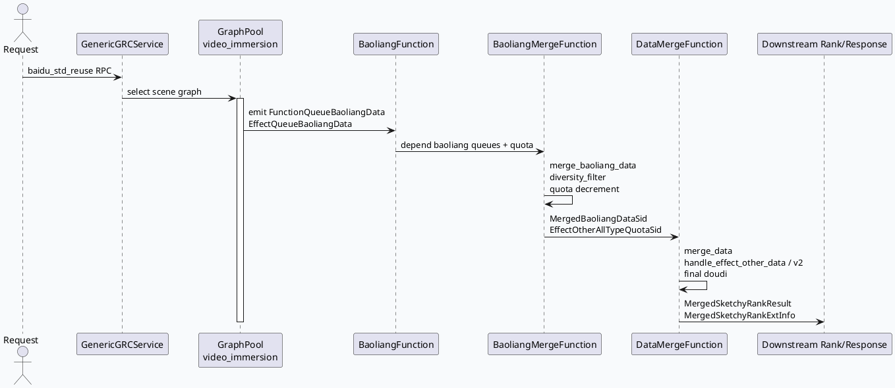

# 2026-06-26 基础库笔记：GRC DataMerge/BaoliangMerge 配额合流框架

> 今日未发现 daily-plan 文件，按 Friday fallback 选题继续分析 GRC `video_launch/strategy_graph.conf` 中保量合流与数据合并框架。KU/内网文档检索未作为事实来源使用，背景信息需人工补充；以下结论来自代码库检索。

<div class="arch-wrap" style="font-family:-apple-system,BlinkMacSystemFont,'Segoe UI',sans-serif;background:#f8fafc;border:1px solid #d8e2ef;border-radius:18px;padding:18px;margin:16px 0;color:#1e293b;"><style>.arch-wrap .title{font-size:22px;font-weight:800;margin-bottom:4px}.arch-wrap .sub{font-size:13px;color:#64748b;margin-bottom:14px}.arch-wrap .layer{border-radius:14px;padding:12px;margin:10px 0;border:1px solid #dbeafe;background:#fff}.arch-wrap .layer h3{margin:0 0 8px;font-size:15px;color:#1d4ed8}.arch-wrap .grid{display:grid;grid-template-columns:repeat(4,minmax(0,1fr));gap:10px}.arch-wrap .box{background:#eff6ff;border:1px solid #bfdbfe;border-radius:12px;padding:10px;font-size:13px;line-height:1.45}.arch-wrap .hot{background:#fff7ed;border-color:#fed7aa}.arch-wrap .out{background:#f0fdf4;border-color:#bbf7d0}.arch-wrap .arrow{text-align:center;color:#64748b;font-weight:700;margin:4px 0}</style><div class="title">GRC 保量合流基础框架全景</div><div class="sub">入口初始化 → 图配置 include → 策略节点依赖 → 配额扣减 → 输出给后续精排链路</div><div class="layer"><h3>服务入口与图装配</h3><div class="grid"><div class="box">`main.cpp` 注册 `GenericGRCService` 与 HTTP graph_view</div><div class="box">`GlobalInitializer` 装载插件、词典、图引擎上下文</div><div class="box">`video_immersion_graph.conf` include 策略/多样性/响应子图</div><div class="box">`strategy_graph.conf` 声明保量与 merge 节点依赖</div></div></div><div class="arrow">↓</div><div class="layer"><h3>保量合流层</h3><div class="grid"><div class="box hot">`BaoliangFunction` 产出功能/效果队列保量集合</div><div class="box hot">`BaoliangMergeFunction` 先功能后效果合并并去重</div><div class="box hot">可按 ua=85 + sid 做保量重排</div><div class="box hot">按 `AllTypeQuota` 扣减剩余非保量 quota</div></div></div><div class="arrow">↓</div><div class="layer"><h3>数据合并层</h3><div class="grid"><div class="box out">`DataMergeFunction` 接收保量结果与效果队列非保量数据</div><div class="box out">初始化类型级 merge context</div><div class="box out">多类型并发 merge，保留每类 quota 与多样性规则</div><div class="box out">输出 `MergedSketchyRankResult`/扩展统计</div></div></div></div>

## 1. 入口链路

- 服务入口在 `src/main.cpp:73-128`：注册 `ReusableRPCProtocol`、加载 `gflags.conf`、初始化 `GlobalInitializer` 与 `ExpManager`，最终 `server.AddService(&generic_grc_service)` 后启动 brpc server。
- `src/main.cpp:115-121` 同时注册 `/graph_view` HTTP 接口，说明图结构可通过服务侧视图排查。
- ua=85 主图入口在 `conf/plugins/graph/video_immersion_graph/video_immersion_graph.conf:42-58`，其中 `video_launch/strategy_graph.conf`、`video_launch/diversity.conf`、`video_launch/grg_response.conf` 被纳入同一 DAG。

## 2. 核心配置依赖

```infographic sequence-timeline-simple
data
  title 配置驱动的保量合流链路
  desc 依赖由 graph-engine 按 @depend/@emit 自动调度
  items
    - time Entry
      label main.cpp
      desc 注册 GRC service 与 graph_view
      icon mdi/server
    - time Graph
      label video_immersion_graph.conf
      desc include video_launch 策略图、多样性与响应图
      icon mdi/graph
    - time Baoliang
      label BaoliangMergeFunction
      desc 合并功能/效果保量并发布剩余 EffectOtherAllTypeQuota
      icon mdi/merge
    - time Merge
      label DataMergeFunction
      desc 保量优先、非保量并发、最终兜底补满 total_quota
      icon mdi/source-branch
```



## 3. 节点契约拆解

```infographic list-grid-badge-card
data
  title GraphData 契约快照
  desc strategy_graph.conf 中保量 merge 与 data merge 的输入输出边界
  items
    - label BaoliangMerge 输入
      desc SidInfo / CommonInfo / CtrQuota / AllTypeQuota / FunctionQueueBaoliangData / EffectQueueBaoliangData
      icon mdi/login
    - label BaoliangMerge 输出
      desc MergedBaoliangDataOld + EffectOtherAllTypeQuotaOld + UpToBaoLiangMergeCostOld
      icon mdi/logout
    - label DataMerge 输入
      desc EffectOtherAllTypeQuotaSid + MergedBaoliangDataSid + EffectQueueOtherData + UMS/PCS/Interest
      icon mdi/database-import
    - label DataMerge 输出
      desc MergedSketchyRankResult + ConstMergedSketchyRankResult + MergedSketchyRankExtInfo
      icon mdi/database-export
```

- `conf/plugins/graph/video_launch/strategy_graph.conf:373-428` 描述 `BaoliangMergeFunction`：依赖功能/效果保量队列、quota、readlist/category/author samples，输出合并后的保量数据和剩余非保量 quota。
- `conf/plugins/graph/video_launch/strategy_graph.conf:429-488` 描述 `DataMergeFunction`：注释明确是 ua85 生效的重构节点，用于完成粗排 `4500 -> 1400` 截断，并在 VFS 去重后进入精排。
- `src/processor/video_launch/baoliang_merge.cpp:24-28` 先合并功能队列保量，再合并效果队列保量，并通过 `nid_set` 去重。
- `src/processor/video_launch/data_merge.cpp:62-69` 将 merge 分成“保量+非保量合并、复制统计、日志打印”三步。

## 4. 基础库实现要点

- **保量优先写入**：`src/processor/video_launch/data_merge.cpp:153-158` 对 `merged_data_result.reserve(*_total_quota)` 后先 `add_all_data_to_output(*_merged_baoliang_data)`，因此保量数据天然占用输出前缀。
- **插入幂等标记**：`src/processor/video_launch/data_merge.cpp:192-205` 使用 `is_insert_sketchy_rank` 防止同一资源在保量、非保量、兜底阶段重复写入。
- **类型级并发**：`src/processor/video_launch/data_merge.cpp:400-409` 为每个 `EffectOtherDataMergeContext` 起 `bthread_async`，类型内独立处理，完成后统一回收 future。
- **质量分调 quota**：`src/processor/video_launch/data_merge.cpp:379-397` 命中 `adjust_quota_by_quality_cupai_is_hit` 时，从 PCS `ContentAgentResult` 拉内容质量分并调用 `adjust_quota`。
- **整数配额分配**：`src/processor/video_launch/data_merge.cpp:909-947` 用最大余额法分配调整后的整数 quota，避免简单取整导致总量损失。

## 5. Pitfalls 卡片

<div class="card-frame" style="font-family:-apple-system,BlinkMacSystemFont,'Segoe UI',sans-serif;background:#f4f7fb;border:1px solid #dbe4ef;border-radius:18px;padding:18px;margin:16px 0;"><div style="font-size:12px;letter-spacing:.08em;text-transform:uppercase;color:#64748b;font-weight:700;">Pitfall / Debugging</div><div style="font-size:28px;font-weight:850;color:#172554;margin:4px 0 10px;">不要把 DataMerge 当成单纯 concat</div><div style="display:grid;grid-template-columns:1.4fr 1fr;gap:14px;"><div style="background:white;border-left:5px solid #3b82f6;border-radius:12px;padding:13px;line-height:1.65;color:#334155;">它同时承担保量优先、非保量类型 quota、多样性、质量分调额、低活兴趣 quota 与兜底补满。排查量级异常时，应沿 `strategy_graph.conf` 的 GraphData 契约看输入是否已经被上游扣减。</div><div style="background:#eff6ff;border:1px solid #bfdbfe;border-radius:12px;padding:13px;color:#1e3a8a;line-height:1.55;">关键观察点：`baoliang_count`、`effect_merge_count`、`effect_merge_doudi_count`、`final_doudi_count`、`relative_score_log`。</div></div></div>

```infographic list-column-done-list
data
  title 调试 Checklist
  desc 保量/配额异常时的基础排查顺序
  items
    - label 检查 graph include
      desc video_immersion_graph.conf 是否包含 strategy_graph.conf 与 diversity.conf
      done true
    - label 检查保量输入
      desc FunctionQueueBaoliangData / EffectQueueBaoliangData 是否非空
      done true
    - label 检查 quota 扣减
      desc EffectOtherAllTypeQuota 是否在 BaoliangMerge 后被保量占用扣减
      done true
    - label 检查插入标记
      desc is_insert_sketchy_rank 是否导致候选被跳过
      done true
    - label 检查实验开关
      desc bl_data_rerank / bl_jf_exp / adjust_quota_by_quality_cupai / is_hit_interest_quota
      done true
```

## 证据来源

- `src/main.cpp:73-128`：服务初始化、协议注册、service 注册与启动。
- `conf/plugins/graph/video_immersion_graph/video_immersion_graph.conf:42-58`：ua=85 图 include 关系。
- `conf/plugins/graph/video_launch/strategy_graph.conf:373-488`：`BaoliangMergeFunction` 与 `DataMergeFunction` GraphData 契约。
- `src/processor/video_launch/baoliang_merge.cpp:24-28`：保量来源合并顺序。
- `src/processor/video_launch/baoliang_merge.cpp:123-168`：保量多样性过滤与 quota 扣减。
- `src/processor/video_launch/data_merge.cpp:153-178`：保量优先、非保量、最终兜底三阶段。
- `src/processor/video_launch/data_merge.cpp:400-409`：类型级并发 merge。
- `src/processor/video_launch/data_merge.cpp:829-947`：内容质量分调整 quota 与最大余额分配。
