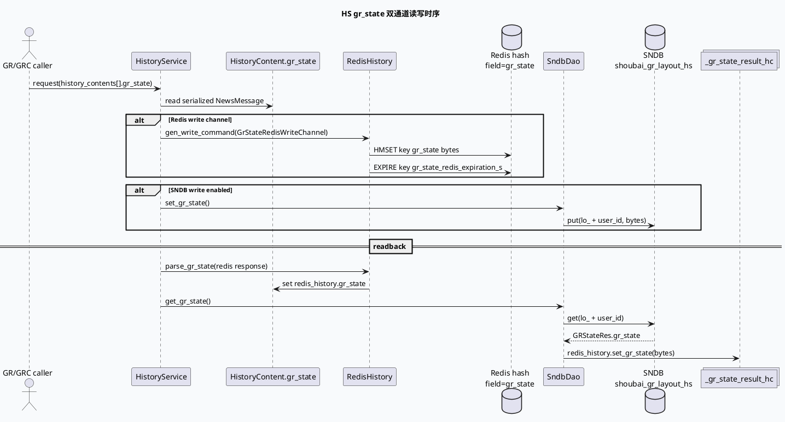

# 2026-06-28 基础库代码理解：HS gr_state 通道契约与读写门禁

> 今日主题来源：本机未发现可用 `daily-plan` 文件；按周日 fallback 继续 History Service 点展状态主题。  
> 内网 KU：本次任务未提供 KU URL/doc-id；如流知识库检索需人工补充。本文以代码库证据为准。  
> 范围：History Service 入口、`HistoryContent.gr_state` 协议、Redis `gr_state` hash field、SNDB `shoubai_gr_layout_hs` group、读写 gflag 与结果容器。

## 架构全景图

<style>.arch-0628-base{font-family:-apple-system,BlinkMacSystemFont,"Segoe UI",sans-serif;background:#f8fafc;border:1px solid #cbd5e1;border-radius:20px;padding:18px;color:#1e293b}.arch-0628-base .title{font-size:24px;font-weight:900;margin-bottom:6px}.arch-0628-base .sub{font-size:13px;color:#64748b;margin-bottom:16px}.arch-0628-base .grid{display:grid;grid-template-columns:1fr 1.15fr 1fr;gap:12px}.arch-0628-base .lane{background:#fff;border:1px solid #dbeafe;border-radius:16px;padding:12px}.arch-0628-base h3{font-size:15px;margin:0 0 10px;color:#1d4ed8}.arch-0628-base .box{background:#f9fafb;border:1px solid #e5e7eb;border-radius:12px;padding:10px;margin:8px 0}.arch-0628-base .box b{display:block;font-size:13px;margin-bottom:4px}.arch-0628-base .box span{font-size:12px;color:#64748b;line-height:1.5}.arch-0628-base .hot{background:#eff6ff;border-color:#93c5fd}.arch-0628-base .note{margin-top:12px;border-left:4px solid #3b82f6;background:#eef6ff;border-radius:10px;padding:10px;font-size:13px;color:#334155}</style><div class="arch-0628-base"><div class="title">HS gr_state 双通道基础契约</div><div class="sub">gr_state 的稳定载体是 `HistoryContent.gr_state` bytes；Redis 和 SNDB 只是两条存取通道，读写开关、provider、prefix 与结果容器都必须同时满足。</div><div class="grid"><div class="lane"><h3>入口与协议层</h3><div class="box hot"><b>HistoryService</b><span>`main.cc` 注册 brpc service，并通过 `conf/gflags.conf` 覆盖 `is_open_gr_state`。</span></div><div class="box"><b>HistoryContent.gr_state</b><span>`history_service.proto:165-175`，字段 9，承载序列化状态 bytes。</span></div><div class="box"><b>NewsMessage.state[]</b><span>`redisprotocol.proto:307`，业务状态数组，不等同于 `ShowClkState`。</span></div></div><div class="lane"><h3>存储通道层</h3><div class="box hot"><b>Redis: gr_state field</b><span>`RedisHistory::parse_gr_state()` 只识别 hash field `gr_state`；写通道 `GrStateRedisWriteChannel` 也只写此 field。</span></div><div class="box hot"><b>SNDB: layout group</b><span>`SndbDao` 对 `shoubai_gr_layout_hs` 读写，key 使用 `lo_ + user_id`。</span></div><div class="box"><b>TTL 与开关</b><span>Redis gr_state 默认 TTL 走 `gr_state_redis_expiration_s`；SNDB 写还受 `write_layout_sndb` 控制。</span></div></div><div class="lane"><h3>读回与消费层</h3><div class="box hot"><b>_gr_state_result_hc</b><span>SNDB 读回落在专用容器 `_gr_state_result_hc[news_idx]`，不是普通 `_result_hc`。</span></div><div class="box"><b>门禁条件</b><span>`is_open_gr_state=true`、provider=`shoubai-gr`、请求包含 `prefix_key == "ne_"`。</span></div><div class="box"><b>TRACE 观测</b><span>Redis/SNDB 读写路径都会在 TRACE 下尝试解析 `NewsMessage` 并打印 JSON。</span></div></div></div><div class="note">结论：排查 gr_state 时不要只问“有没有状态”，而要拆成“协议 bytes 是否存在、走哪条通道、哪个开关/门禁是否生效、结果写入哪个容器”。</div></div>

## 核心流程图



## 配置/结构信息图

```infographic hierarchy-structure
data
  title gr_state 基础通道配置树
  desc gflag、channel、field、group 与结果容器共同定义 gr_state 是否可见
  items
    - label 服务入口
      desc `main.cc:39-44` 解析命令行并加载 `conf/gflags.conf`
      children
        - label is_open_gr_state
          desc `main.cc:32` 默认 false；`gflags.conf:35` 覆盖为 true
    - label Redis 通道
      desc `redis_history.cc:605-617` 针对 `GrStateRedisWriteChannel` 只写 `gr_state`
      children
        - label TTL
          desc `redis_history.cc:660-662` 使用 `gr_state_redis_expiration_s`
    - label SNDB 写通道
      desc `sndb_dao.cc:96-121` 从非空 `HistoryContent.gr_state` 写 `shoubai_gr_layout_hs`
      children
        - label write_layout_sndb
          desc `sndb_dao.cc:28` 默认 false；`gflags.conf:10` 当前 false
    - label SNDB 读通道
      desc `sndb_dao.cc:234-273` provider/prefix 通过后写 `_gr_state_result_hc`
```

## 关键结论

- `HistoryContent.gr_state` 是基础库层唯一稳定的状态 bytes 入参/出参；`IssuedItem` 中的时间、透传字段不能替代它。
- Redis 写入路径对 `GrStateRedisWriteChannel` 是专门分支：写 `gr_state` field 后再单独设置 TTL，不混入普通 `issued_items/other` field。
- SNDB 写路径与读路径的开关语义不同：`write_layout_sndb` 控制写，`is_open_gr_state` 控制读；当前配置显示读开、写关。
- SNDB 读回有三道门：`is_open_gr_state`、provider=`shoubai-gr`、请求中存在 `prefix_key == "ne_"`；缺任一项都会返回 -1。
- SNDB 读回写入 `_gr_state_result_hc[news_idx].redis_history.gr_state`，不是 `_result_hc`，因此调试时要看专用容器。

## Pitfalls 卡片

<style>.pit-0628-base{font-family:-apple-system,BlinkMacSystemFont,"Segoe UI",sans-serif;max-width:1000px;border-radius:20px;background:#f5f7fa;border:1px solid #c7d2fe;padding:20px;color:#1e293b}.pit-0628-base .meta{font-size:12px;letter-spacing:.08em;text-transform:uppercase;color:#1d4ed8;font-weight:900}.pit-0628-base .headline{font-size:28px;line-height:1.15;font-weight:900;margin:8px 0 12px}.pit-0628-base .grid{display:grid;grid-template-columns:1.2fr .9fr;gap:14px}.pit-0628-base .panel{background:#fff;border-top:4px solid #3b82f6;border-radius:12px;padding:12px}.pit-0628-base .panel b{display:block;margin-bottom:6px}.pit-0628-base .panel p{margin:0;font-size:14px;line-height:1.65;color:#334155}.pit-0628-base .end{margin-top:12px;font-weight:900;color:#1d4ed8}</style><div class="pit-0628-base"><div class="meta">pitfall · history service</div><div class="headline">读开关打开，不代表状态已经写进 SNDB</div><div class="grid"><div class="panel"><b>读写门禁分离</b><p>`is_open_gr_state=true` 只说明 SNDB 读路径允许尝试；写路径仍依赖 `write_layout_sndb`。当前配置中写开关为 false。</p></div><div class="panel"><b>容器位置容易看错</b><p>SNDB 读回写 `_gr_state_result_hc`，Redis 读回写当前 `HistoryContext.redis_history`。只看普通历史 merge 容器会漏判。</p></div></div><div class="end">∎ 先判通道，再判开关，最后解析 bytes。</div></div>

## 调试 checklist

```infographic list-column-done-list
data
  title gr_state 基础库排查清单
  items
    - label 确认服务加载配置
      desc `main.cc:43` 是否加载 `conf/gflags.conf`
      done true
    - label 确认读门禁
      desc `gflags.conf:35` 是否为 `-is_open_gr_state=true`
      done true
    - label 确认写门禁
      desc `gflags.conf:10` 是否为 `-write_layout_sndb=true`
      done false
    - label 确认 Redis field
      desc Redis 响应 hash 中是否存在 field `gr_state`
      done false
    - label 确认 SNDB 请求条件
      desc provider 是否为 `shoubai-gr`，请求是否包含 `prefix_key == "ne_"`
      done false
    - label 确认结果容器
      desc SNDB 读回看 `_gr_state_result_hc[news_idx].redis_history.gr_state`
      done false
```

## 证据来源

- `src/main.cc:32-44`：`is_open_gr_state` gflag 定义与 `conf/gflags.conf` 加载。
- `conf/gflags.conf:9-35`：`write_layout_sndb=false`、`is_open_gr_state=true`。
- `proto/history_service.proto:22-28`：`ShowClkState` 枚举。
- `proto/history_service.proto:31-175`：`IssuedItem` 与 `HistoryContent.gr_state` 协议字段。
- `proto/redisprotocol.proto:238-307`：`show_state/show_tss` 不存 Redis 注释与 `NewsMessage.state[]` 字段。
- `src/history/redis_history.cc:86-143`：Redis 读回 `gr_state` field。
- `src/history/redis_history.cc:605-681`：`GrStateRedisWriteChannel` 写入与 TTL 选择。
- `src/dao/sndb_dao.cc:96-121`：SNDB 写 `shoubai_gr_layout_hs`。
- `src/dao/sndb_dao.cc:234-273`：SNDB 读门禁与 `_gr_state_result_hc` 写回。
