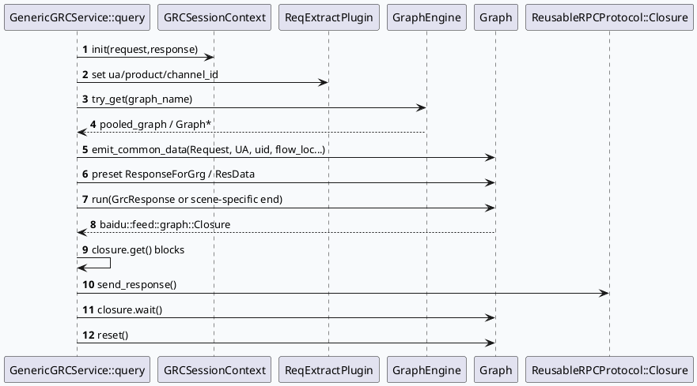

# GRC 图执行与 Filter 生命周期：从请求入口到过滤顶点

> 日期：2026-06-30｜类型：基础库笔记｜主题来源：周二 fallback（daily-plan 未覆盖今日，内网检索未执行；以本地代码库证据替代，lite-grc 命名需人工补充确认）

<style>.arch{font-family:Inter,Arial,sans-serif;border:1px solid #d8e2ef;border-radius:16px;padding:18px;background:#f8fafc;color:#18324a}.arch h3{margin:0 0 12px;font-size:20px}.arch-row{display:grid;grid-template-columns:1fr 1.2fr 1fr;gap:12px}.arch-layer{border-radius:14px;padding:12px;background:white;border-top:5px solid #3d5a80;box-shadow:0 1px 4px rgba(30,50,80,.08)}.arch-layer b{display:block;color:#243b53;margin-bottom:8px}.arch-box{padding:8px 10px;margin:7px 0;border-radius:10px;background:#edf4fb;border:1px solid #c9d9ea;font-size:13px}.arch-box.hot{background:#fff7ed;border-color:#f3b36a}.arrow{text-align:center;color:#607d9a;font-weight:700;margin:10px 0}.note{font-size:12px;color:#52677a;margin-top:10px}</style><div class="arch"><h3>架构全景：GraphEngine 驱动的一次 GRC 请求</h3><div class="arch-row"><div class="arch-layer"><b>入口与上下文</b><div class="arch-box">brpc Controller / GRCRequest</div><div class="arch-box hot">GRCSessionContext init</div><div class="arch-box">ReqExtractPlugin 注入 ua/product/channel_id</div></div><div class="arch-layer"><b>GraphEngine 执行核心</b><div class="arch-box hot">ApplicationContext 获取 graph_engine</div><div class="arch-box">按 UA 选择 graph_name</div><div class="arch-box">GraphPool::try_get(graph_name)</div><div class="arch-box hot">emit_common_data → graph->run(end)</div><div class="arch-box">closure.get / send_response / wait</div></div><div class="arch-layer"><b>收尾与复用</b><div class="arch-box">Response preset / CopyFrom</div><div class="arch-box">TraceData / common_adjust 日志</div><div class="arch-box hot">graph->reset()</div><div class="arch-box">DynamicTimeOut report_request_time</div></div></div><div class="note">关键约束：GraphData 引用与 graph reset 的生命周期强绑定，响应发送后仍需 closure.wait() 完成收尾。</div></div>

## 1. 核心流程



## 2. 配置与结构信息图

```infographic
infographic sequence-ascending-steps
data
  title GRC Graph Run 生命周期
  desc 从请求上下文到对象池复用的关键状态转移
  items
    - label Context Init
      desc sctx.init 校验请求与响应指针
      icon mdi/account-cog
    - label Graph Select
      desc 根据 ua 选择 dibar_reddot / video_immersion / searchc_related / default
      icon mdi/source-branch
    - label Data Emit
      desc Request、UA、uid、flow_loc、ExpInfo 写入 GraphData
      icon mdi/database-arrow-up
    - label Run End
      desc 选择 GrcResponse / ClusterData / InterestCardData 作为求解终点
      icon mdi/play-circle
    - label Reset
      desc send_response + wait 后 reset，释放本轮图状态
      icon mdi/recycle
```

```infographic
infographic list-grid-badge-card
data
  title Filter 顶点契约
  desc 过滤逻辑通常以依赖数据 + 回调组件 + emit 输出组合进入图
  items
    - label Depend
      desc PreciseAdjustPartAllResult 等上游结果
      icon mdi/link-variant
    - label Function
      desc PreciseAdjustFilter 或注册的 FilterCb
      icon mdi/filter
    - label Callback
      desc filter_by_* 返回 true 表示过滤
      icon mdi/call-split
    - label Emit
      desc PreciseAdjustFilterOutput 等下游消费数据
      icon mdi/export
```

## 3. 读代码要点

- `grc_service.cpp:151-211`：RPC 入口完成 `sctx.init`、`ReqExtractPlugin` 注入、`GraphEngine` 获取、按 UA 选图并调用 `run()`。
- `grc_service.cpp:87-149`：`emit_common_data()` 将 `Request`、`UA/ua`、`uid/cuid`、`flow_loc`、`ExpInfo` 等公共数据写入图。
- `grc_service.cpp:226-320`：`run()` 注入动态超时、设置 graph log info、preset 响应数据、执行 `graph->run(end)` 并上报耗时。
- `grc_service.cpp:342-344`：`send_response()` 后仍调用 `closure.wait()`，避免异步尾部未完成。
- `grc_service.cpp:213-220`：trace/common_adjust 打点后 `graph->reset()`，是对象池复用的边界。
- `conf/plugins/graph/precise_adjust_filter.conf:1-8`：过滤顶点声明 function/depend/emit 三段式契约。

## 4. Pitfalls 卡片

<style>.card{font-family:Inter,Arial,sans-serif;background:#fffaf3;border:1px solid #f0d4aa;border-radius:18px;padding:18px;margin:16px 0;color:#2c2418}.card-title{font-size:22px;font-weight:800;letter-spacing:-.02em}.card-grid{display:grid;grid-template-columns:2fr 1fr;gap:14px;margin-top:12px}.card-panel{background:#fff;border-left:5px solid #b36b2c;border-radius:12px;padding:12px}.card-panel b{color:#7a4218}.card-small{font-size:13px;line-height:1.65;color:#594b3a}</style><div class="card"><div class="card-title">最容易踩坑的是“响应已发”不等于“图已安全释放”</div><div class="card-grid"><div class="card-panel"><b>生命周期边界</b><div class="card-small">GraphData 里既有 ref/cref，也有 preset 出来的响应对象。不要在 graph reset 之后继续持有图内数据引用；排查悬挂引用时优先看 send_response、closure.wait、reset 的相对顺序。</div></div><div class="card-panel"><b>调试原则</b><div class="card-small">先定位 UA→graph_name，再定位 end data，再看目标 vertex 的 depend 是否全部 ready。</div></div></div></div>

## 5. 调试 checklist

```infographic
infographic list-column-done-list
data
  title Graph / Filter 排查清单
  items
    - label 确认 UA 是否命中预期 graph_name
      desc 查 grc_service.cpp 中 ua 分支，避免 default 图误判
      done true
    - label 确认 end data 是否正确
      desc GrcResponse、ClusterData、InterestCardData 不同场景终点不同
      done true
    - label 确认 depend 数据是否由上游 emit
      desc 对照 vertex conf 的 depend 和 emit 名称
      done true
    - label 确认 FilterCb 返回语义
      desc 多数 filter_by_* true 表示过滤，不是保留
      done true
    - label reset 后禁止继续访问 GraphData 引用
      desc 尤其是异步 closure 或日志延迟输出场景
      done true
```

## 证据来源

- `src/service/grc_service.cpp:87-149`
- `src/service/grc_service.cpp:151-220`
- `src/service/grc_service.cpp:226-344`
- `conf/plugins/graph/precise_adjust_filter.conf:1-8`
