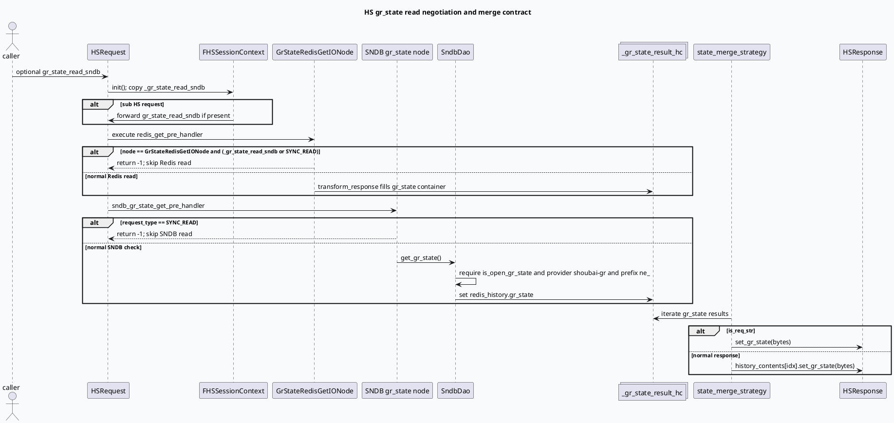

# 2026-07-05 基础库代码理解：HS gr_state 读请求协商与合并契约

> 日期：2026-07-05｜类型：基础库笔记  
> 今日主题来源：本机未发现可用 `daily-plan` 文件；按周日 fallback 继续 History Service `gr_state` 主题。本次不重复“字段值域”，而聚焦 `HSRequest.gr_state_read_sndb` 如何改变 Redis/SNDB 读取路径，以及结果如何合并到响应。已按任务要求设置 `BAIDU_CC_USERNAME=hujiyang`；当前未提供 KU URL/doc-id，内网策略背景需人工补充，本文以本地代码库检索结果为准。

## 1. 架构全景图
<style>.arch0705{font-family:-apple-system,BlinkMacSystemFont,"Segoe UI",sans-serif;background:#f8fafc;border:1px solid #cbd5e1;border-radius:20px;padding:18px;margin:16px 0;color:#1f2937}.arch0705 .title{font-size:22px;font-weight:850;letter-spacing:-.02em;margin-bottom:6px}.arch0705 .sub{font-size:13px;color:#64748b;margin-bottom:14px}.arch0705 .grid{display:grid;grid-template-columns:1fr 1.15fr 1fr;gap:12px}.arch0705 .lane{background:#fff;border:1px solid #e5e7eb;border-radius:16px;padding:12px}.arch0705 h3{margin:0 0 10px;font-size:15px;color:#334155}.arch0705 .box{background:#f1f5f9;border-left:4px solid #3d5a80;border-radius:12px;padding:10px;margin:8px 0;font-size:13px;line-height:1.55}.arch0705 .hot{border-left-color:#2d6a4f;background:#eef7f2}.arch0705 .warn{border-left-color:#b45309;background:#fff7ed}.arch0705 .risk{border-left-color:#b91c1c;background:#fef2f2}.arch0705 .note{font-size:12px;color:#64748b;line-height:1.55;margin-top:10px}</style><div class="arch0705"><div class="title">HS gr_state：一次请求内的“读源协商 → 专用容器 → 响应合并”</div><div class="sub">`gr_state_read_sndb` 不是单纯多读一个存储，而是会让 `GrStateRedisGetIONode` 主动跳过 Redis，把 SNDB 结果放入 `_gr_state_result_hc`，最后由状态合并策略写回响应。</div><div class="grid"><div class="lane"><h3>协议与入口</h3><div class="box hot"><b>HSRequest.gr_state_read_sndb</b><br/>字段 11，调用方显式设置后进入 session context；子请求也会透传该字段。</div><div class="box"><b>main.cc</b><br/>服务启动注册 `HistoryService`，加载 `conf/gflags.conf`。</div><div class="box warn"><b>is_open_gr_state</b><br/>gflag 默认 false，配置中置 true；它是 SNDB 读的服务端总开关。</div></div><div class="lane"><h3>读取路径选择</h3><div class="box risk"><b>Redis 短路</b><br/>当节点为 `GrStateRedisGetIONode` 且 `gr_state_read_sndb=true` 或 `SYNC_READ` 时，Redis pre handler 直接返回 -1。</div><div class="box hot"><b>SNDB 读取</b><br/>`sndb_gr_state_get_pre_handler` 调用 `SndbDao::get_gr_state()`，自身再按 provider 与 prefix 做二次门禁。</div><div class="box"><b>专用结果容器</b><br/>Redis/SNDB 读回均写 `_gr_state_result_hc`，不是普通 `_result_hc`。</div></div><div class="lane"><h3>响应合并</h3><div class="box hot"><b>state_merge_strategy</b><br/>遍历 `_gr_state_result_hc`，有 `gr_state` 时合并到 `HistoryContent.gr_state` 或顶层 `HSResponse.gr_state`。</div><div class="box warn"><b>is_req_str 分支</b><br/>若 `is_req_str=true`，结果走 `response.gr_state`；否则写对应 `history_contents[idx].gr_state`。</div><div class="box"><b>写通道独立</b><br/>SNDB 写由 `write_layout_sndb` 控制；当前配置为 false，不能用“读开”推断“写开”。</div></div></div><div class="note">调试主线：先看请求是否携带 `gr_state_read_sndb`，再看 Redis 节点是否被短路，最后看 `_gr_state_result_hc` 是否被 `state_merge_strategy` 合并。</div></div>

## 2. 核心流程图


## 3. 配置/结构信息图
```infographic
infographic hierarchy-structure
data
  title gr_state 读取契约四层门禁
  desc 从协议字段到响应合并，每层都可能让“SNDB 已有数据但调用方拿不到 gr_state”
  items
    - label 协议层
      desc `history_service.proto:195-209` 定义 `HSRequest.gr_state_read_sndb`，调用方不带则 session 默认为 false
      children
        - label 子请求透传
          desc `fhs.cc:137-139` 仅在原请求 has 字段时透传
    - label Redis 层
      desc `redis_handler.cc:33-36`：gr_state 读 SNDB 或 SYNC_READ 时，`GrStateRedisGetIONode` 跳过 Redis
      children
        - label 专用 Redis field
          desc `redis_history.cc:605-617` 写路径只写 hash field `gr_state`
    - label SNDB 层
      desc `sndb_dao.cc:234-273`：服务开关、provider、prefix 三重门禁后写 `_gr_state_result_hc`
      children
        - label 写入开关
          desc `sndb_handler.cc:71-82` 写入由 `write_layout_sndb` 控制；当前 `gflags.conf:10` 为 false
    - label 合并层
      desc `strategy.cc:513-526`：`state_merge_strategy` 决定写顶层 `response.gr_state` 还是 `history_contents[idx].gr_state`
```

## 4. 关键结论

- `gr_state_read_sndb` 是请求级读源协商字段：它不只是“多读 SNDB”，还会让 `GrStateRedisGetIONode` 直接跳过 Redis 读路径。
- `SYNC_READ` 对 Redis 与 SNDB 的处理不对称：Redis handler 会因为 `SYNC_READ` 跳过 `GrStateRedisGetIONode`，SNDB handler 也会因为 `SYNC_READ` 跳过 SNDB 读；因此同步读不应期待通过该链路额外读到 gr_state。
- SNDB 读还有服务端门禁：`FLAGS_is_open_gr_state`、`provider == "shoubai-gr"`、请求里存在 `prefix_key == "ne_"`。缺一项就不会写 `_gr_state_result_hc`。
- 结果合并不在普通 merge 主循环里完成，而由 `state_merge_strategy()` 专门遍历 `_gr_state_result_hc`；排查时不要只看 `_result_hc`。
- `is_req_str` 会改变响应落点：普通响应写 `history_contents[idx].gr_state`，bytes 响应模式写顶层 `HSResponse.gr_state`。

## 5. Pitfalls 卡片
<style>.card0705{font-family:-apple-system,BlinkMacSystemFont,"Segoe UI",sans-serif;background:#f4f3f0;border:1px solid #ded8ce;border-radius:18px;padding:18px;margin:18px 0;color:#2f3437}.card0705 .meta{font-size:12px;letter-spacing:.08em;text-transform:uppercase;color:#7c6f64;font-weight:700}.card0705 .title{font-size:24px;font-weight:850;letter-spacing:-.02em;margin:6px 0 12px}.card0705 .grid{display:grid;grid-template-columns:1.4fr 1fr;gap:14px}.card0705 .panel{background:#fffdf8;border-top:4px solid #2d6a4f;border-radius:14px;padding:12px;font-size:13px;line-height:1.65}.card0705 .panel b{color:#1f4f3b}.card0705 .end{font-size:18px;color:#2d6a4f;margin-top:8px}</style><div class="card0705"><div class="meta">Pitfalls · gr_state read path</div><div class="title">最容易误判的不是字段值，而是“你到底从哪条通道读到它”</div><div class="grid"><div class="panel"><b>误判 1：以为设置 `gr_state_read_sndb=true` 会 Redis+SNDB 双读。</b><br/>实际 Redis pre handler 会短路 `GrStateRedisGetIONode`。若 SNDB 门禁未通过，响应可能没有 gr_state。</div><div class="panel"><b>误判 2：只查 `_result_hc`。</b><br/>gr_state 有专用 `_gr_state_result_hc`，最终合并也走 `state_merge_strategy()`。</div><div class="panel"><b>误判 3：读开等于写开。</b><br/>`is_open_gr_state=true` 只控制读；`write_layout_sndb=false` 时 SNDB 写仍关闭。</div><div class="panel"><b>误判 4：忽略 `is_req_str`。</b><br/>bytes 响应模式下看 `HSResponse.gr_state`，普通模式下看 `HistoryContent.gr_state`。</div></div><div class="end">∎</div></div>

## 6. 调试 checklist
```infographic
infographic list-column-done-list
data
  title HS gr_state 读不到时的 7 步排查
  desc 每一步都对应一个代码门禁或响应落点
  items
    - label 检查请求是否 has `gr_state_read_sndb`
      desc 没有 has 字段时 session 默认为 false，子请求也不会透传
      done true
    - label 检查 request_type 是否 SYNC_READ
      desc SYNC_READ 会跳过 gr_state Redis/SNDB 读路径
      done true
    - label 检查 provider 是否 `shoubai-gr`
      desc provider 不匹配时 `SndbDao::get_gr_state()` 返回 -1
      done true
    - label 检查 history_contents 是否包含 `prefix_key == ne_`
      desc SNDB gr_state 读回需要找到 news idx
      done true
    - label 检查 `is_open_gr_state` 与 `write_layout_sndb`
      desc 读开关和写开关语义不同
      done true
    - label 检查 `_gr_state_result_hc`
      desc 不要只看普通 `_result_hc`
      done true
    - label 按 `is_req_str` 查响应字段
      desc true 看顶层 `response.gr_state`，false 看 `history_contents[idx].gr_state`
      done true
```

## 7. 证据来源

- `main.cc:39-44`：解析命令行并加载 `conf/gflags.conf`。
- `conf/gflags.conf:10,35`：`write_layout_sndb=false`，`is_open_gr_state=true`。
- `history_service.proto:195-209`：`HSRequest.gr_state_read_sndb` 协议字段。
- `fhs.cc:137-139`：子 HS 请求透传 `gr_state_read_sndb`。
- `session_context.cc:178-180`：session 初始化 `_gr_state_read_sndb`。
- `redis_handler.cc:33-36`：`GrStateRedisGetIONode` 在 SNDB 读或 `SYNC_READ` 下短路 Redis。
- `sndb_handler.cc:50-62`：SNDB gr_state 读 handler；`SYNC_READ` 下跳过。
- `sndb_dao.cc:234-273`：SNDB 读门禁与 `_gr_state_result_hc` 写入。
- `strategy.cc:513-526`：`state_merge_strategy()` 合并 gr_state 到响应。
- `redis_history.cc:605-617,660-662`：Redis 写 `gr_state` field 与专用 TTL。

## 8. 需人工补充

- KU/周报中 `gr_state_read_sndb` 小流量策略、上线范围与 owner。
- 线上调用方是否已有明确携带 `gr_state_read_sndb=true` 的灰度请求样例。
- `get_data_tree.conf` 中 `get_gr_state_sndb` 节点与当前线上 graph/tree 的启用版本。