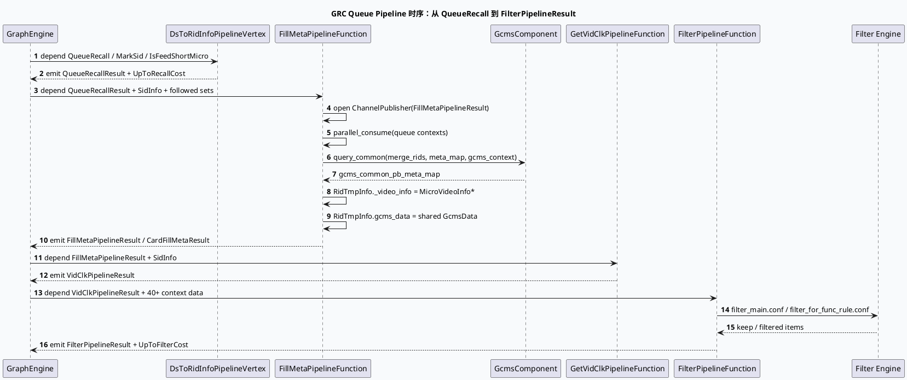

# 2026-07-06 基础库代码理解：GRC 队列 Pipeline 主通路与元数据过滤契约

> 日期：2026-07-06｜类型：基础库笔记  
> 今日主题来源：本机未发现可用 `daily-plan` 文件；按周一 fallback 选择 GRC 主链路中的队列 Pipeline 框架，与业务侧短剧/合集队列主题配对。  
> 内网 KU：本次任务未提供 KU URL/doc-id；如流知识库检索需人工补充。本文以本地代码库证据为准。  
> 范围：`queue_vertex.conf` 中 `DsToRidInfoPipelineVertex → FillMetaPipelineFunction → GetVidClkPipelineFunction → FilterPipelineFunction`，以及 `FillMetaPipelineFunction` 对 GCMS PB 正排、合集改写、队列级 ChannelPublisher 的处理。

## 架构全景图

<style>.arch-0706-base{font-family:-apple-system,BlinkMacSystemFont,"Segoe UI",sans-serif;background:#f8fafc;border:1px solid #cbd5e1;border-radius:20px;padding:18px;color:#1e293b}.arch-0706-base .title{font-size:25px;font-weight:900;margin-bottom:6px}.arch-0706-base .sub{font-size:13px;color:#64748b;margin-bottom:16px}.arch-0706-base .grid{display:grid;grid-template-columns:1fr 1.15fr 1fr;gap:12px}.arch-0706-base .lane{background:#fff;border:1px solid #dbeafe;border-radius:16px;padding:12px}.arch-0706-base h3{font-size:15px;margin:0 0 10px;color:#1d4ed8}.arch-0706-base .box{background:#f9fafb;border:1px solid #e5e7eb;border-radius:12px;padding:10px;margin:8px 0}.arch-0706-base .box b{display:block;font-size:13px;margin-bottom:4px}.arch-0706-base .box span{font-size:12px;color:#64748b;line-height:1.5}.arch-0706-base .hot{background:#eff6ff;border-color:#93c5fd}.arch-0706-base .warn{background:#fff7ed;border-color:#fdba74}.arch-0706-base .note{margin-top:12px;border-left:4px solid #3b82f6;background:#eef6ff;border-radius:10px;padding:10px;font-size:13px;color:#334155}</style><div class="arch-0706-base"><div class="title">GRC Queue Pipeline：召回结果进入可排序候选集的主通道</div><div class="sub">Graph 配置把队列处理拆成四段：格式转换、GCMS 元数据填充、点击历史补齐、过滤引擎。每段都是 `is_queue: 1` 的队列顶点，按 QueueContext 分片并行消费。</div><div class="grid"><div class="lane"><h3>召回格式层</h3><div class="box hot"><b>DsToRidInfoPipelineVertex</b><span>`queue_vertex.conf:1-22` 从 `QueueRecall` 读入，输出 `QueueRecallResult` 与耗时 `UpToRecallCost`。</span></div><div class="box"><b>QueueContext</b><span>后续节点按队列维度携带 `rid_vec`、`rids`、GCMS meta map 等中间状态。</span></div></div><div class="lane"><h3>元数据与点击补齐</h3><div class="box hot"><b>FillMetaPipelineFunction</b><span>`queue_vertex.conf:24-57` 依赖 Sid 与关注集合，输出 `FillMetaPipelineResult` / `CardFillMetaResult`。</span></div><div class="box warn"><b>GCMS PB query_common</b><span>`fill_meta_pipeline.cpp:118-144` 用 rid set 批量查 PB 正排，失败时记录 warning 但返回 ERR_OK。</span></div><div class="box"><b>GetVidClkPipelineFunction</b><span>`queue_vertex.conf:78-92` 从填充后的候选继续补点击历史，输出 `VidClkPipelineResult`。</span></div></div><div class="lane"><h3>过滤引擎层</h3><div class="box hot"><b>FilterPipelineFunction</b><span>`queue_vertex.conf:93-217` 依赖曝光、readlist、LCN、用户画像等 40+ 数据，输出 `FilterPipelineResult`。</span></div><div class="box"><b>filter_main.conf</b><span>`filter_engine_conf` 与 `filter_engine_conf_for_func` 把普通队列/功能队列过滤规则分开配置。</span></div></div></div><div class="note">关键边界：FillMeta 阶段负责把 `RidTmpInfo` 接上 `MicroVideoInfo/GcmsData`；Filter 阶段之后，候选才具备进入粗排/merge/保量/多样性的基础属性。</div></div>

## 核心流程图



## 配置结构信息图

```infographic hierarchy-structure
data
  title queue_vertex.conf 的 Pipeline 配置树
  desc 四段主链路均声明 is_queue: 1，依赖/输出通过 GraphData 名称连接
  items
    - label DsToRidInfoPipelineVertex
      desc `queue_vertex.conf:1-22` QueueRecall → QueueRecallResult
      children
        - label depend
          desc QueueRecall, MarkSid, IsFeedShortMicro
        - label emit
          desc QueueRecallResult, NewsQueueRecallResult, UpToRecallCost
    - label FillMetaPipelineFunction
      desc `queue_vertex.conf:24-57` QueueRecallResult → FillMetaPipelineResult
      children
        - label depend
          desc SidInfo, followed author/tb/mthid sets, landing flags
        - label emit
          desc FillMetaPipelineResult, CardFillMetaResult, UpToFillMetaCost
    - label GetVidClkPipelineFunction
      desc `queue_vertex.conf:78-92` FillMetaPipelineResult → VidClkPipelineResult
      children
        - label depend
          desc FillMetaPipelineResult, SidInfo
        - label option
          desc is_queue=1, is_mutable_input=0
    - label FilterPipelineFunction
      desc `queue_vertex.conf:93-217` VidClkPipelineResult → FilterPipelineResult
      children
        - label depend
          desc DislikeInfo, readlist, show map, LCN, UMS, Heji/Duanju filter info 等
        - label option
          desc filter_main.conf + filter_for_func_rule.conf
```

## 关键结论

- `queue_vertex.conf:1-217` 把“召回结果处理”显式拆成四段，每段只通过 GraphData 连接；这让图引擎可以按依赖自动调度，但也要求数据名严格一致。
- `FillMetaPipelineFunction::processor()` 在 `fill_meta_pipeline.cpp:26-48` 中打开两个 `ChannelPublisher`，并把 `QueueRecallResult` move 到 `mutable_input` 后 `parallel_consume()`；这说明该节点是按队列上下文并行处理，而不是单个全局 vector。
- `FillMetaPipelineFunction::process()` 在 `fill_meta_pipeline.cpp:118-144` 批量调用 `GcmsComponent::query_common()`；若 GCMS 返回非 0，函数记录 warning 后返回 `ERR_OK`，下游会看到该队列缺 meta 或候选减少，而不是整个图失败。
- `fill_meta_pipeline.cpp:155-186` 将 `MicroVideoInfo` 指针接入 `RidTmpInfo`，再构造 `GcmsData`；后续 filter/adjust/diversity 读到的很多字段都依赖这里填充成功。
- `queue_vertex.conf:93-217` 的 `FilterPipelineFunction` 依赖项很宽，说明过滤不是单一 operator：曝光去重、readlist、LCN、画像、低质、合集/短剧过滤信息都在同一 pipeline 阶段聚合。
- `filter_engine_conf` 与 `filter_engine_conf_for_func` 分离，是普通队列与功能队列过滤策略差异的配置入口；排查功能队列误杀时不能只看 `filter_main.conf`。

## Pitfalls 卡片

<style>.pit-0706-base{font-family:-apple-system,BlinkMacSystemFont,"Segoe UI",sans-serif;max-width:1040px;border-radius:20px;background:#f5f7fa;border:1px solid #c7d2fe;padding:20px;color:#1e293b}.pit-0706-base .meta{font-size:12px;letter-spacing:.08em;text-transform:uppercase;color:#1d4ed8;font-weight:900}.pit-0706-base .headline{font-size:28px;line-height:1.15;font-weight:900;margin:8px 0 12px}.pit-0706-base .grid{display:grid;grid-template-columns:1.2fr 1fr;gap:14px}.pit-0706-base .panel{background:#fff;border-top:4px solid #3b82f6;border-radius:12px;padding:12px}.pit-0706-base .panel b{display:block;margin-bottom:6px}.pit-0706-base .panel p{margin:0;font-size:14px;line-height:1.65;color:#334155}.pit-0706-base .end{margin-top:12px;font-weight:900;color:#1d4ed8}</style><div class="pit-0706-base"><div class="meta">pitfall · queue pipeline</div><div class="headline">GCMS 查询失败不一定让请求失败，但会让候选“静默变瘦”</div><div class="grid"><div class="panel"><b>返回 ERR_OK 的副作用</b><p>`fill_meta_pipeline.cpp:140-144` 中 GCMS ret 非 0 时只记录 warning 并返回 `ERR_OK`。图继续跑，但该队列的 `gcms_data` 可能缺失，后续 Filter/Adjust 可能按空字段过滤或跳过。</p></div><div class="panel"><b>排查顺序</b><p>先看 `fill_meta_pipeline_rpc` SIA 与 after GCMS meta 数量，再看 FilterPipeline 的丢弃原因；不要直接把最终候选少归因到排序或多样性。</p></div></div><div class="end">∎ 候选少：先核对 FillMeta，再核对 Filter。</div></div>

## 调试 checklist

```infographic list-column-done-list
data
  title Queue Pipeline 排查清单
  items
    - label 确认四段 GraphData 名称连接正确
      desc QueueRecallResult → FillMetaPipelineResult → VidClkPipelineResult → FilterPipelineResult
      done true
    - label 检查 FillMeta 是否打开 ChannelPublisher
      desc `fill_meta_pipeline.cpp:29-42` 任一 publisher 空都会返回 -1
      done true
    - label 检查 GCMS query_common 返回值与 meta_map 数量
      desc ret 非 0 不会打断整图，但会造成候选元数据缺失
      done true
    - label 检查 RidTmpInfo 是否成功挂载 gcms_data
      desc `_video_info` 与 `gcms_data` 是后续业务字段读取基础
      done true
    - label 区分普通队列和功能队列过滤配置
      desc `filter_main.conf` 与 `filter_for_func_rule.conf` 分开看
      done true
    - label 避免 reset 后引用队列内对象
      desc 下游如果持有 `RidTmpInfo` 内部指针，需确认生命周期仍在本轮 graph 内
      done false
```

## 证据来源

- `conf/plugins/graph/queue_vertex.conf:1-22`：`DsToRidInfoPipelineVertex` 配置。
- `conf/plugins/graph/queue_vertex.conf:24-57`：`FillMetaPipelineFunction` 配置。
- `conf/plugins/graph/queue_vertex.conf:78-92`：`GetVidClkPipelineFunction` 配置。
- `conf/plugins/graph/queue_vertex.conf:93-217`：`FilterPipelineFunction` 宽依赖与过滤配置入口。
- `src/processor/video_launch/fill_meta_pipeline.cpp:26-48`：publisher 打开、`mutable_input`、`parallel_consume()`。
- `src/processor/video_launch/fill_meta_pipeline.cpp:118-144`：`GcmsComponent::query_common()` 与失败处理。
- `src/processor/video_launch/fill_meta_pipeline.cpp:155-186`：`RidTmpInfo` 绑定 `MicroVideoInfo` 与 `GcmsData`。
