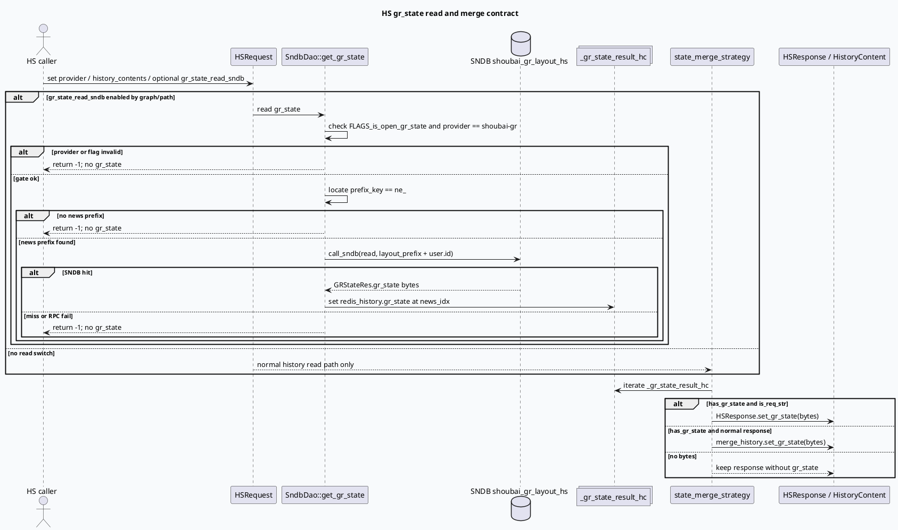

# 2026-07-12 基础库代码理解：HS gr_state 写入、读回与合并契约

> 日期：2026-07-12｜类型：基础库笔记  
> 今日主题来源：本机未发现可用 `daily-plan` 文件；按周日 fallback 继续 History Service 点展状态主题。本篇从基础库角度梳理 `gr_state` 如何进入 `HistoryContent`、如何被 SNDB 读回、最终如何合并到 `HSResponse`。已按任务要求设置 `BAIDU_CC_USERNAME=hujiyang`；本次没有 KU URL/doc-id，内网产品背景需人工补充，以下结论来自本地代码库检索。  
> 路径规范：证据路径均使用相对路径，不包含机器本地绝对路径。

## 1. 架构全景图
<style>.arch0712{font-family:-apple-system,BlinkMacSystemFont,"Segoe UI",sans-serif;background:#f8fafc;border:1px solid #cbd5e1;border-radius:20px;padding:18px;margin:16px 0;color:#1f2937}.arch0712 .title{font-size:22px;font-weight:850;letter-spacing:-.02em;margin-bottom:6px}.arch0712 .sub{font-size:13px;color:#64748b;margin-bottom:14px}.arch0712 .grid{display:grid;grid-template-columns:1fr 1fr 1fr;gap:12px}.arch0712 .lane{background:#fff;border:1px solid #e5e7eb;border-radius:16px;padding:12px}.arch0712 h3{font-size:15px;color:#334155;margin:0 0 8px}.arch0712 .box{border-radius:12px;padding:10px;margin:8px 0;background:#f1f5f9;border-left:4px solid #3d5a80;font-size:13px;line-height:1.55}.arch0712 .ok{border-left-color:#2d6a4f;background:#eef7f2}.arch0712 .warn{border-left-color:#b45309;background:#fff7ed}.arch0712 .risk{border-left-color:#b91c1c;background:#fef2f2}.arch0712 .note{font-size:12px;color:#64748b;line-height:1.55;margin-top:10px}</style><div class="arch0712"><div class="title">HS gr_state 基础库契约：字段存在 ≠ 数据一定可读</div><div class="sub">`gr_state` 是 `HistoryContent` 与 `HSResponse` 上的 bytes 通道；读 SNDB 需要请求开关、provider、prefix、服务端门禁同时满足，最后再由 merge strategy 写入响应。</div><div class="grid"><div class="lane"><h3>协议入口</h3><div class="box ok"><b>写入载体</b><br/>`HistoryContent.gr_state` 是用户状态 bytes，和 issued_items/other 同属历史内容字段。</div><div class="box warn"><b>读源开关</b><br/>`HSRequest.gr_state_read_sndb` 是 optional bool；调用方不设置时不能假设会读 SNDB。</div><div class="box"><b>响应落点</b><br/>普通响应写回 `HistoryContent.gr_state`；bytes 请求模式写回顶层 `HSResponse.gr_state`。</div></div><div class="lane"><h3>SNDB 读取门禁</h3><div class="box risk"><b>provider 限制</b><br/>`get_gr_state()` 要求 `FLAGS_is_open_gr_state` 且 provider 为 `shoubai-gr`。</div><div class="box warn"><b>prefix 限制</b><br/>请求中必须存在 `prefix_key == "ne_"` 的 history_content，否则返回 -1。</div><div class="box ok"><b>数据形态</b><br/>SNDB 返回 `GRStateRes.gr_state`，TRACE 时可解析为 `gr::NewsMessage` 打日志。</div></div><div class="lane"><h3>合并出口</h3><div class="box"><b>中间缓存</b><br/>读到后写入 `_gr_state_result_hc[news_idx].redis_history.gr_state`。</div><div class="box ok"><b>state_merge_strategy</b><br/>只在 `has_gr_state()` 时合并，避免空 bytes 污染响应。</div><div class="box risk"><b>新旧 merge 注意</b><br/>`new_merge_history_strategy()` 中 gr_state 合并块处于注释状态，需要确认图配置是否显式调用 `state_merge_strategy()`。</div></div></div><div class="note">结论：排查 gr_state 不能只看 proto 字段，要沿“请求开关 → SNDB 门禁 → 中间缓存 → merge strategy → 响应落点”逐段验证。</div></div>

## 2. 核心流程图


## 3. 配置/结构信息图
```infographic
infographic compare-hierarchy-left-right-circle-node-pill-badge
data
  title gr_state 基础库四段契约
  desc 任何一段缺失都会让业务侧看不到稳定点展状态
  items
    - label 请求协议
      desc `HSRequest.gr_state_read_sndb` 是 optional；`HistoryContent.gr_state` 和 `HSResponse.gr_state` 都是 bytes 通道
      value 25
      icon mdi/file-document-outline
      children
        - label HistoryContent.gr_state
          desc 写入和普通响应承载位
        - label HSRequest.gr_state_read_sndb
          desc 是否读取 SNDB 的请求开关
        - label HSResponse.gr_state
          desc bytes 请求模式的响应承载位
    - label 服务端门禁
      desc `is_open_gr_state`、provider、`ne_` prefix、SNDB hit 必须同时满足
      value 25
      icon mdi/gate
      children
        - label FLAGS_is_open_gr_state
          desc 总开关
        - label provider shoubai-gr
          desc 非该 provider 直接跳过
        - label prefix_key ne_
          desc 定位 news_idx
    - label 中间缓存
      desc 成功读取后落到 `_gr_state_result_hc[news_idx]`
      value 25
      icon mdi/database-arrow-down
      children
        - label GRStateRes.gr_state
          desc SNDB 返回 bytes
        - label redis_history.gr_state
          desc 临时 HistoryContext 承载
    - label 响应合并
      desc `state_merge_strategy()` 决定写顶层还是写 HistoryContent
      value 25
      icon mdi/source-merge
      children
        - label is_req_str true
          desc 顶层 HSResponse.gr_state
        - label is_req_str false
          desc HistoryContent.gr_state
```

## 4. 关键结论

- `gr_state` 的协议层有三个关键点：`HistoryContent.gr_state`（输入/普通输出）、`HSRequest.gr_state_read_sndb`（读 SNDB 开关）、`HSResponse.gr_state`（bytes 输出模式）。
- SNDB 读回不是“字段存在就自动发生”：`SndbDao::get_gr_state()` 明确检查 `FLAGS_is_open_gr_state` 与 provider；请求中还必须有 `prefix_key == "ne_"`。
- 成功读到 SNDB 后，代码不是直接写响应，而是先放入 `_gr_state_result_hc[news_idx].redis_history.gr_state`，再由 `state_merge_strategy()` 做响应合并。
- `state_merge_strategy()` 按 `is_req_str` 分流：`true` 写顶层 `HSResponse.gr_state`，否则写对应 `merge_history.gr_state`。
- `new_merge_history_strategy()` 内部有一段 gr_state 合并逻辑处于注释状态；如果图配置只调用新 merge 而没有后置 `state_merge_strategy()`，业务侧会看不到 gr_state，需要结合 graph/vertex 配置验证。

## 5. Pitfalls 卡片
<style>.card0712{font-family:-apple-system,BlinkMacSystemFont,"Segoe UI",sans-serif;background:#f4f3f0;border:1px solid #ded8ce;border-radius:18px;padding:18px;margin:18px 0;color:#2f3437}.card0712 .meta{font-size:12px;letter-spacing:.08em;text-transform:uppercase;color:#7c6f64;font-weight:700}.card0712 .title{font-size:24px;font-weight:850;letter-spacing:-.02em;margin:6px 0 12px}.card0712 .grid{display:grid;grid-template-columns:1.2fr 1fr;gap:14px}.card0712 .panel{background:#fffdf8;border-top:4px solid #2d6a4f;border-radius:14px;padding:12px;font-size:13px;line-height:1.65}.card0712 .panel b{color:#1f4f3b}.card0712 .end{font-size:18px;color:#2d6a4f;margin-top:8px}</style><div class="card0712"><div class="meta">Pitfalls · base-library contract</div><div class="title">gr_state 排查最容易漏掉的是“合并出口”，不是 SNDB 本身</div><div class="grid"><div class="panel"><b>字段存在不等于路径启用。</b><br/>proto 有 `gr_state_read_sndb`，但它是 optional；调用方和图路径不触发时不会自动读。</div><div class="panel"><b>读到不等于响应有。</b><br/>SNDB hit 后还要经过 `_gr_state_result_hc` 与 `state_merge_strategy()` 才能进入响应。</div><div class="panel"><b>prefix 是定位器。</b><br/>没有 `ne_`，`news_idx` 找不到，SNDB 数据即使存在也不会被挂回正确内容。</div><div class="panel"><b>响应模式要分开查。</b><br/>`is_req_str=true` 查顶层 response，普通模式查对应 HistoryContent。</div></div><div class="end">∎</div></div>

## 6. 调试 checklist
```infographic
infographic list-column-done-list
data
  title HS gr_state 基础库排查 checklist
  desc 用同一张清单覆盖读源、门禁、缓存与响应合并
  items
    - label 确认调用方是否设置 `gr_state_read_sndb`
      desc optional 字段未设置时，不进入 SNDB 读回预期
      done true
    - label 确认 provider 是否为 `shoubai-gr`
      desc `get_gr_state()` 对 provider 做硬门禁
      done true
    - label 确认请求 history_contents 中是否有 `prefix_key == "ne_"`
      desc 用于定位 `_gr_state_result_hc` 的 news_idx
      done true
    - label 检查 `FLAGS_is_open_gr_state`
      desc 关闭时直接跳过 SNDB gr_state 读取
      done true
    - label 搜索 `_gr_state_result_hc` 是否写入
      desc 写入位置在 `sndb_dao.cc:271-272`
      done true
    - label 验证 `state_merge_strategy()` 是否在图中执行
      desc 新 merge 内 gr_state 合并块被注释，需看后置策略
      done true
    - label 按 `is_req_str` 检查正确响应字段
      desc 顶层 `HSResponse.gr_state` 与 `HistoryContent.gr_state` 不可混查
      done true
```

## 7. 证据来源

- `proto/history_service.proto:165-174`：`HistoryContent.gr_state` 是用户状态数据 bytes。
- `proto/history_service.proto:195-208`：`HSRequest.gr_state_read_sndb` 是 optional bool。
- `proto/history_service.proto:212-218`：`HSResponse.gr_state` 是顶层用户状态数据 bytes。
- `proto/redisprotocol.proto:168-239`：`NewsMessage` 结构中包含 `show_state/show_tss` 等传递字段。
- `proto/redisprotocol.proto:307`：`NewsMessage.state[]` 定义五值点展状态。
- `src/dao/sndb_dao.cc:234-273`：SNDB gr_state 读回的 provider/prefix/结果写入逻辑。
- `src/history/strategy.cc:513-526`：`state_merge_strategy()` 将 gr_state 写到顶层响应或 `merge_history`。
- `src/history/strategy.cc:529-540`：`new_merge_history_strategy()` 内部 gr_state 合并块为注释状态。

## 8. 需人工补充

- 当前线上图配置中，哪些 read path 会触发 `SndbDao::get_gr_state()` 与 `state_merge_strategy()`。
- `is_open_gr_state`、`write_layout_sndb` 的线上环境值与灰度范围。
- KU/周报中关于 SNDB gr_state 接入进度、owner 与监控指标。