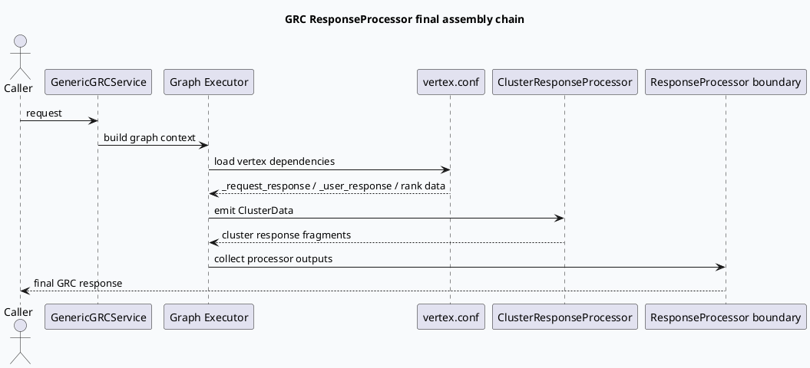

# GRC ResponseProcessor 末端响应装配链路

> 主题来源：未发现显式 daily-plan 文件，按周一兜底主题生成。内网 KU 检索未参与，本篇以代码库检索证据为准，需人工补充线上配置差异。

## 架构全景

<style>.arch20260713{font-family:Inter,Arial,sans-serif;background:#f8fafc;border:1px solid #d9e2ec;border-radius:8px;padding:18px;margin:16px 0;color:#1f2937}.arch20260713 .title{font-size:20px;font-weight:800;margin-bottom:12px}.arch20260713 .layers{display:grid;grid-template-columns:1fr;gap:10px}.arch20260713 .layer{border:1px solid #cbd5e1;border-radius:8px;background:#fff;padding:12px}.arch20260713 .lname{font-size:13px;font-weight:800;color:#334155;margin-bottom:8px;text-transform:uppercase}.arch20260713 .grid{display:grid;grid-template-columns:repeat(4,minmax(0,1fr));gap:8px}.arch20260713 .box{border-radius:6px;border:1px solid #dbe4ee;background:#f8fafc;padding:9px;font-size:13px;line-height:1.35}.arch20260713 .box strong{display:block;color:#0f172a;font-size:13px}.arch20260713 .hot{border-color:#3d5a80;background:#eef4fb}.arch20260713 .flow{font-size:18px;text-align:center;color:#64748b;font-weight:800}@media(max-width:760px){.arch20260713 .grid{grid-template-columns:1fr 1fr}}</style><div class="arch20260713"><div class="title">GRC 请求到响应的末端装配视图</div><div class="layers"><div class="layer"><div class="lname">Service Entry</div><div class="grid"><div class="box hot"><strong>GenericGRCService</strong>main.cpp 注册 RPC 服务</div><div class="box"><strong>GrcHttpServiceImpl</strong>HTTP 兼容入口</div><div class="box"><strong>Graph Executor</strong>按 vertex.conf 装配图</div><div class="box"><strong>Request Context</strong>UA / EXP 条件驱动依赖</div></div></div><div class="flow">↓</div><div class="layer"><div class="lname">Graph Response Area</div><div class="grid"><div class="box hot"><strong>_request_response</strong>RequestFeatureResponse 依赖点</div><div class="box"><strong>_user_response</strong>UserFeatureResponseCopy 条件依赖</div><div class="box hot"><strong>ClusterResponseProcessor</strong>ClusterData 输出</div><div class="box"><strong>Rank Result</strong>RankServiceResult / success flag</div></div></div><div class="flow">↓</div><div class="layer"><div class="lname">Final Assembly</div><div class="grid"><div class="box"><strong>Processor Outputs</strong>多路 GraphData 汇聚</div><div class="box"><strong>Response Fields</strong>透传字段、排序结果、扩展信息</div><div class="box hot"><strong>ResponseProcessor</strong>末端响应归并边界</div><div class="box"><strong>Downstream GRG</strong>候选和上下文交付</div></div></div></div></div>

## 核心调用链



## 配置结构信息图

```infographic
infographic list-grid-badge-card
data
  title Response graph evidence map
  desc 末端装配依赖不是单个函数孤岛，而是 vertex.conf 中响应区数据依赖和 Processor 输出共同组成
  items
    - label RPC service
      desc main.cpp 注册 GenericGRCService 与 GrcHttpServiceImpl
      icon mdi/server-network
    - label Request response dep
      desc vertex.conf 定义 _request_response -> RequestFeatureResponse
      icon mdi/source-branch
    - label User response dep
      desc _user_response 在 UA 与 EXP 条件下接入 UserFeatureResponseCopy
      icon mdi/account-filter
    - label Cluster response
      desc ClusterResponseProcessor emit ClusterData
      icon mdi/vector-combine
    - label Rank result
      desc RankServiceProcessor 输出 RankServiceResult 与 IsRankServiceSuccess
      icon mdi/sort
    - label Final boundary
      desc ResponseProcessor 负责把图上多路结果收束为返回结构
      icon mdi/package-variant-closed
```

## 关键理解

GRC 的响应装配边界应从 `main.cpp` 的服务注册开始看，而不是只搜某个 `ResponseProcessor` 类名。`GenericGRCService` 和 `GrcHttpServiceImpl` 在入口层被注册，真正的数据依赖进入 graph 后，由 `vertex.conf` 中的响应区节点完成显式声明。

`_request_response` 与 `_user_response` 是响应装配前的上下文输入点，`ClusterResponseProcessor` 说明图内仍有中间 response-like 数据产物。最终响应装配的职责是收束这些 Processor 输出，而不是重新决定召回或排序策略。

## Pitfalls

<style>.pit20260713{font-family:Inter,Arial,sans-serif;background:#fff;border-left:6px solid #3d5a80;border-radius:8px;padding:16px;margin:18px 0;box-shadow:0 1px 0 #e5e7eb;color:#1f2937}.pit20260713 .k{font-size:12px;font-weight:800;color:#3d5a80;text-transform:uppercase;margin-bottom:6px}.pit20260713 .h{font-size:22px;font-weight:850;margin-bottom:8px}.pit20260713 p{font-size:14px;line-height:1.65;margin:0}.pit20260713 code{background:#eef2f7;padding:1px 4px;border-radius:4px}</style><div class="pit20260713"><div class="k">Pitfall</div><div class="h">不要把响应装配误读成单点 Processor</div><p>如果只看类名，会漏掉 <code>vertex.conf</code> 中的条件依赖和上游 emit 数据。正确阅读顺序是入口服务注册 → graph 配置 → 响应区依赖 → Processor 输出收束。</p></div>

## 调试 checklist

```infographic
infographic list-column-done-list
data
  title Response assembly debugging checklist
  items
    - label 入口是否注册
      desc 检查 main.cpp 中 GenericGRCService / GrcHttpServiceImpl 是否加入 brpc server
      done true
    - label 图依赖是否命中
      desc 检查 vertex.conf 中 _request_response 与 _user_response 条件是否满足
      done true
    - label 中间数据是否 emit
      desc 检查 ClusterResponseProcessor 是否输出 ClusterData
      done true
    - label Rank 结果是否可用
      desc 检查 RankServiceResult 与 IsRankServiceSuccess 数据是否进入响应区
      done true
    - label 线上差异需人工补充
      desc KU/线上配置未检索，需确认部署环境是否覆盖本地 conf
      done false
```

## 证据来源

- `src/main.cpp:106-116`：注册 `GenericGRCService` 与 `GrcHttpServiceImpl`。
- `conf/plugins/graph/vertex.conf:355-357`：`_request_response` 依赖 `RequestFeatureResponse`。
- `conf/plugins/graph/vertex.conf:2192-2195`：`ClusterResponseProcessor` emit `ClusterData`。
- `conf/plugins/graph/vertex.conf:2623-2628`：`_user_response` 与 `_request_response` 的条件依赖。
