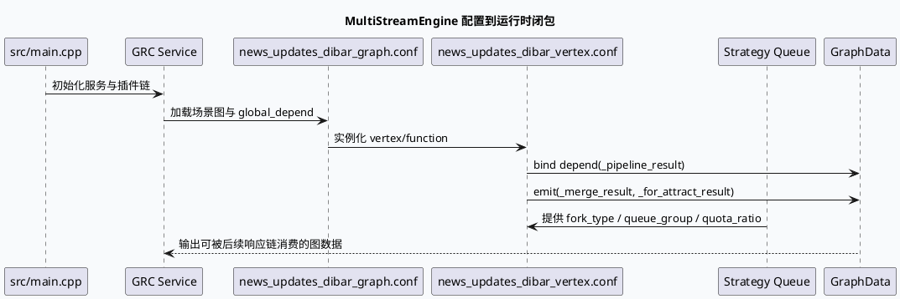

# 2026-07-15 基础库代码理解：MultiStreamEngine 依赖绑定与运行时闭包

> 日期：2026-07-15｜类型：基础库笔记  
> 今日主题来源：本机未发现可用 `daily-plan` 文件；按周三 fallback 选择 GRG/MV-GRC `MultiStreamEngine` 配置装配框架，并与业务侧 `news_updates_dibar` NewDiversityMerge 配对。  
> 内网 KU：本次任务未提供 KU URL/doc-id；如流知识库检索需人工补充。本文以本地代码库证据为准。  
> 范围：服务入口、图配置、vertex 依赖、strategy queue 结构，以及 MultiStreamEngine 在业务图中的运行时闭包位置。

## 架构全景

<style>.arch20260715base{font-family:Inter,Arial,sans-serif;background:#f8fafc;border:1px solid #d6dee8;border-radius:8px;padding:18px;margin:16px 0;color:#1f2937}.arch20260715base .title{font-size:20px;font-weight:850;margin-bottom:12px}.arch20260715base .grid{display:grid;grid-template-columns:1fr 34px 1fr 34px 1fr;gap:8px;align-items:stretch}.arch20260715base .box{background:#fff;border:1px solid #cbd5e1;border-radius:8px;padding:12px;min-height:118px}.arch20260715base .arrow{display:flex;align-items:center;justify-content:center;color:#64748b;font-weight:900}.arch20260715base .label{font-size:12px;font-weight:800;color:#475569;text-transform:uppercase;margin-bottom:6px}.arch20260715base .name{font-size:16px;font-weight:850;margin-bottom:8px}.arch20260715base .desc{font-size:13px;line-height:1.55;color:#334155}.arch20260715base .strip{display:grid;grid-template-columns:repeat(4,1fr);gap:8px;margin-top:10px}.arch20260715base .chip{background:#eef6ff;border:1px solid #bfdbfe;border-radius:8px;padding:8px;font-size:12px;line-height:1.45;color:#1e3a5f}</style><div class="arch20260715base"><div class="title">MultiStreamEngine 在 MV-GRC 图执行中的位置</div><div class="grid"><div class="box"><div class="label">Service Entry</div><div class="name">src/main.cpp</div><div class="desc">进程注册 GRC 服务与初始化模块，图执行能力作为服务内的插件化处理链被装入。</div></div><div class="arrow">→</div><div class="box"><div class="label">Graph Runtime</div><div class="name">news_updates_dibar_graph.conf</div><div class="desc">场景图声明全局依赖，如 log_id、uid、cuid、ua、tab、product 和 debug 标志，为 vertex 提供公共上下文。</div></div><div class="arrow">→</div><div class="box"><div class="label">Vertex Closure</div><div class="name">news_updates_dibar_vertex.conf</div><div class="desc">MergePipelineFunction 等 vertex 通过 emit/depend 把中间结果挂接为图数据，形成后续合并与响应装配的闭包。</div></div></div><div class="strip"><div class="chip">global_depend：请求级上下文</div><div class="chip">depend：上游产物输入</div><div class="chip">emit：下游图数据输出</div><div class="chip">strategy queue：业务队列与配额</div></div></div>

## 核心流程



## 配置结构

```infographic
infographic hierarchy-tree-tech-style-capsule-item
data
  title news_updates_dibar 图执行配置骨架
  desc 从服务入口到 vertex 闭包的基础库视角
  items
    - label Service Entry
      desc src/main.cpp 注册 GRC 服务与初始化模块
      icon mdi/server
      children
        - label Graph Config
          desc graph name=news_updates_dibar, pool_bvar=news_updates_dibar_pool
          icon mdi/graph-outline
          children
            - label global_depend
              desc log_id uid cuid ua tab product is_debug 等请求级上下文
              icon mdi/database-arrow-down
            - label Vertex Config
              desc MergePipelineFunction_news_updates_dibar 绑定输入输出图数据
              icon mdi/source-branch
              children
                - label depend
                  desc _pipeline_result -> NewsSketchyRpcConfigResult
                  icon mdi/import
                - label emit
                  desc _merge_result / _for_attract_result
                  icon mdi/export
        - label Strategy Config
          desc fork_type + queue_group + queue + quota_ratio 定义多队列候选来源
          icon mdi/tune
```

## 关键结论

<style>.card20260715base{font-family:Inter,Arial,sans-serif;background:#fafafa;border:1px solid #d6dee8;border-radius:8px;padding:16px;margin:16px 0;color:#1f2937}.card20260715base .meta{font-size:12px;font-weight:850;color:#52616f;text-transform:uppercase}.card20260715base .headline{font-size:24px;font-weight:900;margin:6px 0 10px}.card20260715base .body{display:grid;grid-template-columns:1.4fr .9fr;gap:12px}.card20260715base .panel{background:#fff;border-top:4px solid #3d5a80;border-radius:6px;padding:12px;font-size:13px;line-height:1.6}.card20260715base strong{color:#243b53}</style><div class="card20260715base"><div class="meta">Pitfall Card</div><div class="headline">不要把 MultiStreamEngine 看成单个函数调用</div><div class="body"><div class="panel"><strong>真正的运行边界</strong> 是 graph/vertex/strategy 三类配置共同形成的闭包：graph 给请求上下文，vertex 声明输入输出图数据，strategy 决定候选队列和配额。只读某个 C++ function 容易漏掉队列选择和图数据命名约束。</div><div class="panel"><strong>调试优先级</strong>：先看 graph name 和 pool_bvar 是否命中，再看 vertex 的 depend/emit 名字是否和下游一致，最后看 strategy 的 queue_group 是否覆盖目标 fork_type。</div></div></div>

## 调试 Checklist

```infographic
infographic list-column-done-list
data
  title MultiStreamEngine 闭包排查清单
  desc 从配置命中到图数据输出逐项确认
  items
    - label 确认场景图
      desc news_updates_dibar_graph.conf 中 name 与 pool_bvar 是否为目标场景
      done true
      icon mdi/check-circle
    - label 确认全局依赖
      desc log_id、uid、cuid、ua、tab、product 等是否进入 graph global_depend
      done true
      icon mdi/check-circle
    - label 确认 vertex 输入
      desc _pipeline_result 是否绑定为 NewsSketchyRpcConfigResult
      done true
      icon mdi/check-circle
    - label 确认 vertex 输出
      desc _merge_result 与 _for_attract_result 是否被后续链路消费
      done true
      icon mdi/check-circle
    - label 确认业务队列
      desc strategy 中 fork_type、queue_group、marks、quota_ratio 是否符合目标实验
      done true
      icon mdi/check-circle
```

## 证据来源

- `src/main.cpp:16-24`：服务入口包含 GRC 服务、全局初始化和 opt 初始化相关头文件。
- `conf/plugins/graph/news_updates_dibar/news_updates_dibar_graph.conf:1-6`：声明 `news_updates_dibar` 图与 `news_updates_dibar_pool`。
- `conf/plugins/graph/news_updates_dibar/news_updates_dibar_graph.conf:7-34`：声明 `log_id`、`uid`、`cuid`、`ua`、`tab`、`product`、`is_debug` 等全局依赖。
- `conf/plugins/graph/news_updates_dibar/news_updates_dibar_vertex.conf:6-22`：`MergePipelineFunction_news_updates_dibar` 绑定 `_pipeline_result` 输入，并 emit `_merge_result`、`_for_attract_result`。
- `conf/plugins/strategies/news_updates_dibar.conf:1-16`：strategy 名称、fork_type、queue_group 与 quota_ratio 的基础结构。

## 需人工补充

- 内网 KU 中关于 `MultiStreamEnginePlugin` / `EngineMgr` 的历史设计说明本次未检索到，需人工补充线上版本差异。
- 本文按本地代码库证据写成，若线上发布分支不同，需对照运行环境配置重新校验 graph 与 strategy 文件。
