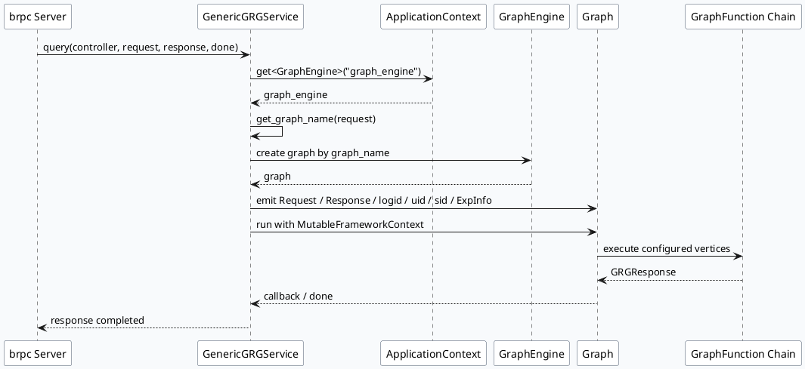
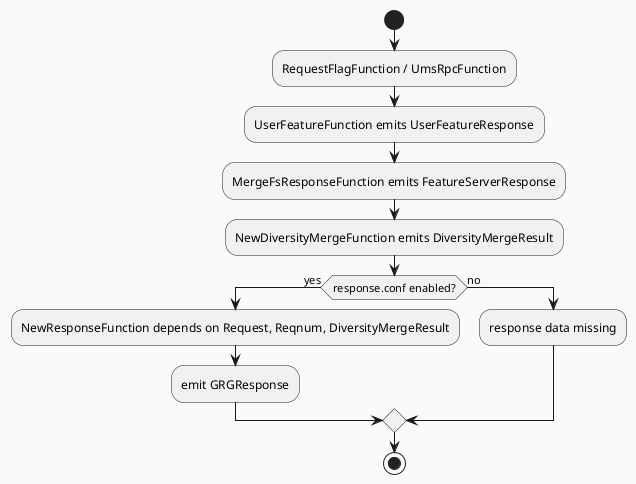

# 2026-07-17 周度代码理解：MV-GRG GenericGRGService 请求生命周期与 GraphEngine 调度边界

> 本文聚焦 `feeda-mv-grg` 的 RPC 服务入口：`GenericGRGService::query` 如何把 brpc 请求转换为 GraphEngine 可执行上下文，并把 `news_updates_dibar` 等场景配置推入后续 GraphFunction 响应链。

<h3>架构全景：RPC 入口到 GraphEngine 执行边界</h3>

<h4>服务入口</h4>
`src/main.cpp` 注册 `GenericGRGService`，协议为 `baidu_std_reuse`

`query()` 接收 `GRCRequest` / `GRCResponse` / `Closure`

UA 为空会打印完整请求 JSON，便于入口参数排查

<h4>上下文与调度</h4>
从 `ApplicationContext` 获取 `GraphEngine("graph_engine")`

按请求选择 `graph_name`，创建 graph 实例

注入 `Request`、`Response`、`logid`、`uid`、`sid`、`product`、`flow_loc`、`ExpInfo`

<h4>配置闭环</h4>
`vertex.conf` 绑定 FS 合并、DiversityMerge 等顶点

`response.conf` 指定 `NewResponseFunction` 输出 `GRGResponse`

动态超时插件为空会直接 FATAL，属于入口硬依赖

brpc Server→GenericGRGService::query→MutableFrameworkContext→GraphEngine→NewResponseFunction

## 1. 入口定位

入口链路从 `src/main.cpp` 开始：服务初始化日志、实验管理、funnel 后，创建 `baidu::rpc::Server`，再注册 `GenericGRGService` 和 HTTP graph view 服务。

关键证据：

- `src/main.cpp:60-79`：创建 server，设置协议与线程选项，`AddService(&grg_service)` 注册 RPC 服务。
- `src/service/grg_service.h:14-21`：`GenericGRGService` 继承 `feed::grc::GRCService`，实现 `query()`。
- `src/service/grg_service.cpp:35-51`：`query()` 接收请求，转换 brpc controller，并从 `ApplicationContext` 获取 `GraphEngine("graph_engine")`。

## 2. `query()` 的生命周期切分

`GenericGRGService::query` 不是单纯转发 RPC，它在进入图执行前完成四类准备工作。

1. **入口防护**：检查 controller 状态、动态超时插件指针、UA 字段。UA 为空时会把请求转 JSON 打 warning，便于定位异常调用方。
2. **场景选择**：通过请求推导 `graph_name`，再用 GraphEngine 创建或获取对应图实例。
3. **上下文注入**：把 RPC 请求、响应对象和运行时元信息注入 graph data，包括 `Request`、`Response`、`logid`、`uid`、`sid`、`product`、`flow_loc`、`is_debug`、`ExpInfo`。
4. **超时与调度**：`DynamicTimeOutPlugin` 是硬依赖，框架上下文与动态超时控制器共同约束后续顶点执行预算。

infographic sequence-timeline-simple
data
  title query 生命周期四段式
  desc 从 RPC 入参到 GraphEngine 可执行上下文
  items
    - time Step 1
      label 入口校验
      desc controller、UA、DynamicTimeOutPlugin
      icon mdi/shield-check
    - time Step 2
      label 图选择
      desc get_graph_name 后进入对应场景 graph
      icon mdi/source-branch
    - time Step 3
      label 数据注入
      desc Request/Response/logid/uid/sid/product/ExpInfo
      icon mdi/database-import
    - time Step 4
      label 顶点执行
      desc vertex.conf 与 response.conf 驱动 GraphFunction 链
      icon mdi/play-network
theme
  palette #3d5a80 #2d6a4f #c2410c

## 3. 配置如何闭合到响应链

`news_updates_dibar` 场景展示了入口上下文进入图后的后半段闭环。

- `conf/plugins/graph/news_updates_dibar/vertex.conf:193-219`：`UserFeatureFunction` 依赖 `Request`、`SidInfo` 等数据并发出 `UserFeatureResponse`，随后 `MergeFsResponseFunction` 合并用户和请求特征服务响应，产出 `FeatureServerResponse`。
- `conf/plugins/graph/news_updates_dibar/vertex.conf:221-252`：`NewDiversityMergeFunction` 作为 engine vertex，依赖多类队列、插入配置和请求数据，产出 `DiversityMergeResult`。
- `conf/plugins/graph/news_updates_dibar/response.conf:1-22`：`NewResponseFunction` 依赖 `Request`、`PassThoughResponse`、`Reqnum`、`DiversityMergeResult` 和 funnel 对象，最终 emit `_response: GRGResponse`。
- `src/process/merge_fs_response_function.cpp:7-31`：FS 响应合并函数把多路 feature response 规整为统一输出。
- `src/process/new_response_function.cpp:23-39`：新版响应函数初始化队列名与 decorate 策略，说明最终响应并不只是透传 merge 结果，还会执行装饰和输出整理。

infographic list-grid-badge-card
data
  title 关键配置节点
  desc 入口注入的数据如何被场景顶点消费
  items
    - label Request
      desc query() 注入，多个顶点共同依赖
      icon mdi/file-document-outline
    - label SidInfo
      desc 特征与策略顶点的实验/场景开关输入
      icon mdi/toggle-switch-outline
    - label FeatureServerResponse
      desc MergeFsResponseFunction 汇总 FS 结果
      icon mdi/merge
    - label DiversityMergeResult
      desc NewDiversityMergeFunction 输出多队列融合结果
      icon mdi/view-grid-plus
    - label GRGResponse
      desc NewResponseFunction 最终响应数据
      icon mdi/reply-all-outline
theme
  palette #3d5a80 #2d6a4f #c2410c

Pitfall Card

入口层的失败通常表现为“图没跑起来”

排查时不要先跳到 DiversityMerge 或 ResponseFunction。`GenericGRGService::query` 之前如果服务未注册、UA/graph_name 异常、`DynamicTimeOutPlugin` 为空、graph data 未注入，后续顶点看到的就是缺失上下文，而不是业务策略错误。

<strong>优先看入口日志</strong> 确认 logid、remote_side、UA warning、graph_name 和 graph 创建结果。

<strong>再看配置闭环</strong> 确认 `vertex.conf` 中 emit/depend 名称与 `response.conf` 的最终 `_response` 数据一致。

## 4. 调试 Checklist

infographic list-column-done-list
data
  title MV-GRG 入口到响应排查清单
  desc 按顺序排查可以减少在业务函数中误判
  items
    - label 服务注册
      desc `src/main.cpp:60-79` 是否注册 `GenericGRGService`
      done true
    - label GraphEngine 获取
      desc `src/service/grg_service.cpp:48-54` 是否拿到 `graph_engine` 与动态超时插件
      done true
    - label 场景图选择
      desc graph_name 是否符合请求 UA、产品和 flow_loc 预期
      done true
    - label 上下文注入
      desc `Request`、`Response`、`ExpInfo`、`uid/sid` 是否写入 graph data
      done true
    - label 顶点依赖
      desc `vertex.conf` 的 depend/emit 名称是否和函数成员绑定一致
      done true
    - label 最终响应
      desc `response.conf` 是否把 `_response` 绑定到 `GRGResponse`
      done true
theme
  palette #3d5a80 #2d6a4f #c2410c

## 5. 结论

`GenericGRGService::query` 是 MV-GRG 的框架边界：它把 brpc 层的 `GRCRequest` 变成 GraphEngine 可消费的数据图，并把动态超时、实验信息、用户标识、产品与流量位置绑定到同一份执行上下文。后续 `MergeFsResponseFunction`、`NewDiversityMergeFunction`、`NewResponseFunction` 的行为都依赖这一步的上下文完整性。排查“响应为空”“策略未生效”“队列结果缺失”时，应先验证入口注入和配置闭环，再深入单个业务顶点。
