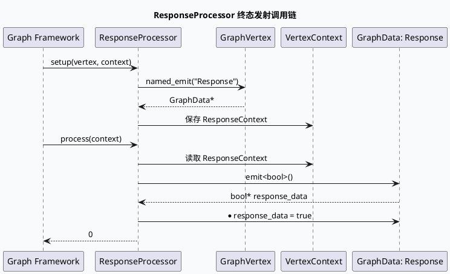

# 2026-07-20 周度代码理解：`ResponseProcessor` 的 GraphData 终态发射边界

> 今日未发现可用的 daily-plan 文件，按周一 fallback 主题分析“最终响应组装边界”。本文聚焦 generator-service 基础框架里 `ResponseProcessor` 如何把图执行完成状态写到命名输出 `Response`，以及这个最小处理器为什么是后续业务 response chain 的统一收口点。

<style>
.rp-arch{font-family:Inter,Arial,sans-serif;background:#f8fafc;border:1px solid #d7dee8;border-radius:8px;padding:18px;margin:16px 0;color:#1f2937}.rp-arch h3{margin:0 0 12px;font-size:18px}.rp-grid{display:grid;grid-template-columns:1.05fr 1.35fr 1fr;gap:12px}.rp-box{background:#fff;border:1px solid #dbe3ef;border-radius:8px;padding:12px}.rp-box h4{margin:0 0 8px;font-size:14px;color:#334155}.rp-box p{margin:4px 0;font-size:13px;line-height:1.55}.rp-core{border-top:4px solid #3d5a80}.rp-flow{border-top:4px solid #2d6a4f}.rp-risk{border-top:4px solid #b45309}.rp-chip{display:inline-block;background:#e8eef6;color:#27445f;border-radius:999px;padding:2px 8px;font-size:12px;margin:2px 4px 2px 0}.rp-arrow{text-align:center;color:#64748b;font-weight:700;padding-top:34px}@media(max-width:820px){.rp-grid{grid-template-columns:1fr}.rp-arrow{display:none}}</style><div class="rp-arch"><h3>架构全景：响应终态从 Processor 写入 GraphData</h3><div class="rp-grid"><div class="rp-box rp-core"><h4>GraphVertex setup</h4><p><span class="rp-chip">BaseProcessor</span><span class="rp-chip">VertexContext</span></p><p>`setup()` 创建 `ResponseContext`，通过 `vertex.named_emit("Response")` 绑定命名输出槽位。</p></div><div class="rp-box rp-flow"><h4>ResponseProcessor process</h4><p><span class="rp-chip">GraphData*</span><span class="rp-chip">emit&lt;bool&gt;()</span></p><p>`process()` 从自定义上下文取回 `response_data`，发射一个 `bool` 数据对象并写入 `true`。</p></div><div class="rp-box rp-risk"><h4>下游收口</h4><p><span class="rp-chip">Response node</span><span class="rp-chip">final flag</span></p><p>该 Processor 不拼业务内容，只声明“图已到达响应完成边界”，让框架层与业务 response 函数解耦。</p></div></div></div>

## 核心结论

`ResponseProcessor` 的设计非常薄：它没有读请求，也没有写 protobuf response，而是把最终状态写成 `Response` 命名输出。这个边界的价值在于：业务层可以在前面的 graph/function 节点完成复杂拼装，框架层只需要一个可观测、可依赖的终态信号。



## 代码路径拆解

`setup()` 阶段的核心动作是把框架命名输出与 Processor 私有上下文绑定起来。证据在 `response_processor.cpp:17-35`：`ResponseContext` 只保存一个 `GraphData*`，`setup()` 通过 `vertex.named_emit("Response")` 获取输出槽位，然后放入 `context._custom_context`。

`process()` 阶段只做三步：从 `VertexContext` 取回 `ResponseContext`，调用 `response_data->emit<bool>()` 申请输出值，最后写入 `true`。证据在 `response_processor.cpp:37-48`。这说明它不是“响应内容生成器”，而是“响应完成信号生成器”。

```infographic
infographic sequence-ascending-steps
data
  title ResponseProcessor 三段契约
  desc 从图顶点绑定到最终 Response 标志的最小闭环
  items
    - label 绑定输出
      desc setup 阶段调用 named_emit("Response")，建立命名输出槽位
      icon mdi/link-variant
    - label 保存上下文
      desc GraphData 指针进入 ResponseContext，避免 process 阶段重复查找
      icon mdi/archive-outline
    - label 发射终态
      desc process 阶段 emit<bool>() 并写入 true，标记响应边界完成
      icon mdi/check-circle-outline
theme
  palette #3d5a80 #2d6a4f #b45309
```

## 为什么要把它看作边界

第一，`ResponseProcessor` 的 `desc()` 明确描述为“生成最终响应标志”，不是“填充最终响应体”。第二，它注册为 `GraphProcessor` 组件，说明它参与的是图执行拓扑，而不是某个业务 scene 的私有逻辑。第三，输出值是 `bool`，天然表达的是完成状态或触发信号，而非可承载内容的结构化响应。

这会影响排查顺序：如果业务字段缺失，不应先怀疑 `ResponseProcessor`；如果图执行无法走到最终响应节点，才需要检查它的 setup/process 是否被调度、命名输出是否匹配、上下文是否被正确保存。

<style>
.rp-card{font-family:Inter,Arial,sans-serif;background:#fbfaf7;border:1px solid #e3ded4;border-left:6px solid #b45309;border-radius:8px;padding:16px;margin:16px 0;color:#2f2a24}.rp-card h3{margin:0 0 10px;font-size:18px}.rp-card-grid{display:grid;grid-template-columns:1fr 1fr;gap:12px}.rp-card-panel{background:#fff;border:1px solid #e7e0d5;border-radius:8px;padding:12px}.rp-card-panel strong{display:block;margin-bottom:6px;color:#7c3f10}.rp-card-panel p{margin:0;font-size:13px;line-height:1.6}@media(max-width:760px){.rp-card-grid{grid-template-columns:1fr}}</style><div class="rp-card"><h3>Pitfalls：不要把终态信号误读成响应拼装</h3><div class="rp-card-grid"><div class="rp-card-panel"><strong>误区一：字段缺失就查 ResponseProcessor</strong><p>该类只写 `bool true`，不处理 item、extmsg、meta 或 protobuf 字段。字段级问题应继续追业务 response function。</p></div><div class="rp-card-panel"><strong>误区二：忽略 named_emit 名称</strong><p>`Response` 是框架连接点。配置或图拓扑里的节点名一旦不一致，Processor 本身正常也无法被下游感知。</p></div></div></div>

```infographic
infographic list-column-done-list
data
  title 调试 Checklist
  desc 响应链路未完成时优先检查的框架侧事项
  items
    - label 确认 Processor 已注册
      desc `BABYLON_REGISTER_COMPONENT_WITH_TYPE_NAME` 是否随二进制加载
      done true
      icon mdi/puzzle-check-outline
    - label 确认 setup 被调用
      desc `named_emit("Response")` 是否返回有效 GraphData 指针
      done true
      icon mdi/call-made
    - label 确认 custom_context 生命周期
      desc `ResponseContext` 是否在 process 前保持可读
      done true
      icon mdi/database-clock-outline
    - label 确认业务 response function 已在前序节点完成内容拼装
      desc 字段缺失要回到业务链路，而不是停在 bool 终态
      done true
      icon mdi/source-branch-check
theme
  palette #3d5a80 #2d6a4f #b45309
```

## 证据来源

- `response_processor.cpp:17-35`：`ResponseContext` 与 `vertex.named_emit("Response")` 绑定。
- `response_processor.cpp:37-48`：`process()` 发射 `bool` 并写入 `true`。
- `response_processor.cpp:52`：组件注册为 `GraphProcessor`。

## 需人工补充

内网 KU/daily-plan 未在本次 cron 环境中定位到今日主题，本文使用代码库检索和历史周一 fallback 主题生成。若当天实际规划另有 KU 文档，需要人工补充对应背景链接。