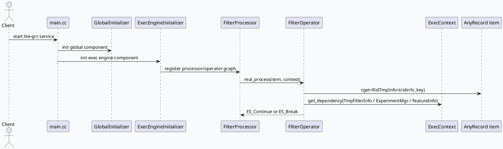

# lite-grc FilterProcessor 与 ExecEngine 过滤算子契约

> 主题来源：本机未发现可用 `daily-plan` 文件，按周二 fallback 主题生成。已设置 `BAIDU_CC_USERNAME=hujiyang`；本次未依赖 KU 正文检索，结论以代码库证据为准，线上策略口径需人工补充。

## 架构全景

<style>.arch20260721{font-family:Inter,Arial,sans-serif;background:#f8fafc;border:1px solid #d7dee8;border-radius:8px;padding:18px;margin:16px 0;color:#1f2937}.arch20260721 .title{font-size:20px;font-weight:850;margin-bottom:12px}.arch20260721 .grid{display:grid;grid-template-columns:1fr 34px 1fr 34px 1fr;gap:8px;align-items:stretch}.arch20260721 .box{background:#fff;border:1px solid #cbd5e1;border-radius:8px;padding:12px}.arch20260721 .arrow{display:flex;align-items:center;justify-content:center;font-weight:900;color:#64748b}.arch20260721 .tag{display:inline-block;font-size:11px;font-weight:750;color:#475569;background:#e2e8f0;border-radius:999px;padding:2px 8px;margin-bottom:8px}.arch20260721 h3{font-size:15px;margin:0 0 8px 0}.arch20260721 p{font-size:13px;line-height:1.55;margin:0;color:#475569}.arch20260721 .foot{margin-top:12px;display:grid;grid-template-columns:1fr 1fr;gap:8px}.arch20260721 .note{background:#eef6ff;border:1px solid #bfdbfe;border-radius:8px;padding:10px;font-size:13px;color:#334155}</style><div class="arch20260721"><div class="title">lite-grc 过滤链路：初始化、依赖注入、单 item 判定</div><div class="grid"><div class="box"><span class="tag">service boot</span><h3>main.cc</h3><p>服务启动后先注册 RPC protocol，再执行 GlobalInitializer 与 ExecEngineInitializer，为后续策略图准备全局组件。</p></div><div class="arrow">→</div><div class="box"><span class="tag">exec engine</span><h3>ExecEngineInitializer</h3><p>初始化 filter processor 所需的上下文、依赖表和 operator registry，形成可由配置驱动的执行单元。</p></div><div class="arrow">→</div><div class="box"><span class="tag">filter operator</span><h3>FilterOperator</h3><p>每个候选 item 通过 AnyRecord 读取临时字段，通过 ExecContext 读取请求级依赖，返回 Continue 或 Break。</p></div></div><div class="foot"><div class="note">核心边界：过滤逻辑不直接构造召回结果，只消费已注入的 ridinfo、TmpFilterInfo、ExperimentMgr、FeatureInfo 等依赖。</div><div class="note">排障边界：若过滤结果异常，优先查 operator 是否被配置命中，其次查 dependency slot 是否正确填充。</div></div></div>

## 核心流程



## 配置与运行结构

```infographic
infographic hierarchy-structure
data
  title FilterProcessor 运行依赖
  desc 从服务启动到单候选过滤的关键对象层级
  items
    - label 启动层
      desc main.cc 注册协议并初始化全局组件
      icon mdi/power
      children
        - label ReusableRPCProtocol
          desc 自定义 RPC protocol 注册
        - label GlobalInitializer
          desc 全局组件初始化
        - label ExecEngineInitializer
          desc ExecEngine 组件初始化
    - label 执行层
      desc Processor 根据配置调度 operator
      icon mdi/sitemap
      children
        - label ExecContext
          desc 请求级依赖访问入口
        - label AnyRecord
          desc 候选 item 字段容器
    - label 判定层
      desc Operator 返回继续或过滤
      icon mdi/filter-check
      children
        - label ES_Continue
          desc 候选保留
        - label ES_Break
          desc 候选过滤
```

## 关键结论

1. `main.cc:75-78` 把 ExecEngine 初始化放在全局组件初始化之后；如果 ExecEngine 组件失败，服务启动阶段直接失败，而不是在请求阶段降级。
2. `heji_filter.cc:10-16` 展示了过滤算子的典型契约：从 item 读取 `RidTmpInfo`，从 context 读取 `TmpFilterInfo`、`ExperimentMgr`、`FeatureInfo`。
3. `heji_filter.cc:7-10` 明确了返回码语义：`ES_Continue` 表示不过滤，`ES_Break` 表示过滤。这是排查误删候选时最先要确认的方向。
4. `exec_engine_common.h:137` 与 `exec_engine_common.cc:32-49` 是通用执行辅助逻辑的聚合点，新增过滤依赖时应优先确认是否已有公共访问模式。

## Pitfalls

<style>.pit20260721{font-family:Inter,Arial,sans-serif;margin:16px 0;display:grid;grid-template-columns:1.1fr .9fr;gap:12px}.pit20260721 .card{background:#fff;border:1px solid #d7dee8;border-radius:8px;padding:14px;color:#1f2937}.pit20260721 .k{font-size:12px;font-weight:800;color:#0f766e;text-transform:uppercase;letter-spacing:.04em}.pit20260721 h3{font-size:17px;margin:6px 0 8px 0}.pit20260721 p{font-size:13px;line-height:1.6;margin:0;color:#475569}.pit20260721 .warn{border-top:4px solid #f59e0b}.pit20260721 .fix{border-top:4px solid #0f766e}</style><div class="pit20260721"><div class="card warn"><div class="k">pitfall</div><h3>把过滤原因误判为召回缺失</h3><p>过滤算子运行在候选已进入执行图之后。若某一路候选消失，不能只查召回队列，也要查 operator 返回的 Break、依赖字段是否为空、实验开关是否命中。</p></div><div class="card fix"><div class="k">debug rule</div><h3>先查配置命中，再查依赖填充</h3><p>同一 operator 在不同 graph/filter 配置中可能只对特定 UA、flow_loc 或场景生效。依赖未注入时，业务条件看起来像“不命中”，实际是执行图装配问题。</p></div></div>

## 调试 checklist

```infographic
infographic list-column-done-list
data
  title FilterProcessor 调试顺序
  desc 按从配置到单 item 的路径缩小问题面
  items
    - label 确认服务启动初始化成功
      desc 检查 main.cc 中 GlobalInitializer 与 ExecEngineInitializer 日志
      done true
      icon mdi/check-circle
    - label 确认 graph/filter 配置命中
      desc 看 UA、flow_loc、scene 条件是否让 operator 进入执行链
      done true
      icon mdi/source-branch
    - label 确认 ExecContext dependency 存在
      desc TmpFilterInfo、ExperimentMgr、FeatureInfo 缺失会让业务判断失真
      done true
      icon mdi/database-check
    - label 确认 AnyRecord 字段存在
      desc ridinfo_key 等候选字段为空时需回查上游 processor
      done true
      icon mdi/card-search
    - label 区分 Continue 与 Break
      desc ES_Break 是过滤动作，ES_Continue 才是放行
      done true
      icon mdi/filter
```

## 证据来源

- `src/main.cc:69-78`：注册 `ReusableRPCProtocol`，并按顺序初始化 `GlobalInitializer`、`ExecEngineInitializer`。
- `src/exec_engine_initializer.h:122-125`：ExecEngine 初始化入口与 filter processor 相关声明。
- `src/strategy/processor/exec_engine_common.h:137`：执行引擎通用结构/辅助逻辑的声明位置。
- `src/strategy/processor/exec_engine_common.cc:32-49`：执行引擎公共逻辑实现入口。
- `src/strategy/processor/filter/heji_filter.cc:7-16`：过滤算子返回码语义与 item/context 依赖读取方式。
- `src/strategy/filter_strategy.cc:223-231`：过滤策略层对下游 processor/operator 的承接位置。

## 需人工补充

- 本次未读取到有效 KU 主题正文，产品侧策略意图、实验命名和线上指标口径需人工补充。
- 若今日实际 daily-plan 不是周二 fallback 主题，应以后续计划文件为准重跑生成。