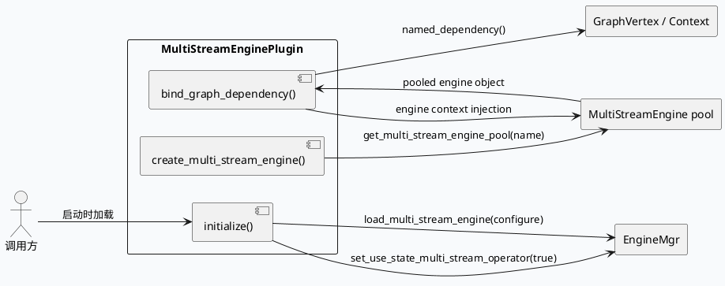

# MultiStreamEnginePlugin 绑定链路：配置装载、引擎池初始化与依赖注入

> 日期：2026-07-29  
> 类型：基础库笔记  
> 主题：`MultiStreamEnginePlugin` 负责把 `news_diversity.conf` 一类配置装载进引擎池，并在 `bind_graph_dependency` 阶段把运行时 `GraphVertex` 依赖注入到 `MultiStreamEngine`，形成可复用的多流执行骨架。

<div class="arch-wrapper" style="font-family:Inter,Arial,sans-serif;border:1px solid #d8dee9;background:#f8fafc;border-radius:8px;padding:18px;margin:14px 0;color:#1f2937;"><style>.arch-wrapper *{box-sizing:border-box}.arch-title{font-size:20px;font-weight:800;margin-bottom:12px}.arch-grid{display:grid;grid-template-columns:1fr 1.15fr 1fr;gap:12px}.arch-box{background:#fff;border:1px solid #dbe3ef;border-radius:7px;padding:12px}.arch-box h3{margin:0 0 8px;font-size:14px}.arch-chip{display:inline-block;padding:3px 8px;border-radius:999px;background:#e8eef7;color:#334155;font-size:11px;font-weight:700;margin:0 6px 6px 0}.arch-flow{display:grid;gap:8px}.arch-step{padding:8px 10px;border:1px solid #dbe3ef;border-radius:6px;background:#f8fbff}.arch-step strong{display:block;font-size:12px;margin-bottom:3px}.arch-note{font-size:12px;line-height:1.55;color:#475569}.arch-arrow{font-size:18px;color:#64748b;text-align:center;line-height:1}</style><div class="arch-title">基础库全景图：插件初始化到图依赖绑定</div><div class="arch-grid"><div class="arch-box"><h3>配置入口</h3><div class="arch-chip">plugin init</div><div class="arch-chip">configure</div><div class="arch-chip">engine pool</div><p class="arch-note">`initialize()` 先启用状态型多流算子，再把配置装进 `EngineMgr`，由引擎池统一管理可复用实例。</p></div><div class="arch-box"><h3>运行时主链路</h3><div class="arch-flow"><div class="arch-step"><strong>1. initialize</strong>读取配置并调用 `load_multi_stream_engine`。</div><div class="arch-arrow">↓</div><div class="arch-step"><strong>2. create / validate</strong>按引擎名从池里取对象，做空指针校验。</div><div class="arch-arrow">↓</div><div class="arch-step"><strong>3. bind_graph_dependency</strong>把 `GraphVertex` 的依赖绑定到 `MultiStreamEngine`。</div></div></div><div class="arch-box"><h3>结果</h3><div class="arch-chip">vertex binding</div><div class="arch-chip">stateful execution</div><div class="arch-chip">reusable engine</div><p class="arch-note">这个层的重点不是业务规则，而是把“配置驱动 + 图依赖注入”变成稳定的可执行框架。</p></div></div></div>

## 核心流程



## 配置与结构

```infographic
infographic list-grid-badge-card
data
  title MultiStreamEnginePlugin 结构拆解
  items
    - label initialize()
      desc 开启多流算子并载入配置
      icon mdi/cog
    - label EngineMgr
      desc 管理引擎池和共享运行态
      icon mdi:server
    - label create_multi_stream_engine()
      desc 按 name 从池中拿实例并校验空指针
      icon mdi:factory
    - label bind_graph_dependency()
      desc 把 GraphVertex 依赖装配到引擎上下文
      icon mdi:link-variant
    - label stateful operator
      desc 让多流算子在同一条请求链上复用运行状态
      icon mdi:cached
```

## 关键结论

<div style="border-left:4px solid #3d5a80;background:#fff;padding:14px 14px 12px;border-radius:6px;border:1px solid #dbe3ef;margin:14px 0;"><div style="font-size:12px;font-weight:700;letter-spacing:0;text-transform:uppercase;color:#3d5a80;margin-bottom:6px;">结论</div><div style="font-size:14px;line-height:1.7;color:#1f2937;">`MultiStreamEnginePlugin` 的价值在于把“配置加载、池化实例创建、图依赖绑定”分成三个独立阶段。这样做的结果是：初始化时只处理静态配置，运行时只处理 vertex 依赖，避免把业务逻辑揉进插件生命周期。</div></div>

## Pitfalls

<div style="display:grid;grid-template-columns:repeat(2,minmax(0,1fr));gap:12px;margin:14px 0;"><div style="background:#fff;border:1px solid #dbe3ef;border-radius:7px;padding:12px;"><div style="font-weight:800;margin-bottom:6px;">配置没加载成功</div><div style="font-size:13px;line-height:1.6;color:#475569;">如果 `load_multi_stream_engine` 未成功，后续 `get_multi_stream_engine_pool(name)` 会直接走空指针校验，整个绑定链路提前失败。</div></div><div style="background:#fff;border:1px solid #dbe3ef;border-radius:7px;padding:12px;"><div style="font-weight:800;margin-bottom:6px;">依赖绑定顺序错误</div><div style="font-size:13px;line-height:1.6;color:#475569;">`bind_graph_dependency` 必须在 vertex 依赖已就绪后执行，否则引擎拿到的上下文不完整，后续多流算子无法正确闭包运行态。</div></div></div>

## 调试 Checklist

```infographic
infographic sequence-ascending-steps
data
  title 调试检查顺序
  items
    - label 确认初始化是否调用
      desc 检查 `initialize()` 是否执行到 `load_multi_stream_engine`
    - label 确认配置名存在
      desc 对照 `configure` 与引擎池里的 name
    - label 确认池对象非空
      desc 观察 `get_multi_stream_engine_pool(name)` 返回值
    - label 确认 vertex 依赖齐全
      desc 验证 `named_dependency()` 可取到需要的上下文
    - label 确认绑定后再进入执行
      desc 让多流引擎在完整依赖下进入图计算阶段
```

## 证据来源

- `baidu/feed-general/common-processor/src/plugin/multi_stream_engine.cpp`
- `baidu/feed-gr/feeda-mv-grg/src/process/diversity_merge.cpp`
- `baidu/feed-gr/feeda-mv-grg/src/strategy/diversity/diversity_mgr.cpp`
