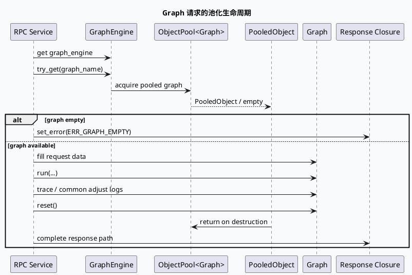

# 2026-10-01 基础库代码理解：Babylon ObjectPool 与 Graph 请求生命周期

> 日期：2026-10-01（周四）
> 主题选择：当前快照没有当日 daily-plan；本地唯一可见的旧计划为 2026-05-29，且其中的 `src/...` 证据路径与当前目录布局不一致，不能直接引用。本次按同一快照的邻近未覆盖合同回退到 **Babylon ObjectPool 的 Graph 获取、请求运行、回收与 reset 生命周期**。KU 正文未读取，业务背景与线上收益需人工补充；本文只依据可核验代码证据。
> 配对关系：业务库笔记分析 GRG `gene_recomm_function` 的业务分支与结果发射；本文只分析服务框架如何把池化 Graph 交给请求并在请求结束时复位。
> 范围：`baidu/feed-gr/feeda-mv-grc/src/service/grc_service.cpp`、`baidu/feed-gr/feeda-mv-grg/src/service/grg_service.cpp`、`baidu/third-party/babylon/src/babylon/concurrent/object_pool.h`。

## 0. 架构全景图

<div style="font-family:system-ui,-apple-system,BlinkMacSystemFont,'Segoe UI',sans-serif;background:#f5f7fa;border:1px solid #d8e1ea;border-radius:8px;padding:16px;margin:16px 0;color:#243b53;line-height:1.45;"><div style="font-size:12px;font-weight:800;color:#52606d;text-transform:uppercase;letter-spacing:.05em;">Graph 请求与对象池边界</div><div style="display:grid;grid-template-columns:1.05fr 24px 1.25fr 24px 1.25fr 24px 1.1fr;gap:8px;align-items:center;margin-top:12px;"><div style="background:#fff;border:1px solid #cbd5e1;border-left:4px solid #3d5a80;border-radius:6px;padding:11px;"><div style="font-size:15px;color:#102a43;font-weight:700;">请求入口</div><div style="margin-top:7px;font-size:12px;color:#52606d;">服务从 ApplicationContext 获取 GraphEngine，按 UA 或请求映射决定 graph_name。</div></div><div style="text-align:center;color:#64748b;font-size:20px;">→</div><div style="background:#fff;border:1px solid #cbd5e1;border-left:4px solid #2d6a4f;border-radius:6px;padding:11px;"><div style="font-size:15px;color:#102a43;font-weight:700;">PooledObject</div><div style="margin-top:7px;font-size:12px;color:#52606d;">`try_get` 返回带池归还语义的句柄；空句柄必须先走错误回包。</div></div><div style="text-align:center;color:#64748b;font-size:20px;">→</div><div style="background:#fff;border:1px solid #cbd5e1;border-left:4px solid #9a5b28;border-radius:6px;padding:11px;"><div style="font-size:15px;color:#102a43;font-weight:700;">Graph 运行</div><div style="margin-top:7px;font-size:12px;color:#52606d;">填充请求上下文、执行 `run`，必要时输出 trace 或通用调整日志。</div></div><div style="text-align:center;color:#64748b;font-size:20px;">→</div><div style="background:#fff;border:1px solid #cbd5e1;border-left:4px solid #b8432f;border-radius:6px;padding:11px;"><div style="font-size:15px;color:#102a43;font-weight:700;">回收与复位</div><div style="margin-top:7px;font-size:12px;color:#52606d;">句柄析构负责归还；服务代码显式 `reset`，防止请求状态进入下一轮复用。</div></div></div><div style="margin-top:12px;padding-top:10px;border-top:1px solid #d8e1ea;font-size:12px;color:#52606d;">核心不变量：池容量与获取模式匹配；空对象先处理错误；Graph 的本轮状态在归还前完成清理。</div></div>

## 1. 核心结论

1. **对象池句柄是请求与 Graph 实例之间的所有权边界。** Babylon `ObjectPool<T>` 的 `pop/try_pop` 返回带 `Deleter` 的智能指针，析构时自动把实例推回池；同时可配置 recycler，在实例重新利用前清理状态（`baidu/third-party/babylon/src/babylon/concurrent/object_pool.h:37-63`）。
2. **GRC 与 GRG 都把 `Graph` 明确建模为 `ObjectPool<Graph>::PooledObject`。** 服务不是每次请求创建 Graph，而是从 `GraphEngine` 按图名获取池化实例（`feeda-mv-grc/src/service/grc_service.cpp:41-43`、`feeda-mv-grg/src/service/grg_service.cpp:21-24`）。
3. **图名选择和池获取是错误分支的第一道闸门。** GRC 根据 UA 选择 `default`、`news_updates_dibar` 等图名后调用 `try_get`；GRG 通过 `get_graph_name` 得到图名后调用同一接口。空 Graph 必须通过服务错误回包结束请求（GRC `:178-205`；GRG `:64-83`）。
4. **Graph 的复位不是可有可无的尾部清理。** GRC 在 `run` 和调试日志之后执行 `graph->reset()`；GRG 在 `run` 返回后执行 `pooled_graph->reset()`（GRC `:212-221`；GRG `:85-92`）。这说明池化实例的安全复用依赖“运行结束 -> reset -> 句柄归还”的顺序。
5. **池容量和获取模式必须由调用方与实现共同约束。** ObjectPool 文档区分严格竞争模式与自动创建模式：前者容量不足时可能等待，后者依赖 creator，并在超过容量时清理多余实例（`object_pool.h:10-17`、`:22-50`）。排查请求卡顿时，需要把池等待与 Graph 业务耗时分开观察。

## 2. 获取到归还的核心时序



GRC 的具体顺序是：获取 GraphEngine -> 按 UA 选择图名 -> `try_get` -> 把 `req_info_ds` emit 到 Graph -> `run` -> 调试/调整日志 -> `graph->reset()`。GRG 则在获取池化对象后先拿动态超时 controller，再填充图运行基础数据、执行 `run`，最后对句柄指向的 Graph 复位。两条链路的差异在于请求上下文和超时控制，池化生命周期合同一致。

```infographic
infographic sequence-ascending-steps
data
  title PooledObject 请求五步
  desc Graph 实例从池中借出，到清理后返回池
  items
    - label 1. 选图
      desc UA 或请求映射决定 graph_name
      icon mdi-map-marker-path
    - label 2. 获取
      desc GraphEngine::try_get 返回 PooledObject
      icon mdi-layers-triple
    - label 3. 校验
      desc 空对象立即错误回包，不进入 run
      icon mdi-alert-circle-check
    - label 4. 执行
      desc 填充 GraphData 并运行图处理链
      icon mdi-play-network
    - label 5. 复位
      desc reset 清理本轮状态后由句柄归还
      icon mdi-backup-restore
 theme
  palette #3d5a80 #2d6a4f #b56b32
```

## 3. ObjectPool API 对服务代码的约束

| API/语义 | 服务侧含义 | 排查重点 |
|---|---|---|
| `pop` | 池为空时按模式等待或创建 | 关注等待是否被误判为业务慢 |
| `try_pop` / `try_get` | 池空时返回空句柄 | 必须有空对象错误分支 |
| `PooledObject` | 句柄析构时自动归还 | 不要把裸指针跨请求保存 |
| `set_recycler` | 归还前重置实例 | 与 Graph 自身 `reset` 的责任边界要清楚 |
| `reserve_and_clear` | 设置容量并清理池 | 容量调整可能影响已有实例 |

当前 Graph 服务显式调用 `reset`，但 ObjectPool 头文件还提供 recycler 回调能力。这里不能据此推断当前 `GraphPool` 已配置 recycler；代码证据只证明服务在运行尾部调用了 Graph 的 `reset`。如果后续版本把 reset 迁移到 recycler，必须重新验证句柄析构、异常路径和提前回包路径是否仍覆盖全部状态。

## 4. 关键边界与性能观察

- **图名回退边界：** GRC 的 UA 映射有明确的 `default` 分支；错误图名可能表现为“拿到了合法 Graph 但走错业务图”，不一定触发空对象错误。
- **空池边界：** `try_get` 空返回与 Graph 内部执行失败是两类问题。前者看图名、池容量和 GraphEngine 状态；后者才进入具体 processor 或 run 链路。
- **reset 边界：** 若 `run` 通过异常式早退、异步 closure 或其他控制流离开，必须确认尾部 reset 仍执行；当前证据只覆盖展示出的同步尾部路径。
- **资源持有边界：** Graph 句柄持有时间越长，池可用实例越少；GRG 还在 Graph 使用期间持有动态超时 controller，需同时观察两类池化资源。
- **快照边界：** 本文没有读取 KU 正文，也没有运行线上流量；容量、并发配置和实际收益需人工补充。

<div style="font-family:system-ui,-apple-system,BlinkMacSystemFont,'Segoe UI',sans-serif;background:#fffaf5;border:1px solid #ead7c0;border-left:5px solid #b56b32;border-radius:6px;padding:14px;margin:16px 0;color:#3d2b1f;"><div style="font-size:12px;font-weight:800;color:#8a4b20;text-transform:uppercase;letter-spacing:.05em;">Pitfalls / 调试卡片</div><div style="margin-top:9px;font-size:14px;line-height:1.65;"><strong>拿到空句柄：</strong>先区分图名映射错误、池耗尽和 GraphEngine 未完成装载。<br><strong>reset 遗漏：</strong>池化 Graph 不是短生命周期对象，新增请求字段必须有对应清理路径。<br><strong>错误图名：</strong>`default` 回退可能隐藏配置问题，排查时记录最终 graph_name。<br><strong>模式误读：</strong>严格竞争和自动创建的等待/创建语义不同，不能只看接口名判断延迟。<br><strong>背景限制：</strong>本文未读取 KU 正文，部署参数和业务收益需人工补充。</div></div>

```infographic
infographic list-column-done-list
data
  title GraphPool 排查 checklist
  items
    - label 记录最终 graph_name
      desc 对照 UA 映射和配置名称，确认没有意外 default 回退
      done true
    - label 检查 try_get 空返回
      desc 先确认 GraphEngine 和池状态，再进入业务处理排查
      done true
    - label 检查 run 前后的 GraphData
      desc 确认请求数据写入目标 Graph，而非跨请求残留
      done false
    - label 检查 reset 覆盖全部状态
      desc 新增字段、缓存和依赖句柄都要纳入复位审查
      done false
    - label 检查句柄持有时间
      desc 将池等待与 processor、RPC、closure 耗时分开统计
      done false
 theme
  palette #2d6a4f #3d5a80 #b8432f
```

## 5. 证据来源

- `baidu/third-party/babylon/src/babylon/concurrent/object_pool.h:10-17`：对象池用途与严格竞争/自动创建模式。
- `baidu/third-party/babylon/src/babylon/concurrent/object_pool.h:37-63`：creator、recycler、pop/try_pop、push 与自动归还语义。
- `baidu/feed-gr/feeda-mv-grc/src/service/grc_service.cpp:41-43`：GRC GraphPool 类型合同。
- `baidu/feed-gr/feeda-mv-grc/src/service/grc_service.cpp:178-221`：GRC 图名选择、try_get、run、日志与 reset。
- `baidu/feed-gr/feeda-mv-grg/src/service/grg_service.cpp:21-24`：GRG GraphPool 类型合同。
- `baidu/feed-gr/feeda-mv-grg/src/service/grg_service.cpp:64-92`：GRG try_get、动态超时句柄、run 与 reset。
