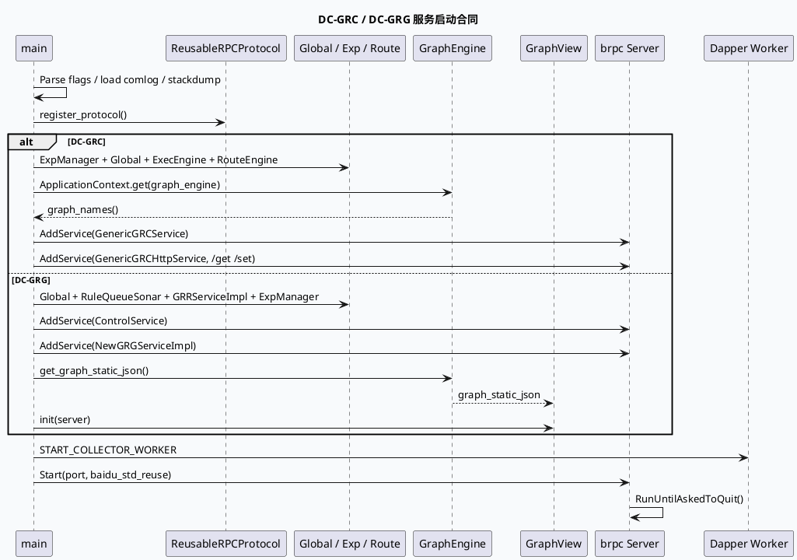

# 2026-10-02 基础库代码理解：DC-GRC / DC-GRG brpc 启动与 Graph 可视化合同

> 日期：2026-10-02（周五）
> 主题选择：canonical 笔记仓库未发现当日 daily-plan；本次按周五代码理解流程回退到同一快照中未充分展开的服务入口边界：**DC-GRC 与 DC-GRG 如何注册 baidu_std_reuse、初始化全局组件、挂载 brpc service，并把 GraphEngine 暴露为运行时/可视化能力**。KU 业务背景未读取，线上收益与部署参数需人工补充；本文只依据可核验代码证据。
> 配对关系：业务库笔记分析 GRC `Dispatcher` 与 GRG `NewGeneratorClosure` 的请求执行分叉；本文只分析服务启动、协议注册、GraphInitializer 与 GraphView 的框架合同。
> 范围：`feeda-dc-grc/src/main.cc`、`feeda-dc-grc/src/initializer/graph_initializer.h`、`feeda-dc-grg/src/main.cc`、`feeda-dc-grg/src/initializer/graph_initializer.h`。

## 0. 架构全景图

<div style="font-family:system-ui,-apple-system,BlinkMacSystemFont,'Segoe UI',sans-serif;background:#f5f7fa;border:1px solid #d8e1ea;border-radius:8px;padding:16px;margin:16px 0;color:#243b53;line-height:1.45;"><div style="font-size:12px;font-weight:800;color:#52606d;text-transform:uppercase;letter-spacing:.05em;">DC-GRC / DC-GRG brpc bootstrap contract</div><div style="display:grid;grid-template-columns:1.05fr 24px 1.2fr 24px 1.2fr 24px 1.05fr;gap:8px;align-items:stretch;margin-top:12px;"><div style="background:#fff;border:1px solid #cbd5e1;border-left:4px solid #3d5a80;border-radius:6px;padding:11px;"><div style="font-size:15px;color:#102a43;font-weight:700;">进程启动</div><div style="margin-top:7px;font-size:12px;color:#52606d;">解析 gflags、注册 BFILE appender、加载 comlog 与 stack dump，建立可观测启动面。</div></div><div style="text-align:center;color:#64748b;font-size:20px;padding-top:34px;">→</div><div style="background:#fff;border:1px solid #cbd5e1;border-left:4px solid #2d6a4f;border-radius:6px;padding:11px;"><div style="font-size:15px;color:#102a43;font-weight:700;">组件初始化</div><div style="margin-top:7px;font-size:12px;color:#52606d;">注册 ReusableRPCProtocol，初始化 Global / Exp / Rank / Route / Exec 等服务级依赖。</div></div><div style="text-align:center;color:#64748b;font-size:20px;padding-top:34px;">→</div><div style="background:#fff;border:1px solid #cbd5e1;border-left:4px solid #9a5b28;border-radius:6px;padding:11px;"><div style="font-size:15px;color:#102a43;font-weight:700;">GraphInitializer</div><div style="margin-top:7px;font-size:12px;color:#52606d;">GRC 触发 graph_names；GRG 抽取 static JSON 并初始化 GraphView 到 server。</div></div><div style="text-align:center;color:#64748b;font-size:20px;padding-top:34px;">→</div><div style="background:#fff;border:1px solid #cbd5e1;border-left:4px solid #b8432f;border-radius:6px;padding:11px;"><div style="font-size:15px;color:#102a43;font-weight:700;">brpc 对外服务</div><div style="margin-top:7px;font-size:12px;color:#52606d;">添加业务 service / HTTP service，启动 Dapper collector，再 `Start` 与 `RunUntilAskedToQuit`。</div></div></div><div style="margin-top:12px;padding-top:10px;border-top:1px solid #d8e1ea;font-size:12px;color:#52606d;">框架差异：DC-GRC 更偏请求路由与图名预热；DC-GRG 额外挂载 GraphView，使 graph static JSON 成为 server 侧可查看的运行资产。</div></div>

## 1. 核心结论

1. **两个服务都把 `baidu_std_reuse` 协议注册放在 brpc 启动前。** GRC 在 `ReusableRPCProtocol::register_protocol()` 失败时直接 fatal 返回；GRG 也在 Global 初始化后注册同一协议（`feeda-dc-grc/src/main.cc:70-72`、`feeda-dc-grg/src/main.cc:55-58`）。这说明 reusable RPC 是服务入口合同，不是某个 processor 的局部优化。
2. **GRC 的启动链更强调路由与执行引擎预热。** 它依次初始化 ExpManager、GlobalInitializer、ExecEngineInitializer、RouteEngine、GraphInitializer，并 dump queue 状态（`feeda-dc-grc/src/main.cc:76-86`）。排查 GRC 启动失败时应按该顺序分层，而不是只看 brpc 端口。
3. **GRG 的启动链额外初始化 Rank 与 GraphView。** GRG 初始化 Global、RuleQueueSonar、GRRServiceImpl、SamplingDataCollector、ExpManager 后才注册 ControlService / NewGRGService，再调用 `GraphInitializer::init(server)`（`feeda-dc-grg/src/main.cc:51-75`、`:86-98`）。Graph 初始化依赖 server 参数，是其和 GRC 的关键差异。
4. **GRC GraphInitializer 是轻量预热合同。** 它从 Babylon `ApplicationContext` 获取 `GraphEngine`，校验非空后调用 `graph_names()`（`feeda-dc-grc/src/initializer/graph_initializer.h:33-39`）。这一步证明 graph_engine 已被装载，但不负责把可视化接口挂到 server。
5. **GRG GraphInitializer 同时承担 GraphView 暴露职责。** 它从 `GraphEngine` 取 `get_graph_static_json` 写入 `GraphView::graph_static_json()`，然后 `graph_view_instance.init(server)`（`feeda-dc-grg/src/initializer/graph_initializer.h:35-47`）。因此 GRG 的 graph 静态结构可视化属于启动合同的一部分。
6. **Dapper worker 在 server start 前启动，退出时显式 stop。** 两边都在 `server.Start` 前执行 `START_COLLECTOR_WORKER`；GRG 还在停止路径调用 GlobalInitializer::stop 与 `STOP_COLLECTOR_WORKER`（`feeda-dc-grc/src/main.cc:129-139`、`feeda-dc-grg/src/main.cc:97-109`）。采集组件不可被视为请求后置日志线程。

## 2. 启动时序



```infographic
infographic compare-hierarchy-left-right-circle-node-pill-badge
data
  title GRC 与 GRG 的 GraphInitializer 差异
  desc 两者都依赖 ApplicationContext 中的 graph_engine，但暴露能力不同
  items
    - label DC-GRC
      desc 读取 graph_engine 并调用 graph_names，验证图已可枚举
      value 1
      children
        - label graph_names
          desc 轻量预热与存在性校验
        - label route/exec
          desc 启动链包含 RouteEngine 和 ExecEngineInitializer
    - label DC-GRG
      desc 读取 static JSON 并把 GraphView 绑定到 brpc server
      value 1
      children
        - label GraphView
          desc graph_static_json + init(server)
        - label new_generator
          desc NewGRGServiceImpl 是主要业务入口
theme
  palette #3d5a80 #2d6a4f #b56b32
```

## 3. 服务入口拆解

| 模块 | 启动证据 | 合同含义 | 排查重点 |
|---|---|---|---|
| ReusableRPCProtocol | `register_protocol()` | `baidu_std_reuse` 必须先注册再 `Start` | 协议注册失败不是端口问题 |
| GRC Global / Exec / Route | `GlobalInitializer`、`ExecEngineInitializer`、`RouteEngine` | 请求路由和执行依赖在服务启动时装载 | 启动失败按初始化顺序定位 |
| GRC GraphInitializer | `graph_engine->graph_names()` | graph_engine 存在性和图名枚举 | 图配置缺失会早于请求暴露 |
| GRG Rank / RuleQueue | `RuleQueueSonar`、`GRRServiceImpl::init()` | 生成服务依赖 rank 与队列观测 | Rank 初始化失败直接阻断服务 |
| GRG GraphView | `get_graph_static_json` + `init(server)` | 静态 graph 结构挂入 server | 可视化接口依赖启动时 JSON 提取 |
| Dapper Worker | `START_COLLECTOR_WORKER` | 采集线程伴随服务生命周期 | 配置文件名 GRC/GRG 不同 |

```infographic
infographic sequence-ascending-steps
data
  title 启动失败排查顺序
  desc 从进程级依赖到图服务再到 brpc 监听，避免把早期初始化错误误判为端口问题
  items
    - label 1. 日志基础设施
      desc comlog、BFILE appender、stackdump 是否完成
      icon mdi/file-document-alert
    - label 2. 协议注册
      desc ReusableRPCProtocol 返回非零会直接退出
      icon mdi/lan-connect
    - label 3. 全局组件
      desc Global、Exp、Route、Rank、Exec 初始化按服务差异检查
      icon mdi/cog-sync
    - label 4. GraphInitializer
      desc GRC 看 graph_names，GRG 看 static JSON 和 GraphView init
      icon mdi/graph-outline
    - label 5. brpc 服务
      desc AddService 成功后再启动 collector 与 server.Start
      icon mdi/server-network
    - label 6. 停止路径
      desc RunUntilAskedToQuit 返回后清理 Cube、Localtime、collector
      icon mdi/stop-circle-outline
theme
  palette #3d5a80 #2d6a4f #b8432f
```

## 4. 关键边界与风险

- **GraphInitializer 文件是头文件实现。** 当前快照中没有对应 `.cc`，引用时应指向 `initializer/graph_initializer.h`，不要捏造实现文件。
- **GRC 与 GRG 的 Graph 初始化不是等价代码。** GRC 只枚举 graph names；GRG 还把 static JSON 注入 GraphView 并绑定 server。排查“图能跑但看不到图”时优先看 GRG 这条链。
- **协议与服务启动是强顺序。** `enabled_protocols = "baidu_std_reuse"` 只有在 register 成功后才可靠；跳过注册会让 server 配置看起来正确但协议不可用。
- **Dapper 采集配置名不同。** GRC 默认 `dapper_ns_plugin.conf`，GRG 默认同名但 sampler 文件是 `funnel_sampler.conf`，不可直接复制启动参数。
- **KU 背景缺失。** 本次没有读取业务 KU 文档，GraphView 的具体访问路径、线上发布方式和 owner 需要人工补充。

<div style="font-family:system-ui,-apple-system,BlinkMacSystemFont,'Segoe UI',sans-serif;background:#fffaf5;border:1px solid #ead7c0;border-left:5px solid #b56b32;border-radius:6px;padding:14px;margin:16px 0;color:#3d2b1f;"><div style="font-size:12px;font-weight:800;color:#8a4b20;text-transform:uppercase;letter-spacing:.05em;">Pitfalls / 调试卡片</div><div style="margin-top:9px;font-size:14px;line-height:1.65;"><strong>把 GraphInitializer 当成普通 .cc：</strong>当前实现都在头文件里，搜索 .cc 会误判缺失。<br><strong>只查 server.Start：</strong>协议注册、Global、Route、Rank、GraphInitializer 都早于端口监听。<br><strong>混淆 Graph 预热和 GraphView：</strong>GRC 的 graph_names 不等于 GRG 的 GraphView 初始化。<br><strong>忽略 collector 生命周期：</strong>Dapper worker 在 Start 前启动，在退出路径停止，采集异常会影响完整观测。<br><strong>背景限制：</strong>未读取 KU 正文，服务拓扑和发布策略需人工补充。</div></div>

```infographic
infographic list-column-done-list
data
  title 启动链 checklist
  items
    - label 确认 baidu_std_reuse 注册成功
      desc register_protocol 返回非零时先修协议依赖
      done true
    - label 按服务差异核对初始化链
      desc GRC 看 Exec/Route，GRG 看 RuleQueue/Rank
      done true
    - label 确认 graph_engine 来自 ApplicationContext
      desc null 表示全局组件或配置装载失败
      done true
    - label 区分 graph_names 与 GraphView
      desc 前者是枚举，后者是可视化服务绑定
      done false
    - label 检查 collector 与 stop 路径
      desc Dapper worker 的启动和停止都要有日志证据
      done false
theme
  palette #2d6a4f #3d5a80 #b8432f
```

## 5. 证据来源

- `feeda-dc-grc/src/main.cc:70-86`：GRC 协议注册、Exp/Global/Exec/Route/Graph 初始化顺序。
- `feeda-dc-grc/src/main.cc:108-130`：GRC brpc ServerOptions、service 注册、Dapper worker 和 server start。
- `feeda-dc-grc/src/initializer/graph_initializer.h:33-39`：GRC 从 ApplicationContext 获取 GraphEngine 并调用 `graph_names()`。
- `feeda-dc-grg/src/main.cc:51-75`：GRG Global、ReusableRPCProtocol、RuleQueueSonar、GRRServiceImpl、SamplingDataCollector、ExpManager 初始化。
- `feeda-dc-grg/src/main.cc:77-98`：GRG 注册 ControlService/NewGRGService、初始化 GraphInitializer、启动 collector/server。
- `feeda-dc-grg/src/initializer/graph_initializer.h:35-47`：GRG 提取 graph static JSON，并把 GraphView 初始化到 brpc server。

## 6. 验证说明

- 已用当前快照直接读取上述文件和行号；没有引用不可见的 KU 正文。
- 全文证据路径使用相对路径，不包含机器本地绝对路径。
- 本文包含 HTML 架构图、PlantUML、两个 infographic 和 Pitfalls infocard，满足至少两类可视化要求。
