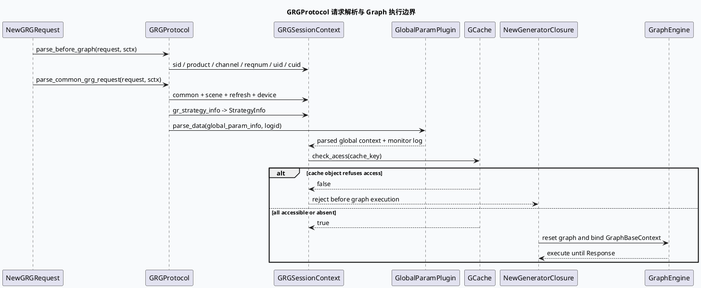

# 2026-10-03 基础库代码理解：GRGProtocol 请求解析与 GraphSession 上下文合同

> 日期：2026-10-03（周六）
> 主题选择：canonical 笔记仓库未发现 2026-10-03 daily-plan；本地唯一计划文件为过期快照，且其中的主要候选已被近期笔记覆盖。本次按同一 DC-GRG 快照回退到未充分展开的框架边界：**GRGProtocol 如何把 NewGRGRequest 拆成 Graph 前置字段、CommonContext、StrategyInfo 和全局参数，并通过缓存准入把共享状态安全地交给 Graph 执行**。
> KU 状态：未读取 KU 正文，业务背景、线上收益和部署参数需人工补充；本文只依据当前代码快照。
> 配对关系：业务库笔记分析 Graph 的 ResponseProcessor、FinishFinish 依赖和最终响应观测收口；本文只分析请求协议与 session context 的输入侧合同。
> 范围：`feeda-dc-grg/src/service/grg_protocol.h`、`feeda-dc-grg/src/service/grg_protocol.cc`、`feeda-dc-grg/src/service/new_generator_service.cc`、`feeda-dc-grg/src/common/session_context.h`。

## 0. 架构全景图

<div style="font-family:system-ui,-apple-system,BlinkMacSystemFont,'Segoe UI',sans-serif;background:#f5f7fa;border:1px solid #d8e1ea;border-radius:8px;padding:16px;margin:16px 0;color:#243b53;line-height:1.45;"><div style="font-size:12px;font-weight:800;color:#52606d;text-transform:uppercase;letter-spacing:.05em;">GRGProtocol request context contract</div><div style="display:grid;grid-template-columns:1.05fr 24px 1.2fr 24px 1.25fr 24px 1.1fr;gap:8px;align-items:stretch;margin-top:12px;"><div style="background:#fff;border:1px solid #cbd5e1;border-left:4px solid #3d5a80;border-radius:6px;padding:11px;"><div style="font-size:15px;color:#102a43;font-weight:700;">NewGRGRequest</div><div style="margin-top:7px;font-size:12px;color:#52606d;">common、scene、refresh、device、strategy 与 global_param 分层进入协议解析。</div></div><div style="text-align:center;color:#64748b;font-size:20px;padding-top:34px;">→</div><div style="background:#fff;border:1px solid #cbd5e1;border-left:4px solid #2d6a4f;border-radius:6px;padding:11px;"><div style="font-size:15px;color:#102a43;font-weight:700;">GRGProtocol</div><div style="margin-top:7px;font-size:12px;color:#52606d;">先抽取图前路由字段，再展开通用字段、实验参数和业务策略。</div></div><div style="text-align:center;color:#64748b;font-size:20px;padding-top:34px;">→</div><div style="background:#fff;border:1px solid #cbd5e1;border-left:4px solid #9a5b28;border-radius:6px;padding:11px;"><div style="font-size:15px;color:#102a43;font-weight:700;">Session Context</div><div style="margin-top:7px;font-size:12px;color:#52606d;">CommonContext、StrategyInfo、cache key 与 global plugin 结果成为 GraphBaseContext 的输入。</div></div><div style="text-align:center;color:#64748b;font-size:20px;padding-top:34px;">→</div><div style="background:#fff;border:1px solid #cbd5e1;border-left:4px solid #b8432f;border-radius:6px;padding:11px;"><div style="font-size:15px;color:#102a43;font-weight:700;">Graph 执行</div><div style="margin-top:7px;font-size:12px;color:#52606d;">closure 取图、reset、绑定 custom context 后运行到 Response。</div></div></div></div>

## 1. 核心结论

1. **协议解析分为图前置和完整请求两段。** `parse_before_graph` 只抽取 sid、experiment bool 参数、product、channel、reqnum、tab、command、uid、cuid、traceid 等路由和身份字段；`parse_common_grg_request` 再解析 common、scene、refresh、device、GR strategy 与 global parameters（`grg_protocol.cc:682-732`）。这让图选择或 session 初始化可以使用一组较小的前置字段。
2. **协议类是 protobuf 到内部 context 的适配层，不是简单字段复制。** `parse_new_common_info` 会复制 filter、pass-through、刷新、设备、用户状态、fake_id 等字段，并根据实验命中在关注 JSON、user activity 等字段之间选择不同解析分支（`grg_protocol.cc:734-825`）。新增字段需要同时确认 protobuf presence、实验门和内部字段默认值。
3. **策略上下文包含多种容器和二进制子协议。** `parse_strategy_info` 处理 qscore map、用户聚类距离 protobuf 字符串、MT score、cube result、history gap、groupkey 与近期行为；其中 cluster/vector 容器会预留容量再写入内部 map（`grg_protocol.cc:75-128`、`:133-195`）。解析失败或字段为空时，问题可能表现为策略缺字段而非 RPC 失败。
4. **缓存访问准入是共享对象的并发合同。** `check_acess` 逐类取 PreCalc、User、Recall、History cache，并调用 `try_access()`；任一对象拒绝访问即返回 false（`grg_protocol.cc:36-72`）。这一步保护的是缓存对象生命周期/可用性，不等价于“缓存一定命中”。
5. **全局参数通过插件解析后写入统一观测日志。** `parse_common_grg_request` 为每个 global_param_info 构造带 logid 的组件 Context，调用 `_global_param_plugin.parse_data`，最后输出 `[global_param_from_gr]`（`grg_protocol.cc:725-732`）。排查实验参数异常时应同时看参数解析日志与 session 字段。
6. **GRGProtocol 的输出最终由 closure 交给 Graph。** 请求解析产出的 common/strategy/session 数据由 NewGeneratorClosure 写入 GraphBaseContext，之后 GraphService 运行到 Response；因此协议解析阶段不负责生成最终 response protobuf。

## 2. 请求解析时序



## 3. 协议层结构信息图

```infographic
infographic sequence-ascending-steps
data
  title NewGRGRequest 解析分层
  desc 解析顺序决定哪些字段能参与图前置路由，哪些字段只在完整上下文中可用
  items
    - label 1. parse_before_graph
      desc sid、product、channel、reqnum、tab、command、uid、cuid 与 traceid
      icon mdi-ray-start-arrow
    - label 2. common context
      desc filter、pass-through、device、refresh、用户状态与场景字段
      icon mdi-account-details-outline
    - label 3. strategy context
      desc qscore、cluster distance、MT score、cube、history gap 与 groupkey
      icon mdi-tune-variant
    - label 4. global parameters
      desc 通过 GlobalParamPlugin 按 logid 解析并输出监控日志
      icon mdi-parameter
    - label 5. cache access
      desc PreCalc、User、Recall、History 对象逐类执行 try_access
      icon mdi-database-check-outline
    - label 6. graph handoff
      desc session context 进入 GraphBaseContext，由 closure 运行主图
      icon mdi-graph-outline
theme
  palette #3d5a80 #2d6a4f #b56b32
```

## 4. 字段合同与风险

| 输入层 | 内部落点 | 代码行为 | 排查重点 |
|---|---|---|---|
| `new_common_info` | `CommonContext` | presence-aware 复制，并叠加实验分支 | 缺字段与默认值是否符合调用方约定 |
| `scene_info` / `refresh_info` | `CommonContext` | 仅在 protobuf has 时解析 | 请求版本差异可能造成字段空值 |
| `gr_strategy_info` | `StrategyInfo` | 解析策略字段并可能影响实验/排序 | 不要把解析成功等同于策略命中 |
| `global_param_info` | plugin context + monitor | 携带 logid 调用插件 | 解析日志与业务字段需交叉核对 |
| cache key | `GCache` objects | `try_access()` 逐对象准入 | false 代表对象不可访问，不一定是 miss |
| session context | `GraphBaseContext` | closure 绑定后交给 Graph | reset/复用时检查旧字段是否清空 |

## 5. 关键边界与调试卡片

<div style="font-family:system-ui,-apple-system,BlinkMacSystemFont,'Segoe UI',sans-serif;background:#fffaf5;border:1px solid #ead7c0;border-left:5px solid #b56b32;border-radius:6px;padding:14px;margin:16px 0;color:#3d2b1f;"><div style="font-size:12px;font-weight:800;color:#8a4b20;text-transform:uppercase;letter-spacing:.05em;">Pitfalls / 协议解析边界</div><div style="margin-top:9px;font-size:14px;line-height:1.65;"><strong>前置字段误读：</strong>parse_before_graph 不是完整请求解析，策略和 global parameter 仍在后续阶段处理。<br><strong>presence 与默认值：</strong>SET_VALUE_IF_EXIST 不会替调用方补全语义，字段缺失要回到 protobuf 版本和上游构造处核对。<br><strong>二进制子协议：</strong>user cluster distance 通过 ParseFromString 进入内部结构，解析失败不能只看外层 RPC 状态。<br><strong>缓存准入：</strong>try_access 返回 false 是并发/生命周期保护信号，不应直接标记为缓存未命中。<br><strong>实验分支：</strong>follow_boost_hit、change_fuwtype 等门会改变同一输入字段的落点，回放请求时必须带齐实验上下文。<br><strong>范围限制：</strong>KU 正文未读取，业务字段含义、部署拓扑和线上收益需人工补充。</div></div>

```infographic
infographic list-column-done-list
data
  title GRGProtocol 排查 checklist
  items
    - label 核对 parse_before_graph 输入
      desc 先确认 command、channel、reqnum、uid/cuid 和 traceid 是否已落入 session
      done true
    - label 核对 common/scene/refresh/device presence
      desc 区分字段未传与字段值为默认值
      done true
    - label 核对策略子结构
      desc qscore、cluster distance、MT 与 history gap 分别检查容器大小
      done false
    - label 核对 global_param plugin 日志
      desc 以 logid 关联 global_param_from_gr 解析结果
      done false
    - label 核对 GCache try_access
      desc 分别记录 PreCalc、User、Recall、History 哪一类拒绝访问
      done false
    - label 核对 GraphBaseContext handoff
      desc 确认 closure reset 后绑定的是当前 session，而非旧请求引用
      done false
theme
  palette #2d6a4f #3d5a80 #b8432f
```

## 6. 证据来源

- `feeda-dc-grg/src/service/grg_protocol.h:32-70`：GRGProtocol 公共解析接口与私有字段解析分层。
- `feeda-dc-grg/src/service/grg_protocol.cc:36-72`：GCache 四类对象的 `try_access` 准入。
- `feeda-dc-grg/src/service/grg_protocol.cc:75-195`：strategy context、cluster distance、MT/cube/history/groupkey 解析。
- `feeda-dc-grg/src/service/grg_protocol.cc:682-732`：图前置字段、完整 common request 与 global parameter 解析顺序。
- `feeda-dc-grg/src/service/grg_protocol.cc:734-825`：CommonContext 字段复制与实验门分支。
- `feeda-dc-grg/src/service/new_generator_closure.cc:70-100`：session context 到 GraphBaseContext、图获取与运行交接。

## 7. 验证说明

- 今日 daily-plan 未找到；过期计划中的候选已与近期笔记重复或证据路径不再可靠，因此按同快照未覆盖边界回退。
- KU 正文未读取，文中已显式标注需人工补充。
- 全文证据路径使用相对路径，不包含机器本地绝对路径。
- 本文包含 HTML 架构图、PlantUML、两个 infographic 和 Pitfalls infocard。
