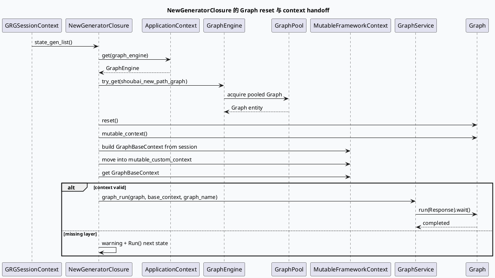

# 2026-10-04 基础库代码理解：GRG Graph reset 与 GraphBaseContext 运行时交接

> 日期：2026-10-04（周日）
> 主题选择：canonical 笔记仓库未发现 2026-10-04 daily-plan；本地唯一计划文件是过期快照，且近期笔记已覆盖 DC-GRG brpc 启动、请求协议解析和响应收口。本次按同一源码快照回退到未充分展开的基础框架边界：**NewGeneratorClosure 如何从 GraphPool 取得可复用 Graph，reset 后把 session 字段物化为 GraphBaseContext，并把所有权交给 Graph 的 MutableFrameworkContext**。
> KU 状态：未读取 KU 正文，业务背景、线上收益和部署参数需人工补充；本文只依据当前代码快照。
> 配对关系：业务库笔记分析 GraphView 的静态/动态图观测服务；本文只分析请求运行时的 Graph 复用和 context handoff。
> 范围：`feeda-dc-grg/src/service/new_generator_closure.cc`、`feeda-dc-grg/src/service/graph_service.cc`、`feeda-dc-grg/src/common/session_context.h`、`feed-general/framework/include/graph_engine.h`。

## 0. 架构全景图

<div style="font-family:system-ui,-apple-system,BlinkMacSystemFont,'Segoe UI',sans-serif;background:#f5f7fa;border:1px solid #d8e1ea;border-radius:8px;padding:16px;margin:16px 0;color:#243b53;line-height:1.45;"><div style="font-size:12px;font-weight:800;color:#52606d;text-transform:uppercase;letter-spacing:.05em;">GRG graph context handoff</div><div style="display:grid;grid-template-columns:1.05fr 24px 1.2fr 24px 1.35fr 24px 1.1fr;gap:8px;align-items:stretch;margin-top:12px;"><div style="background:#fff;border:1px solid #cbd5e1;border-left:4px solid #3d5a80;border-radius:6px;padding:11px;"><div style="font-size:15px;color:#102a43;font-weight:700;">Session</div><div style="margin-top:7px;font-size:12px;color:#52606d;">请求、响应、logid、uid/cuid、channel 与 command 已由入口绑定到 session。</div></div><div style="text-align:center;color:#64748b;font-size:20px;padding-top:34px;">→</div><div style="background:#fff;border:1px solid #cbd5e1;border-left:4px solid #2d6a4f;border-radius:6px;padding:11px;"><div style="font-size:15px;color:#102a43;font-weight:700;">GraphPool</div><div style="margin-top:7px;font-size:12px;color:#52606d;">try_get 固定图名，取得可复用 Graph；reset 清除上一请求残留状态。</div></div><div style="text-align:center;color:#64748b;font-size:20px;padding-top:34px;">→</div><div style="background:#fff;border:1px solid #cbd5e1;border-left:4px solid #9a5b28;border-radius:6px;padding:11px;"><div style="font-size:15px;color:#102a43;font-weight:700;">MutableFrameworkContext</div><div style="margin-top:7px;font-size:12px;color:#52606d;">把 GraphBaseContext 移入 mutable_custom_context，再取回确认类型和指针有效。</div></div><div style="text-align:center;color:#64748b;font-size:20px;padding-top:34px;">→</div><div style="background:#fff;border:1px solid #cbd5e1;border-left:4px solid #b8432f;border-radius:6px;padding:11px;"><div style="font-size:15px;color:#102a43;font-weight:700;">GraphService</div><div style="margin-top:7px;font-size:12px;color:#52606d;">以当前 GraphBaseContext 运行固定图到 Response，并记录关键路径。</div></div></div></div>

## 1. 核心结论

1. **GraphPool 复用的第一安全边界是 reset。** `state_gen_list` 通过 GraphEngine 的 `try_get("shoubai_new_path_graph")` 取得 Graph 后立即调用 `reset()`，再获取 `MutableFrameworkContext`（`new_generator_closure.cc:77-85`）。这说明池化 Graph 的 context 和 vertex 状态不能默认认为是空对象。
2. **GraphBaseContext 是 session 到图节点的窄接口。** 当前代码只把 session、logid、uid/cuid、origin/channel、command、tab、product、baiduid 写入 context（`new_generator_closure.cc:86-96`）。图内 processor 通过该对象继续取得 `graph_session_context`，而不是直接持有入口 closure。
3. **context 交接使用 move，再通过类型读取验证。** `mutable_custom_context = move(graph_base_context)` 后立即调用 `get<GraphBaseContext>()`；取不到时只记录 warning 并继续 closure 状态机（`new_generator_closure.cc:96-117`）。排查异常时要分别区分 move 后类型缺失、Graph 为空和 GraphEngine 为空。
4. **固定图名同时出现在取图和运行调用。** `try_get` 与 `GraphService::graph_run` 都使用 `shoubai_new_path_graph`（`new_generator_closure.cc:80-100`）。改配置图名时只改一处会造成“池中取到图但运行观测名不一致”或直接取空。
5. **GraphService 消费的是当前 context，而非重新构造请求。** closure 将 GraphBaseContext 传入 `graph_run`，由 GraphService 设置 graph log info、找到 Response 数据节点并等待执行（`graph_service.cc:23-46`）。这把 context 的字段完整性变成所有 processor 的共同前置合同。
6. **失败路径的诊断信息按层次区分。** `graph_engine is null`、固定图为空、`m_graph_context is null`、`emit_base_context is null` 分别对应组件、池化图、框架 context 和类型交接四层问题；不能统一归因于 Graph 执行失败。

## 2. Graph 运行时交接时序



## 3. Context 字段信息图

```infographic
infographic sequence-ascending-steps
data
  title GraphBaseContext 交接层次
  desc session 字段被压缩为图执行所需的稳定输入，所有字段都来自当前请求上下文
  items
    - label 1. request identity
      desc session pointer、logid、uid、cuid 与 baiduid
      icon mdi-account-key-outline
    - label 2. routing
      desc origin_channel_id、channel_id、command 与 tab
      icon mdi-source-branch
    - label 3. product context
      desc product 与图内通用请求属性
      icon mdi-package-variant-closed
    - label 4. graph reset
      desc 复用 Graph 先清理旧请求的 vertex/context 状态
      icon mdi-refresh-circle
    - label 5. type handoff
      desc move 到 mutable_custom_context 后用 get 验证有效性
      icon mdi-transfer
    - label 6. execution
      desc GraphService 使用同一个 context 运行到 Response
      icon mdi-play-network
 theme
  palette #3d5a80 #2d6a4f #b56b32
```

## 4. 复用边界

| 层次 | 当前代码行为 | 排查问题 |
|---|---|---|
| GraphEngine | `ApplicationContext` 获取组件 | 全局组件是否成功初始化 |
| GraphPool | `try_get` 固定图名 | 图名是否存在、池是否有可用对象 |
| Graph | `reset()` 后进入 mutable context | 上一请求数据是否被清理 |
| GraphBaseContext | 写入 session 和路由字段 | 新字段是否遗漏或仍指向旧 session |
| custom context | `move` 后 `get` | 类型注册、所有权和生命周期是否一致 |
| GraphService | 运行到 `Response` 并等待 | context 是否能被所有依赖节点取得 |

## 5. 关键边界与 Pitfalls 卡片

<div style="font-family:system-ui,-apple-system,BlinkMacSystemFont,'Segoe UI',sans-serif;background:#fffaf5;border:1px solid #ead7c0;border-left:5px solid #b56b32;border-radius:6px;padding:14px;margin:16px 0;color:#3d2b1f;"><div style="font-size:12px;font-weight:800;color:#8a4b20;text-transform:uppercase;letter-spacing:.05em;">Pitfalls / Graph context 卡片</div><div style="margin-top:9px;font-size:14px;line-height:1.65;"><strong>跳过 reset：</strong>池化 Graph 不是新建对象，旧 vertex 状态可能污染当前请求。<br><strong>只检查 Graph 不检查 context：</strong>Graph 非空不代表 MutableFrameworkContext 或 GraphBaseContext 有效。<br><strong>混淆 move 与复制：</strong>context 已转移所有权，后续应从 mutable_custom_context 取回，不要依赖原 unique pointer。<br><strong>只改 try_get 图名：</strong>GraphService 的 graph_name 参数也必须保持合同一致。<br><strong>忽略字段来源：</strong>uid、channel、command 等来自当前 session，跨请求缓存时必须确认没有悬挂引用。<br><strong>范围限制：</strong>KU 正文未读取，图部署参数、线上收益和业务字段含义需人工补充。</div></div>

```infographic
infographic list-column-done-list
data
  title Graph handoff 调试 checklist
  items
    - label 确认 graph_engine 非空
      desc 先排查 ApplicationContext 全局组件初始化
      done true
    - label 确认固定图名存在
      desc try_get 与 graph_run 使用同一个图名
      done true
    - label 确认 reset 已执行
      desc 在填充当前 session 前清除池化 Graph 的旧状态
      done true
    - label 核对 GraphBaseContext 字段
      desc logid、uid/cuid、channel、command、tab 与 product 逐项核对
      done false
    - label 核对 mutable_custom_context 类型
      desc move 后 get GraphBaseContext 必须成功
      done false
    - label 核对 GraphService 运行目标
      desc Response 节点、critical path 和 graph monitor 是否正常完成
      done false
 theme
  palette #2d6a4f #3d5a80 #b8432f
```

## 6. 证据来源

- `feeda-dc-grg/src/service/new_generator_closure.cc:70-118`：获取 GraphEngine、try_get、reset、填充 GraphBaseContext 和 GraphService handoff。
- `feeda-dc-grg/src/service/graph_service.cc:23-46`：设置图日志、找到 Response 节点并等待运行完成。
- `feed-general/framework/include/graph_engine.h:110-120`：GraphEngine 的 create、graph_names 与静态图导出接口。
- `feeda-dc-grg/src/processor/generator_recall_processer.cpp:43-61`：图内 processor 从 GraphBaseContext 取得 session 的消费方式。
- `feeda-dc-grg/src/common/session_context.h:114-120`：session 依赖的全局参数和执行引擎组件声明。

## 7. 验证说明

- 今日 daily-plan 未找到；过期计划候选与近期笔记重复或边界已覆盖，因此按同快照未充分展开的 Graph context handoff 回退。
- KU 正文未读取，文中已显式标注需人工补充。
- 全文证据路径使用相对路径，不包含机器本地绝对路径。
- 本文包含 HTML 架构图、PlantUML、两个 infographic 和 Pitfalls infocard。
