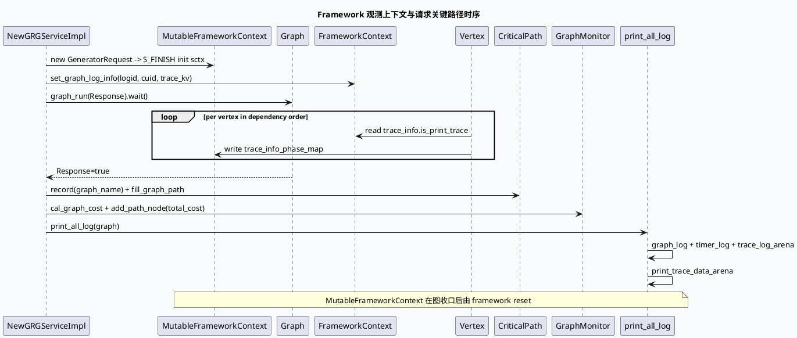

# 2026-10-05 基础库代码理解：TraceInfo/MutableFrameworkContext 与请求级关键路径观测合同

> 日期：2026-10-05（周一）
> 主题选择：canonical 笔记仓库无 2026-10-05 daily-plan；仓内唯一计划 daily-plan-20260529.json 描述的是旧 MV-GR 路径，与当前 code-read-dc-grg 快照（DC-GRG new_generator_service.cc + graph_service.cc + feed-general/framework）不一致。近期笔记已覆盖 GraphView（10-04）、GRG 入口 + GraphSession handoff（10-03）、DC-GRG brpc bootstrap（10-02）、Babylon ObjectPool（10-01）。本次按同一 DC-GRG 快照回退到基础框架侧尚未单独展开的两个相邻合同：feed-general/framework 的 TraceInfo / MutableFrameworkContext / print_trace_data_arena 生命周期，以及 GRG CriticalPath::record + GraphMonitor::add_path_node 形成的请求级关键路径写入边界。
> KU 状态：未读取 KU 正文，业务背景、线上收益、部署拓扑需人工补充；以下仅依据当前代码快照。
> 配对关系：业务库笔记分析同一请求下 critical_path.record / graph_monitor.add_path_node 的业务方调用链与日志出口；本文只分析框架侧的状态字段、写入接口与跨线程收口。
> 范围：feed-general/framework/include/base.h、feed-general/framework/src/log.cpp、feed-general/framework/include/graph_monitor.h、feed-general/framework/src/graph_monitor.cpp、feed-general/framework/include/trace_log/trace_plugin.h、feed-general/framework/src/trace_plugin.cpp、feed-general/framework/conf/trace_log.conf、feeda-dc-grg/src/critical_path/critical_path.h、feeda-dc-grg/src/critical_path/critical_path.cc、feeda-dc-grg/src/service/graph_service.cc、feeda-dc-grg/src/service/new_generator_service.cc、feeda-dc-grg/src/service/new_generator_closure.cc、feeda-dc-grg/src/processor/response_processor.cpp。

## 0. 架构全景图

<div style="font-family:system-ui,-apple-system,BlinkMacSystemFont,Segoe UI,sans-serif;background:#f4f8f6;border:1px solid #cfe4d6;border-radius:8px;padding:16px;margin:16px 0;color:#243b53;line-height:1.45;"><div style="font-size:12px;font-weight:800;color:#52606d;text-transform:uppercase;letter-spacing:.05em;">Framework 观测上下文与请求关键路径合同<div style="display:grid;grid-template-columns:1.05fr 24px 1.25fr 24px 1.15fr 24px 1.2fr;gap:8px;align-items:stretch;margin-top:12px;"><div style="background:#fff;border:1px solid #cbd5e1;border-left:4px solid #3d5a80;border-radius:6px;padding:11px;"><div style="font-size:15px;color:#102a43;font-weight:700;">FrameworkContext<div style="margin-top:7px;font-size:12px;color:#52606d;">TraceInfo{is_print_trace,is_print_debug,log_type_bloom,trace_kv,sid} 在图运行时只读复制给 vertex。<div style="text-align:center;color:#64748b;font-size:20px;padding-top:34px;">→<div style="background:#fff;border:1px solid #cbd5e1;border-left:4px solid #2d6a4f;border-radius:6px;padding:11px;"><div style="font-size:15px;color:#102a43;font-weight:700;">MutableFrameworkContext<div style="margin-top:7px;font-size:12px;color:#52606d;">mutable_custom_context + trace_info_phase_map 由 vertex 写入；print_trace_data_arena 逐节点汇总。<div style="text-align:center;color:#64748b;font-size:20px;padding-top:34px;">→<div style="background:#fff;border:1px solid #cbd5e1;border-left:4px solid #9a5b28;border-radius:6px;padding:11px;"><div style="font-size:15px;color:#102a43;font-weight:700;">CriticalPath / GraphMonitor<div style="margin-top:7px;font-size:12px;color:#52606d;">record(stage) 写时间线；fill_graph_path + add_path_node 写自定义节点与路径信息。<div style="text-align:center;color:#64748b;font-size:20px;padding-top:34px;">→<div style="background:#fff;border:1px solid #cbd5e1;border-left:4px solid #b8432f;border-radius:6px;padding:11px;"><div style="font-size:15px;color:#102a43;font-weight:700;">print_all_log<div style="margin-top:7px;font-size:12px;color:#52606d;">graph run 完成后按模块级别写 REQUEST/GRAPH 日志，并触发 trace log arena 输出。<div style="margin-top:10px;font-size:12px;line-height:1.55;color:#52606d;">核心合同：FrameworkContext 是只读快照，MutableFrameworkContext 是 vertex 写入区；二者通过 graph-context(T) / mutable_context(T) 区分访问语义，调用方不能跨权限读写。

## 1. 核心结论

1. TraceInfo 是图级的「是否要打印」开关载体，而不是 vertex 私有变量。feed-general/framework/include/base.h:90-152 把它定义为图执行期间的常量：默认 is_print_trace=false、is_print_debug=false，并提供 static is_print_trace_log() 在拷贝时根据 logid/mod/log_flow 重新判断；这意味着每个请求进来时该结构由 service 写入一次，随后对所有 vertex 只读。clear() 仅在请求收尾时由 MutableFrameworkContext::reset() 触发，因此 vertex 不能假设自己拿到的是「空 TraceInfo」。
2. MutableFrameworkContext 是 vertex 唯一允许写入的副作用区。feed-general/framework/include/base.h:233-260 持有 mutable_custom_context、trace_info_phase_map、pair_total_size，并要求 reset() 遍历 phase map 后清空，避免 arena 中的 trace accessor 跨请求泄漏。print_trace_data_arena()（feed-general/framework/src/log.cpp:122-183）直接读 framework_context-trace_info.is_print_trace + m_framework_context-trace_info_phase_map 做格式化输出，所以 vertex 只要往 trace_info_phase_map 写数据就一定能被聚合，不需要再走任何额外开关。
3. print_trace_log / print_trace_data 的写入顺序由框架统一调度。log.cpp:186-256 中 print_trace_log_arena() 先判断 is_print_trace / is_print_debug / log_type_bloom，再调用 construct_trace_log_arena()；print_all_log() 在 graph_run 末尾被调用，串行执行 graph_log、timer_log、trace_log、trace_data 四类日志。业务侧误以为日志是 vertex 单独打印的，会导致排查时漏看 print_all_log 失败。
4. GraphMonitor::add_path_node 的失败是 warning，不是 fatal。feed-general/framework/src/graph_monitor.cpp:135-152 当 _graph_paths 中找不到 _module_name 时只记录 warning，不修改图路径状态；fill_graph_path() 找不到 graph_name 时也返回 -1 而非抛错。这意味着 critical path 缺失节点不会让请求失败，但排查 latency 时不能依赖 graph monitor 完整。
5. CriticalPath::record 是不带锁的内存追加。feeda-dc-grg/src/critical_path/critical_path.h:38-50 持有 vector-of-pair-string-uint64；record() / set_base_us() 直接 emplace，依赖「同一请求只在主 bthread 上写」的隐式合同。如果未来在异步路径里调用 record，会出现写竞争。
6. set_graph_log_info 是图入口与 trace 系统的粘合点。feeda-dc-grg/src/service/graph_service.cc:30-43 在 graph_run 开头把 cuid、logid、entries、trace_info 写入 framework context；之后 graph-run(Response).wait()、关键路径 fill_graph_path、print_all_log 才有机会读取这些字段。去掉这一步会让后续 trace log 全部缺 cuid/logid。
7. ResponseProcessor 是完成信号节点，不负责填充业务字段。feeda-dc-grg/src/processor/response_processor.cpp:17-48 setup 时 named_emit("Response")，process 时只校验 framework context、GraphBaseContext、session、new request 后 emit-bool=true。真正的 response protobuf 由前置 processor 写入；观察 Response=true 不能等同于「业务字段已就绪」。
8. fill_dynamic_graph_request 受全局 gflag 控制，副作用跨请求。feeda-dc-grg/src/critical_path/critical_path.cc:27-36 在 FLAGS_open_fill_dynamic_graph 为 true 时调用 GraphView::fill_dynamic_graph_request，key_prefix 拼出 logid/channel_id/refresh_state。打开 gflag 后采样会持续到 10-04 笔记覆盖的「完成即关闭」状态为止；新请求到来前不能假定当前是否还在采样窗口。

## 2. 时序：图入口 → trace 写入 → 关键路径 → 日志收口



## 3. TraceInfo / MutableFrameworkContext 字段合同

```infographic
infographic compare-hierarchy-left-right-circle-node-pill-badge
data
  title TraceInfo vs MutableFrameworkContext
  desc 一次请求中两个上下文的角色与写入权限
  items
    - label FrameworkContext::trace_info
      desc is_print_trace / is_print_debug / log_type_bloom / trace_kv
      icon mdi/eye-outline
    - label FrameworkContext::trace_info.sid
      desc 由 service 写入，构造 trace accessor 时作为子字段回填
      icon mdi/account-circle-outline
    - label MutableFrameworkContext::mutable_custom_context
      desc Any 语义，vertex 写入 GraphBaseContext 等自定义对象
      icon mdi/package-variant-closed
    - label MutableFrameworkContext::trace_info_phase_map
      desc phase -> log_type -> accessor，trace 数据写入区
      icon mdi/graph-outline
    - label MutableFrameworkContext::pair_total_size
      desc trace accessor 累计字节数，决定是否触发限速
      icon mdi/counter
    - label MFC.reset()
      desc 清空 phase map 与 custom context，确保 arena 不跨请求
      icon mdi/refresh-circle
  theme
    palette #3d5a80 #2d6a4f #9a5b28 #b8432f
```

## 4. 关键路径写入 API

| API | 文件:行 | 写什么 | 线程假设 | 失败模式 |
|---|---|---|---|---|
| CriticalPath::set_base_us | critical_path.h:46 / critical_path.cc:32 | 在 _time_us_line 写入 (base_us, gettimeofday_us) | 入口主 bthread | 写入即成功 |
| CriticalPath::record | critical_path.h:45 / critical_path.cc:38 | push (stage, us) 时间点 | 同上 | 不校验 stage 是否重复 |
| CriticalPath::fill_graph_path | critical_path.h:25 / critical_path.cc:27 | 通过 gflag 决定是否采样到 GraphView | 同上 | gflag 关闭时静默 |
| GraphMonitor::reg_graph | graph_monitor.h:21 | 注册 graph_name 到 path map | 启动期 | 重名覆盖 |
| GraphMonitor::fill_graph_path | graph_monitor.h:23-28 / graph_monitor.cpp:114-122 | 生成 GraphPath 并写入 map | 主 bthread | 未注册返回 -1 + warning |
| GraphMonitor::add_path_node | graph_monitor.h:30-36 / graph_monitor.cpp:135-140 | 追加自定义节点 + cost_us | 主 bthread | 未注册时 warning |
| GraphMonitor::generate_path | graph_monitor.h:28 | 生成 final_path 字符串 | 主 bthread | map 缺失时返回空串 |
| TraceLogPlugin::wireup | trace_plugin.cpp:21-66 | 解析 trace_log.conf，按 @trace_sample 注册到 trace_conf_map | 启动期 | 配置错误 FATAL |

## 5. 字段与生命周期

| 字段 | 写入位置 | 读取位置 | 生命周期 | 备注 |
|---|---|---|---|---|
| TraceInfo.is_print_trace | service 入口 | print_trace_log_arena（log.cpp:192） | 一个请求 | 默认 false |
| TraceInfo.is_print_debug | service 入口 | print_trace_log_arena（log.cpp:196） | 一个请求 | 与 debug gate 同语义 |
| TraceInfo.log_type_bloom | service 入口 | construct_trace_log_arena（log.cpp:199） | 一个请求 | (1 log_type 位) |
| TraceInfo.trace_kv | service 入口 | print_trace_data_arena（log.cpp:128） | 一个请求 | 拼到 trace 日志头 |
| MutableFrameworkContext.trace_info_phase_map | 各 vertex | print_trace_data_arena（log.cpp:142） | 一个请求 | arena 持有 accessor |
| MutableFrameworkContext.mutable_custom_context | closure / service | 图内 vertex 通过 get-T() 取 | 一个请求 | 不可跨请求复用 |
| CriticalPath._time_us_line | record / set_base_us | state_finish 输出 | 一个请求 | vector 追加 |
| GraphMonitor._graph_paths[graph_name] | reg_graph + fill_graph_path | generate_path | 进程级 map | graph_name 维度 |
| GraphView._graph_dynamic_json | fill_dynamic_graph_request | graph_view_dynamic HTTP | 受 gflag 控制 | 详见 10-04 笔记 |
| trace_conf_map[log_type] | TraceLogPlugin::wireup | print_trace_data_arena 取 conf_item | 进程级 | 配置驱动 |

## 6. 关键边界与 Pitfalls 卡片

<div style="font-family:system-ui,-apple-system,BlinkMacSystemFont,Segoe UI,sans-serif;background:#fffaf5;border:1px solid #ead7c0;border-left:5px solid #b56b32;border-radius:6px;padding:14px;margin:16px 0;color:#3d2b1f;"><div style="font-size:12px;font-weight:800;color:#8a4b20;text-transform:uppercase;letter-spacing:.05em;">Pitfalls / 观测上下文合同<div style="margin-top:9px;font-size:14px;line-height:1.65;">

- **把 is_print_trace 当业务开关**：它是 trace 输出 gate，不影响图执行；改它不会改变推荐结果。
- **误用 FrameworkContext 写自定义字段**：FrameworkContext 走的是只读路径，往里写自定义数据不会进入 print_trace_data_arena。
- **add_path_node 静默失败**：_module_name 未注册时只 warning，节点不会出现在 final_path 中。
- **fill_graph_path 关闭 gflag**：open_fill_dynamic_graph 为 false 时关键路径采样直接跳过，排查「动态图缺失」时要先确认 gflag。
- **trace_info_phase_map 跨请求**：如未触发 MFC.reset()，上一请求 accessor 可能留在 arena 中，下一请求读时会看到旧的 phase key。
- **record 非主线程**：CriticalPath::record 当前不持锁，只能在 service 主 bthread 上调用；放入异步路径会破坏时间线。
- **范围限制**：KU 正文未读取；TraceLog 字典、biz-line 标签和线上收益需人工补充。


```infographic
infographic list-column-done-list
data
  title Trace + CriticalPath 调试 Checklist
  desc 框架观测上下文与请求关键路径的现场核对项
  items
    - label 检查 set_graph_log_info 是否先于 graph_run
      done true
      icon mdi/check-circle-outline
    - label 检查 TraceInfo.is_print_trace 来源
      done true
      icon mdi/filter-check-outline
    - label 检查 MutableFrameworkContext.reset 是否在 graph 收口后触发
      done true
      icon mdi/refresh-circle
    - label 检查 GraphMonitor 是否注册了当前 graph_name
      done true
      icon mdi/graph-outline
    - label 检查 record 与 add_path_node 调用顺序
      done true
      icon mdi/source-branch
    - label 检查 print_all_log 是否输出 REQUEST/GRAPH/trace
      done true
      icon mdi/text-search
    - label 检查 FLAGS_open_fill_dynamic_graph 与完成状态
      done true
      icon mdi/flag-outline
  theme
    palette #3d5a80 #2d6a4f #9a5b28 #b8432f
```

## 7. 证据来源

- feed-general/framework/include/base.h:90-152：TraceInfo 字段与 is_print_trace_log() 重判断。
- feed-general/framework/include/base.h:205-260：FrameworkContext 与 MutableFrameworkContext 的 reset 边界。
- feed-general/framework/src/log.cpp:122-183：print_trace_data_arena 聚合 phase map。
- feed-general/framework/src/log.cpp:186-256：print_trace_log_arena + print_all_log 调度。
- feed-general/framework/include/graph_monitor.h:21-36：reg_graph / fill_graph_path / add_path_node 接口。
- feed-general/framework/src/graph_monitor.cpp:114-152：graph_path 写入与未注册 warning。
- feed-general/framework/include/trace_log/trace_plugin.h:14-25：wireup 与 trace_conf_map 索引。
- feed-general/framework/src/trace_plugin.cpp:21-66：trace_log.conf 解析与 trace_conf 注册。
- feed-general/framework/conf/trace_log.conf:5-34：[@trace_sample] 配置示例（trace/vip/flow）。
- feeda-dc-grg/src/critical_path/critical_path.h:21-50：CriticalPath 公共 API 与成员。
- feeda-dc-grg/src/critical_path/critical_path.cc:27-41：fill_graph_path、record、set_base_us。
- feeda-dc-grg/src/service/graph_service.cc:23-46：set_graph_log_info + run(Response).wait + fill_graph_path + record + cal_graph_cost + generate_path + print_all_log。
- feeda-dc-grg/src/service/new_generator_service.cc:65-83：入口设置 sctx 与 _new_all_critical_path.set_base_us(received_time_us)。
- feeda-dc-grg/src/service/new_generator_closure.cc:71-118：state_gen_list 拼装 GraphBaseContext 并调用 GraphService::graph_run。
- feeda-dc-grg/src/processor/response_processor.cpp:17-48：ResponseProcessor 完成信号节点。

> 外部 KU 正文未读取，trace log 字典、biz-line 标签与部署拓扑需人工补充。fill_graph_path 的 gflag 控制逻辑只在 critical_path.cc:27-36 可见，跨服务（如 GRC）的同类开关不在当前快照。
