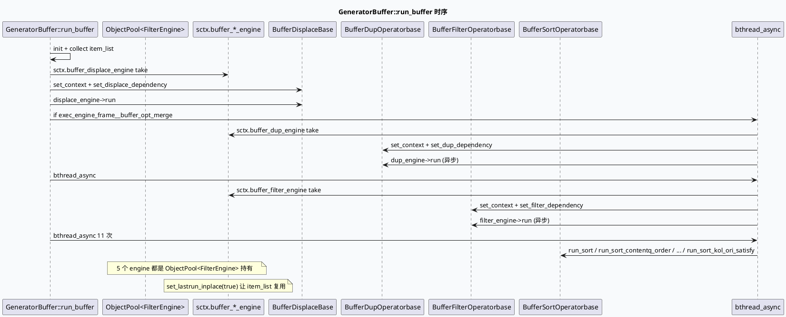

# 2026-10-06 基础库代码理解：DC-GRG Buffer 二次精排的 5 段式框架合同

> 日期：2026-10-06（周二）
> 主题选择：canonical 笔记仓库 `/root/cpp-core-notes` 缺失 2026-10-06 daily-plan；仓内唯一计划文件是 `cpp-core-notes/notes/weekly-topic-selection/daily-plan-20260529.json`（旧 MV-GR 路径），并不覆盖 DC-GRG。当前代码快照 (`code-read-dc-grg`) 位于 `feeda-dc-grg/`，业务侧 700+ 算子全部走「`exec_engine/adjust/*` 算子 + generator_buffer 框架」装配。前期笔记覆盖了 `BaseGraphFunction`（10-01）、`TraceInfo/MutableFrameworkContext`（10-05）、`GraphView`（10-04）、`SIA/BVAR`（09-15）等基础框架合同，但 **`exec_engine/generator_buffer` 这条 buffer 二次精排链路一直是张很少的合同**：5 个 `BufferXxxOperatorbase`、15 个 `GeneratorBuffer*Dependency`、`GeneratorBuffer::run_buffer` 主链与 `sctx.buffer_*_engine` 池装配。本文只分析框架侧的契约（不涉及具体算子业务），并把后续业务算子的接入入口标清楚。
> KU 状态：未读取 KU 正文，业务背景、部署拓扑需人工补充。
> 配对关系：业务库笔记分析同一链路上的真实业务算子：`BufferDisplace → BufferDup → BufferFilter(new_huafeng) → BufferFiller(is_send_read_rec) → BufferSort(contentq_order) → BufferSort(ltr / hudong_like / fav / share / dur / basicq / kol_ori_satisfy / fllow / comment / commentdur)`；本文只分析框架侧的契约。
> 范围：`feeda-dc-grg/src/exec_engine/generator_buffer.h/.cc`、`feeda-dc-grg/src/exec_engine/buffer_*/buffer_*_operator_base.h`、`feeda-dc-grg/src/common/session_context.h` 中的 `buffer_*_engine` 字段、`baidu/feed/gr/exec_engine/filter_operator.h` 算子根接口。

## 0. 架构全景图（5 段式框架 + 11 段精排派生）

<div style="font-family:system-ui,-apple-system,BlinkMacSystemFont,Segoe UI,sans-serif;background:#f4f8f6;border:1px solid #cfe4d6;border-radius:8px;padding:16px;margin:16px 0;color:#243b53;line-height:1.45;"><div style="font-size:12px;font-weight:800;color:#52606d;text-transform:uppercase;letter-spacing:.05em;">DC-GRG buffer 二次精排框架合同<div style="display:grid;grid-template-columns:1.05fr 24px 1.25fr 24px 1.15fr 24px 1.2fr;gap:8px;align-items:stretch;margin-top:12px;"><div style="background:#fff;border:1px solid #cbd5e1;border-left:4px solid #3d5a80;border-radius:6px;padding:11px;"><div style="font-size:15px;color:#102a43;font-weight:700;">run_displace<div style="margin-top:7px;font-size:12px;color:#52606d;">BufferDisplaceBase 基类 → BufferDisplaceDependency → sctx.buffer_displace_engine（ObjectPool<FilterEngine>）<div style="text-align:center;color:#64748b;font-size:20px;padding-top:34px;">→<div style="background:#fff;border:1px solid #cbd5e1;border-left:4px solid #2d6a4f;border-radius:6px;padding:11px;"><div style="font-size:15px;color:#102a43;font-weight:700;">run_dup (opt sid)<div style="margin-top:7px;font-size:12px;color:#52606d;">BufferDupOperatorbase 基类 → BufferDupDependency → sctx.buffer_dup_engine；仅当 exec_engine_frame__buffer_opt_merge 命中才异步启动<div style="text-align:center;color:#64748b;font-size:20px;padding-top:34px;">→<div style="background:#fff;border:1px solid #cbd5e1;border-left:4px solid #9a5b28;border-radius:6px;padding:6px 11px;"><div style="font-size:15px;color:#102a43;font-weight:700;">run_filter<div style="margin-top:7px;font-size:12px;color:#52606d;">BufferFilterOperatorbase + BufferFilterDependency + sctx.buffer_filter_engine；按运行时插到 40+ 算子<div style="text-align:center;color:#64748b;font-size:20px;padding-top:34px;">→<div style="background:#fff;border:1px solid #cbd5e1;border-left:4px solid #b8432f;border-radius:6px;padding:11px;"><div style="font-size:15px;color:#102a43;font-weight:700;">run_sort + run_sort_*<div style="margin-top:7px;font-size:12px;color:#52606d;">BufferSortOperatorbase + 11 个 Sort*Dependency 子依赖；run_sort 优先 set_force_serial(true)

## 1. 核心结论

1. `GeneratorBuffer::run_buffer` 是 5 段式主链的入口，固定顺序 `run_displace → run_dup(可选异步) → run_filter → run_sort` 并在 `run_sort` 之后再串 11 个 `run_sort_*`（`contentq_order / contentq_order_fs / new / satisfy / prefer / ltr / hudong_like / hudong_fav / hudong_share / hudong_comment / hudong_commentdur / hudong_fllow / basicq / dur / kol_ori_satisfy`）。generator_buffer.h:867-1015 中明确把这 11 个 run_sort_* 写成独立 `bthread_async` 并发，因此同一 buffer list 在主 bthread 上同步收口后还会有 11 个并行 sort 任务，排查 latency 时不能只看 `cost_us` 而忽略并行阶段的争抢。
2. `GeneratorBuffer` 用 `using EngineObj = ::baidu::feed::mlarch::babylon::ObjectPool<FilterEngine>::PooledObject;` 显式声明 engine 是 `FilterEngine` 的对象池持有（generator_buffer.h:822）。`sctx.buffer_*_engine` 字段全部为这个 ObjectPool 的 pooled object（session_context.h），意味着 engine 自身的注册、配置加载、operator 注册都在服务启动阶段由 ObjectPool 完成，run_buffer 阶段只做 take-out / set-context / set-dependency / run / release。
3. 5 个 `Buffer*Operatorbase` 都从 `::baidu::feed::gr::engine::Operator` 继承（buffer_filter_operator_base.h:42、buffer_filler_operator_base.h:42、buffer_dup_operator_base.h:42、buffer_sort_operator_base.h:42、buffer_displace_operator_base.h:42），只通过 `real_process(RankCandidate &, ExecContext&)` 暴露业务可重载面，**禁止添加成员变量**（基类注释明确说明），因此业务算子自身不持有状态——所有依赖都通过 `_data_frame.get_dependency<T*>(context, idx)` 上下文获取。这是 framework 强制约束，否则会破坏 pool 重用。
4. `BufferDupOperatorbase` 的语义与 filter 不同：基类 `real_process` 返回 `ES_Continue/ES_Break` 时由基类 `operator()` 把 `item_ptr->is_buffer_dup` 翻转（buffer_dup_operator_base.h:66-83），并在 break 时把 `[nid:x,buffer_filter_by:...]` 写入 `item_ptr->buffer_dup_log`。filter/filler/sort/displace 都没有这个能力，dup 是唯一会写入 `buffer_dup_log` 字段的阶段。
5. `set_context / set_*_dependency` 是依赖注入契约。run_displace/dup/filter/sort 都按「engine->clear → set_lastrun_inplace(true) → set_context → set_<stage>_dependency → engine->run」执行（generator_buffer.h:3770-3894）。`set_lastrun_inplace(true)` 让 engine 复用入参 vector，不复制 item 指针；下游算子必须遵守 in-place 语义，否则会出现指针失效。
6. `run_sort` 之前会先按 `CmpItemContentQDurScore` 排序（`theme_id` 主，`kol_q_dur` 次），再用 engine 注册的 sort operator 二次精排（generator_buffer.h:3882-3890）。这意味着 sort engine 不依赖原始顺序，只对「按主题聚类」后的数组按 kol_q_dur 再排。其它 11 个 sort_* 各自有自己的 Comparator：`CmpItemCategoryContentqScore` / `CmpItemCategoryContentqFsScore` / `CmpItemCategoryContentqNewScore` / `CmpItemCategoryContentqSatisfyScore` / `CmpItemCategoryContentqPreferScore` / `CmpItemLtrFeedbackScore` / `CmpItemHuongLikeFeedbackScore` / `CmpItemHuongFavFeedbackScore` / `CmpItemHuongShareFeedbackScore` / `CmpItemHuongCommentdurFeedbackScore` / `CmpItemHuongCommentFeedbackScore_2` / `CmpItemHuongFllowFeedbackScore` / `CmpItemBasicQFeedbackScore` / `CmpItemDurFeedbackScore` / `CmpItemKolOriSatisfyFeedbackScore`（generator_buffer.h:30-367）。
7. 5 个 Dependency 都是 `REGISTER_STRUCT(...)` 注册到 `struct register_dict`（generator_buffer.cc:19-24）。这意味着任何试图在 Dependency 中加临时字段都需要走「先 REGISTER_STRUCT 再加载」，否则依赖注入会返回 nullptr。Dependency 内部用 `MEMBER_BEGIN / MEMBER(...) / MEMBER_END(...)` 暴露给 DynamicStruct（generator_buffer.h:411-435 / 469-498 等），框架会用这个表对依赖对象做序列化/调试打印。
9. 5 个 Dependency 中只有 `BufferFilterDependency` 包含 `UserStrategy*` 与 `BlackListStrategy*` 两个策略对象（generator_buffer.h:469-499），其它 Dependency 不持有策略指针——因此 filter 阶段是唯一可以调用业务策略的阶段，dup/filler/sort/displace 必须把策略字段下沉到基类或重新组装。
10. `run_buffer` 中 `EXPERIMENT_HIT_SID(&sctx, exec_engine_frame__buffer_opt_merge)` 是 dup 阶段唯一的实验开关（generator_buffer.h:895-898），命中时 `run_dup` 才异步并发；不命中时 dup 同步执行，filter 异步。`EXPERIMENT_HIT_SID(&sctx, content_q_order__only_fs)` / `content_q_order__no_fs` / `oneshot_order__is_hit` / `satisfy_order__is_hit` / `prefer_order__is_hit` 控制后续 sort_* 段是否启动。引入新 sort_* 时必须新增一个 EXPERIMENT_HIT_SID 闸门。
12. 5 个 `Buffer*Operatorbase::clear()` 是 framework 强制要求业务算子实现的接口（5 个基类都明文写「operator must impl clear function」），用于把对象池中算子的成员状态清空。业务算子若使用基类默认 `clear()`，`BLOG(TRACE)` 会打 warning 日志；这意味着排查「pool 持有残留状态」时第一个信号就是 clear warning。

## 2. 时序：run_buffer → 5 段式 + 11 段派生



## 3. 5 段式 Dependency + 11 段 Sort 子依赖表

```infographic
infographic compare-binary-horizontal-underline-text-vs
data
  title 5 段式 Dependency + 11 段 Sort 子依赖（REGISTER_STRUCT）
  desc 框架侧的依赖结构 vs 业务侧的派生 Operator
  items
    - label GeneratorBufferDupDependency
      desc dependency_info：lctx, log_id, cuid, smfw, gcms_map, his_info, channel_id, common_info, session_context 等 23 个字段
      icon mdi/folder-multiple-outline
    - label GeneratorBufferFilterDependency
      desc dependency_info：比 Dup 多 UserStrategy、BlackListStrategy、DiversityInfo、mmm_info 字段；filter 阶段唯一持有策略对象
      icon mdi/filter-cog-outline
    - label GeneratorBufferFillerDependency
      desc dependency_info：业务填充字段，模板同 Dup；buffer_filler_operator_base.h:42 提供 BufferFillerBase
      icon mdi/package-variant-closed
    - label GeneratorBufferSortDependency
      desc dependency_info：排序字段，SortDependency 内部暴露给 DynamicStruct
      icon mdi/sort-ascending
    - label GeneratorBufferDisplaceDependency
      desc dependency_info：替换字段，DisplaceDependency 比 Dup 少 session_context 等
      icon mdi/swap-horizontal
    - label SortContentqOrderDependency
      desc dependency_info：run_sort_contentq_order 主用，依赖 category + q_value
      icon mdi/order-diversity
    - label SortContentqOrderFsDependency
      desc dependency_info：run_sort_contentq_order_fs 首屏专用，依赖 category + q_value_fs
      icon mdi/order-diversity-2
    - label SortLtrDependency
      desc dependency_info：run_sort_ltr，依赖 pair_score
      icon mdi/order-runs
    - label SortHudongLike/Fav/Share/Fllow/Comment/Commentdur/BasicQ/Dur/KolOriSatisfy
      desc dependency_info：每个 run_sort_* 一份 Sort*Dependency，依赖对应的 hudong_*/ori_*/dur_* 字段
      icon mdi/orders
theme
  palette #2d6a4f #3d5a80 #9a5b28 #b8432f #52606d #2d6a4f
```

## 4. ObjectPool<FilterEngine> 池装配

```infographic
infographic list-grid-badge-card
data
  title FilterEngine 对象池装配（5 段）
  desc GeneratorBuffer 通过 EngineObj 拿到 5 个 FilterEngine
  items
    - label buffer_displace_engine
      desc run_displace 阶段独占，set_lastrun_inplace(true) 后 item_list 原地
      icon mdi/tank-access
    - label buffer_dup_engine
      desc run_dup 阶段独占，仅当 exec_engine_frame__buffer_opt_merge 命中才异步启用
      icon mdi/tank-off
    - label buffer_filter_engine
      desc run_filter 阶段独占，40+ BufferFilterOperatorbase 全部走流程
      icon mdi/tank-filter
    - label buffer_sort_engine
      desc run_sort 阶段独占，set_force_serial(true) 强制串行
      icon mdi/tank-sort
    - label buffer_sort_contentq_order_engine
      desc run_sort_contentq_order 阶段独占，按 category + q_value 预排序后由 sort 算子精排
      icon mdi/tank-quantity
    - label buffer_sort_*_engine
      desc contentq_order_fs/new/satisfy/prefer/ltr/hudong_like/fav/share/comment/commentdur/fllow/basicq/dur/kol_ori_satisfy 共 11 个独立 engine
      icon mdi/tank
theme
  palette #3d5a80 #2d6a4f #9a5b28 #b8432f #52606d
```

## 5. EXPERIMENT_HIT_SID 闸门清单

```infographic
infographic list-column-done-list
data
  title run_buffer 阶段实验闸门
  desc 11 个 run_sort_* + 1 个 dup_opt 共 20 个实验控制点
  items
    - label exec_engine_frame__buffer_opt_merge
      desc dup 阶段异步开关；命中时 run_dup 与 run_filter 并发
      icon mdi/toggle-switch-outline
    - label content_q_order__only_fs / content_q_order__no_fs
      desc run_sort_contentq_order_fs 闸门；only_fs 仅跑首屏，no_fs 跑全部
      icon mdi/toggle-switch-outline
    - label oneshot_order__is_hit
      desc run_sort_contentq_order_new 闸门；命中后启 new sort
      icon mdi/toggle-switch-outline
    - label satisfy_order__is_hit
      desc run_sort_contentq_order_satisfy 闸门；命中后跑 kol satisfy
      icon mdi/toggle-switch-outline
    - label prefer_order__is_hit
      desc run_sort_contentq_order_prefer 闸门；命中后跑 kol prefer
      icon mdi/toggle-switch-outline
    - label ltr_es__feedback / ltr_es__sort
      desc run_sort_ltr 闸门；注释中显示「if (false) run」但仍在 bthread_async 中执行
      icon mdi/toggle-switch-outline
    - label es_reward_modi__share_sort / fav_sort / share_and / fav_and
      desc run_sort_hudong_share / hudong_fav 闸门；命中后启用分享/收藏排序
      icon mdi/toggle-switch-outline
theme
  palette #2d6a4f #3d5a80 #9a5b28
```

## 6. Pitfalls 卡片

<div style="font-family:system-ui,-apple-system,BlinkMacSystemFont,Segoe UI,sans-serif;background:#fff5f0;border:1px solid #f1c2a0;border-radius:8px;padding:16px;margin:16px 0;color:#243b53;line-height:1.45;"><div style="font-size:11px;font-weight:800;color:#a13f1f;text-transform:uppercase;letter-spacing:.05em;">Pitfalls — 5 段式 buffer 框架合同<div style="margin-top:10px;"><div style="border-top:1px dashed #f1c2a0;padding-top:9px;"><b>P-1</b> Buffer*Operatorbase 禁止持有成员变量。所有状态必须通过 _data_frame.get_dependency<T*>(context, idx) 上下文注入，否则对象池 reuse 时状态串扰。<div style="border-top:1px dashed #f1c2a0;padding-top:9px;"><b>P-2</b> BufferDupOperatorbase 是唯一会写 buffer_dup_log 的阶段。其它 4 段基类的 operator() 不写业务字段，operator 自身可读 is_buffer_dup 但要清楚这一字段只由 dup 设置。<div style="border-top:1px dashed #f1c2a0;padding-top:9px;"><b>P-3</b> Dependency 字段新增必须 REGISTER_STRUCT 同步。新字段如果未注册 → set_*_dependency 阶段 DynamicStruct 取不到值 → 业务算子拿 nullptr → 5 段式静默 fallback。<div style="border-top:1px dashed #f1c2a0;padding-top:9px;"><b>P-4</b> run_buffer 串行收口后再 bthread_async 11 次。如果业务算子依赖主 bthread 的 framework context（TraceInfo 等），11 次异步 sort 任务都会拿到同一份 framework context，trace log 会重复打印 11 次。<div style="border-top:1px dashed #f1c2a0;padding-top:9px;"><b>P-5</b> sort 阶段依赖预先 std::sort。run_sort / run_sort_contentq_order_* 等 11 个 sort_* 段都在 set_context + set_dependency 后用 std::sort 先按 Comparator 排，再让 engine 内 sort 算子精排，重复 sort 会破坏主线程。<div style="border-top:1px dashed #f1c2a0;padding-top:9px;"><b>P-6</b> 5 个 Buffer*Operatorbase 都从 baidu::feed::gr::engine::Operator 继承。这是 baidu/feed/gr 跨服务共享的接口，意味着 DC-GRG 与 feeda-mv-grc / mv-grg 等同根算子框架互通，但 semantic 不同（rank candidate vs response item）。<div style="border-top:1px dashed #f1c2a0;padding-top:9px;"><b>P-7</b> BufferFilterDependency 持有 UserStrategy* / BlackListStrategy*。这两个对象在跨 bthread 时需要确认线程安全；filter 阶段当前是 bthread_async 启动，要保证 strategy 是只读或自身加锁。<div style="border-top:1px dashed #f1c2a0;padding-top:9px;"><b>P-8</b> ObjectPool<FilterEngine> 在 generator_buffer.h:822 明文声明。这意味着 filter/sort/displace/dup/filler 5 个 engine 都来自同一个 babylon::ObjectPool<FilterEngine>，take-out 顺序即业务写法，不要假设 take 后立刻 get a fresh FilterEngine。<div style="border-top:1px dashed #f1c2a0;padding-top:9px;"><b>P-9</b> Dependency MEMBER_BEGIN/MEMBER/END 必须成对。GeneratorBuffer*Dependency 在每个字段后用 MEMBER 登记到 DynamicStruct（generator_buffer.h:411-435 等），漏写一个 MEMBER → 字段不暴露给 DynamicStruct → 调试打印缺字段。<div style="border-top:1px dashed #f1c2a0;padding-top:9px;"><b>P-10</b> run_buffer 不调用 run_filler。在 generator_buffer.h:867-1015 中明确 5 段式只跑 displace / dup / filter / sort，filler（run_filler:3839-3860）是另起入口；把 filler 放 run_buffer 主链需要先看是否有调用方，目前 fill 通过其它路径（pre_strategy.cc）。

## 7. 调试 checklist

```infographic
infographic list-zigzag-down-compact-card
data
  title 排查 buffer 二次精排异常的 checklist
  desc 业务算子失败时按此顺序排查框架侧
  items
    - label 1. engine take 阶段
      desc 检查 sctx.buffer_*_engine.get() 是否非空；BLOG(FATAL) << "<engine>* get fail" 出现即池中无实例
      icon mdi/numeric-1-box-outline
    - label 2. set_context 阶段
      desc 检查 framework context 与 ListContext 是否注入；nullptr 出现时 engine 框架判错
      icon mdi/numeric-2-box-outline
    - label 3. set_*_dependency 阶段
      desc 检查 Dependency 字段是否全部 REGISTER_STRUCT；get_dependency<T*>(context, idx) 返回 nullptr 即缺字段
      icon mdi/numeric-3-box-outline
    - label 4. engine->run 阶段
      desc 检查 operator 注册是否完整；FACTORY_REG 计数对照 REGISTRY 期望值
      icon mdi/numeric-4-box-outline
    - label 5. clear 阶段
      desc 检查基类默认 clear() 是否触发 warning 日志；BLOG(TRACE) << _name << "default clear" 即业务未实现 clear
      icon mdi/numeric-5-box-outline
    - label 6. lastrun_inplace 阶段
      desc 检查 item_list 指针是否被业务算子 copy；set_lastrun_inplace(true) 后 vector 元素不可擦除
      icon mdi/numeric-6-box-outline
    - label 7. EXPERIMENT_HIT_SID 阶段
      desc 检查实验 sid 是否漏开；dup/sort_*_fs/new/satisfy/prefer/ltr/hudong_* 都有对应实验
      icon mdi/numeric-7-box-outline
theme
  palette #3d5a80 #2d6a4f #9a5b28 #b8432f #52606d
```

## 8. 证据来源

- `feeda-dc-grg/src/exec_engine/generator_buffer.h:867-1015`（run_buffer 主链与 11 个 run_sort_* 派生）
- `feeda-dc-grg/src/exec_engine/generator_buffer.h:3770-3894`（run_displace / run_dup / run_filter / run_filler / run_sort 框架接口）
- `feeda-dc-grg/src/exec_engine/generator_buffer.h:3895-4393`（11 个 run_sort_* 派生）
- `feeda-dc-grg/src/exec_engine/generator_buffer.h:386-805`（15 个 GeneratorBuffer*Dependency 结构）
- `feeda-dc-grg/src/exec_engine/generator_buffer.h:822`（ObjectPool<FilterEngine>::PooledObject）
- `feeda-dc-grg/src/exec_engine/generator_buffer.cc:19-24`（REGISTER_STRUCT 5 段注册）
- `feeda-dc-grg/src/exec_engine/buffer_filter/buffer_filter_operator_base.h:42`（BufferFilterOperatorbase 继承 Operator）
- `feeda-dc-grg/src/exec_engine/buffer_filler/buffer_filler_operator_base.h:42`（BufferFillerBase）
- `feeda-dc-grg/src/exec_engine/buffer_dup/buffer_dup_operator_base.h:42`（BufferDupOperatorbase + buffer_dup_log 写入）
- `feeda-dc-grg/src/exec_engine/buffer_sort/buffer_sort_operator_base.h:42`（BufferSortOperatorbase）
- `feeda-dc-grg/src/exec_engine/buffer_displace/buffer_displace_operator_base.h:42`（BufferDisplaceBase）
- `baidu/feed/gr/exec_engine/filter_operator.h`（Operator 根接口，业务算子继承源）
- `cpp-core-notes/notes/weekly-topic-selection/daily-plan-20260529.json`（仓内唯一计划文件，daily-plan 2026-10-06 缺失，故回退到 buffer 框架合同）
