# 2026-10-08 基础库代码理解：feed-gr/parser 解析器框架合同（AnyParser / Parser / Schema 字段写入）

> 日期：2026-10-08（周四）
> 回退说明：本次运行在 `cpp-core-notes` 目录及工作区内**未找到任何 daily-plan 文件**（`find` 搜索 `*daily-plan*` / `*daily_plan*` 均无命中）。按既定回退规则，从历史笔记语料中选取一个**尚未覆盖且有强采纳信号**的主题：`feed-gr/parser` 解析器框架合同（74 处 `BABYLON_REGISTER_FACTORY_COMPONENT_WITH_TYPE_NAME` 注册，超过 load-bearing 阈值 50），并与业务侧配对。**KU / 业务上下文需人工补充**，本文只使用同快照源码与配置证据。

---

## 一、架构全景：解析器框架的三层合同

<div class="arch-wrapper" style="font-family:-apple-system,Segoe UI,Helvetica,Arial,sans-serif;max-width:1100px;margin:0 auto;padding:18px;background:#f8fafc;border-radius:10px;">
<div style="display:grid;grid-template-columns:1fr 1.6fr 1fr;gap:14px;align-items:stretch;">
<div style="background:#eef2f7;border-left:4px solid #3d5a80;padding:14px;border-radius:8px;">
<div style="font-size:11px;letter-spacing:.14em;color:#5b6b80;font-weight:700;">SOURCE LAYER</div>
<div style="font-size:15px;font-weight:700;margin:8px 0 10px;color:#1a1a1a;">输入载体</div>
<div style="font-size:13px;line-height:1.85;color:#3c4a5a;">
• <code>std::string</code>（JSON / PB / FB 文本）<br>
• <code>rapidjson::Value</code><br>
• <code>FbTable</code><br>
• <code>RedisReply</code><br>
• <code>Message</code>（protobuf）
</div>
</div>
<div style="background:#ffffff;border-left:4px solid #0f766e;padding:14px;border-radius:8px;box-shadow:0 1px 4px rgba(15,23,42,.08);">
<div style="font-size:11px;letter-spacing:.14em;color:#5b6b80;font-weight:700;">CONTRACT LAYER · feed-gr/parser</div>
<div style="font-size:15px;font-weight:700;margin:8px 0 10px;color:#1a1a1a;">AnyParser → Parser&lt;INPUT, OUTPUT&gt; → DsParser</div>
<div style="display:grid;grid-template-columns:1fr 1fr;gap:8px;font-size:12.5px;line-height:1.7;color:#3c4a5a;">
<div style="background:#f1f5f9;padding:9px;border-radius:6px;"><b>类型擦除层</b><br><code>AnyParser</code><br><code>parse(Any, Any)</code></div>
<div style="background:#f1f5f9;padding:9px;border-radius:6px;"><b>类型化层</b><br><code>Parser&lt;I,O&gt;</code><br><code>initialize()</code> + <code>parse()</code></div>
<div style="background:#f1f5f9;padding:9px;border-radius:6px;"><b>字段写入层</b><br><code>AssignDsParser</code><br><code>FieldAccessor</code></div>
<div style="background:#f1f5f9;padding:9px;border-radius:6px;"><b>生命周期</b><br><code>unique_ptr&lt;T&gt;</code><br>构造→失败即置空</div>
</div>
</div>
<div style="background:#eef2f7;border-left:4px solid #b45309;padding:14px;border-radius:8px;">
<div style="font-size:11px;letter-spacing:.14em;color:#5b6b80;font-weight:700;">TARGET LAYER</div>
<div style="font-size:15px;font-weight:700;margin:8px 0 10px;color:#1a1a1a;">输出载体</div>
<div style="font-size:13px;line-height:1.85;color:#3c4a5a;">
• <code>DynamicStruct</code><br>
• <code>Schema</code>（字段定义）<br>
• <code>FieldAccessor</code>（字段句柄）<br>
• <code>SchemaManager</code>（全局 schema 注册）<br>
• <code>ApplicationContext</code>（工厂取实例）
</div>
</div>
</div>
<div style="margin-top:14px;background:#0f766e;color:#fff;padding:11px 14px;border-radius:8px;font-size:13px;line-height:1.6;">
<b>核心不变量：</b>解析器只做「外部载体 → DynamicStruct 字段」的单向写入，不负责业务语义；所有字段定位在 <code>initialize()</code> 阶段一次解析完并缓存为 <code>FieldAccessor</code>，请求热路径上只做写入与类型检查。
</div>
</div>

## 二、框架层核心合同

### 2.1 三级继承链

```plantuml
@startuml
skinparam handwritten false
skinparam backgroundColor #f8fafc
left to right direction

abstract class AnyParser {
  +virtual int32_t parse(const Any& in, Any& out) noexcept = 0
}

class "Parser<INPUT, OUTPUT, A>" {
  +initialize(ConfigUnit, Schema*)
  +parse(const INPUT&, OUTPUT*)
  +construct<T>() : unique_ptr<T>
  -_schema_ptr : Schema*
}

abstract class "DsParser<INPUT>" {
  +parse(const INPUT&, DynamicStruct*)
}

class "AssignDsParser<INPUT>" {
  +initialize(ConfigUnit, Schema*)
  -_struct_field_ptr : unique_ptr<FieldAccessor>
}

class Int32DsParser
class DoubleDsParser
class Int64DsParser
class StringToDsParser

AnyParser <|-- Parser
Parser <|-- DsParser
DsParser <|-- AssignDsParser
AssignDsParser <|-- Int32DsParser
AssignDsParser <|-- DoubleDsParser
AssignDsParser <|-- Int64DsParser
AssignDsParser <|-- StringToDsParser

note right of Parser
  unique_ptr 重载：
  1. 默认可构造 → new T
  2. DynamicStruct → create(schema)
  3. 其他不可构造 → LOG(FATAL)+abort
  解析失败立即 output = nullptr
end note

class SchemaManager <<external>>
class FieldAccessor <<external>>
Parser ..> SchemaManager : 持有 schema
AssignDsParser ..> FieldAccessor : 缓存字段句柄
@enduml
```



### 2.2 `unique_ptr` 重载的生命周期语义

`Parser<INPUT, OUTPUT>::parse(input, std::unique_ptr<OUTPUT>& output)` 是**唯一管理输出对象所有权**的入口：

1. 先 `construct<OUTPUT>()` 分配输出；不可默认构造且非 `DynamicStruct` 时直接 `LOG(FATAL) + abort()`（`parser.h:64-74`）——这是一个硬失败点。
2. 调用虚函数 `parse(input, output.get())` 填字段。
3. 返回码非 0 时把 `output` 置空（`parser.h:84-86`），调用方拿到的是空指针而非半成品。

`AnyParser` 的类型擦除重载（`parser.h:90-100`）先做 `input.cget<INPUT>()` / `output.get<OUTPUT>()` 双重判空，再转发到类型化 `parse`。这条路径决定了：**擦除入口对类型不匹配静默返回 -1**，而类型化入口对构造失败直接 abort。

### 2.3 派生层次与注册族

`ASSIGN_PARSER_CLASS` 宏（`parser.h:124-137`）把「取值 → `*(output->get<T>(*_struct_field_ptr)) = input` → 返回 0」这段样板收敛为一行宏，派生出的 `Int32DsParser` / `DoubleDsParser` / `Int64DsParser` / `StringToDsParser` 全部是纯赋值语义，`initialize` 被 `final` 锁定为「配置字段名 → `schema->get_field()` → 缓存 `_struct_field_ptr`」。

按基类统计的注册分布（同快照实测）：

```infographic
infographic list-grid-badge-card
data
  title 解析器注册基类分布（74 处 BABYLON 注册）
  desc 按继承基类聚合的 parser 组件注册数，反映框架的扩展广度
  items
    - label JsonFieldParser
      value 18
      desc rapidjson::Value → DynamicStruct 字段级解析
      icon mdi/code-json
    - label PBFieldParser
      value 13
      desc protobuf Message → DynamicStruct 字段级解析
      icon mdi/table-network
    - label ReusableJsonFieldParser
      value 10
      desc 可复用 JSON 值对象，降低热路径解析开销
      icon mdi/speedometer
    - label StringDsParser
      value 8
      desc 整串入口（JSON/PB/FB 文本整体解析为 DynamicStruct）
      icon mdi/text-box
    - label FbFieldParser
      value 6
      desc FlatBuffers Table → DynamicStruct 字段级解析
      icon mdi/table-large
    - label PostHandler 类
      value 4
      desc Json/Pb PostHandler，解析后处理（PBFieldParser 与 ReusableJsonFieldParser 派生）
      icon mdi/filter-variant
    - label 其他专用族
      value 15
      desc Redis 系列、Cube、Meditation、UserProfile、BloomFilter 等专用解析器
      icon mdi/function-variant
theme
  palette #3D5A80 #0F766E #B45309 #64748B
```

## 三、配置驱动的装配合同

框架本身不认识业务，**装配完全由配置字符串驱动**。`JsonParser`（`json_parser.h:40-47`）的 `initialize(ConfigUnit, Schema*)` 读取 `struct_field` 定位 `FieldAccessor`，`JsonObject`（`json_parser.h:54-72`）在遍历 JSON 对象时逐字段调用子 parser：

```plantuml
@startuml
skinparam handwritten false
skinparam backgroundColor #f8fafc
participant Conf as 配置 (.conf)
participant "JsonParser" as JP
participant "JsonObject" as JO
participant "JsonInt32Parser" as FI
participant "DynamicStruct::Schema" as Schema
database DS as DynamicStruct

Conf -> JP : initialize(ConfigUnit, Schema*)
JP -> Schema : get_field(struct_field)
Schema --> JP : FieldAccessor
Conf -> JP : parser: json_int32_parser\nstruct_field: final_score_tmp
loop 每个 @field 配置项
  JP -> JO : _parse(Value, obj, output)
  JO -> FI : parse(json_field 子节点)
  FI -> DS : *(output->get<int32_t>(accessor)) = v
end
JO --> JP : 0
JP --> Conf : initialize 返回值
@enduml
```

配置侧的形状（相对配置根）：

```infographic
infographic sequence-timeline-simple
data
  title 单个 field 解析项的配置生命周期
  desc 一个 @field 条目从文本到 DynamicStruct 字段写入的四个阶段
  steps
    - label 1. 配置加载
      time T0
      desc comcfg 解析 @field 列表，得到 json_field / struct_field / parser 三元组
    - label 2. 实例化
      time T1
      desc ApplicationContext 按 parser 字符串名 get_or_create 工厂组件
    - label 3. 字段定位
      time T2
      desc initialize 中 schema->get_field(struct_field) 一次完成并缓存
    - label 4. 热路径写入
      time T3
      desc 请求期只做取值与赋值，字段句柄不再解析
theme
  palette #3D5A80 #0F766E #B45309 #64748B
```

## 四、PB 侧的扩展合同

`PBFieldParser` 与模板化的 `PBTParser<T>`（`gcms_pb_parser.h:115-152`）把 protobuf 反射式取值封装为 `get_field(DynamicStruct*)`：`_struct_field` 是一个 `FieldAccessor` **向量**，`get_field` 逐层 `get_dynamic_struct()` 下钻，最后一层用 `get<T>()` 取出叶字段指针。

`check_and_init_field`（`gcms_pb_parser.h:118-134`）做一次**类型 ID 强校验**：`TypeId<T>().ID` 与 schema 字段的 `type_id` 不一致时 `LOG(FATAL)` 并返回 -1。这与 `AssignDsParser` 的 `final initialize` 形成对照——PB 侧允许子类继续扩展 `initialize`，但字段类型契约不可绕过。

`PBFieldParser::parse` 的 null-parser 分支返回 **100** 而非 -1（`gcms_pb_parser.h:99-106`），注释明确说明这是为了让 feature 上报能区分「parser 未配置」与「parser 解析失败」两类情况。

## 五、Pitfalls

<div class="card-frame" style="font-family:-apple-system,Segoe UI,Helvetica,Arial,sans-serif;max-width:1100px;margin:0 auto;padding:16px;background:#f5f7fa;border-radius:10px;">
<div class="card" style="background:#fff;padding:18px 20px;border-radius:8px;border-left:4px solid #3d5a80;">
<div class="card-meta" style="font-size:11px;letter-spacing:.14em;color:#64748b;font-weight:700;">PITFALLS · 解析器框架</div>
<div class="card-title" style="font-size:24px;font-weight:800;color:#1a1a1a;margin:8px 0 4px;letter-spacing:-.02em;">六类真实踩坑点</div>
<div class="card-bar" style="height:4px;background:#3d5a80;width:72px;border-radius:2px;margin:10px 0 14px;"></div>
<div style="display:grid;grid-template-columns:1fr 1fr;gap:12px;font-size:13.5px;line-height:1.7;color:#334155;">
<div style="border-top:2px solid #3d5a80;padding-top:9px;"><b>1. abort 而非返回错误码</b><br>OUTPUT 既不可默认构造又不是 DynamicStruct 时，`construct()` 直接 abort。想避免必须让 OUTPUT 可默认构造，或改为传裸指针重载。</div>
<div style="border-top:2px solid #0f766e;padding-top:9px;"><b>2. 类型擦除入口静默 -1</b><br>`AnyParser::parse` 里 `cget/get` 失败只返回 -1，没有日志。擦除入口的失败率应与类型化入口分开监控。</div>
<div style="border-top:2px solid #b45309;padding-top:9px;"><b>3. 解析失败半成品被丢弃</b><br>返回码非 0 时框架把 `output` 置空，调用方若自行复用了旧指针，会读到已析构对象。</div>
<div style="border-top:2px solid #b45309;padding-top:9px;"><b>4. PB null-parser 返回 100</b><br>这不是错误码 1xx 家族，而是约定哨兵值。业务侧上报逻辑若按 `!= 0` 判失败，会把「未配置」误报成失败。</div>
<div style="border-top:2px solid #64748b;padding-top:9px;"><b>5. TypeId 不匹配是致命日志</b><br>`check_and_init_field` 类型不符会 `LOG(FATAL)`。schema 与 pb 字段类型漂移在启动期就会暴露，不要试图在运行期兜底。</div>
<div style="border-top:2px solid #64748b;padding-top:9px;"><b>6. 字段句柄只解析一次</b><br>改 schema 定义而不重启，缓存的 `FieldAccessor` 与新布局错位。热加载 schema 与 parser 生命周期必须同批管理。</div>
</div>
<div class="card-endmark" style="text-align:right;color:#94a3b8;margin-top:14px;">∎</div>
</div>
</div>

## 六、调试 checklist

```infographic
infographic list-column-done-list
data
  title 解析器框架排障 checklist
  desc 从配置到热路径的六步定位顺序
  items
    - label 确认 parser 字符串名已注册
      done false
      desc 统计该名字在 BABYLON_REGISTER_FACTORY_COMPONENT_WITH_TYPE_NAME 中是否出现
    - label 确认 factory 取实例成功
      done false
      desc get_or_create 返回 nullptr 时会 LOG(FATAL) 并 init 失败
    - label 确认 struct_field 在 schema 中存在
      done false
      desc initialize 阶段 schema->get_field 失败即整组配置失效
    - label 确认 json_field / pb_field 路径可达
      done false
      desc 路径写错时字段静默缺失，不会触发 FATAL
    - label 确认 TypeId 与 schema 字段类型一致
      done false
      desc PBTParser 的 check_and_init_field 是启动期硬校验
    - label 区分 100 与 -1 两类失败
      done false
      desc 100=parser 未配置，-1/非零=解析或取值失败
theme
  palette #3D5A80 #0F766E #B45309 #64748B
```

## 七、证据来源

- `parser/src/parser.h:27-38`（AnyParser 类型擦除基类）
- `parser/src/parser.h:40-104`（Parser\<INPUT, OUTPUT\> 与 unique_ptr 构造/失败语义）
- `parser/src/parser.h:106-122`（DsParser / AssignDsParser 与 FieldAccessor 缓存）
- `parser/src/parser.h:124-137`（ASSIGN_PARSER_CLASS 宏与四个赋值型派生）
- `parser/src/assign_ds_parser.cpp:16-35`（initialize 两级重载与 schema 字段定位）
- `parser/src/json_parser.h:27-150`（JsonFieldParser / JsonObject / JsonTParser / JsonArrayTParser 层次）
- `parser/src/fb_parser.h:26-70`（FbFieldParser / FbParser / FbTParser）
- `parser/src/pb_parser.h:17-30`（PbParser 与 PbCompressTypeEnum）
- `parser/src/gcms_pb_parser.h:95-152`（PBFieldParser::parse 的 100 哨兵、PBTParser 类型校验与 get_field 下钻）
