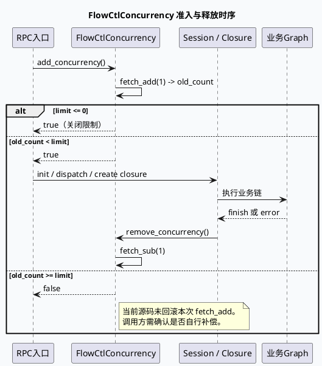

# 2026-10-09 基础库代码理解：FlowCtlConcurrency 请求准入与释放合同

> 日期：2026-10-09（周五）
> 主题选择：canonical 笔记仓库未发现本周 daily-plan；10-08 已覆盖 parser 框架与 GCMS/UMS/Redis 配置装配，因此回退到同一 DC-GRC/DC-GRG 快照中相邻但未重复的基础库边界：`FlowCtlConcurrency` 的原子计数、限流判定与释放责任。
> KU 状态：未读取 KU 正文；业务背景、线上阈值与部署参数需人工补充。本文只依据可核验源码证据。
> 配对关系：业务库笔记分析 GRG `PCSRespConv` 的外部响应落地；本文只分析请求进入业务链之前的并发准入合同。

## 一、架构全景

<div style="font-family:system-ui,-apple-system,BlinkMacSystemFont,'Segoe UI',sans-serif;max-width:1100px;margin:16px auto;padding:16px;background:#f5f7fa;border:1px solid #d8e1ea;border-radius:8px;color:#243b53;line-height:1.45;"><div style="font-size:12px;font-weight:800;color:#52606d;letter-spacing:.06em;">REQUEST ADMISSION / RELEASE CONTRACT</div><div style="display:grid;grid-template-columns:1fr 22px 1.25fr 22px 1.25fr 22px 1fr;gap:8px;align-items:stretch;margin-top:12px;"><div style="background:#fff;border-left:4px solid #3d5a80;border-radius:6px;padding:12px;"><div style="font-weight:750;color:#102a43;">RPC 入口</div><div style="font-size:12px;margin-top:7px;">GRC query 或 GRG gen 创建 session，并请求占用一个并发令牌。</div></div><div style="text-align:center;font-size:20px;padding-top:30px;color:#64748b;">→</div><div style="background:#fff;border-left:4px solid #0f766e;border-radius:6px;padding:12px;"><div style="font-weight:750;color:#102a43;">原子计数</div><div style="font-size:12px;margin-top:7px;">`fetch_add(1)` 返回旧值；旧值与启动时捕获的 limit 比较。</div></div><div style="text-align:center;font-size:20px;padding-top:30px;color:#64748b;">→</div><div style="background:#fff;border-left:4px solid #b45309;border-radius:6px;padding:12px;"><div style="font-weight:750;color:#102a43;">业务链</div><div style="font-size:12px;margin-top:7px;">通过后初始化 session、分发 command 或运行 Graph；失败也要闭合释放责任。</div></div><div style="text-align:center;font-size:20px;padding-top:30px;color:#64748b;">→</div><div style="background:#fff;border-left:4px solid #b8432f;border-radius:6px;padding:12px;"><div style="font-weight:750;color:#102a43;">释放</div><div style="font-size:12px;margin-top:7px;">closure 或错误分支调用 `remove_concurrency()`，原子计数减一。</div></div></div><div style="margin-top:13px;padding-top:10px;border-top:1px solid #d8e1ea;font-size:12px;color:#52606d;"><b>核心不变量：</b>一次成功准入必须恰好对应一次释放；拒绝分支当前实现会先增加计数再返回 false，因此调用方必须确认是否承担回滚责任。</div></div>

## 二、实现合同

### 2.1 限值在构造时捕获

GRC 的 `flowcontrol/flowctl_concurrency.h:10-37` 和 GRG 同名头文件都在构造函数中把 `FLAGS_grc_max_concurrency` 或 `FLAGS_grg_max_concurrency` 保存到 `_limit`，计数器为 `boost::atomic<int>`。这意味着运行中修改 gflag 不会自动更新已经创建的单例阈值，排查动态调参时应先确认进程是否重启。

### 2.2 判定是“旧值比较”，不是 CAS 令牌

`flowctl_concurrency.cpp:10-24` 的核心逻辑是：

1. `_concurrency.fetch_add(1, boost::memory_order_relaxed)` 先把计数加一，并取得加法前的 `concurrency_count`。
2. 当旧值小于 `_limit` 时返回 true。
3. 当 `_limit <= 0` 时也返回 true，表示零或负值关闭限制。
4. 其他情况返回 false，但源码中的回滚 `fetch_sub` 被注释掉。

因此当 limit 为 N 时，第 N+1 个并发请求可能已经把计数推进到 N+1 后才被拒绝。若调用方对 false 分支不做补偿，`get_concurrency()` 会持续高于实际业务请求数，后续请求会持续被拒绝。这是该实现最重要的运维风险。



### 2.3 单例不是线程安全初始化保证

`get_instance()` 通过裸指针判空后 `new FlowCtlConcurrency()`。源码没有 mutex、`std::call_once` 或函数局部静态对象。由于该单例通常在服务启动后由请求路径使用，实际是否只在单线程初始化需要结合入口调用时机确认；不能仅凭 `boost::atomic<int>` 推断单例初始化也线程安全。

## 三、两个服务的边界

```infographic
infographic compare-binary-horizontal-underline-text-vs
data
  title GRC 与 GRG 的并发控制差异
  desc 两边算法几乎同构，差异主要来自 flag 名称与释放持有者
  items
    - label DC-GRC
      desc grc_max_concurrency；命名空间 grc；释放通常由 session 或服务错误路径承担
      value 1
      icon mdi:transit-connection-variant
    - label DC-GRG
      desc grg_max_concurrency；命名空间 grg；NewGeneratorClosure 的 release 状态负责收口
      value 1
      icon mdi:graph-outline
theme
  palette #3D5A80 #0F766E #B45309
```

| 边界 | GRC | GRG | 排查重点 |
|---|---|---|---|
| flag | `grc_max_concurrency` | `grg_max_concurrency` | 不要把一侧阈值当成另一侧配置 |
| 计数实现 | `fetch_add` + relaxed | `fetch_add` + relaxed | 观察值是并发准入计数，不是完成请求数 |
| 拒绝行为 | 返回 false，源码未回滚 | 返回 false，源码未回滚 | 需要确认调用方是否补偿 |
| 释放 API | `remove_concurrency()` | `remove_concurrency()` | 每个成功 add 必须对应一次 remove |
| 关闭限流 | limit <= 0 返回 true | limit <= 0 返回 true | 零值不是“全部拒绝” |

## 四、调试路径

```infographic
infographic sequence-ascending-steps
data
  title 并发异常排查顺序
  desc 从配置、原子计数到业务释放逐层确认
  items
    - label 1. 核对启动参数
      desc 确认对应服务的 grc 或 grg flag，以及单例构造时的实际 limit
      icon mdi:flag-checkered
    - label 2. 观察计数曲线
      desc 对比 get_concurrency、请求进入量、拒绝量和完成量
      icon mdi:chart-line
    - label 3. 查拒绝分支
      desc 检查 add_concurrency 返回 false 后是否补偿 fetch_sub
      icon mdi:source-branch-check
    - label 4. 查异常出口
      desc session init 失败、参数错误、超时和 early return 是否释放
      icon mdi:alert-circle-outline
    - label 5. 查 closure 收口
      desc GRG 重点确认 finish/release 状态是否覆盖所有图执行结果
      icon mdi:state-machine
    - label 6. 做重启验证
      desc 若修改 flag，验证新进程是否重新捕获阈值
      icon mdi:restart

theme
  palette #3D5A80 #0F766E #B45309
```

## 五、Pitfalls 卡片

<div style="font-family:system-ui,-apple-system,BlinkMacSystemFont,'Segoe UI',sans-serif;max-width:1100px;margin:16px auto;padding:17px 19px;background:#fffaf5;border:1px solid #ead7c0;border-left:5px solid #b45309;border-radius:7px;color:#3d2b1f;line-height:1.65;"><div style="font-size:12px;font-weight:800;color:#8a4b20;letter-spacing:.06em;">PITFALLS / 并发准入</div><div style="font-size:20px;font-weight:800;margin:7px 0 12px;color:#1a1a1a;">五个需要现场确认的假设</div><div style="display:grid;grid-template-columns:1fr 1fr;gap:12px;font-size:13px;"><div><b>1. 拒绝不等于无副作用</b><br>返回 false 前计数已经加一，必须验证调用方是否回滚。</div><div><b>2. 原子计数不等于完整令牌</b><br>relaxed 原子只保证计数操作本身，不表达业务生命周期。</div><div><b>3. limit 是启动快照</b><br>单例构造后改变 gflag 不会改变 `_limit`。</div><div><b>4. 每个入口都要闭合</b><br>init 失败、异常和 early return 不能跳过 remove。</div><div><b>5. 单例初始化需单独验证</b><br>裸指针判空没有展示出并发初始化保护。</div><div><b>6. KU 背景缺失</b><br>线上阈值、报警口径与 owner 需人工补充。</div></div><div style="text-align:right;color:#94a3b8;margin-top:13px;">∎</div></div>

## 六、证据来源

- `feeda-dc-grc/src/flowcontrol/flowctl_concurrency.h:7-37`：GRC flag、单例、limit 与原子计数声明。
- `feeda-dc-grc/src/flowcontrol/flowctl_concurrency.cpp:4-29`：GRC `fetch_add`、限值判定与 `remove_concurrency`。
- `feeda-dc-grg/src/flowcontrol/flowctl_concurrency.h:8-38`：GRG flag、单例、limit 与原子计数声明。
- `feeda-dc-grg/src/flowcontrol/flowctl_concurrency.cpp:6-29`：GRG 同构实现及拒绝分支未回滚事实。

## 七、结论

`FlowCtlConcurrency` 是一个轻量的请求准入计数器，而不是完整的 RAII 令牌。它的正确性依赖上层把 `add_concurrency()`、session 生命周期和 `remove_concurrency()` 串成闭环；特别要关注拒绝分支的计数补偿与 early return 的释放责任。
