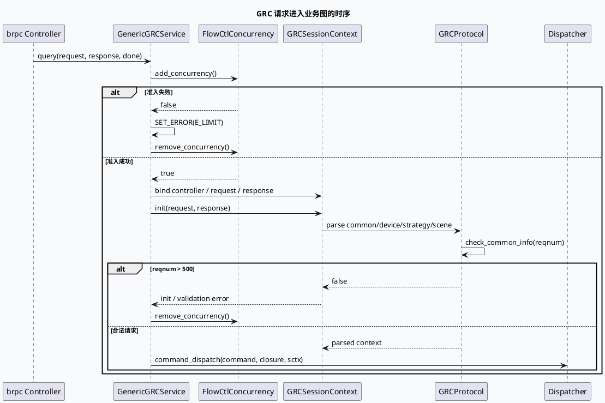

# 2026-10-10 基础库代码理解：GRCProtocol 请求解析与 RPC 入口合同

> 日期：2026-10-10（周六）
> 主题选择：当前日期未发现 daily-plan；旧计划仅覆盖到 2026-06，且近期笔记已覆盖 FlowCtlConcurrency、PCSRespConv、GCMS/UMS/Redis parser 等边界。本次回退到同一 DC-GRC 快照中未重复的基础库合同：`main.cc -> GenericGRCService::query -> GRCSessionContext::init -> GRCProtocol` 的请求解析、校验和错误出口。
> KU 状态：未读取 KU 正文；业务背景、线上协议 owner、阈值变更流程需人工补充。本文只依据可核验源码证据。
> 配对关系：业务库笔记分析 quota 配置与多目标 merge；本文只分析请求如何进入这条业务图，以及字段缺失/非法 reqnum 如何在入口被处理。

## 一、架构全景

<div style="font-family:system-ui,-apple-system,BlinkMacSystemFont,'Segoe UI',sans-serif;max-width:1100px;margin:16px auto;padding:16px;background:#f5f7fa;border:1px solid #d8e1ea;border-radius:8px;color:#243b53;line-height:1.45;"><div style="font-size:12px;font-weight:800;color:#52606d;letter-spacing:.06em;">GRC REQUEST CONTRACT / PARSE BEFORE GRAPH</div><div style="display:grid;grid-template-columns:1fr 22px 1.2fr 22px 1.35fr 22px 1fr;gap:8px;align-items:stretch;margin-top:12px;"><div style="background:#fff;border-left:4px solid #3d5a80;border-radius:6px;padding:12px;"><div style="font-weight:750;color:#102a43;">brpc 入口</div><div style="font-size:12px;margin-top:7px;">`GenericGRCService::query` 获取 logid、来源和 controller。</div></div><div style="text-align:center;font-size:20px;padding-top:30px;color:#64748b;">→</div><div style="background:#fff;border-left:4px solid #0f766e;border-radius:6px;padding:12px;"><div style="font-weight:750;color:#102a43;">Session 初始化</div><div style="font-size:12px;margin-top:7px;">并发准入后建立 `GRCSessionContext`，绑定 request、response、RPC context。</div></div><div style="text-align:center;font-size:20px;padding-top:30px;color:#64748b;">→</div><div style="background:#fff;border-left:4px solid #b45309;border-radius:6px;padding:12px;"><div style="font-weight:750;color:#102a43;">分层解析与校验</div><div style="font-size:12px;margin-top:7px;">common/device/strategy/scene/refresh 分层读取 has_* 字段；`reqnum` 做兼容和上限检查。</div></div><div style="text-align:center;font-size:20px;padding-top:30px;color:#64748b;">→</div><div style="background:#fff;border-left:4px solid #b8432f;border-radius:6px;padding:12px;"><div style="font-weight:750;color:#102a43;">Dispatcher / Graph</div><div style="font-size:12px;margin-top:7px;">初始化成功后按 command 分发，closure 负责后续响应和释放。</div></div></div><div style="margin-top:13px;padding-top:10px;border-top:1px solid #d8e1ea;font-size:12px;color:#52606d;"><b>核心不变量：</b>请求必须先完成准入和 session 绑定，再进入 dispatcher；解析函数只在 protobuf 字段存在时覆盖内部结构，缺省值由兼容逻辑或默认值承担。</div></div>

## 二、入口与生命周期

`main.cc:54-84` 先解析 gflag、加载日志和实验参数，再初始化 Global、ExecEngine、RouteEngine、Graph 等组件。`main.cc:108-133` 创建 `GenericGRCService`，启用 `baidu_std_reuse`，设置线程数并启动 brpc server；这说明 `GRCProtocol` 位于服务请求路径，而不是独立的批处理工具。

`grc_service.cc:30-48` 从 brpc controller 提取 logid、收包时间、source tag，并把当前并发写入监控。`grc_service.cc:82-100` 创建并绑定 `GRCSessionContext`，先调用 `add_concurrency()`，失败时进入统一错误宏；随后记录完整请求并进入 `sctx->init(request, response)`。

错误宏 `grc_service.cc:50-80` 同时设置 response error、标记 controller failed、写入请求摘要和并发指标，并调用 `remove_concurrency()`。因此入口排障时不能只看 response code，还要检查宏是否覆盖了所有 early return；成功路径则把 closure 交给 `Dispatcher::command_dispatch`。

## 三、字段解析合同

`grc_protocol.h:21-52` 把解析拆成 common、device、strategy、feature、scene、refresh 等函数，并保留 `parse_history_info` 的未实现占位。`grc_protocol.cc:44-78` 的宏都先检查 protobuf message 是否存在，再检查字段的 `has_*`，最后才写入内部 `CommonInfo` 等结构。这种模式避免把缺省 protobuf 值误判为客户端显式传值。

`grc_protocol.cc:84-127` 的 `parse_common_info` 读取 uid、cuid、channel、reqnum、command、产品、用户状态和请求来源等字段，随后补充 type/subtype、关注反馈和 UMS 信息。重复字段另行遍历，例如 `select_attention`、`personal_recommend_info` 和反馈列表；排查“字段存在但业务没生效”时要继续看这些集合构造，而不能只看宏映射。

`grc_protocol.cc:298-312` 的 `check_common_info` 有两个特殊语义：小视频 + 手百且 reqnum 为 0 时兼容性地改成 10；reqnum 大于 500 直接返回 false。这个上限发生在业务图之前，应该把它归因到请求合同，而不是 quota 分配失败。



## 四、入口校验信息图

```infographic
infographic sequence-ascending-steps
data
  title 请求合同的四道门
  desc 先建立运行时上下文，再把合法请求交给业务图
  items
    - label 1. RPC 元数据
      desc 读取 logid、时间、source tag 和 controller
      icon mdi:lan-connect
    - label 2. 并发准入
      desc add_concurrency 失败直接返回 E_LIMIT，并闭合计数
      icon mdi:speedometer
    - label 3. protobuf 分层解析
      desc common/device/strategy/feature/scene/refresh 只覆盖 has_* 字段
      icon mdi:format-list-checks
    - label 4. reqnum 校验与分发
      desc 小视频零值兼容为 10；超过 500 拒绝；其余进入 command_dispatch
      icon mdi:source-branch

theme
  palette #3D5A80 #0F766E #B45309
```

## 五、调试 checklist

```infographic
infographic list-column-done-list
data
  title GRC 请求异常排查 checklist
  desc 从入口日志逐层缩小到协议字段或业务 dispatcher
  items
    - label 确认 server 使用 baidu_std_reuse 且服务已完成 GraphInitializer
      done true
    - label 对齐 logid、source tag、remote side 与请求摘要
      done false
    - label 检查 add_concurrency 返回值和错误宏是否执行 remove
      done false
    - label 检查 request 是否带有对应 message 及 has_* 字段
      done false
    - label 单独验证 reqnum 为 0 的频道兼容规则和大于 500 拒绝规则
      done false
    - label 确认 init 成功后 command_dispatch 是否接管 closure
      done false
    - label 再进入 quota 或 processor 分析，不把入口拒绝误判为业务缺数
      done false

theme
  palette #3D5A80 #0F766E #B45309
```

## 六、Pitfalls 卡片

<div style="font-family:system-ui,-apple-system,BlinkMacSystemFont,'Segoe UI',sans-serif;max-width:1100px;margin:16px auto;padding:17px 19px;background:#fffaf5;border:1px solid #ead7c0;border-left:5px solid #b45309;border-radius:7px;color:#3d2b1f;line-height:1.65;"><div style="font-size:12px;font-weight:800;color:#8a4b20;letter-spacing:.06em;">PITFALLS / 请求入口</div><div style="font-size:20px;font-weight:800;margin:7px 0 12px;color:#1a1a1a;">六个不要混淆的边界</div><div style="display:grid;grid-template-columns:1fr 1fr;gap:12px;font-size:13px;"><div><b>1. 缺省字段不等于显式 0</b><br>解析宏先检查 message 和字段存在性。</div><div><b>2. reqnum 上限早于 quota</b><br>大于 500 的请求不会进入后续配额分配。</div><div><b>3. 零 reqnum 有频道例外</b><br>小视频手百请求会被兼容改写为 10。</div><div><b>4. 并发失败也有计数责任</b><br>统一错误宏会释放准入，新增错误出口需复核。</div><div><b>5. init 成功才进入 dispatcher</b><br>不要用 dispatcher 没有日志推断 Graph 没启动。</div><div><b>6. KU 背景缺失</b><br>协议 owner、阈值变更流程和线上报警需人工补充。</div></div><div style="text-align:right;color:#94a3b8;margin-top:13px;">∎</div></div>

## 七、证据来源

- `feeda-dc-grc/src/main.cc:54-84`：全局组件、实验、图和路由初始化。
- `feeda-dc-grc/src/main.cc:108-133`：brpc 服务、协议、线程和 server 启动。
- `feeda-dc-grc/src/service/grc_service.cc:30-100`：RPC 入口、session 建立、并发准入和统一错误出口。
- `feeda-dc-grc/src/common/grc_protocol.h:21-52`：分层解析 API。
- `feeda-dc-grc/src/common/grc_protocol.cc:44-127`：字段存在性解析与 common 信息装配。
- `feeda-dc-grc/src/common/grc_protocol.cc:298-312`：reqnum 兼容值和 500 上限。

## 八、结论

DC-GRC 的协议层不是简单的 protobuf 拷贝：它把 brpc 元数据、并发准入、session 生命周期、分层字段存在性和 reqnum 兼容规则串成一个前置合同。后续 quota 或 processor 看到的输入，已经是这一层筛选后的内部结构；因此排查业务缺数时必须先排除入口拒绝、字段未携带和 reqnum 校验三类原因。
