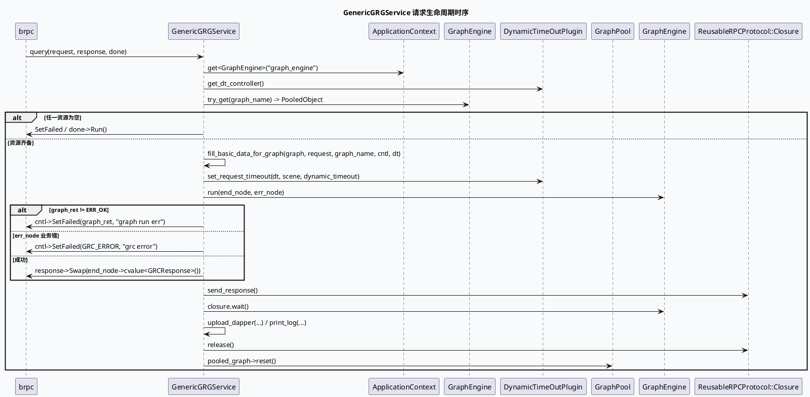

# 2026-10-11 基础库代码理解：GenericGRGService 请求到 Graph 执行的合同

> 日期：2026-10-11（周日）
> 主题选择：canonical `/root/cpp-core-notes` 仓库未发现 2026-10-11 的 daily-plan；旧计划仅覆盖到 2026-06；近期笔记（10-09/10-10）已覆盖 FlowCtlConcurrency 准入、PCSRespConv 业务落地、GRG ResponseProcessor 收口等边界。本次回退到同一 `feeda-mv-grg` 快照中尚未覆盖的基础库合同：`GenericGRGService::query` 把 brpc 请求装入 GraphPool、配置 DynamicTimeOutPlugin 并执行 `graph->run`，以及 `run` 函数中 end_node/err_node 与 `ReusableRPCProtocol::Closure` 的收口流程。
> KU 状态：未读取 KU 正文；scene→graph 映射、动态超时阈值、线上 dapper 推送规则需人工补充。本文只依据可核验源码证据。
> 配对关系：业务库笔记分析 `DiversityMgr` 在该 graph 之上如何被实例化、调用与裁决。本笔记只描述请求进入 Graph 引擎前后的资源/超时/响应生命周期，不展开多样性策略本身。

## 一、架构全景

<div style="font-family:system-ui,-apple-system,BlinkMacSystemFont,'Segoe UI',sans-serif;max-width:1100px;margin:16px auto;padding:16px;background:#f5f7fa;border:1px solid #d8e1ea;border-radius:8px;color:#243b53;line-height:1.45;"><div style="font-size:12px;font-weight:800;color:#52606d;letter-spacing:.06em;">GRG REQUEST LIFECYCLE / GRAPH POOL + DYNAMIC TIMEOUT</div><div style="display:grid;grid-template-columns:1fr 22px 1.3fr 22px 1.2fr 22px 1fr;gap:8px;align-items:stretch;margin-top:12px;"><div style="background:#fff;border-left:4px solid #3d5a80;border-radius:6px;padding:12px;"><div style="font-weight:750;color:#102a43;">brpc 入口</div><div style="font-size:12px;margin-top:7px;">`GenericGRGService::query` 抓取 logid、UA、controller；失败则直接退出。</div></div><div style="text-align:center;font-size:20px;padding-top:30px;color:#64748b;">→</div><div style="background:#fff;border-left:4px solid #0f766e;border-radius:6px;padding:12px;"><div style="font-weight:750;color:#102a43;">Graph 池借出</div><div style="font-size:12px;margin-top:7px;">按 `ua` 选 graph 名；`graph_engine->try_get(graph_name)` 借出 `GraphPool::PooledObject`。</div></div><div style="text-align:center;font-size:20px;padding-top:30px;color:#64748b;">→</div><div style="background:#fff;border-left:4px solid #b45309;border-radius:6px;padding:12px;"><div style="font-weight:750;color:#102a43;">基础数据 + 超时</div><div style="font-size:12px;margin-top:7px;">`fill_basic_data_for_graph` 写入 Request/UA/logid/uid/tab 等图变量，并按 graph scene 注册场景超时。</div></div><div style="text-align:center;font-size:20px;padding-top:30px;color:#64748b;">→</div><div style="background:#fff;border-left:4px solid #b8432f;border-radius:6px;padding:12px;"><div style="font-weight:750;color:#102a43;">图执行 + 收口</div><div style="font-size:12px;margin-top:7px;">`graph->run(end_node, err_node)` 后 swap `GRGResponse`；Closure 的 send_response/release 负责后续回复与归还。</div></div></div><div style="margin-top:13px;padding-top:10px;border-top:1px solid #d8e1ea;font-size:12px;color:#52606d;"><b>核心不变量：</b>每个请求必须拿到一个 PooledObject、一个 DTController 和一个 ReusableRPCProtocol::Closure；请求结束三件资源都要按正确顺序归还：先 swap 响应、再 send_response、再归还 pooled_graph。</div></div>

## 二、入口与生命周期

`grg_service.cpp:30-33` 在构造函数里把 `DynamicTimeOutPlugin` 缓存在 `_dynamic_timeout_plugin`。这是一种轻量 DI：plugin 由 `babylon::ApplicationContext::instance().get<DynamicTimeOutPlugin>()` 解析，因此该单例是否在启动时准备好，决定了请求路径能不能立即拿到 plugin。

`grg_service.cpp:35-94` 的 `query()` 是真正的入口：

1. `baidu::rpc::Controller` 抽出 logid 与 remote_side；`cntl->Failed()` 时直接退出（set_error 路径在 GRG 当前实现中被注释改写为 `cntl->SetFailed` + `done->Run()`，见下文 2.3）。
3. 通过 `ApplicationContext::instance().get<GraphEngine>("graph_engine")` 拿图引擎；`_dynamic_timeout_plugin == nullptr` 同样走 `set_error(... ERR_DYNAMIC_TIMEOUT ...)`，但函数签名里 `set_error` 内部调 `done->Run()`，所以 brpc 在被调后 closure 已被消费。
4. `CastUtil::string_to_numeric` 解析 `request->device_info().ua()`；UA 为 0 时打印 warning 加请求 PB JSON，是排查 “UA 空字符串导致 scene 退化为 default” 的关键观测点。
5. `get_graph_name(ua, request)` 决定 graph：85/87/123 → `short_micro_video`，102 → `news_updates_dibar`，其他 → `default`。该选择决定了 `vertex.conf` 加载哪些算子，因此“UA 漏配 → default 图”会同时改变依赖列表与 dapper 路径。
7. `graph_engine->try_get(graph_name)` 返回 `GraphPool::PooledObject`；空时同样 `set_error(GET_GRAPH_EMPTY, "get graph empty")`。
8. `_dynamic_timeout_plugin->get_dt_controller()` 拿 DTController；空时返回 `ERR_DYNAMIC_TIMEOUT`。PooledObject 与 DTController 任一失败都会让请求以 brpc failed 结束。
9. `fill_basic_data_for_graph` 装好图变量再 `run()`；最后 `pooled_graph->reset()` 归还。

这套顺序说明 `GenericGRGService` 把“资源获取 → 数据准备 → 图执行 → 资源归还”做成串行约定，并发安全依赖 PooledObject 与 DTController 的内部加锁/复用。

### 2.1 图变量绑定（fill_basic_data_for_graph）

`grg_service.cpp:121-202`：

- `Request / cuid / baiduid / tab / tabfrom` 通过 `emit<>::ref(...)` 把外部 `string` 引用进 GraphData，**不复制**——这要求外部 request 对象在 graph 整次执行期间存活，否则会读到已释放的 string buffer。
- `is_vip_cuid = is_hit_vip(cuid, uid)`：`is_hit_vip` 通过 `GET_COMMON_DICT` 命中 `d_target_cuid` 字典，`is_vip_cuid->emit<uint32_t>() = ...` 写入图变量；响应函数据此决定是否打印 RESPONSE 全量 PB（`is_hit_vip` 返回 true 时 `print_log` 会把 response PB JSON 写入 RESPONSE 日志）。
- `is_debug = FLAGS_is_debug_switch && request->common_info().is_debug()`：gflag 必须为真，且请求侧 is_debug=true；只满足一半仍写入 false。
- `ExpInfo` 通过 `feed_exp::ExpInfo::load(logid, request->pass_through().exp_params())` 装载；失败仅 warning，不中断。这条路径让 graph 中各算子用 `EXPERIMENT_HIT_PARAM` / `GET_COMMON_DICT` 时不再重新解析。
- `framework::set_graph_log_info(graph, logid, {product, ua})`：把 logid + log entries 写入 GraphLog，让后续 `GraphLog` 拼接时自带 product/ua 头。
- 动态超时：`scene` 来自 `graph_name`，但 `news_updates_dibar` 被改写为 `short_micro_video`——这是 GRC 固定默认场景，避免每个 graph 都需要单独的 dso 配置。`_dynamic_timeout_plugin->set_request_timeout(dt_cntl, scene, dynamic_timeout)` 把 dt 控制句柄与 scene 绑定到 graph context。

### 2.2 graph_name 选择与 dapper 边界

`grg_service.cpp:113-120` 的 `get_graph_name` 是一段直白的 if/else，但它是 dapper 上报链路的入口：`upload_dapper` 只对 `ua ∈ {85,87,123}` 真正上传（`grg_service.cpp:316-355`）；其他 UA 在 `print_log` 里走 `BLOG(TRACE)`，并不会跑到队列。这就解释了为什么同一份请求在不同 UA 下看到的 dapper 行为不同。

### 2.3 run() 与响应 swap

`grg_service.cpp:203-265`：

- `end_node = graph->find_data("GRGResponse")`、`err_node = graph->find_data("GrcErrorNum")` 在所有路径都被读取；`end_node->cvalue<feed::grc::GRCResponse>()` 在 success 分支被 `Swap` 进外层 response。其他分支通过 `cntl->SetFailed(err, "graph run err" | "grc error")` 直接写 brpc controller。
- `closure_done->send_response()` 必须放在 swap 或 SetFailed 之后调用，否则 brpc 会带着空 body 回包。
- `closure.wait()` 等到所有异步节点完成；该 wait 是阻塞当前 bthread 的同步动作。
- `upload_dapper` 与 `print_log` 都是请求结束的可观测面，依赖 `start_graph_run_time` / `end_graph_time`；超时场景下两者差距会显著放大。
- `closure_done->release()` 归还 reusable closure。



## 三、生命周期关键不变量

```infographic
infographic sequence-ascending-steps
data
  title 请求生命周期的四道门
  desc 资源、场景、GraphData 与 Closure 四个边界必须按顺序闭合
  items
    - label 1. 资源获取
      desc GraphEngine、DynamicTimeOutPlugin、PooledObject 必须都不为空，否则 SetFailed
      icon mdi:lock-alert
    - label 2. 场景选择
      desc ua 决定 graph_name；news_updates_dibar 改写为 short_micro_video scene
      icon mdi:map-marker-path
    - label 3. 数据准备
      desc Request/uid/baiduid/tab 用 ref() 共享；ExpInfo 装载通过即生效
      icon mdi:database-arrow-up
    - label 4. 图执行与收口
      desc graph->run 后 swap 响应；先 send_response、再 closure.wait()、再 reset PooledObject
      icon mdi:content-save-move

theme
  palette #3D5A80 #0F766E #B45309
```

## 四、与其它边界的差异

| 边界 | GRG 入口 (本次主题) | GRC 入口 (10-10) | 释放责任 |
|---|---|---|---|
| 获取资源 | GraphEngine + DynamicTimeOutPlugin + PooledObject | FlowCtlConcurrency + GRCSessionContext | 三件必齐，否则 SetFailed |
| 请求上下文 | `fill_basic_data_for_graph` 写 GraphData | `GRCProtocol::init` 解析并覆盖内部结构 | 图变量可外部引用 |
| 错误出口 | `cntl->SetFailed(...) + done->Run()` + warning | `SET_ERROR(E_*) + remove_concurrency()` | GRG 没显式承诺并发释放 |
| 响应封装 | `response->Swap(end_node->cvalue<...>())` | `ResponseProcessor` 生成 PassThoughResponse | GRG 走 brpc reuse closure |
| dapper 上报 | `upload_dapper` 仅 UA ∈ {85,87,123} | 由 common-processor 处理 | 复用同一套 trace/临界路径 |

## 五、调试 checklist

```infographic
infographic list-column-done-list
data
  title GRG 入口异常排查 checklist
  desc 先排除资源缺失与场景错配，再排查图变量与 dapper
  items
    - label 核对 cntl->Failed()、DynamicTimeOutPlugin 与 GraphEngine 三件资源
      done true
    - label 记录 ua → graph_name 的实际选择，确认 default 退化是否预期
      done false
    - label 验证 pooled_graph 与 dt_cntl 同时非空，避免短请求借用空对象
      done false
    - label 检查 fill_basic_data_for_graph 中 ref() 的字符串生命周期
      done false
    - label 关注 ExpInfo::load 失败是否被静默 warning 吞掉
      done false
    - label 注意 news_updates_dibar 被改写为 short_micro_video scene 的副作用
      done false
    - label dapper 只对 {85,87,123} 上传；其他 UA 检查 BLOG(TRACE) 输出
      done false
    - label send_response / release / pooled_graph.reset 顺序必须正确
      done false

theme
  palette #3D5A80 #0F766E #B45309
```

## 六、Pitfalls 卡片

<div style="font-family:system-ui,-apple-system,BlinkMacSystemFont,'Segoe UI',sans-serif;max-width:1100px;margin:16px auto;padding:17px 19px;background:#fffaf5;border:1px solid #ead7c0;border-left:5px solid #b45309;border-radius:7px;color:#3d2b1f;line-height:1.65;"><div style="font-size:12px;font-weight:800;color:#8a4b20;letter-spacing:.06em;">PITFALLS / GRG 入口</div><div style="font-size:20px;font-weight:800;margin:7px 0 12px;color:#1a1a1a;">七个容易误读的现象</div><div style="display:grid;grid-template-columns:1fr 1fr;gap:12px;font-size:13px;"><div><b>1. graph 名字不等于 scene</b><br>news_updates_dibar 在动态超时 scene 上被改写为 short_micro_video。</div><div><b>2. set_error 没真正释放并发</b><br>注释改写为 cntl->SetFailed+done->Run；并发释放需要其它会话约束。</div><div><b>3. UA=0 不会终止请求</b><br>仅打印 warning，请求会继续走 default graph。</div><div><b>4. ref() 共享外部字符串</b><br>Request 引用是零拷贝；request 生命周期覆盖 graph 整次执行才能保证安全。</div><div><b>5. ExpInfo load 静默失败</b><br>load 失败仅 warning；下游实验门可能完全没生效。</div><div><b>6. dapper 只对 UA∈{85,87,123} 上传</b><br>其他 UA 的 final_path 走 BLOG(TRACE)，不会真正上报。</div><div><b>7. release 与 reset 必须显式</b><br>closure_done->release 与 pooled_graph->reset 都是显式调用，缺一会导致池耗尽。</div><div><b>8. KU 背景缺失</b><br>scene→graph 映射、dapper 推送与动态超时阈值需人工补充。</div></div><div style="text-align:right;color:#94a3b8;margin-top:13px;">∎</div></div>

## 七、证据来源

- `feeda-mv-grg/src/service/grg_service.cpp:30-33`：构造函数缓存 DynamicTimeOutPlugin。
- `feeda-mv-grg/src/service/grg_service.cpp:35-94`：query 入口与资源获取顺序。
- `feeda-mv-grg/src/service/grg_service.cpp:113-120`：UA → graph_name 映射。
- `feeda-mv-grg/src/service/grg_service.cpp:121-202`：fill_basic_data_for_graph 写入 GraphData 与超时绑定。
- `feeda-mv-grg/src/service/grg_service.cpp:203-265`：run + 响应 swap + upload_dapper + release。
- `feeda-mv-grg/src/service/grg_service.cpp:266-306`：print_log 写 RESPONSE 全量 PB 与 trace 日志。
- `feeda-mv-grg/src/service/grg_service.cpp:308-359`：upload_dapper 只对 UA∈{85,87,123} 上报 final_path。

## 八、结论

`GenericGRGService` 把 brpc 请求、GraphEngine pool、DynamicTimeOutPlugin 与 ReusableRPCProtocol::Closure 串成一个四段不变量：资源齐备 → 场景与数据准备 → 图执行与响应 swap → 按序 send_response/release/reset。理解这条链路后，可以把后续 dapper 缺失、graph 退化、响应字段为空等问题准确归类到入口/数据/收口三类原因之一，避免误判到具体的 vertex 函数。