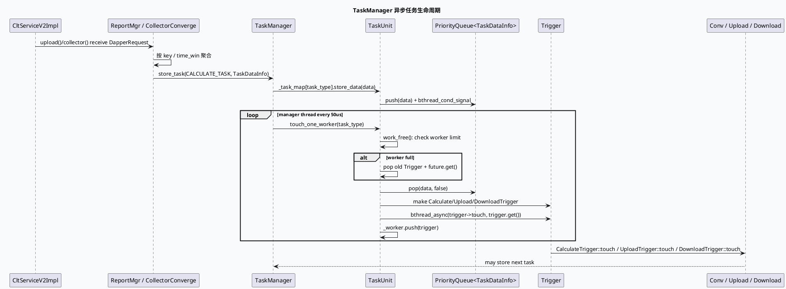
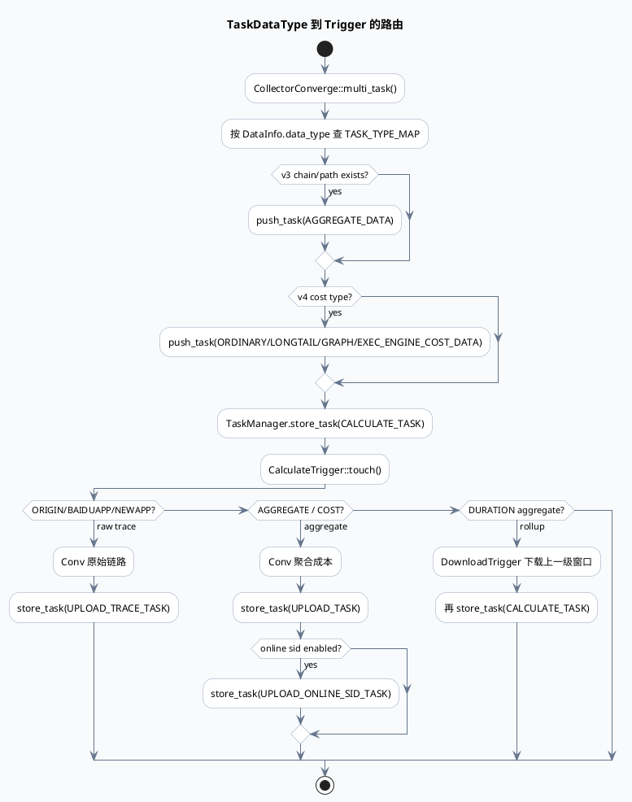

# Dapper Collector TaskManager 异步任务管线

> 日期：2026-06-02  
> 主题来源：未发现本机 daily-plan 文件；按最近两日双 Markdown 工作流延续，选择 `dapper-collector` 中可复用的基础库/框架主题：`TaskManager` + `TaskUnit` + `Trigger` 异步调度。  
> 范围：服务启动、两级 buffer、TaskManager 后台线程、PriorityQueue、bthread_async、Calculate/Upload/Download Trigger 的任务流转。  
> 内网文档：当前任务未提供 KU URL/doc-id；本文以代码库检索结果替代，若有内部运维手册需人工补充。

---

## 0. 架构全景图

<div class="arch-wrapper dapper-task-arch"><style scoped>.dapper-task-arch{font-family:-apple-system,BlinkMacSystemFont,'Segoe UI',Roboto,sans-serif;background:#f8fafc;border:1px solid #dbe4ee;border-radius:14px;padding:22px;margin:16px 0;color:#172033}.dapper-task-arch .arch-title{font-size:18px;font-weight:900;margin-bottom:14px}.dapper-task-arch .arch-layer{border-radius:10px;padding:14px;margin:10px 0}.dapper-task-arch .user{background:#dbeafe;border-left:5px solid #2563eb}.dapper-task-arch .application{background:#dcfce7;border-left:5px solid #16a34a}.dapper-task-arch .ai{background:#fef3c7;border-left:5px solid #d97706}.dapper-task-arch .data{background:#fce7f3;border-left:5px solid #db2777}.dapper-task-arch .infra{background:#ede9fe;border-left:5px solid #7c3aed}.dapper-task-arch .arch-layer-title{font-size:13px;font-weight:800;margin-bottom:8px}.dapper-task-arch .arch-grid{display:grid;grid-template-columns:repeat(4,minmax(0,1fr));gap:8px}.dapper-task-arch .arch-box{background:rgba(255,255,255,.86);border:1px solid rgba(15,23,42,.08);border-radius:8px;padding:9px;font-size:12px;line-height:1.35}.dapper-task-arch .arch-box.highlight{border:2px solid #d97706;background:#fff7ed;font-weight:800}.dapper-task-arch small{display:block;color:#64748b;margin-top:3px}</style><div class="arch-title">Dapper Collector：接入缓冲 → 汇聚窗口 → 异步任务 → 存储</div><div class="arch-layer user"><div class="arch-layer-title">① RPC 接入层</div><div class="arch-grid"><div class="arch-box">`CollectorServiceImpl::upload`<small>旧版压缩/base64 监控日志</small></div><div class="arch-box highlight">`CltServiceV2Impl::upload`<small>按 key 切片进入 CollectorAssemble</small></div><div class="arch-box">`CltServiceV2Impl::collector`<small>二级 collector 汇聚入口</small></div><div class="arch-box">`trigger_task`<small>手工触发 tick/hour/day</small></div></div></div><div class="arch-layer application"><div class="arch-layer-title">② 两级缓冲与汇聚</div><div class="arch-grid"><div class="arch-box">`ReportMgr(CollectorAssemble)`<small>buffer_pool1；拼同 logid</small></div><div class="arch-box">`CollctorAssemble::_next_deal_data`<small>跨轮保留未凑齐数据</small></div><div class="arch-box">`CollectorTimeConvChannel`<small>分组 RPC 到 collector2</small></div><div class="arch-box">`ReportMgr(CollectorConverge)`<small>buffer_pool2；按 10s 窗口聚合</small></div></div></div><div class="arch-layer ai"><div class="arch-layer-title">③ TaskManager 调度核心</div><div class="arch-grid"><div class="arch-box highlight">`TaskManager::_task_map`<small>TaskType → TaskUnit</small></div><div class="arch-box">`PriorityQueue<TaskDataInfo>`<small>bthread mutex/cond 保护待处理队列</small></div><div class="arch-box">`PriorityQueue<Trigger>`<small>保存异步 worker future</small></div><div class="arch-box">`touch_one_worker`<small>按类型创建 Trigger 并 bthread_async</small></div></div></div><div class="arch-layer data"><div class="arch-layer-title">④ 数据转换与落库</div><div class="arch-grid"><div class="arch-box">`CalculateTrigger`<small>Conv / CommonConv / GraphConv / ExecEngineConv</small></div><div class="arch-box">`UploadTrigger`<small>build_upload_context + Upload::upload</small></div><div class="arch-box">`DownloadTrigger`<small>按 duration 构造 SQL 下载</small></div><div class="arch-box">`TaskDataInfo`<small>dapper_request / upload_data / download_data / mid_data</small></div></div></div></div>

---

## 1. 关键结论

1. **TaskManager 是一个轻量调度器，不直接做业务计算**：它维护 `TaskType -> TaskUnit`，后台线程每 50us 扫描 `_task_map`，由 `TaskUnit::touch_one_worker()` 决定是否弹出任务并创建 Trigger。
2. **并发上限不是线程池参数，而是 worker future 队列长度**：`work_free()` 通过 `_worker.size()` 与 `worker_num_limit_l1/l2` 控制并发，达到上限时会 `pop` 一个已启动 Trigger 并 `future().get()` 等待完成。
3. **任务类型分为计算、上传、下载三类主干**：`CALCULATE_TASK` 走 `CalculateTrigger`；`UPLOAD_TASK/UPLOAD_TRACE_TASK/UPLOAD_ONLINE_SID_TASK` 走批量 `UploadTrigger`；`DOWNLOAD_TASK` 走 `DownloadTrigger` 后再回到 `CALCULATE_TASK`。
4. **Graph/ExecEngine 成本是 v4 数据类型分支**：`TASK_TYPE_MAP` 将 `GRAPH_LONGTAIL_COST`、`ADJUST_ENGINE_NODE_COST`、`MULTISTREAM_ENGINE_NODE_COST` 等映射到专门的 `TaskDataType`，再由 `GraphConv` / `ExecEngineConv` 汇聚。

---

## 2. 核心流程图



---

## 3. 配置/结构信息图

```infographic
infographic hierarchy-structure
data
  title TaskManager 关键结构
  desc 队列、worker 与 Trigger 的关系决定吞吐、积压和排障入口
  items
    - label TaskManager
      desc `_task_map` + 5 个后台线程；初始化时 run/run_upload/run_upload_trace/run_upload_online_sid/run_tick_seed
      children
        - label run
          desc 扫 CALCULATE_TASK / DOWNLOAD_TASK 等非上传任务
        - label run_upload
          desc 只扫 UPLOAD_TASK
        - label run_upload_trace
          desc 只扫 UPLOAD_TRACE_TASK
        - label run_upload_online_sid
          desc 只扫 UPLOAD_ONLINE_SID_TASK
    - label TaskUnit
      desc 每种 TaskType 一个队列和一组 worker future
      children
        - label _priority_queue
          desc 待处理 TaskDataInfo；push 后 signal
        - label _worker
          desc 已启动 Trigger；并发满时 future.get 回收
    - label Trigger
      desc Calculate/Upload/Download 三类执行体
      children
        - label CalculateTrigger
          desc 按 TaskDataType 调 Conv，产生 upload/download 后续任务
        - label UploadTrigger
          desc 按 database/table/sid_suffix 合并 post_data
        - label DownloadTrigger
          desc 构造 SQL 下载聚合数据后回到 CALCULATE_TASK
```

### 关键参数

| 参数 | 默认/配置 | 作用 | 证据 |
|---|---:|---|---|
| `worker_num_limit_l1` | `5` | `CALCULATE_TASK` 并发上限 | `src/manager/task_unit.cc:26-29`, `src/manager/task_unit.cc:92-99` |
| `worker_num_limit_l2` | `10` | 非计算任务并发上限 | `src/manager/task_unit.cc:26-29`, `src/manager/task_unit.cc:92-99` |
| `upload_batch_size_limit` | `120000` | 聚合上传批大小 | `src/manager/task_unit.cc:31-36`, `src/manager/task_unit.cc:69-89` |
| `upload_time_limit_ms` | `360000` | 聚合上传批等待上限 | `src/manager/task_unit.cc:31-36`, `src/manager/task_unit.cc:81-82` |
| `buffer_pool1_size` | `conf: 2` | CollectorAssemble 并发 buffer 数 | `conf/gflags.conf:7-11`, `src/service/collector_v2.cc:56-87` |
| `push_diff_time` | `conf: 35` | 二级 collector 时间窗延迟推送 | `conf/gflags.conf:11-13`, `src/processor/collector_converge.cpp:105-117` |

---

## 4. 任务类型路由图



---

## 5. Pitfalls 卡片

<div class="card-frame dapper-task-card"><style scoped>.dapper-task-card{font-family:-apple-system,BlinkMacSystemFont,'Segoe UI',Roboto,sans-serif;margin:18px 0}.dapper-task-card .card{background:#fff7ed;border:1px solid #fed7aa;border-radius:16px;padding:22px;color:#1f2937;box-shadow:0 8px 24px rgba(15,23,42,.06)}.dapper-task-card .card-meta{font-size:12px;font-weight:800;letter-spacing:.08em;text-transform:uppercase;color:#c2410c}.dapper-task-card .card-title{font-size:28px;font-weight:900;letter-spacing:-.02em;margin:6px 0 12px}.dapper-task-card .card-grid{display:grid;grid-template-columns:2fr 1fr;gap:14px}.dapper-task-card .card-panel{background:rgba(255,255,255,.72);border-top:4px solid #ea580c;border-radius:10px;padding:13px;font-size:14px;line-height:1.65}.dapper-task-card .card-highlight{border-left:5px solid #ea580c;padding-left:12px;font-weight:800}.dapper-task-card code{background:#ffedd5;border-radius:4px;padding:1px 4px}</style><div class="card"><div class="card-meta">PITFALLS · ASYNC QUEUE</div><div class="card-title">积压不一定在 RPC 入口，可能卡在 worker future 回收</div><div class="card-grid"><div class="card-panel"><div class="card-highlight">`work_free()` 在并发满时会同步等待一个旧 Trigger 的 `future().get()`。</div><p>如果 Upload 或 Download 后端慢，TaskUnit 不只是“少开 worker”，而是会在扫描线程里等待旧任务完成，表现为队列持续增长、触发延迟放大。</p></div><div class="card-panel"><b>优先检查</b><br>① `_priority_queue.size()`<br>② `_worker.size()`<br>③ UploadTrigger 耗时日志<br>④ Download SQL 慢查询<br>⑤ `push_diff_time` 是否过大/过小</div></div></div></div>

---

## 6. 调试 checklist

```infographic
infographic list-column-done-list
data
  title Dapper Collector 调试 checklist
  desc 适用于数据延迟、长尾路径缺失、上传积压、窗口错乱问题
  items
    - label 确认入口是否接收
      desc 看 `receive_count`、`valid_request_count`、`filter_request_count` 与 `accept_switch`
      done false
    - label 确认一级聚合是否输出
      desc `CollctorAssemble::_next_deal_data` 是否持续堆积；是否因 channel_id 或 RequestFilter 被过滤
      done false
    - label 确认二级时间窗
      desc `request_time / 10000 * 10` 是否落在当前 10 分钟内；异常时间会被丢弃
      done false
    - label 确认 TaskType 路由
      desc DataType 不在 `TASK_TYPE_MAP` 会打印 warning 且不进入 v4 汇聚
      done false
    - label 确认 worker 上限
      desc CALCULATE 看 `worker_num_limit_l1`，上传/下载看 `worker_num_limit_l2`
      done false
    - label 确认上传上下文
      desc database/table miss 会跳过写入；sid_suffix 按 `(sid/10)%2` 分表
      done false
    - label 确认滚动聚合
      desc `UploadTrigger::next_duration()` 当前被注释，定时滚动依赖 manual/tick 触发链路
      done false
```

---

## 7. 证据来源

- `main.cc:61-129`：注册 baidu_std_reuse、初始化 `GlobalInitializer`、添加 `CollectorServiceImpl` 与 `CltServiceV2Impl`。
- `src/service/collector_v2.cc:56-87`：初始化两级 `ReportMgr` buffer pool。
- `src/service/collector_v2.cc:110-229`：入口按 key 切片进入一级 `CollectorAssemble`。
- `src/processor/collector_assemble.cpp:52-206`：一级按 key 合并 req/chain/path/data_info。
- `src/processor/collector_assemble.cpp:330-500`：一级按 receiver/module/idc 分组 RPC 到二级 collector。
- `src/processor/collector_converge.cpp:30-117`：二级按 10s time_win 暂存，超过 `push_diff_time` 后推任务。
- `src/processor/collector_converge.cpp:128-184`：按 `TASK_TYPE_MAP` 拆分 v4 数据类型并 `store_task(CALCULATE_TASK)`。
- `include/common/common.h:217-224`：`TaskType` 枚举。
- `include/common/common.h:377-384`：`TaskDataInfo` 结构。
- `src/manager/task_manager.cc:37-52`：启动多个后台扫描线程。
- `src/manager/task_unit.cc:92-170`：并发限制、Trigger 创建与 `bthread_async`。
- `src/data/calculate_trigger.cc:40-247`：不同 `TaskDataType` 的 Conv 与后续任务路由。
- `src/data/upload_trigger.cc:21-84`：上传上下文构造与批量上传。
- `src/data/download_trigger.cc:21-46`：下载后回流到计算任务。
