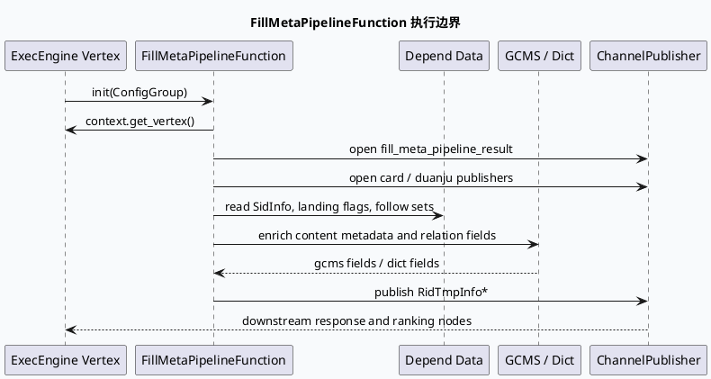

# 2026-07-24 周五代码理解：video_launch FillMetaPipeline 元数据补齐框架

> 本文基于本地 `feeda-mv-grc` 代码阅读生成；未读取到 daily-plan 文件，也未获得可直接读取的 KU 背景文档，线上实验、指标口径和策略负责人需人工补充。主题沿用当日业务侧 `video_launch` 响应契约链路，基础库侧聚焦 `FillMetaPipelineFunction` 如何把 GraphFunction 输入、Channel 输出和 GCMS 元数据补齐组织起来。

## 1. 架构全景图：GraphFunction 到元数据补齐通道
<style>.arch-vl{font-family:-apple-system,BlinkMacSystemFont,"Segoe UI",sans-serif;background:#f8fafc;border:1px solid #d9e2ec;border-radius:12px;padding:18px;margin:16px 0;color:#243b53}.arch-vl-title{font-size:22px;font-weight:850;margin-bottom:12px;color:#102a43}.arch-vl-grid{display:grid;grid-template-columns:1fr 1.1fr 1fr;gap:12px}.arch-vl-layer{background:#fff;border:1px solid #d9e2ec;border-radius:10px;padding:12px}.arch-vl-layer h3{margin:0 0 10px;font-size:15px;color:#334e68}.arch-vl-box{border-left:4px solid #2f80a7;background:#f7fbfd;padding:10px;margin:8px 0;border-radius:8px}.arch-vl-box strong{display:block;color:#102a43;margin-bottom:4px}.arch-vl-note{font-size:12px;line-height:1.55;color:#52606d}.arch-vl-flow{display:flex;gap:8px;align-items:center;justify-content:space-between;margin-top:14px}.arch-vl-step{flex:1;background:#eef8f6;border:1px solid #b7e4dc;border-radius:9px;padding:9px;text-align:center;font-weight:700;font-size:13px}.arch-vl-arrow{color:#486581;font-weight:900}@media(max-width:820px){.arch-vl-grid{grid-template-columns:1fr}.arch-vl-flow{flex-direction:column}.arch-vl-arrow{transform:rotate(90deg)}}</style><div class="arch-vl"><div class="arch-vl-title">video_launch FillMetaPipeline 基础框架</div><div class="arch-vl-grid"><div class="arch-vl-layer"><h3>图执行入口</h3><div class="arch-vl-box"><strong>PipelineGraphFunction</strong><span>作为 ExecEngine 图函数节点运行，`init` 阶段绑定 vertex 上下文。</span></div><div class="arch-vl-box"><strong>GRAPH_FUNCTION_DEPEND_DATA</strong><span>声明 SidInfo、搜索落地页开关、关注集合、请求上下文等依赖。</span></div></div><div class="arch-vl-layer"><h3>元数据补齐核心</h3><div class="arch-vl-box"><strong>FillMetaPipelineFunction</strong><span>按 item 类型拆分普通补齐、卡片补齐和短剧补齐通道。</span></div><div class="arch-vl-box"><strong>GCMS / DictManager</strong><span>承接内容元数据、作者关系、热点 IP 等外部或本地字典信息。</span></div></div><div class="arch-vl-layer"><h3>下游输出</h3><div class="arch-vl-box"><strong>ChannelPublisher&lt;RidTmpInfo*&gt;</strong><span>把补齐后的候选 item 继续推给响应/排序后续节点。</span></div><div class="arch-vl-box"><strong>Response Contract</strong><span>字段完整性最终会影响 GRG 侧 ResponseForGrg 的可解析性。</span></div></div></div><div class="arch-vl-flow"><div class="arch-vl-step">Vertex Context</div><div class="arch-vl-arrow">→</div><div class="arch-vl-step">Depend Data</div><div class="arch-vl-arrow">→</div><div class="arch-vl-step">FillMeta</div><div class="arch-vl-arrow">→</div><div class="arch-vl-step">Channel Output</div></div><div class="arch-vl-note">阅读重点：这不是单个字段填充函数，而是图执行节点内的元数据补齐框架。它把上下文、依赖数据、GCMS/字典信息和多路输出通道放在一个节点边界内。</div></div>

## 2. 核心流程：初始化、依赖绑定与通道发布


## 3. 结构信息图：节点内的四类责任
```infographic
infographic list-grid-badge-card
data
  title FillMetaPipeline 节点责任拆分
  desc 从图函数入口到可消费候选 item 的基础库职责
  items
    - label 图上下文绑定
      desc init 中把 result publisher 绑定到当前 graph vertex，确保输出落在同一执行图内。
      icon mdi/graph-outline
    - label 依赖数据声明
      desc GRAPH_FUNCTION_DEPEND_DATA 集中声明 SidInfo、落地页标记、关注集合等输入。
      icon mdi/database-arrow-down
    - label 多通道输出
      desc 普通、卡片、短剧等 FillMeta 结果通过 ChannelPublisher 分流。
      icon mdi/source-branch
    - label 元数据补齐
      desc GCMS、DictManager、作者关系和内容标签补齐构成候选 item 的响应前置条件。
      icon mdi/card-text-outline
theme
  palette #2f80a7 #2d6a4f #b7791f #52606d
```

## 4. 关键代码阅读结论

`fill_meta_pipeline.cpp:19-38` 显示 `FillMetaPipelineFunction` 继承 `PipelineGraphFunction`，在 `init` 中通过 `context.get_vertex()` 初始化结果对象，并打开普通与卡片补齐 publisher。这说明基础库边界首先是图节点输出通道，而不是业务策略判断。

`fill_meta_pipeline.cpp:628-643` 的 `GRAPH_FUNCTION_INTERFACE` 声明了 `SidInfo`、lite/dibar 搜索落地页标记、关注 fid/author 集合等依赖，并通过 `REGISTER_GRC_FUNCTION(FillMetaPipelineFunction)` 注册到 GRC 图函数体系。新增依赖字段时，需要同时检查图配置、数据生产节点和该宏声明，否则运行期表现会像字段为空而不是编译失败。

`fill_meta.cpp:16-24` 引入 `grc.pb.h`、`plugin/gcms_component.h`、`DictManager` 和通用 register 头，说明传统 FillMeta 与 video_launch pipeline 共享“protobuf 字段 + GCMS 组件 + 字典组件”的补齐模式。业务侧看到的 ResponseForGrg 字段完整性，基础库侧源头常在这些补齐组件。

## 5. Pitfalls 卡片
<style>.pit-vl{font-family:-apple-system,BlinkMacSystemFont,"Segoe UI",sans-serif;background:#fffaf0;border:1px solid #f5d6a3;border-radius:12px;padding:16px;margin:16px 0;color:#3d2c13}.pit-vl-title{font-weight:850;font-size:18px;margin-bottom:10px}.pit-vl-grid{display:grid;grid-template-columns:1.2fr 1fr;gap:12px}.pit-vl-panel{background:#fff;border-top:4px solid #b7791f;border-radius:8px;padding:12px;line-height:1.6}.pit-vl-panel strong{display:block;color:#744210;margin-bottom:4px}@media(max-width:760px){.pit-vl-grid{grid-template-columns:1fr}}</style><div class="pit-vl"><div class="pit-vl-title">调试时最容易误判的边界</div><div class="pit-vl-grid"><div class="pit-vl-panel"><strong>只看 ResponseForGrg 会晚一步</strong>GRG 侧字段缺失往往已经在 FillMeta 阶段发生。先确认 FillMeta pipeline 的 publisher 是否输出了补齐后的 RidTmpInfo，再追响应序列化。</div><div class="pit-vl-panel"><strong>依赖宏不是文档装饰</strong>GRAPH_FUNCTION_DEPEND_DATA 是运行时数据契约。新增或重命名输入字段时，要同步检查 producer、vertex 配置和函数声明。</div><div class="pit-vl-panel"><strong>卡片/短剧通道会改变样本集合</strong>同一 FillMeta 节点可能按卡片类型或短剧类型拆分输出，排查丢 item 时要确认走的是哪个 publisher。</div><div class="pit-vl-panel"><strong>GCMS 失败不一定显式中断</strong>元数据缺口可能以默认值或空字段继续向后传递，需要结合日志和响应字段一起看。</div></div></div>

## 6. 调试 checklist
```infographic
infographic list-column-done-list
data
  title FillMetaPipeline 调试检查表
  desc 先定位节点边界，再验证字段来源和输出通道
  items
    - label 确认 GraphFunction 已注册
      desc 检查 REGISTER_GRC_FUNCTION 与图配置中的函数名是否一致。
      done true
    - label 检查依赖数据是否由上游生产
      desc 对照 GRAPH_FUNCTION_DEPEND_DATA 和 vertex 数据流，避免空依赖误判为策略过滤。
      done true
    - label 区分普通、卡片、短剧 publisher
      desc 丢失样本时按 item 类型确认输出通道。
      done true
    - label 联合检查 GCMS 和 DictManager
      desc 字段缺失时同时看外部元数据和本地字典路径。
      done true
    - label 再追 GRG ResponseForGrg
      desc 基础补齐确认后，再看响应侧序列化和 extmsg 组装。
      done true
theme
  palette #2f80a7 #2d6a4f #b7791f #52606d
```

## 7. 证据来源

- `src/processor/video_launch/fill_meta_pipeline.cpp:19-38`：`FillMetaPipelineFunction` 类、vertex 绑定与 publisher 打开。
- `src/processor/video_launch/fill_meta_pipeline.cpp:628-643`：`GRAPH_FUNCTION_DEPEND_DATA` 依赖声明与 `REGISTER_GRC_FUNCTION` 注册。
- `src/processor/fill_meta.cpp:16-24`：protobuf、GCMS 组件、DictManager 和注册机制依赖。
- `src/process/response_function.cpp:1-17`：GRG 响应函数侧 protobuf/base64/json 等响应装配依赖。

## 8. 需人工补充

- 今日 daily-plan 未在本机检索到，主题采用当日 `video_launch` 业务链路的代码证据 fallback。
- KU 背景文档未接入本次产物，线上实验、指标口径、负责人和真实流量分桶需人工补充。
