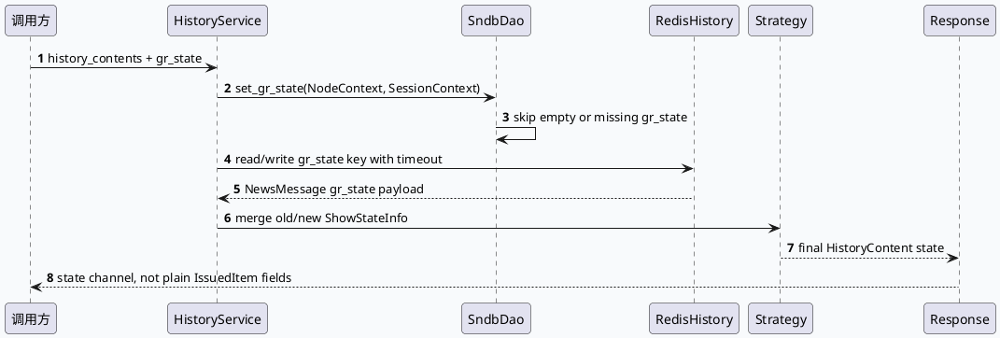

# History Service `gr_state`：Redis/SNDB 双通道一致性与合并边界

> 日期：2026-07-26  
> 类型：基础库笔记  
> 主题：`HistoryContent.gr_state` 不是普通 history item 字段，而是由 History Service 在 Redis 与 SNDB 通道之间写入、读取、合并后透传给业务侧的状态契约。

<style>.hs26-arch{font-family:Inter,Arial,sans-serif;background:#f8fafc;border:1px solid #d7dee8;border-radius:8px;padding:18px;margin:14px 0;color:#1f2937}.hs26-title{font-size:20px;font-weight:800;margin-bottom:12px}.hs26-grid{display:grid;grid-template-columns:1fr 1.2fr 1fr;gap:12px}.hs26-box{background:#fff;border:1px solid #dbe3ef;border-radius:7px;padding:12px}.hs26-box h3{font-size:14px;margin:0 0 8px;color:#36506b}.hs26-pill{display:inline-block;border:1px solid #b7c6d8;background:#eef5fb;border-radius:999px;padding:3px 8px;margin:3px 4px 3px 0;font-size:12px}.hs26-flow{margin-top:12px;display:grid;grid-template-columns:repeat(4,1fr);gap:10px}.hs26-step{border-left:4px solid #4d7c9f;background:#fff;padding:10px;border-radius:6px;font-size:13px}.hs26-note{font-size:12px;color:#5f6b7a;margin-top:8px}</style><div class="hs26-arch"><div class="hs26-title">架构全景：`gr_state` 从写入开关到业务透传</div><div class="hs26-grid"><div class="hs26-box"><h3>入口与请求</h3><span class="hs26-pill">HSService</span><span class="hs26-pill">HistoryService</span><span class="hs26-pill">HistoryContent</span><p>请求中只有 news 对应的 `history_content` 才携带 `gr_state`，空值会被跳过。</p></div><div class="hs26-box"><h3>状态存储双通道</h3><span class="hs26-pill">Redis state key</span><span class="hs26-pill">SNDB gr_state table</span><span class="hs26-pill">timeout budget</span><p>配置同时暴露 Redis BNS/读写超时、SNDB meta BNS 与写入开关。线上排障要先确认通道是否被开关裁剪。</p></div><div class="hs26-box"><h3>读取与合并</h3><span class="hs26-pill">NewsMessage</span><span class="hs26-pill">strategy merge</span><span class="hs26-pill">ShowStateInfo</span><p>History Service 将状态恢复为 `NewsMessage` 语义，再在 strategy 中按 nid/位置与旧状态进行合并。</p></div></div><div class="hs26-flow"><div class="hs26-step">1. 请求携带 `history_contents(i).gr_state()`</div><div class="hs26-step">2. `set_gr_state` 过滤空值并构造状态写入</div><div class="hs26-step">3. Redis/SNDB 按配置启停和超时预算访问</div><div class="hs26-step">4. response 中状态透传给下游业务</div></div><div class="hs26-note">关键判断：状态字段不应从 `IssuedItem` 普通展示字段反推，应以 `gr_state` 通道和合并结果为准。</div></div>

## 核心流程



```infographic
infographic sequence-timeline-rounded-rect-node
data
  title 配置到运行时的四个检查点
  desc 先看开关，再看通道，再看合并，最后看 response 透传
  items
    - time Config
      label `is_open_gr_state`
      desc 是否启用 gr_state 状态链路
      icon mdi/toggle-switch
    - time Write
      label `write_layout_sndb`
      desc SNDB 写入可能独立关闭，不等价于 Redis 关闭
      icon mdi/database-arrow-up
    - time Budget
      label Redis read/write timeout
      desc 读写主备超时决定降级窗口
      icon mdi/timer-outline
    - time Merge
      label Strategy merge
      desc UNKNOWN/旧状态/新状态在合并处收敛
      icon mdi/source-merge
```

## 代码理解

`SndbDao::set_gr_state` 明确把 `gr_state` 当作独立状态写入入口处理：当 `history_contents_size()` 为 0，或请求条数与结果条数不一致时直接失败；遍历时还会跳过没有 `gr_state` 或 `gr_state` 为空的 item。这个约束解释了为什么业务侧偶发状态缺失时，不能只查内容 item 是否存在，还要查请求是否真的携带了状态 payload。

`redis_history.cc` 在恢复状态时使用 `gr::NewsMessage gr_state_history_msg`，说明状态数据最终回到业务熟悉的 NewsMessage 结构，而不是裸字符串。`strategy.cc` 中对 `ShowStateInfo::UNKNOWN` 的判断则是合并边界：当新旧状态都不可识别时，系统保留 UNKNOWN 语义，而不是把缺失状态伪装成 UNSHOW 或 SHOWED。

## Pitfalls

<style>.hs26-card{font-family:Inter,Arial,sans-serif;background:#fff;border:1px solid #d7dee8;border-radius:8px;padding:16px;margin:14px 0;color:#1f2937}.hs26-card h3{margin:0 0 8px;font-size:18px}.hs26-card-grid{display:grid;grid-template-columns:1.1fr 1fr;gap:12px}.hs26-card-panel{border-top:3px solid #4d7c9f;background:#f8fafc;padding:10px;border-radius:6px}.hs26-card-panel strong{display:block;margin-bottom:6px;color:#263f57}.hs26-card p{margin:0;font-size:13px;line-height:1.55}</style><div class="hs26-card"><h3>排障卡片：不要把状态缺失误判成去重问题</h3><div class="hs26-card-grid"><div class="hs26-card-panel"><strong>错误方向</strong><p>只检查 `IssuedItem`、show_tss/click_tss 或内容正排，容易遗漏真正的状态通道开关。</p></div><div class="hs26-card-panel"><strong>正确切入</strong><p>先查 `is_open_gr_state`、`write_layout_sndb`、Redis/SNDB BNS 与超时，再看 `set_gr_state` 是否跳过空 payload。</p></div></div></div>

```infographic
infographic list-column-done-list
data
  title 调试 checklist
  desc 状态透传异常时按顺序收敛范围
  items
    - label 确认环境配置
      desc 检查 `is_open_gr_state` 与 `write_layout_sndb`
      done true
    - label 确认请求 payload
      desc `history_contents(i).has_gr_state()` 且非空
      done true
    - label 确认存储通道
      desc Redis 主备超时和 SNDB meta BNS 是否符合机房
      done true
    - label 确认合并语义
      desc UNKNOWN 是否来自合并逻辑而不是业务自行兜底
      done true
```

## 证据来源

- `src/dao/sndb_dao.cc:96-105`：`SndbDao::set_gr_state` 的请求尺寸校验、`has_gr_state()` 与空值过滤。
- `src/history/redis_history.cc:122-129`：Redis 读取完整数据并恢复 `gr::NewsMessage gr_state_history_msg`。
- `src/history/strategy.cc:657-671`：状态合并时保留 `ShowStateInfo::UNKNOWN` 判断。
- `noahdes/value/history-service-fenji/conf_template.value:11`：`write_layout_sndb=false` 写入开关。
- `noahdes/value/history-service-fenji/conf_template.value:29-33`：`gr_state_redis_bns` 与 Redis 主备读写超时。
- `noahdes/value/history-service-fenji/conf_template.value:121`：`is_open_gr_state=false` 环境级开关。
