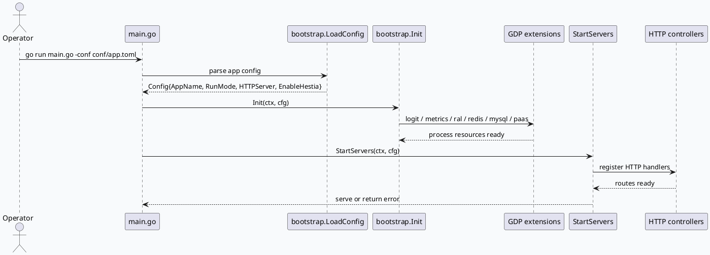

# rec-server GDP 启动链路：配置装载、依赖初始化与 HTTP Server 生命周期

> 日期：2026-07-28  
> 类型：基础库笔记  
> 主题：`rec-server` 不是 C++ RPC 服务，而是 GDP2 Go 服务；今日基础库侧关注 `main.go` 如何把 `conf/app.toml`、`bootstrap.Init`、全局资源初始化和 `StartServers` 串成一次可观测的启动生命周期。

<style>.rs28-arch{font-family:Inter,Arial,sans-serif;background:#f8fafc;border:1px solid #d8dee9;border-radius:8px;padding:18px;margin:14px 0;color:#1f2937}.rs28-title{font-size:20px;font-weight:800;margin-bottom:12px}.rs28-grid{display:grid;grid-template-columns:1fr 1.1fr 1fr;gap:12px}.rs28-box{background:#fff;border:1px solid #dbe3ef;border-radius:7px;padding:12px}.rs28-box h3{font-size:14px;margin:0 0 8px;color:#36506b}.rs28-box p{font-size:13px;line-height:1.55;margin:0;color:#4b5563}.rs28-pill{display:inline-block;border:1px solid #cbd5e1;background:#eef6ff;border-radius:999px;padding:3px 8px;margin:3px;font-size:12px;color:#334155}.rs28-arrow{text-align:center;font-weight:800;color:#64748b;align-self:center}.rs28-row{display:grid;grid-template-columns:1fr 32px 1fr 32px 1fr;gap:8px;align-items:stretch;margin-top:12px}</style><div class="rs28-arch"><div class="rs28-title">启动全景：配置文件先行，资源容器后置，Server 最后挂载</div><div class="rs28-grid"><div class="rs28-box"><h3>入口层</h3><p>`main.go` 接收 `-conf`，默认 `conf/app.toml`，通过 `bootstrap.LoadConfig` 解析运行模式、IDC、Hestia 与 HTTP Server 配置。</p></div><div class="rs28-box"><h3>基础设施层</h3><p>`bootstrap.Init` 注册日志、Metrics、RAL、Redis、MySQL、Paas、Servicer、Observer 等 GDP 扩展，形成业务控制器可复用的进程级依赖。</p></div><div class="rs28-box"><h3>服务层</h3><p>`StartServers` 创建 `gserver.Server` 管理容器，再按配置装配 HTTP Server；Hestia 热重启由同一入口选择。</p></div></div><div class="rs28-row"><div class="rs28-box"><span class="rs28-pill">flag.Parse</span><span class="rs28-pill">LoadConfig</span></div><div class="rs28-arrow">→</div><div class="rs28-box"><span class="rs28-pill">logit</span><span class="rs28-pill">gmetrics</span><span class="rs28-pill">mysql</span><span class="rs28-pill">redis</span></div><div class="rs28-arrow">→</div><div class="rs28-box"><span class="rs28-pill">gserver</span><span class="rs28-pill">protocols.HTTP</span><span class="rs28-pill">controller</span></div></div></div>

## 入口与生命周期

`main.go` 的职责很薄：读取配置路径、装载配置、执行初始化、启动服务。关键点是它没有在入口处直接拼业务路由，而是把进程级依赖交给 `bootstrap`，把 HTTP 业务注册交给 `httpserver/controller`。



## 配置结构

```infographic
infographic hierarchy-tree-tech-style-capsule-item
data
  title rec-server 启动配置结构
  desc 配置装载只决定运行时容器形态，不直接承载业务策略
  items
    - label main.go
      desc 默认 conf/app.toml，可用 -conf 切换环境
      icon mdi/application-cog
      children
        - label bootstrap.Config
          desc AppName / IDC / RunMode / EnableHestia / HTTPServer
          icon mdi/file-cog
        - label bootstrap.Init
          desc 注册 GDP 基础设施扩展
          icon mdi/lan-connect
        - label StartServers
          desc 创建 gserver 管理容器并挂 HTTP 服务
          icon mdi/server-network
theme
  palette #36506b #2d6a4f #b45309
```

## 关键判断

1. `rec-server` 的根入口是 `main.go`，不是 `main.cc/main.cpp`。这意味着本次代码理解应使用 Go/GDP 服务入口链，而不是 C++ brpc 入口链。
2. `bootstrap.Config` 将运行模式、IDC、Hestia 开关和 `httpserver.ServerConfig` 聚合成启动契约；业务控制器不应绕过这个配置结构自行读取全局配置。
3. `bootstrap.Init` 是进程级依赖边界。DAO 层依赖的 `resource.OrmClientRecServer` 这类全局资源，应该在 HTTP Handler 被调用之前完成初始化。
4. `StartServers` 是服务挂载边界。新增 HTTP 能力时，应优先检查 controller 注册链，而不是在入口层堆业务逻辑。

## Pitfalls

<style>.rs28-card{font-family:Inter,Arial,sans-serif;background:#fbfaf7;border:1px solid #ded8ca;border-radius:8px;padding:16px;margin:14px 0;color:#2f3136}.rs28-card h3{font-size:17px;margin:0 0 10px;color:#5b4636}.rs28-card ul{margin:0;padding-left:18px}.rs28-card li{font-size:13px;line-height:1.6;margin:5px 0}.rs28-card b{color:#7c3f14}</style><div class="rs28-card"><h3>调试时最容易看错的三件事</h3><ul><li><b>入口类型看错：</b>仓库里没有 C++ 入口，继续按 `main.cc` 路径查会误判为“无服务”。</li><li><b>初始化顺序被绕开：</b>DAO 或 Handler 若在 `bootstrap.Init` 前使用 `resource`，容易得到 nil 或未初始化客户端。</li><li><b>Hestia 与普通启动混淆：</b>`EnableHestia` 影响启动容器和热重启路径，排查端口与进程时必须先看配置。</li></ul></div>

## 调试 Checklist

```infographic
infographic list-column-done-list
data
  title rec-server 启动问题排查
  desc 从配置路径到 HTTP Handler 的最短确认链
  items
    - label 确认入口
      desc main.go 存在，main.cc/main.cpp 不存在
      done true
      icon mdi/check-circle
    - label 确认配置文件
      desc -conf 参数或默认 conf/app.toml 是否存在且可解析
      done true
      icon mdi/file-check
    - label 确认基础设施初始化
      desc logit / metrics / ral / mysql / redis 初始化是否报错
      done true
      icon mdi/database-check
    - label 确认服务挂载
      desc StartServers 是否按 HTTPServer 配置启动 gserver
      done true
      icon mdi/server
    - label 确认路由注册
      desc 新增业务 Handler 是否进入 controller 注册链
      done true
      icon mdi/routes
theme
  palette #36506b #2d6a4f #b45309
```

## 证据来源

- `main.go:5-18`：入口包、GDP 自动 maxprocs、`bootstrap` 与 `controller/launch_review/handler` 引入。
- `main.go:20-25`：默认配置路径和 `-conf` 切换说明。
- `bootstrap/config.go:18-35`：`Config` 聚合 AppName、IDC、RunMode 等启动字段。
- `bootstrap/bootstrap.go:14-24`：GDP 扩展依赖覆盖 observer、metrics、mysql、ral、servicer、redis 等。
- `bootstrap/server.go:17-24`：`StartServers` 负责服务管理容器与 Hestia/非 Hestia 启动路径。
