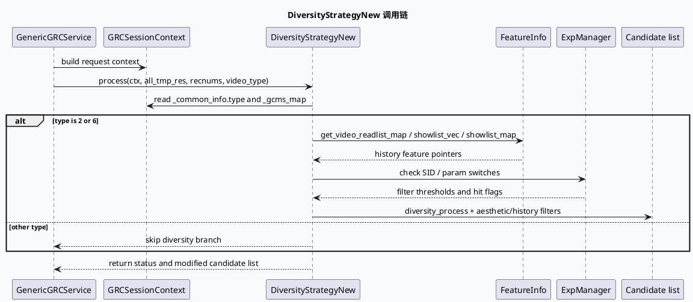

# DC-GRC DiversityStrategyNew：召回侧多样性策略生命周期

> 运行说明：2026-08-04 未发现 daily-plan 文件，本篇按历史未覆盖主题 fallback 生成。KU/业务背景检索不可用时需人工补充；当前结论基于代码与配置证据。

<style>.arch-dcgrc{font-family:Inter,Arial,sans-serif;background:#f8fafc;border:1px solid #dbe4ef;border-radius:8px;padding:16px;color:#1f2937}.arch-dcgrc .title{font-size:20px;font-weight:800;margin-bottom:12px}.arch-dcgrc .layers{display:grid;grid-template-columns:1fr;gap:10px}.arch-dcgrc .layer{border:1px solid #cbd5e1;border-radius:8px;padding:10px;background:#fff}.arch-dcgrc .layer h3{font-size:14px;margin:0 0 8px;color:#334155}.arch-dcgrc .grid{display:grid;grid-template-columns:repeat(4,minmax(0,1fr));gap:8px}.arch-dcgrc .box{border-radius:6px;padding:8px;background:#eef6ff;border:1px solid #bfdbfe;font-size:12px;line-height:1.45}.arch-dcgrc .box.core{background:#ecfdf5;border-color:#86efac}.arch-dcgrc .box.warn{background:#fff7ed;border-color:#fed7aa}.arch-dcgrc .flow{font-size:12px;color:#64748b;margin-top:8px}@media(max-width:720px){.arch-dcgrc .grid{grid-template-columns:1fr 1fr}}</style><div class="arch-dcgrc"><div class="title">架构全景：GenericGRCService 到 DiversityStrategyNew</div><div class="layers"><div class="layer"><h3>入口层</h3><div class="grid"><div class="box">ReusableRPCProtocol 注册<br/>src/main.cc:70-73</div><div class="box">ExpManager 加载 conf<br/>src/main.cc:76-77</div><div class="box core">GenericGRCService 注册<br/>src/main.cc:110-123</div><div class="box">HTTP Service 并列暴露<br/>src/main.cc:110-123</div></div></div><div class="layer"><h3>策略层</h3><div class="grid"><div class="box core">DiversityStrategyNew::process<br/>diversity_strategy_new.cc:39-71</div><div class="box">type 分支：2/6 进入 diversity_process<br/>diversity_strategy_new.cc:55-58</div><div class="box">实验参数驱动过滤<br/>diversity_strategy_new.cc:117-118</div><div class="box warn">GCMS map 可为空，需要降级日志<br/>diversity_strategy_new.cc:44-47</div></div></div><div class="layer"><h3>上下文与配置层</h3><div class="grid"><div class="box">showlist / readlist 特征<br/>diversity_strategy_new.cc:96-98</div><div class="box">queue_quota_info 队列额度<br/>conf/queue_quota.conf:1-50</div><div class="box">策略配置聚合入口<br/>conf/grc_strategy.conf:1-10</div><div class="box">filter / quota / queue 组合生效<br/>conf/grc_strategy.conf:6-10</div></div><div class="flow">核心判断：该策略不是单一去重函数，而是入口服务、实验参数、历史特征、队列 quota 共同约束的召回侧生命周期。</div></div></div></div>

## 核心结论

DiversityStrategyNew 的边界在召回服务内部：`process()` 从 `GRCSessionContext` 取请求类型、GCMS map、历史展现/阅读特征，并只对特定 `type` 进入 `diversity_process()`。它的职责更接近“召回候选的策略闸门”，不是 GRG 侧最终排序合并。

配置上，`grc_strategy.conf` 只做聚合 include，真正影响队列规模和透传形态的是 `queue_quota.conf`、`queue.conf`、`filter.conf`、`quota.conf` 等下游配置。排查线上多样性问题时，如果只看 C++ 分支而忽略队列 quota，容易把配置阈值误判成策略逻辑 bug。



```infographic
infographic sequence-ascending-steps
data
  title 策略生命周期检查点
  desc 从入口到候选改写的最小证据链
  items
    - label 服务注册
      desc main.cc 注册 RPC/HTTP service，确认请求确实进入 GRC 服务
      icon mdi/server-network
    - label 上下文绑定
      desc process 保存 sctx、recnums、video_type，并读取 GCMS map
      icon mdi/link-variant
    - label 类型分支
      desc common_info.type 为 2 或 6 时进入 diversity_process
      icon mdi/source-branch
    - label 历史特征
      desc 从 FeatureInfo 获取 readlist/showlist 指针
      icon mdi/history
    - label 实验参数
      desc EXPERIMENT_GET/HIT 控制美观度和过滤阈值
      icon mdi/tune
    - label 候选输出
      desc all_tmp_res 被过滤或重排后返回上游
      icon mdi/check-network
theme
  palette #2563eb #16a34a #f59e0b #64748b
```

## 配置结构

```infographic
infographic hierarchy-structure
data
  title grc_strategy.conf include 树
  desc 配置入口很薄，问题定位应沿 include 展开
  items
    - label grc_strategy.conf
      desc 聚合入口
      children
        - label quota.conf
          desc 全局 quota
        - label queue_quota.conf
          desc disp/theme/newhot/picture/follow 等队列额度
        - label queue.conf
          desc 队列定义
        - label flow_classification.conf
          desc 流量分类
        - label filter.conf
          desc 过滤策略
theme
  palette #334155 #2563eb #16a34a #f59e0b
```

<style>.pit-card{font-family:Inter,Arial,sans-serif;background:#fffaf0;border:1px solid #fed7aa;border-radius:8px;padding:16px;margin-top:12px;color:#1f2937}.pit-card .meta{font-size:12px;font-weight:700;color:#b45309;text-transform:uppercase}.pit-card .title{font-size:20px;font-weight:800;margin:6px 0}.pit-card .body{font-size:14px;line-height:1.65}.pit-card .rule{height:3px;background:#f59e0b;width:72px;margin:10px 0}</style><div class="pit-card"><div class="meta">Pitfall</div><div class="title">GCMS 空指针日志不是完整失败信号</div><div class="rule"></div><div class="body">DiversityStrategyNew 在读取 <code>sctx._gcms_map</code> 后只打印 warning；后续是否继续过滤还取决于请求 type、历史特征和实验开关。排查时应同时看 <code>diversity_strategy_new.cc:44-58</code> 与实验参数命中情况。</div></div>

```infographic
infographic list-column-done-list
data
  title 调试 checklist
  items
    - label 确认服务入口是否注册 GenericGRCService
      done true
      desc src/main.cc:110-123
    - label 检查请求 type 是否进入 2/6 分支
      done true
      desc diversity_strategy_new.cc:55-58
    - label 打印 showlist/readlist 是否为空
      done true
      desc diversity_strategy_new.cc:96-98
    - label 核对 aesthetic_v3_filter 实验阈值
      done true
      desc diversity_strategy_new.cc:207-215
    - label 展开 queue_quota.conf 的队列额度
      done true
      desc conf/queue_quota.conf:1-50
    - label 人工补充 KU 中的业务策略口径
      done false
      desc 本次未发现 daily-plan，业务上下文需人工确认
theme
  palette #16a34a #f59e0b #64748b
```

## 证据来源

- `src/main.cc:70-123`：协议注册、实验配置初始化、GRC RPC/HTTP service 注册。
- `src/strategy/diversity_strategy_new.cc:39-75`：`process()` 入口、GCMS map 读取、type 分支。
- `src/strategy/diversity_strategy_new.cc:96-118`：readlist/showlist 特征读取与实验开关。
- `src/strategy/diversity_strategy_new.cc:207-215`：美观度过滤阈值来自 SID/参数。
- `src/strategy/diversity_strategy_new.h:15-24`：策略类头文件依赖与职责说明。
- `conf/grc_strategy.conf:1-10`：策略配置 include 聚合。
- `conf/queue_quota.conf:1-50`：队列名称、rec_src、透传标记和 quota 默认值。
