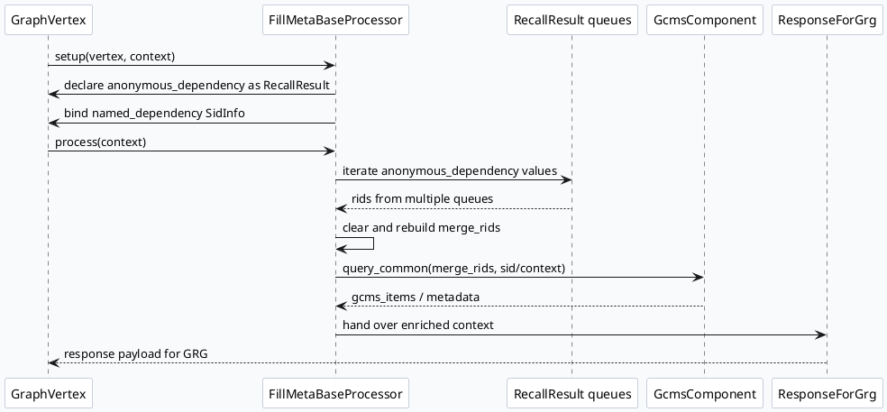

# MV-GRC FillMeta 到 ResponseForGrg：元数据补齐与响应契约

> 运行说明：2026-08-07 未发现 daily-plan 文件，本篇按附近未覆盖主题 fallback 生成。当前 cron 环境中 `ku` 命令不可用，KU/业务背景需人工补充；本文结论基于 MV-GRC 代码与配置证据。

<style>.arch-grc-fillmeta{font-family:Inter,Arial,sans-serif;background:#f8fafc;border:1px solid #d8e2ef;border-radius:8px;padding:16px;color:#1f2937}.arch-grc-fillmeta .title{font-size:20px;font-weight:800;margin-bottom:12px}.arch-grc-fillmeta .band{background:#fff;border:1px solid #cbd5e1;border-radius:8px;padding:10px;margin-bottom:10px}.arch-grc-fillmeta h3{font-size:14px;margin:0 0 8px;color:#334155}.arch-grc-fillmeta .grid{display:grid;grid-template-columns:repeat(4,minmax(0,1fr));gap:8px}.arch-grc-fillmeta .box{border-radius:6px;padding:9px;border:1px solid #dbe4ef;background:#f8fafc;font-size:12px;line-height:1.45}.arch-grc-fillmeta .box b{display:block;font-size:13px;color:#0f172a;margin-bottom:3px}.arch-grc-fillmeta .hot{background:#eef6ff;border-color:#93c5fd}.arch-grc-fillmeta .warn{background:#fff7ed;border-color:#fdba74}.arch-grc-fillmeta .arrow{text-align:center;color:#64748b;font-weight:700;margin:-2px 0 8px}</style><div class="arch-grc-fillmeta"><div class="title">架构全景：RecallResult 汇聚、GCMS/IFCS 补齐、GRG 响应出口</div><div class="band"><h3>Graph 依赖层</h3><div class="grid"><div class="box"><b>anonymous_dependency</b>多队列 RecallResult 先声明 mutable 与类型</div><div class="box"><b>SidInfo</b>named_dependency 注入 SID/实验条件</div><div class="box"><b>FollowedAuthorSet</b>作者关系类辅助依赖</div><div class="box"><b>GraphVertex</b>把配置依赖转为运行时对象</div></div></div><div class="arrow">↓</div><div class="band"><h3>FillMeta 执行层</h3><div class="grid"><div class="box hot"><b>merge_rids</b>从各 RecallResult 合并 rid 集合</div><div class="box hot"><b>query_common</b>调用 GcmsComponent 批量查内容元数据</div><div class="box"><b>gcms_items</b>以 rid/nid 维度承载返回详情</div><div class="box warn"><b>日志与 SIA</b>记录总 nid 量与阶段耗时</div></div></div><div class="arrow">↓</div><div class="band"><h3>响应契约层</h3><div class="grid"><div class="box"><b>ResponseForGrg</b>把补齐结果转成 GRG 可读响应</div><div class="box"><b>NewsMessage</b>承载 item 字段与扩展信息</div><div class="box warn"><b>extmsg/Serialize</b>跨服务边界关注体积与解析兼容</div><div class="box"><b>MV-GRG</b>下游继续 merge 与 response function</div></div></div></div>

## 关键判断

FillMeta 不是单纯的字段填充器，它是 MV-GRC 响应出口前的元数据契约层：上游召回队列只提供候选 rid，FillMeta 负责把多队列候选合并成 `merge_rids`，再通过 `GcmsComponent::get_instance().query_common()` 批量补齐内容侧元信息，最后交给 `ResponseForGrg` 形成下游 GRG 可继续消费的响应。

## 核心调用链



## 配置与运行结构

```infographic
infographic hierarchy-structure
data
  title FillMeta 响应契约结构
  desc 从图依赖声明到元数据查询再到 GRG 响应出口
  items
    - label Graph 配置
      desc vertex.conf 绑定处理器和依赖
      icon mdi/graph
      children
        - label anonymous_dependency
          desc 多个 RecallResult 输入
        - label SidInfo
          desc named_dependency 注入
    - label FillMetaBaseProcessor
      desc 汇聚候选并补齐内容元数据
      icon mdi/database-sync
      children
        - label merge_rids
          desc 跨队列 rid 去重集合
        - label query_common
          desc GCMS/IFCS 元数据查询入口
    - label ResponseForGrg
      desc 输出下游 GRG 可解析响应
      icon mdi/export
      children
        - label NewsMessage
          desc 内容字段载体
        - label extmsg
          desc 扩展字段与序列化边界
theme
  palette #2563eb #0f766e #f97316
```

## 证据解读

`fill_meta.cpp:137-146` 显示 setup 阶段读取 `anonymous_dependency_size()`，将匿名依赖声明为 mutable，并声明类型为 `RecallResult`，同时通过 `named_dependency("SidInfo")` 绑定 SID 上下文。这说明 FillMeta 的输入不是硬编码队列，而是由图配置注入。

`fill_meta.cpp:177-200` 显示处理阶段清空 `merge_rids`，遍历匿名依赖中的 `RecallResult`，并把多个队列的 `rids` 插入同一个集合。这个集合是后续元数据批量查询的候选全集。

`fill_meta.cpp:244-254` 出现 `GcmsComponent::get_instance().query_common(...)` 与总 nid size 日志，说明 FillMeta 在召回后、响应前承担内容元数据读放大控制点。如果这里输入膨胀，会直接影响下游响应体积和延迟。

`src/processor/video_launch/response_for_grg.cpp` 与 `vertex.conf` 中的 `ResponseForGrg` 共同构成出口侧证据：FillMeta 的结果不是终态展示响应，而是给 GRG merge/response 链继续消费的中间契约。

<style>.card-grc-fillmeta{font-family:Inter,Arial,sans-serif;background:#fff;border:1px solid #d8e2ef;border-radius:8px;padding:16px;margin:14px 0;color:#1f2937}.card-grc-fillmeta .meta{font-size:12px;font-weight:800;color:#2563eb;text-transform:uppercase;letter-spacing:.04em}.card-grc-fillmeta .title{font-size:22px;font-weight:850;margin:5px 0 10px}.card-grc-fillmeta .grid{display:grid;grid-template-columns:1.4fr 1fr;gap:12px}.card-grc-fillmeta .panel{background:#f8fafc;border-top:3px solid #2563eb;padding:10px;border-radius:6px;font-size:13px;line-height:1.55}.card-grc-fillmeta b{color:#0f172a}</style><div class="card-grc-fillmeta"><div class="meta">Pitfalls</div><div class="title">不要把 FillMeta 看成普通字段补齐</div><div class="grid"><div class="panel"><b>契约风险：</b>它聚合多队列候选并调用内容元数据服务，输出会影响 GRG 的 merge 和 response function。如果只看某个召回队列，容易低估整体候选规模。</div><div class="panel"><b>调试入口：</b>先看 `merge_rids size`、`query_common` 返回规模和 `ResponseForGrg` 输出字段，再判断问题是召回不足、元数据缺失还是序列化边界异常。</div></div></div>

```infographic
infographic list-column-done-list
data
  title 调试 checklist
  desc 排查 FillMeta 到 ResponseForGrg 链路时按顺序确认
  items
    - label 检查 vertex 依赖
      desc anonymous_dependency 是否都声明为 RecallResult，SidInfo 是否可取
      done true
    - label 检查 merge_rids 规模
      desc 多队列合并后是否异常膨胀或为空
      done true
    - label 检查 query_common 返回
      desc GCMS/IFCS 是否有缺字段、超时或返回量不一致
      done true
    - label 检查 ResponseForGrg
      desc 下游 GRG 需要的 NewsMessage/extmsg 字段是否完整
      done true
    - label 检查序列化体积
      desc Serialize/Parse 边界是否成为 CPU 或兼容性瓶颈
      done false
theme
  palette #2563eb #16a34a #f97316
```

## 证据来源

- `src/processor/fill_meta.cpp:137-146`：GraphVertex 依赖声明与 `SidInfo` 绑定。
- `src/processor/fill_meta.cpp:177-200`：多队列 `RecallResult` 合并到 `merge_rids`。
- `src/processor/fill_meta.cpp:244-254`：`GcmsComponent::get_instance().query_common()` 元数据查询与规模日志。
- `src/processor/video_launch/response_for_grg.cpp`：GRC 到 GRG 的响应出口处理。
- `conf/plugins/graph/vertex.conf`：`FillMeta`/`ResponseForGrg` 图节点与依赖配置。
