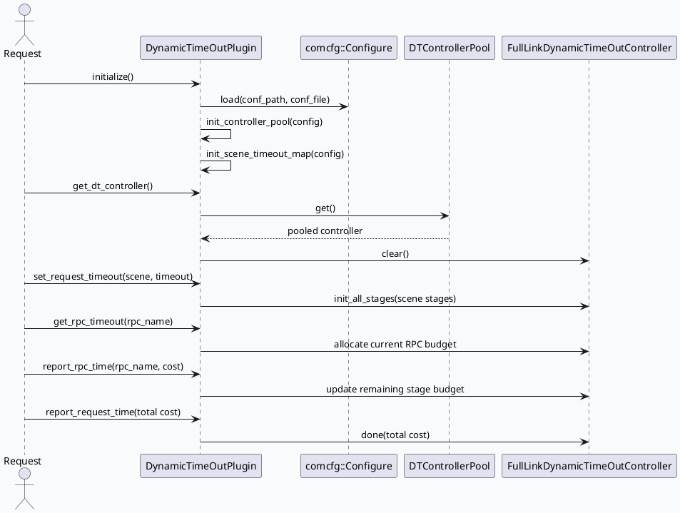

# DynamicTimeOutPlugin：从配置到请求预算的全链路生命周期

> 生成日期：2026-08-08  
> 计划状态：未找到今日 daily-plan，按相邻未覆盖主题 fallback。KU/业务上下文需人工补充；本文以代码证据为主。

## 架构全景

<style>.dt-arch{font-family:Inter,Arial,sans-serif;background:#f8fafc;border:1px solid #d8e1ea;border-radius:8px;padding:18px;margin:16px 0;color:#1f2937}.dt-arch-title{font-size:20px;font-weight:800;margin-bottom:12px}.dt-layers{display:grid;grid-template-columns:1fr;gap:10px}.dt-layer{border:1px solid #cbd5e1;border-radius:8px;background:#fff;padding:12px}.dt-layer h3{font-size:14px;margin:0 0 8px;color:#334155}.dt-grid{display:grid;grid-template-columns:repeat(4,minmax(0,1fr));gap:8px}.dt-box{background:#eef6f5;border-left:4px solid #2f7d73;border-radius:6px;padding:9px;font-size:12px;line-height:1.45}.dt-box strong{display:block;font-size:13px;color:#143f3a}.dt-arrow{font-size:12px;color:#64748b;margin:2px 0;text-align:center}@media(max-width:760px){.dt-grid{grid-template-columns:1fr}}</style><div class="dt-arch"><div class="dt-arch-title">动态超时插件分层视图</div><div class="dt-layers"><div class="dt-layer"><h3>配置层</h3><div class="dt-grid"><div class="dt-box"><strong>gflags</strong>dynamic_timeout_conf_path / dynamic_timeout_conf_file 定位配置</div><div class="dt-box"><strong>controller_pool</strong>控制 FullLinkDynamicTimeOutController 复用容量</div><div class="dt-box"><strong>scene</strong>按业务场景组织 stage 列表</div><div class="dt-box"><strong>stage</strong>定义 rpc_name、default_timeout、min_timeout 和并发组</div></div></div><div class="dt-arrow">config.load → init_controller_pool → init_scene_timeout_map</div><div class="dt-layer"><h3>运行层</h3><div class="dt-grid"><div class="dt-box"><strong>controller pool</strong>请求进入时 get_dt_controller，复用前 clear</div><div class="dt-box"><strong>request budget</strong>set_request_timeout 绑定 scene 和总超时</div><div class="dt-box"><strong>rpc budget</strong>get_rpc_timeout 按 rpc 名称分配本次调用预算</div><div class="dt-box"><strong>feedback</strong>report_rpc_time / report_request_time 回写耗时</div></div></div><div class="dt-arrow">请求结束 → done → controller 回池</div><div class="dt-layer"><h3>观测与风险层</h3><div class="dt-grid"><div class="dt-box"><strong>bvar latency</strong>动态统计 RPC 耗时窗口</div><div class="dt-box"><strong>fallback</strong>配置加载失败当前返回 0，服务可继续启动</div><div class="dt-box"><strong>scene miss</strong>场景不匹配时容易退回默认策略</div><div class="dt-box"><strong>pool size</strong>容量不足会影响复用效率和尾延迟</div></div></div></div></div>

## 核心调用链



## 配置结构信息图

```infographic
infographic hierarchy-structure
data
  title dynamic_timeout.conf 结构
  desc 配置从 pool 容量下钻到 scene，再下钻到 stage 与并发 rpc
  items
    - label controller_pool
      desc size 控制 controller 池容量；测试配置中 size 为 12
      icon mdi/database-sync
      children
        - label size
          desc 复用对象池容量
          icon mdi/counter
    - label scene
      desc name 标识业务场景；每个场景包含 stages
      icon mdi/source-branch
      children
        - label stages
          desc window_size 与多个 stage 共同决定预算窗口
          icon mdi/view-sequential
        - label stage
          desc priority/default_timeout/rpc_name/min_timeout
          icon mdi/timer-outline
        - label concurrent
          desc 并发 rpc 组使用最大耗时作为 stage 耗时
          icon mdi/call-split

theme
  palette #2f7d73 #3d5a80 #c7792f
```

## 关键结论

<style>.dt-card{font-family:Inter,Arial,sans-serif;background:#f4f8f6;border:1px solid #cddbd7;border-radius:8px;padding:18px;margin:16px 0;color:#263b37}.dt-card .meta{font-size:12px;font-weight:700;color:#2f7d73;letter-spacing:.04em;text-transform:uppercase}.dt-card .title{font-size:22px;font-weight:850;margin:6px 0 10px}.dt-card .body{font-size:14px;line-height:1.65}.dt-card .cols{display:grid;grid-template-columns:2fr 1fr;gap:12px;margin-top:12px}.dt-card .panel{border-top:3px solid #2f7d73;background:#fff;padding:10px;border-radius:6px;font-size:13px;line-height:1.55}@media(max-width:760px){.dt-card .cols{grid-template-columns:1fr}}</style><div class="dt-card"><div class="meta">Pitfall</div><div class="title">配置加载失败不是启动失败</div><div class="body">`DynamicTimeOutPlugin::initialize()` 在配置加载失败时记录 warning 后返回 0，后续是否真的具备动态超时能力取决于调用方是否继续使用已初始化的 scene map 和 controller pool。</div><div class="cols"><div class="panel"><strong>排查重点</strong><br>先看启动日志中的 fail to load dynamic_timeout conf，再核对 gflags 指向的目录与文件名。</div><div class="panel"><strong>证据</strong><br>dynamic_timeout_plugin.cpp:12-21</div></div></div>

## 调试 Checklist

```infographic
infographic list-column-done-list
data
  title 动态超时排查清单
  desc 从配置存在性到运行时反馈逐层确认
  items
    - label 确认 gflags 指向
      desc dynamic_timeout_conf_path 与 dynamic_timeout_conf_file 是否在目标部署中正确
      done false
      icon mdi/file-cog-outline
    - label 确认 controller_pool.size
      desc 高并发场景下容量过小会放大对象申请和复用失败成本
      done false
      icon mdi/database-refresh
    - label 确认 scene 名称
      desc set_request_timeout 传入 scene 必须能命中 init_scene_timeout_map 的配置
      done false
      icon mdi/map-marker-path
    - label 确认 stage/rpc_name
      desc get_rpc_timeout 的 rpc_name 需要和配置中的 rpc_name 或 concurrent 名称一致
      done false
      icon mdi/timer-search
    - label 确认反馈上报
      desc report_rpc_time 与 report_request_time 缺失会削弱动态预算修正
      done false
      icon mdi/chart-line

theme
  palette #2f7d73 #3d5a80 #c7792f
```

## 证据来源

- `src/dynamic_timeout_plugin.cpp:12-21`：加载配置并初始化 controller pool、scene timeout map。
- `src/dynamic_timeout_plugin.cpp:25-31`：从对象池获取 controller，复用前执行 clear。
- `include/dynamic_timeout_plugin.h:18-29`：插件对外暴露 initialize、set/get/report 超时接口。
- `include/dynamic_timeout.h:55-68`：controller 记录剩余 RPC 时间、当前 stage、并发完成计数和 stage timeout。
- `test/conf/plugins/dynamic_timeout.conf:1-32`：示例配置包含 controller_pool、scene、stages、stage、concurrent。
