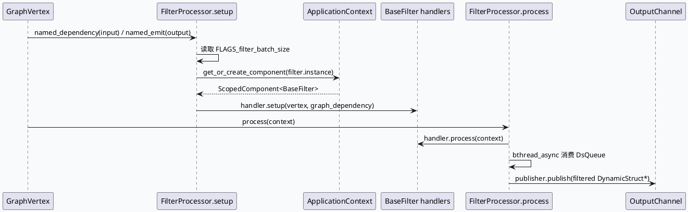

# Common Processor FilterProcessor：过滤执行生命周期与批处理边界

> 生成日期：2026-08-09  
> 计划状态：未找到今日 daily-plan，按相邻未覆盖主题 fallback。KU/业务上下文需人工补充；本文以代码证据为主。

## 架构全景

<style>.fp-arch{font-family:Inter,Arial,sans-serif;background:#f8fafc;border:1px solid #d7e0ea;border-radius:8px;padding:18px;margin:16px 0;color:#1f2937}.fp-title{font-size:20px;font-weight:800;margin-bottom:12px}.fp-lanes{display:grid;grid-template-columns:1fr 1.25fr 1fr;gap:12px}.fp-lane{background:#fff;border:1px solid #cbd5e1;border-radius:8px;padding:12px}.fp-lane h3{font-size:14px;margin:0 0 9px;color:#334155}.fp-box{border:1px solid #d8dee8;border-radius:7px;padding:9px;margin:7px 0;background:#f9fbfd;font-size:12px;line-height:1.45}.fp-box strong{display:block;color:#28536b;font-size:13px;margin-bottom:3px}.fp-core{background:#eef6f7;border-color:#8fb8c7}.fp-meta{font-size:12px;color:#64748b;margin-top:10px}.fp-arrow{text-align:center;color:#64748b;font-weight:700;margin:5px 0}@media(max-width:900px){.fp-lanes{grid-template-columns:1fr}}</style><div class="fp-arch"><div class="fp-title">FilterProcessor 在 GraphVertex 中的执行位置</div><div class="fp-lanes"><div class="fp-lane"><h3>输入与依赖</h3><div class="fp-box"><strong>Graph dependency</strong>通过 `FILTER_GRAPH_DEPENDENCY_INPUT_NAME` 取得输入 channel。</div><div class="fp-box"><strong>FilterGroup</strong>配置展开为多个 filter component 名称。</div><div class="fp-box"><strong>全局批量阈值</strong>`FLAGS_filter_batch_size` 覆盖默认 batch_size。</div></div><div class="fp-lane"><h3>执行核心</h3><div class="fp-box fp-core"><strong>setup</strong>绑定输入、输出、FilterGroup，并通过 ApplicationContext 创建 handler。</div><div class="fp-arrow">↓</div><div class="fp-box fp-core"><strong>process</strong>逐个 handler 调用 `process(context)`，再异步消费输入队列。</div><div class="fp-arrow">↓</div><div class="fp-box fp-core"><strong>publish</strong>过滤后的 DynamicStruct 指针进入 publish 队列，批量发往输出 channel。</div></div><div class="fp-lane"><h3>收尾与输出</h3><div class="fp-box"><strong>FilterEndProcessor</strong>按 batch_size 从输入 channel 拉取结果。</div><div class="fp-box"><strong>GraphData emit</strong>用 `output_data->emit(...)` 汇总输出。</div><div class="fp-box"><strong>调试重点</strong>先看 vertex conf，再看 FilterGroup，再看每个 BaseFilter 的依赖。</div></div></div><div class="fp-meta">证据：filter_processor.cpp:26-151；filter_end_processor.cpp:20-60；base_filter.h:18-48。</div></div>

## 核心流程



FilterProcessor 的生命周期分成三层：`setup` 阶段把 GraphVertex 的输入输出 channel 和 FilterGroup 配置固化到 `FilterContext`；`process` 阶段先让所有 handler 执行自己的逻辑，再用 `bthread_async` 拉取输入、发布结果；FilterEndProcessor 负责把过滤链尾部结果写回 GraphData。这个分层意味着排查时不能只看某一个 filter 类，必须同时核对 vertex 依赖、FilterGroup 展开结果和输出端 emit 名称。

## 配置结构

```infographic
infographic hierarchy-tree-tech-style-capsule-item
data
  title Filter 执行配置层级
  desc 从 vertex 到 filter operator 的最小闭环
  items
    - label exec_engine_vertex
      desc plugin + processor + input/output + conf
      icon mdi/graph-outline
      children
        - label filter_engine
          desc exec_type 与 generator 策略
          icon mdi/cog-outline
          children
            - label filter
              desc name / valid / depend
              icon mdi/filter-outline
            - label BaseFilter
              desc setup / process / destroy
              icon mdi/code-braces
            - label Channel
              desc InputChannel 到 OutputChannel
              icon mdi/source-branch
theme
  palette #28536b #5f8d9f #d68060
```

`filter_exec_engine_vertex.conf` 展示 vertex 层声明：`plugin: filter_engine_plugin`、`processor: FilterEngineProcessor`、`input: FilterInput`、`output: FilterResult`、`conf: test_filter.conf`。`test_filter.conf` 再声明 `filter_engine`、generator 和 `FilterOperator_history` 这类过滤因子。代码侧 `BaseFilter` 只暴露 `setup/process/destroy` 合约，所以具体过滤行为来自配置注册的 handler，而不是 FilterProcessor 本身硬编码。

## Pitfalls

<style>.fp-card{font-family:Inter,Arial,sans-serif;background:#fbfaf7;border:1px solid #ddd6c8;border-radius:8px;padding:16px;margin:16px 0;color:#2f2f2f}.fp-card-title{font-size:18px;font-weight:800;margin-bottom:10px;color:#5f4b32}.fp-card-grid{display:grid;grid-template-columns:1.15fr 1fr;gap:12px}.fp-card-panel{background:#fff;border-top:4px solid #b87945;border-radius:6px;padding:12px;font-size:13px;line-height:1.6}.fp-card-panel strong{display:block;margin-bottom:4px;color:#3f3429}@media(max-width:760px){.fp-card-grid{grid-template-columns:1fr}}</style><div class="fp-card"><div class="fp-card-title">过滤链最容易误判的三个点</div><div class="fp-card-grid"><div class="fp-card-panel"><strong>batch_size 有两处语义</strong>FilterProcessor 默认 20，并由 gflag 覆盖；FilterEndProcessor 默认 500。吞吐异常时要区分执行端和收尾端。</div><div class="fp-card-panel"><strong>handler 顺序来自 FilterGroup</strong>`filter_handlers` 的顺序由配置展开顺序决定，代码里只是顺序遍历。</div><div class="fp-card-panel"><strong>GraphData 不等于业务过滤结果</strong>过滤过程传递的是 `DynamicStruct*`，最终输出才通过 FilterEndProcessor emit。</div><div class="fp-card-panel"><strong>异步消费不代表 handler 异步</strong>handler.process 先同步逐个执行，后面的 bthread_async 负责队列消费和发布。</div></div></div>

## 调试 Checklist

```infographic
infographic list-column-done-list
data
  title FilterProcessor 排查清单
  desc 按依赖声明到队列输出的顺序验证
  items
    - label 确认 vertex input/output 名称
      desc 查看 filter_exec_engine_vertex.conf:1-12
      done true
      icon mdi/check-circle-outline
    - label 确认 FilterGroup 展开出的 handler 顺序
      desc 对照 test_filter.conf:19-38 与组件注册
      done true
      icon mdi/format-list-numbered
    - label 检查 batch_size 是否被 gflag 覆盖
      desc filter_processor.cpp:26-57
      done true
      icon mdi/tune
    - label 检查 handler.process 是否实际过滤或只打标
      desc BaseFilter 子类实现才决定业务语义
      done false
      icon mdi/filter-search
    - label 检查 FilterEndProcessor 是否 emit 到预期 GraphData
      desc filter_end_processor.cpp:47-60
      done true
      icon mdi/export
theme
  palette #28536b #7aa6b8 #d68060
```

## 证据来源

- `src/microframe/filter/filter_processor.cpp:26-151`：gflag、FilterContext、handler 创建、handler.process、异步队列消费与 publish。
- `src/microframe/filter/filter_end_processor.cpp:20-60`：收尾 processor 的 batch_size、named_emit 和 GraphData 输出。
- `src/microframe/filter/interface/base_filter.h:18-48`：BaseFilter 的 setup/process/destroy 合约。
- `test/conf/plugins/exec_engine/filter_exec_engine_vertex.conf:1-12`：filter vertex 的 plugin、processor、input/output、conf 绑定。
- `test/conf/plugins/exec_engine/test_filter.conf:1-38`：filter_engine、generator 与 FilterOperator 示例配置。

## 需人工补充

今日未找到 daily-plan，也没有可用 KU 父文档上下文。本文基于 common-processor 代码与本地测试配置生成，后续需要补充线上服务的真实 FilterGroup 配置、组件注册表和具体业务 filter 子类清单。
