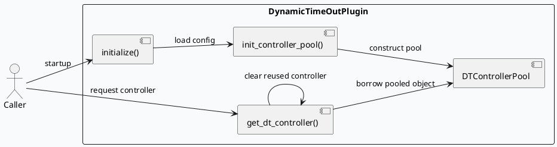

# DynamicTimeOutPlugin：配置加载与 Controller 池化边界

> 生成日期：2026-08-10  
> 计划状态：未找到今日 daily-plan，按相邻未覆盖主题 fallback。KU/业务上下文需人工补充；本文以代码证据为主。

## 架构全景

<style>.dt-arch{font-family:Inter,Arial,sans-serif;background:#f8fafc;border:1px solid #d8e1ea;border-radius:8px;padding:18px;margin:16px 0;color:#1f2937}.dt-arch-title{font-size:20px;font-weight:800;margin-bottom:12px}.dt-layers{display:grid;grid-template-columns:1fr;gap:10px}.dt-layer{border:1px solid #cbd5e1;border-radius:8px;background:#fff;padding:12px}.dt-layer h3{font-size:14px;margin:0 0 8px;color:#334155}.dt-grid{display:grid;grid-template-columns:repeat(4,minmax(0,1fr));gap:8px}.dt-box{background:#fbfdff;border:1px solid #d8dee8;border-radius:7px;padding:8px;font-size:12px;line-height:1.45;min-height:64px}.dt-box strong{display:block;font-size:13px;color:#0f172a;margin-bottom:2px}.dt-arrow{font-size:12px;color:#64748b;margin:4px 0 0;text-align:center}.dt-note{margin-top:10px;font-size:12px;color:#475569}.dt-tag{display:inline-block;font-size:11px;padding:2px 6px;border-radius:999px;background:#e2e8f0;color:#334155;margin-left:6px}</style>
<div class="dt-arch"><div class="dt-arch-title">DynamicTimeOutPlugin runtime flow</div><div class="dt-layers"><div class="dt-layer"><h3>1. Config bootstrap</h3><div class="dt-grid"><div class="dt-box"><strong>flags</strong>`dynamic_timeout_conf_path` and `dynamic_timeout_conf_file`</div><div class="dt-box"><strong>initialize()</strong>load config with `comcfg::Configure`</div><div class="dt-box"><strong>error path</strong>on load failure, log warning and keep plugin inert</div><div class="dt-box"><strong>contract</strong>plugin startup must not assume external defaults</div></div><div class="dt-arrow">9-17: load conf -> validate -> continue</div></div><div class="dt-layer"><h3>2. Pool construction</h3><div class="dt-grid"><div class="dt-box"><strong>init_controller_pool()</strong>validate `controller_pool.size`</div><div class="dt-box"><strong>pool object</strong>allocate `DTControllerPool` from config size</div><div class="dt-box"><strong>state</strong>record `_pool_size` and reset counters</div><div class="dt-box"><strong>failure mode</strong>missing or zero size is fatal</div></div><div class="dt-arrow">81-95: config -> pool size -> pool instance</div></div><div class="dt-layer"><h3>3. Borrow / reuse</h3><div class="dt-grid"><div class="dt-box"><strong>get_dt_controller()</strong>borrow from pool</div><div class="dt-box"><strong>clear()</strong>reset reused controller before use</div><div class="dt-box"><strong>pooled object</strong>RAII wrapper returns controller to pool</div><div class="dt-box"><strong>benefit</strong>reduce allocation churn for repeated requests</div></div><div class="dt-arrow">25-29: borrow -> clear -> reuse</div></div></div><div class="dt-note">The plugin is a narrow base-layer utility: it does not own business semantics, only the lifetime and reuse policy for timeout controllers.</div></div>

## 核心流程



```infographic sequence-ascending-steps
 data
  title Dynamic timeout lifecycle
  desc From config load to safe controller reuse
  items
    - label Load plugin conf
      desc `initialize()` reads `dynamic_timeout.conf`
    - label Validate pool size
      desc `init_controller_pool()` checks `controller_pool.size`
    - label Build controller pool
      desc Create `DTControllerPool` and reset counters
    - label Borrow controller
      desc `get_dt_controller()` fetches a pooled object
    - label Clear before reuse
      desc Avoid stale state leaking across requests
 theme
  palette #2563eb #0f172a #94a3b8
```

## 关键代码证据

- `src/dynamic_timeout_plugin.cpp:9-17` 读取 `dynamic_timeout_conf_path` / `dynamic_timeout_conf_file` 并执行配置加载。
- `src/dynamic_timeout_plugin.cpp:25-29` 从池中借出 controller，复用前执行 `clear()`。
- `src/dynamic_timeout_plugin.cpp:81-95` 校验 `controller_pool.size` 并构建 `DTControllerPool`。
- `include/dynamic_timeout_plugin.h:19-22` 声明插件初始化、借用接口和请求预算设置接口。

## Pitfalls

<div style="display:grid;grid-template-columns:repeat(3,minmax(0,1fr));gap:10px;margin:14px 0;"><div style="background:#fff;border:1px solid #d8dee8;border-radius:8px;padding:12px;"><strong>Pool size missing</strong><div style="margin-top:6px;color:#334155;font-size:13px;line-height:1.5">`controller_pool.size` 缺失或为 0 时直接失败，不能用默认值兜底。</div></div><div style="background:#fff;border:1px solid #d8dee8;border-radius:8px;padding:12px;"><strong>Stale state leak</strong><div style="margin-top:6px;color:#334155;font-size:13px;line-height:1.5">借出的 controller 必须先 `clear()`，否则上次请求残留会污染当前预算计算。</div></div><div style="background:#fff;border:1px solid #d8dee8;border-radius:8px;padding:12px;"><strong>Config path drift</strong><div style="margin-top:6px;color:#334155;font-size:13px;line-height:1.5">插件只认固定 flags；部署侧改了目录但没同步参数，会导致初始化退化为不可用状态。</div></div></div>

## 调试 Checklist

```infographic list-column-done-list
 data
  title Debug checklist
  desc Verify plugin startup and pool behavior
  items
    - label Confirm config files exist
      desc `./conf/plugins/dynamic_timeout.conf`
      done true
    - label Check pool size field
      desc Validate `controller_pool.size` is non-zero
      done true
    - label Inspect startup logs
      desc Look for config load warnings or fatal pool init failures
      done true
    - label Trace controller reuse
      desc Verify borrowed objects are cleared before use
      done true
    - label Inspect caller contract
      desc Confirm request budget set path still uses the plugin API
      done true
 theme
  palette #0f172a #2563eb #64748b
```

## 证据来源

- `src/dynamic_timeout_plugin.cpp:9-17`
- `src/dynamic_timeout_plugin.cpp:25-29`
- `src/dynamic_timeout_plugin.cpp:81-95`
- `include/dynamic_timeout_plugin.h:19-22`
