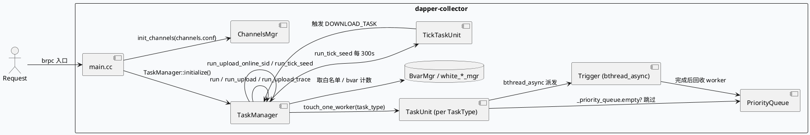
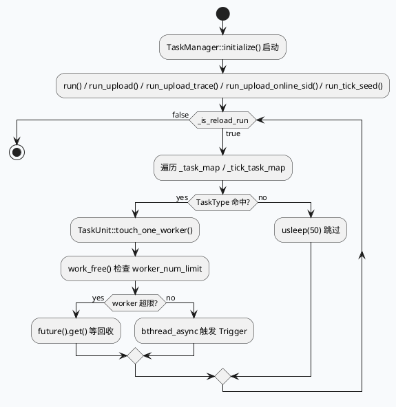

# dapper-collector 任务调度框架：TaskManager、TaskUnit、TickTaskUnit 与 ChannelsMgr

> 运行说明：2026-08-26 未发现 `daily-plan-20260826.json` 文件，按历史未覆盖主题 fallback 到 `dapper-collector` 的任务调度与跨切面通道框架。当前 cron 环境未验证 KU 可用性，KU/业务背景需人工补充；本文只使用本地代码与配置证据。

<div class="arch-wrapper" style="display:flex;gap:12px;align-items:stretch;background:#f8fafc;border:1px solid #d8e2ef;border-radius:8px;padding:14px;color:#1f2937;font-family:Inter,Arial,sans-serif;">
  <div class="arch-main" style="flex:1;min-width:0;">
    <div style="font-size:20px;font-weight:800;margin:0 0 10px 0;">任务调度与跨切面通道全景</div>
    <div class="arch-layer application" style="background:#fff;border:1px solid #cbd5e1;border-radius:8px;padding:10px;margin-bottom:10px;">
      <b style="display:block;margin-bottom:6px;color:#334155;">调度入口</b>
      <div style="display:grid;grid-template-columns:repeat(3,minmax(0,1fr));gap:8px;">
        <div style="background:#eef4f8;border-left:4px solid #3d5a80;padding:8px;border-radius:6px;">`main.cc:51-58`：注册 collector_service、bns_permission、白名单_mgr；初始化 TaskManager。</div>
        <div style="background:#eef4f8;border-left:4px solid #3d5a80;padding:8px;border-radius:6px;">`TaskManager::initialize()` 同时启动 run/run_upload/run_upload_trace/run_upload_online_sid/run_tick_seed 五个常驻线程。</div>
        <div style="background:#eef4f8;border-left:4px solid #3d5a80;padding:8px;border-radius:6px;">`TaskUnit::touch_one_worker()` 在每个 task_type 上用 bthread_async 触发对应 Trigger。</div>
      </div>
    </div>
    <div class="arch-layer ai" style="background:#fff;border:1px solid #cbd5e1;border-radius:8px;padding:10px;margin-bottom:10px;">
      <b style="display:block;margin-bottom:6px;color:#334155;">并发与限流</b>
      <div style="display:grid;grid-template-columns:repeat(2,minmax(0,1fr));gap:8px;">
        <div style="background:#eef4f8;border-left:4px solid #5b3d80;padding:8px;border-radius:6px;">`TaskUnit::work_free()` 用 `FLAGS_worker_num_limit_l1/l2` 限制并发，超过则阻塞并 `future().get()` 等旧任务。</div>
        <div style="background:#eef4f8;border-left:4px solid #5b3d80;padding:8px;border-radius:6px;">`PriorityQueue::push()` 走 `bthread_mutex` + `bthread_cond_signal`，跨 worker 唤醒。</div>
      </div>
    </div>
    <div class="arch-layer data" style="background:#fff;border:1px solid #cbd5e1;border-radius:8px;padding:10px;margin-bottom:10px;">
      <b style="display:block;margin-bottom:6px;color:#334155;">数据侧</b>
      <div style="display:grid;grid-template-columns:repeat(2,minmax(0,1fr));gap:8px;">
        <div style="background:#f3f8f4;border-left:4px solid #2d6a4f;padding:8px;border-radius:6px;">`TaskManager::store_task()` 用 `_task_map<TaskType, TaskUnit>` 缓存，单线程遍历 + 任务派发。</div>
        <div style="background:#f3f8f4;border-left:4px solid #2d6a4f;padding:8px;border-radius:6px;">`TickTaskUnit::pop()` 走堆顶时间窗 + `CacheComponent` MurmurHash 去重，触发 DOWNLOAD_TASK。</div>
      </div>
    </div>
  </div>
  <div class="arch-sidebar" style="width:260px;min-width:260px;">
    <div class="arch-layer infra" style="background:#fff;border:1px solid #cbd5e1;border-radius:8px;padding:10px;height:100%;">
      <b style="display:block;margin-bottom:6px;color:#334155;">跨切面通道</b>
      <div style="font-size:13px;line-height:1.55;color:#334155;">`include/common/channels.h:22-30`：单例 `ChannelsMgr::get_instance().get_mgr().init_channels("channels.conf")` 加载。</div>
      <div style="font-size:13px;line-height:1.55;color:#334155;margin-top:8px;">`conf/channels.conf`：CollectorTimeConvChannel、bns 列表 `list://10.9.224.45:8991`、snappy/gzip、max_retry/timeout 走 baidu_std 协议。</div>
      <div style="font-size:13px;line-height:1.55;color:#334155;margin-top:8px;">`main.cc:48-50`：用 `DEFINE_string(compress_type, "snappy", ...)`、`<baidu/feed/mlarch/babylon/reusable_rpc_protocol.h>` 复用 RPC 协议。</div>
    </div>
  </div>
</div>

## 核心链路





```infographic
sequence-ascending-steps
  data
    title dapper-collector 调度运行步骤
    desc 从入口线程池到 Trigger 派发的全景
    items
      - label 入口装配
        desc main.cc 注册 collector_service、白名单_mgr 并启动 TaskManager
      - label 多线程常驻
        desc run 系列五个 std::thread 各自按 TaskType 过滤遍历
      - label TaskUnit 派发
        desc work_free 控并发，按 task_type 选择 Trigger
      - label bthread_async
        desc 用 babylon::bthread_async 启动异步任务并把 future 装入 worker 队列
      - label TickTaskUnit
        desc 周期 300s 触发 DOWNLOAD_TASK，CacheComponent 去重
```

## 结构信息图

```infographic
compare-hierarchy-left-right-circle-node-pill-badge
  data
    title 配置与运行时的职责划分
    items
      - label conf/gflags.conf
        desc worker_num_limit_l1/l2、upload_batch_size_limit、idc_index 等运行时参数
      - label conf/channels.conf
        desc 跨服务的 baidu_std RPC 通道注册 (CollectorTimeConvChannel)
      - label conf/cache.conf
        desc CacheComponent 后端（用于 tick_task_timeliness MurmurHash 去重）
      - label task_manager.cc
        desc 五大常驻线程 + store_task 入口
      - label task_unit.cc
        desc 单 TaskType 的优先级队列 + worker 池 + Trigger 派发
      - label tick_task_unit.cc
        desc 周期 tick，CacheComponent 去重后转 DOWNLOAD_TASK
      - label include/manager/task_manager.h
        desc _task_map<TaskType, TaskUnit> 与 _tick_task_map 索引
```

## 关键证据

- `main.cc:51-58`：`TaskManager::initialize()`、`run_upload_online_sid`、`run_tick_seed` 等常驻线程统一入口；同一文件还定义了 `compress_type`、`trace_database`、`origin_key_database`、`aggregate_info_database`、`sndb_conf_path`、`sndb_conf_file`、`module_name` 等跨进程 gflags。
- `src/manager/task_manager.cc:55-145`：五个 `run_*()` 各自用 `std::thread + while(_is_reload_run)` 循环，按 `TaskType::UPLOAD_TASK / UPLOAD_TRACE_TASK / UPLOAD_ONLINE_SID_TASK` 过滤遍历 `_task_map`，以 `usleep(50)` 让出 CPU。
- `src/manager/task_manager.cc:147-160`：`run_tick_seed()` 以 `sleep(300)` 为周期，对 `_tick_task_map` 做 `pop()` 触发下游 download 任务。
- `src/manager/task_manager.cc:185-220`：将外部传入的 `MidData` 通过 `_tick_task_map[TickTaskType::TASK_DAFAULT].push_tick_seed(mid_data_ptr)` 注入 Tick 调度。
- `src/manager/task_unit.cc:54-91`：`PriorityQueue<T>::push()` 用 `bthread_mutex_lock + _queue.push_back + bthread_cond_signal` 跨 worker 唤醒消费者。
- `src/manager/task_unit.cc:90-105`：`work_free()` 用 `FLAGS_worker_num_limit_l2`（默认 10）和 `_task_type == CALCULATE_TASK` 时的 `_l1`（默认 5）双重限制并发，超限时 `trigger->future().get()` 阻塞回收。
- `src/manager/task_unit.cc:107-170`：`touch_one_worker()` 用宏 `TOUCH_TRIGGER(Trigger, trigger, func)` 包装 `babylon::bthread_async`，并把 `trigger->future()` 装入 `_worker` 队列；按 `TaskType::CALCULATE_TASK / UPLOAD_TASK / UPLOAD_TRACE_TASK / UPLOAD_ONLINE_SID_TASK / DOWNLOAD_TASK` 选取 `CalculateTrigger / UploadTrigger / DownloadTrigger`。
- `src/manager/tick_task_unit.cc:18-37`：`TickTaskUnit::push/pop` 走优先级队列 + `tirgger_time_s > now` 拒绝未到期元素；`pop` 成功后调用 `TaskManager::get_instance().store_task(TaskType::DOWNLOAD_TASK, data)`。
- `src/manager/tick_task_unit.cc:39-50`：`push_tick_seed` 用 `database + duration + req_s` 拼 MurmurHash32，命中 `CacheComponent("tick_task_timeliness")` 时返回 `-1` 实现周期内去重。
- `src/processor/collector_assemble.cpp:44-48`：`CollctorAssemble::init()` 用 `ChannelsMgr::get_instance().get_mgr().init_channels("channels.conf")` 加载 RPC 通道；失败时 `LOG(WARNING) + return false`，不抛 fatal。
- `include/common/channels.h:22-30`：`ChannelsMgr` 用 Meyer's singleton 包装 `_mgr`，并把 conf 文件路径延迟到 `init_channels` 时才解析。
- `conf/channels.conf`：`CollectorTimeConvChannel`、`lb=c_murmurhash`、`max_retry=1`、`protocol=baidu_std`、`bns=list://10.9.224.45:8991`、`timeout_ms=15`，典型跨 IDC 调出配置。

## Pitfalls

<div style="display:grid;grid-template-columns:repeat(2,minmax(0,1fr));gap:10px;margin-top:8px;">
  <div style="background:#fff;border:1px solid #d8e2ef;border-left:4px solid #b8432f;border-radius:8px;padding:12px;">
    <div style="font-weight:700;color:#1f2937;margin-bottom:6px;">worker_num_limit 是软限制，阻塞路径要小心</div>
    <div style="color:#334155;line-height:1.55;">`work_free()` 在超限时用 `future().get()` 阻塞回收，这意味着上游 push 速度若远高于 worker 处理速度，主调度线程会卡在 `_worker.pop(...)`，进而影响其他 TaskType 的派发。</div>
  </div>
  <div style="background:#fff;border:1px solid #d8e2ef;border-left:4px solid #b8432f;border-radius:8px;padding:12px;">
    <div style="font-weight:700;color:#1f2937;margin-bottom:6px;">channels.conf 加载失败只 WARNING，不阻断启动</div>
    <div style="color:#334155;line-height:1.55;">`CollctorAssemble::init()` 在 `init_channels` 失败时仅返回 `false`，进程不会退出，但下游 Conv 调用会因为拿不到 channel 而失败，需要单独探测。</div>
  </div>
  <div style="background:#fff;border:1px solid #d8e2ef;border-left:4px solid #b8432f;border-radius:8px;padding:12px;">
    <div style="font-weight:700;color:#1f2937;margin-bottom:6px;">Tick 周期去重依赖 CacheComponent</div>
    <div style="color:#334155;line-height:1.55;">`tick_task_timeliness` 的 MurmurHash 周期去重只在 CacheComponent 后端存活期内有效，cache 重启或换 backend 时会丢失去重状态，可能出现同一窗口重复 trigger。</div>
  </div>
  <div style="background:#fff;border:1px solid #d8e2ef;border-left:4px solid #b8432f;border-radius:8px;padding:12px;">
    <div style="font-weight:700;color:#1f2937;margin-bottom:6px;">TaskType 字符串硬编码在 macro 中</div>
    <div style="color:#334155;line-height:1.55;">`touch_one_worker` 用 `if/else if` 链 + 宏硬编码五种 TaskType，新增 TaskType 必须同步修改该分支与 `TaskUnit::store_data`，否则会被静默忽略。</div>
  </div>
</div>

## 调试 Checklist

```infographic
list-column-done-list
  data
    title 调试 checklist
    items
      - label 确认 main.cc 启动后 TaskManager::initialize() 成功
        done true
      - label gflags.conf 中 worker_num_limit_l1/l2 与业务并发匹配
        done true
      - label channels.conf 中 bns 列表可解析，timeout_ms 充足
        done true
      - label TaskManager 的五大 run_* 线程已起来（看 bvar）
        done true
      - label TaskUnit::touch_one_worker 命中 task_type 分支（看 LOG(NOTICE)）
        done true
      - label TickTaskUnit::pop 触发 DOWNLOAD_TASK（看 store_task 日志）
        done true
      - label CacheComponent::is_in("tick_task_timeliness") 命中率符合预期
        done true
```

## 证据来源

- `main.cc`
- `src/manager/task_manager.cc`
- `src/manager/task_unit.cc`
- `src/manager/tick_task_unit.cc`
- `src/processor/collector_assemble.cpp`
- `include/common/channels.h`
- `include/manager/task_manager.h`
- `conf/channels.conf`
- `conf/gflags.conf`
- `conf/cache.conf`