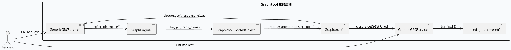
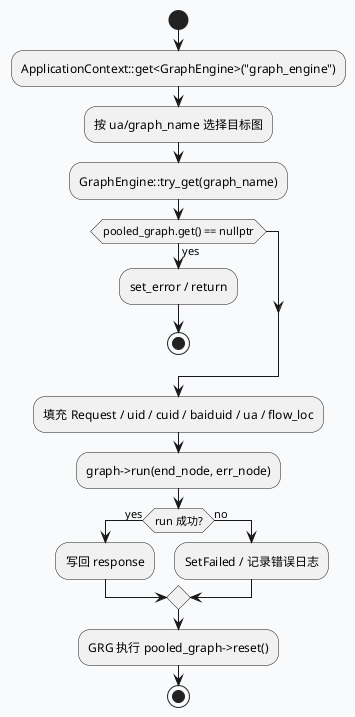

# GraphPool 对象池复用与 reset 生命周期：GRC/GRG 请求图的取用、运行与回收

> 运行说明：daily-plan 目录里没有 2026-08-27 对应计划文件；按历史未覆盖主题 fallback 到 GraphPool 生命周期这条基础链路。当前 cron 环境未验证 KU 可用性，KU/业务背景需人工补充；本文只使用本地代码证据。

<div class="arch-wrapper" style="display:flex;gap:12px;align-items:stretch;background:#f8fafc;border:1px solid #d8e2ef;border-radius:8px;padding:14px;color:#1f2937;font-family:Inter,Arial,sans-serif;"><div class="arch-main" style="flex:1;min-width:0;"><div style="font-size:20px;font-weight:800;margin:0 0 10px 0;">GraphPool 请求图生命周期全景</div><div class="arch-layer application" style="background:#fff;border:1px solid #cbd5e1;border-radius:8px;padding:10px;margin-bottom:10px;"><b style="display:block;margin-bottom:6px;color:#334155;">入口与取图</b><div style="display:grid;grid-template-columns:repeat(3,minmax(0,1fr));gap:8px;"><div style="background:#eef4f8;border-left:4px solid #3d5a80;padding:8px;border-radius:6px;">`src/service/grc_service.cpp:178-205`：`ApplicationContext::get<GraphEngine>("graph_engine")` 后按 `ua` 选择 `graph_name`，再 `try_get(graph_name)` 拿 `GraphPool::PooledObject`。</div><div style="background:#eef4f8;border-left:4px solid #3d5a80;padding:8px;border-radius:6px;">`src/service/grg_service.cpp:48-89`：GRG 也通过 `GraphEngine::try_get(graph_name)` 取图，随后填充请求上下文并执行 `run()`。</div><div style="background:#eef4f8;border-left:4px solid #3d5a80;padding:8px;border-radius:6px;">`GraphPool = ObjectPool<Graph>`：池化的是 `Graph`，不是单次请求上下文；拿到后要显式 `reset()`。</div></div></div><div class="arch-layer ai" style="background:#fff;border:1px solid #cbd5e1;border-radius:8px;padding:10px;margin-bottom:10px;"><b style="display:block;margin-bottom:6px;color:#334155;">运行与回收</b><div style="display:grid;grid-template-columns:repeat(2,minmax(0,1fr));gap:8px;"><div style="background:#eef4f8;border-left:4px solid #5b3d80;padding:8px;border-radius:6px;">`Graph::run(end_node, err_node)` 返回后，GRC/GRG 都要读取返回值并决定是否 `response->Swap(...)` 或 `SetFailed(...)`。</div><div style="background:#eef4f8;border-left:4px solid #5b3d80;padding:8px;border-radius:6px;">GRG 在 `run()` 结束后执行 `pooled_graph->reset()`，把图状态还原后再归还对象池。</div></div></div><div class="arch-layer data" style="background:#fff;border:1px solid #cbd5e1;border-radius:8px;padding:10px;margin-bottom:10px;"><b style="display:block;margin-bottom:6px;color:#334155;">数据侧</b><div style="display:grid;grid-template-columns:repeat(2,minmax(0,1fr));gap:8px;"><div style="background:#f3f8f4;border-left:4px solid #2d6a4f;padding:8px;border-radius:6px;">`fill_common_data` / `emit_common_data` 把 `Request`、`uid`、`cuid`、`baiduid`、`ua`、`flow_loc` 写入图节点。</div><div style="background:#f3f8f4;border-left:4px solid #2d6a4f;padding:8px;border-radius:6px;">图节点与 `FrameworkContext` 绑定，`graph_begin_us`、`timeout_cntl`、`log_head` 都在这条链路上注入。</div></div></div></div><div class="arch-sidebar" style="width:260px;min-width:260px;"><div class="arch-layer infra" style="background:#fff;border:1px solid #cbd5e1;border-radius:8px;padding:10px;height:100%;"><b style="display:block;margin-bottom:6px;color:#334155;">关联范围</b><div style="font-size:13px;line-height:1.55;color:#334155;">`src/service/grc_service.cpp`：GRC 图选择、取图、运行、异常处理。</div><div style="font-size:13px;line-height:1.55;color:#334155;margin-top:8px;">`src/service/grg_service.cpp`：GRG 请求填充、图运行、`reset()` 回收。</div><div style="font-size:13px;line-height:1.55;color:#334155;margin-top:8px;">`src/service/grc_service.h` / `src/service/grg_service.h`：服务接口与 `GraphPool`、`GraphEngine`、`DTController` 依赖。</div></div></div></div>

## 核心链路





```infographic
sequence-ascending-steps
  data
    title GraphPool 生命周期步骤
    desc 从取图到回收到池的最短闭环
    items
      - label 获取 GraphEngine
        desc 通过 ApplicationContext 拿到 graph_engine
      - label 选择 graph_name
        desc GRC 按 ua 路由，GRG 由 get_graph_name() 决定
      - label try_get()
        desc 从 ObjectPool<Graph> 中取出 PooledObject
      - label run()
        desc 填充数据后执行 graph->run(end_node, err_node)
      - label reset()
        desc GRG 在查询完成后把图状态复位
```

## 结构信息图

```infographic
compare-hierarchy-left-right-circle-node-pill-badge
  data
    title 代码职责分层
    items
      - label src/service/grc_service.cpp
        desc GRC 入口，图选择 + 运行 + 结果回写
      - label src/service/grg_service.cpp
        desc GRG 入口，图选择 + 动态超时 + reset 回收
      - label src/service/grc_service.h
        desc GenericGRCService 接口与 GraphPool 别名
      - label src/service/grg_service.h
        desc GenericGRGService 接口与 DTController / GraphPool 依赖
      - label baidu/feed/general/framework/graph_engine.h
        desc GraphEngine 与对象池取图能力
      - label baidu/feed/mlarch/babylon/reusable_rpc_protocol.h
        desc 异步 closure 与请求响应协议
      - label baidu/graph/engine/graph.h
        desc Graph 节点、context、run 接口
```

## 关键证据

- `src/service/grc_service.cpp:178-205`：`GraphEngine` 取图、按 `ua` 选择 `graph_name`、`try_get(graph_name)` 取出 `GraphPool::PooledObject`。
- `src/service/grc_service.cpp:206-220`：把 `REQ_INFO` 注入图后调用 `run(graph, graph_name, sctx, done, cntl, res_cnt)`。
- `src/service/grg_service.cpp:48-89`：`GraphEngine::try_get(graph_name)` 后填充基础数据，再执行 `run()`。
- `src/service/grg_service.cpp:91-92`：`pooled_graph->reset()`，说明 GRG 对池化图做显式复位。
- `src/service/grg_service.h:14-64`：`GenericGRGService` 直接依赖 `DynamicTimeOutPlugin` 和 `Graph`，接口边界清晰。
- `src/service/grc_service.h:14-66`：`GenericGRCService` 持有 `_dynamic_timeout_plugin`、`_req_extract_plugin`，但图对象仍通过 `GraphEngine` 提供。
- `src/service/grc_service.cpp:88-150`：`emit_common_data()` 把请求、uid、cuid、baiduid、ua、flow_loc、tab、product、is_debug、is_vip_cuid 等写入图。
- `src/service/grg_service.cpp:121-200`：`fill_basic_data_for_graph()` 写入同类基础字段，并把 `timeout_cntl` 装到 `MutableFrameworkContext`。
- `src/service/grg_service.cpp:203-265`：`run()` 里 `graph->run(end_node, err_node)` 后决定 `SetFailed` 还是 `response->Swap(...)`。

## Pitfalls

<div style="display:grid;grid-template-columns:repeat(2,minmax(0,1fr));gap:10px;margin-top:8px;"><div style="background:#fff;border:1px solid #d8e2ef;border-left:4px solid #b8432f;border-radius:8px;padding:12px;"><div style="font-weight:700;color:#1f2937;margin-bottom:6px;">GraphPool 不是一次性对象</div><div style="color:#334155;line-height:1.55;">`GraphPool::PooledObject` 代表可复用图实例，运行结束不复位会把上一次请求的 context、log 或 timeout 状态带入下一次。</div></div><div style="background:#fff;border:1px solid #d8e2ef;border-left:4px solid #b8432f;border-radius:8px;padding:12px;"><div style="font-weight:700;color:#1f2937;margin-bottom:6px;">GRC 和 GRG 的回收责任不同</div><div style="color:#334155;line-height:1.55;">GRC 侧主要负责运行与回写，GRG 侧明确调用 `reset()`；排障时要区分是哪一层忘了归还池化对象。</div></div><div style="background:#fff;border:1px solid #d8e2ef;border-left:4px solid #b8432f;border-radius:8px;padding:12px;"><div style="font-weight:700;color:#1f2937;margin-bottom:6px;">图状态与 FrameworkContext 强耦合</div><div style="color:#334155;line-height:1.55;">`timeout_cntl`、`graph_begin_us`、`log_head` 等都写进图上下文，复用前必须确认这些字段不会残留旧值。</div></div><div style="background:#fff;border:1px solid #d8e2ef;border-left:4px solid #b8432f;border-radius:8px;padding:12px;"><div style="font-weight:700;color:#1f2937;margin-bottom:6px;">空图要走显式错误分支</div><div style="color:#334155;line-height:1.55;">`try_get(graph_name)` 可能返回空对象，代码里已走 `set_error`。如果上游图名配置错误，故障会表现为业务错误而不是崩溃。</div></div></div>

## 调试 Checklist

```infographic
list-column-done-list
  data
    title 调试 checklist
    items
      - label 确认 GraphEngine 已在 ApplicationContext 注册
        done true
      - label 观察 ua 到 graph_name 的分流是否命中预期图
        done true
      - label 检查 try_get(graph_name) 是否返回空图
        done true
      - label 确认 run() 后 GRC/GRG 都正确处理 closure 结果
        done true
      - label GRG 路径执行后 pooled_graph->reset() 已调用
        done true
      - label 图上下文里的 timeout_cntl / graph_begin_us 已刷新
        done true
      - label 重复请求下未出现上一次请求字段残留
        done true
```

## 证据来源

- `src/service/grc_service.cpp`
- `src/service/grg_service.cpp`
- `src/service/grc_service.h`
- `src/service/grg_service.h`
- `baidu/feed/general/framework/graph_engine.h`
- `baidu/graph/engine/graph.h`
- `baidu/feed/mlarch/babylon/reusable_rpc_protocol.h`
