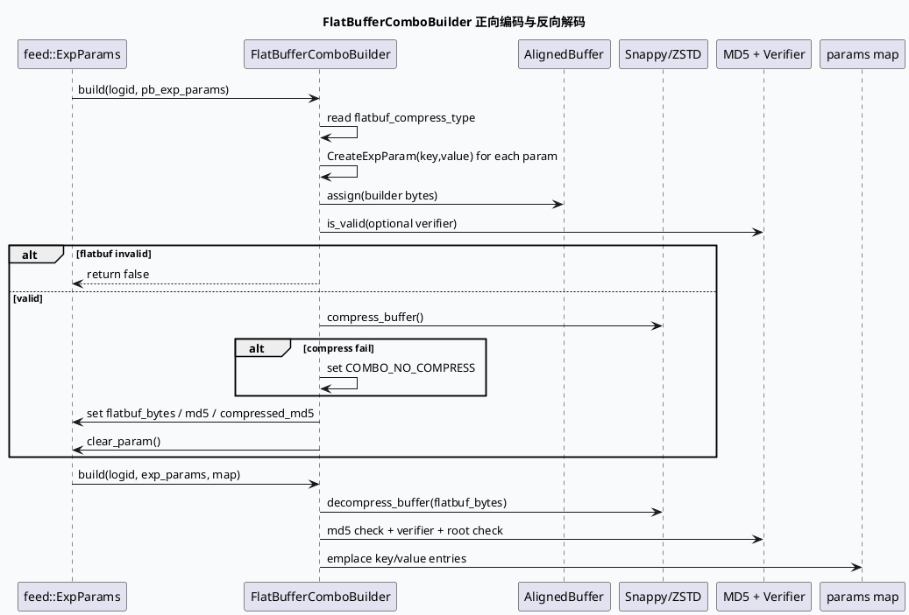

# 2026-09-17 基础库理解：ExpParam FlatBuffer ComboBuilder 的编码、压缩与校验合同

> 日期：2026-09-17  
> 主题选择：未发现本日有效 daily-plan；近期笔记已覆盖 AEF、SIA/BVAR、ApplicationContext、GraphFunction、ObjectPool 等主题，因此回退到邻近未覆盖的 **feed-general/exp-param 参数实验基础库合同**。KU 正文未读取，业务背景需人工补充；本文只依据本地代码证据。  
> 范围：`FlatBufferComboBuilder` 如何把 `feed::ExpParams` 的 protobuf 参数表转成 flatbuffer bytes，如何压缩、写回 MD5 与压缩类型，以及服务端反向解码时如何校验完整性。

---

## 0. 架构全景图

<div style="font-family:system-ui,-apple-system,BlinkMacSystemFont,'Segoe UI',sans-serif;background:#f5f7fa;border:1px solid #d8e1ea;border-radius:8px;padding:16px;margin:16px 0;color:#243b53;line-height:1.45;"><div style="display:grid;grid-template-columns:1fr 1.15fr 1fr;gap:12px;align-items:stretch;"><div style="background:#ffffff;border:1px solid #cbd5e1;border-radius:8px;padding:12px;"><div style="font-size:12px;font-weight:800;color:#52606d;text-transform:uppercase;letter-spacing:.04em;">Protobuf 参数表</div><div style="margin-top:8px;font-size:15px;color:#102a43;font-weight:700;">feed::ExpParams.param[]</div><div style="margin-top:8px;font-size:12px;color:#52606d;">输入仍是 key/value repeated 字段；构建器只负责二进制承载格式转换，不改变参数语义。</div></div><div style="background:#ffffff;border:1px solid #cbd5e1;border-radius:8px;padding:12px;"><div style="font-size:12px;font-weight:800;color:#52606d;text-transform:uppercase;letter-spacing:.04em;">ComboBuilder 合同</div><div style="margin-top:8px;font-size:15px;color:#102a43;font-weight:700;">align → flatbuf → compress → md5</div><div style="margin-top:8px;font-size:12px;color:#52606d;">AlignedBuffer 保证 flatbuffer root 对齐；可选 verify；压缩失败时软降级为 no-compress。</div></div><div style="background:#ffffff;border:1px solid #cbd5e1;border-radius:8px;padding:12px;"><div style="font-size:12px;font-weight:800;color:#102a43;text-transform:uppercase;letter-spacing:.04em;">下游读取</div><div style="margin-top:8px;font-size:15px;color:#102a43;font-weight:700;">flatbuf_bytes → unordered_map</div><div style="margin-top:8px;font-size:12px;color:#52606d;">反向 build 解压、校验 MD5/Verifier/root，再填充扁平化参数表。</div></div></div><div style="margin-top:12px;display:grid;grid-template-columns:1fr 42px 1fr 42px 1fr 42px 1fr;gap:8px;align-items:center;"><div style="background:#e0f2fe;border:1px solid #bae6fd;border-radius:6px;padding:10px;text-align:center;color:#075985;font-size:13px;">param key/value</div><div style="text-align:center;color:#64748b;font-weight:800;">→</div><div style="background:#ecfdf5;border:1px solid #bbf7d0;border-radius:6px;padding:10px;text-align:center;color:#166534;font-size:13px;">FlatBufferBuilder</div><div style="text-align:center;color:#64748b;font-weight:800;">→</div><div style="background:#fff7ed;border:1px solid #fed7aa;border-radius:6px;padding:10px;text-align:center;color:#9a3412;font-size:13px;">Snappy/ZSTD/None</div><div style="text-align:center;color:#64748b;font-weight:800;">→</div><div style="background:#f1f5f9;border:1px solid #cbd5e1;border-radius:6px;padding:10px;text-align:center;color:#334155;font-size:13px;">flatbuf_bytes + md5</div></div></div>

**一句话结论：** 这个基础库合同的核心不是“把参数压小”，而是给 `ExpParams` 提供一条可降级、可校验、可反解的二进制参数通道；排查时要同时看对齐、压缩类型、MD5 和 verifier 四个面。

## 1. 核心流程图



## 2. 合同结构信息图

```infographic
infographic list-grid-badge-card
data
  title ComboBuilder 的六个基础合同面
  desc 任一面异常都会让实验参数落到旧 protobuf 或空参数路径
  items
    - label aligned buffer
      desc posix_memalign 16-byte 起步，避免 flatbuffer root 原地解释时违反 4-byte 对齐
      icon mdi:format-align-left
    - label errno bands
      desc 0 成功，正数软退，负数硬失败，方便区分降级和不可用
      icon mdi:counter
    - label forward build
      desc param repeated 被写为 flatbuffer vector，随后写回 flatbuf_bytes 并清空 param
      icon mdi:arrow-right-bold
    - label compression
      desc 支持 no-compress、snappy、zstd，combo_no_compress 可紧急绕开压缩路径
      icon mdi:zip-box-outline
    - label integrity
      desc raw md5 与 compressed md5 分别覆盖解压后和压缩前 bytes
      icon mdi:shield-check-outline
    - label reverse map
      desc 解压和校验通过后才把 flatbuffer param 转成 unordered_map
      icon mdi:table-key
 theme
  palette #3D5A80 #0F766E #F59E0B
```

## 3. 关键机制拆解

### 3.1 `AlignedBuffer` 是 flatbuffer 原地读取的前置条件

`src/flatbuf_combo_builder.h:60-139` 用 `posix_memalign(kAlign=16)` 管理 buffer，并明确说明 `std::vector<uint8_t>` 在全局 allocator 被 hook 后可能只满足 1-byte 对齐。`src/flatbuf_combo_builder.hpp:13-24` 在 `is_valid()` 中继续检查 `(buffer_ptr & 0x3u) == 0`，这说明对齐不是性能优化，而是 flatbuffer root 原地解释的正确性合同。

### 3.2 errno 被分成成功、软退和硬失败三类

`src/flatbuf_combo_builder.h:24-54` 把 `FlatBufBuildErrno` 分为成功区、压缩或局部越界软退出区、解压/校验/结构硬失败区。正向 build 中 `src/flatbuf_combo_builder.hpp:86-90` 对压缩错误会切回 no-compress；反向 build 中 `src/flatbuf_combo_builder.hpp:197-203` 解压错误直接返回 false。这个分层决定了线上能否继续用未压缩 flatbuffer 兜底。

### 3.3 正向编码会修改原始 protobuf 对象

`src/flatbuf_combo_builder.hpp:37-65` 遍历 `pb_exp_params.param()` 创建 flatbuffer `ExpParam` 列表；`src/flatbuf_combo_builder.hpp:95-100` 通过 `const_cast` 写回 `flatbuf_bytes`、压缩类型和两个 MD5，并 `clear_param()`。调用方如果还需要原始 repeated param，必须在调用前复制，否则 build 后 protobuf 已经切换为 flatbuffer 承载。

### 3.4 压缩失败是软降级，不是 build 失败

`src/flatbuf_combo_builder.hpp:113-164` 按压缩类型进入 no-compress、snappy 或 zstd 分支。snappy 输出长度异常、zstd error、未知压缩类型都会返回 errno；但正向 build 对压缩错误的处理是 `set COMBO_NO_COMPRESS`。因此线上看到 `flatbuf_compress_type` 退回 no-compress 时，不应立刻判断参数丢失，要继续核对 `flatbuf_bytes` 和 raw md5。

### 3.5 反向解码先做解压和完整性，再读参数表

`src/flatbuf_combo_builder.hpp:176-224` 首先处理无 `flatbuf_bytes`、压缩类型和解压错误，再校验 raw md5 与 compressed md5；`src/flatbuf_combo_builder.hpp:227-250` 继续执行 verifier、root 和 param vector 检查；`src/flatbuf_combo_builder.hpp:252-262` 才向 map 写 key/value。服务端排查参数空时，应先看 decode errno，而不是只看 map size。

## 4. 正反向对账信息图

```infographic
infographic compare-hierarchy-left-right-circle-node-pill-badge
data
  title 正向编码与反向解码的对账点
  desc 两侧日志字段不同，但可以通过 md5、compress_type 和 errno 串起来
  items
    - label encode side
      desc CreateVector、is_valid、compress、md5、clear_param
      value 1
      icon mdi:package-up
      children
        - label align
          desc AlignedBuffer 承载 flatbuffer bytes
        - label fallback
          desc 压缩失败后 no-compress 兜底
        - label writeback
          desc flatbuf_bytes 写回并清空 param
    - label decode side
      desc decompress、md5、verifier、root、param vector
      value 2
      icon mdi:package-down
      children
        - label no bytes
          desc FBERR_NO_FLATBUF_BYTES 是正常缺省态
        - label integrity
          desc raw/compressed md5 任一不匹配都会失败
        - label map
          desc root 和 param vector 正常后才填 params
 theme
  palette #3D5A80 #0F766E #F59E0B
```

## 5. Pitfalls 卡片

<div style="font-family:Inter,Arial,sans-serif;background:#ffffff;border:1px solid #d7dee8;border-left:6px solid #3d5a80;border-radius:8px;padding:18px;margin:18px 0;color:#1f2937;line-height:1.6;"><div style="font-size:12px;letter-spacing:.08em;text-transform:uppercase;color:#3d5a80;font-weight:800;">Pitfalls · FlatBuffer Combo</div><div style="font-size:24px;line-height:1.2;font-weight:900;margin:7px 0 12px;">flatbuf_bytes 存在，不代表参数一定可用</div><div style="display:grid;grid-template-columns:1.35fr 1fr;gap:12px;"><div style="background:#f8fafc;border-top:3px solid #3d5a80;border-radius:6px;padding:12px;font-size:14px;"><b>四个常见误判：</b><br>① 忽略 build 会 clear 原始 param；② 把压缩失败误判为参数丢失；③ 只看 flatbuf_bytes 非空，不看 md5/verifier/root；④ 忘记 align violation 会让原地解释失败。</div><div style="background:#fff7ed;border-top:3px solid #f59e0b;border-radius:6px;padding:12px;font-size:14px;color:#7c2d12;"><b>核对顺序</b><br>compress_type → align → decode errno → raw md5 → compressed md5 → verifier → root → param vector → map size。</div></div><div style="margin-top:12px;font-weight:900;color:#3d5a80;">∎ 先定位二进制承载层，再判断实验参数语义。</div></div>

## 6. 调试 checklist

```infographic
infographic list-column-done-list
data
  title FlatBuffer ComboBuilder 调试清单
  desc 适用于参数空、decode 失败、压缩降级和实验开关不生效
  items
    - label 确认输入形态
      desc build 前 ExpParams.param_size 是否符合预期，build 后是否被 clear_param
      done true
    - label 检查压缩类型
      desc combo_no_compress 是否打开，flatbuf_compress_type 是否被改成 no-compress
      done true
    - label 检查对齐
      desc is_valid 是否返回 FBERR_ALIGN_VIOLATION
      done false
    - label 核对 MD5
      desc raw md5 与 compressed md5 分别对应解压后和压缩 bytes
      done false
    - label 开启 verifier
      desc enable_flatbuf_verify 或反向 build 的 is_valid(true) 是否报错
      done false
    - label 检查 root/vector
      desc GetExpParams 与 param vector 均非空后才看参数 map
      done false
    - label 区分软退硬错
      desc 正 errno 多为软退，负 errno 多为不可用路径
      done false
 theme
  palette #3D5A80 #0F766E #F59E0B
```

## 7. 证据来源

- `src/flatbuf_combo_builder.h:24-54`：`FlatBufBuildErrno` 的成功、软退、硬失败分层。
- `src/flatbuf_combo_builder.h:60-139`：`AlignedBuffer` 的 16-byte 对齐堆块管理。
- `src/flatbuf_combo_builder.h:147-203`：`FlatBufferComboBuilder` 的正向/反向 build 接口与压缩数据访问接口。
- `src/flatbuf_combo_builder.hpp:13-35`：buffer 空、4-byte 对齐和 optional verifier 校验。
- `src/flatbuf_combo_builder.hpp:37-100`：正向 build 创建 flatbuffer、计算 MD5、写回 `flatbuf_bytes` 并清空 param。
- `src/flatbuf_combo_builder.hpp:113-164`：no-compress、snappy、zstd 三种压缩分支。
- `src/flatbuf_combo_builder.hpp:176-262`：反向 build 的解压、MD5、verifier、root、param vector 与 map 写入。
- `src/flatbuf_combo_builder.hpp:277-340`：反向解压的 snappy/zstd 上限保护和错误码。

> KU 正文未读取，需人工补充线上 `ExpParams` 下发路径、灰度开关策略、压缩类型选择依据和 decode errno 监控口径。
