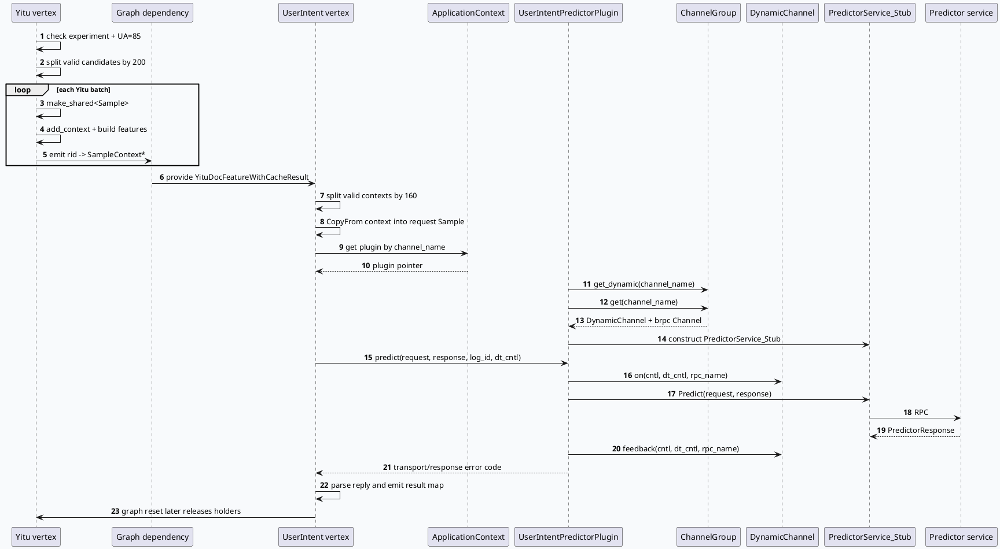

# 2026-09-25 基础库代码理解：GRC Yitu Sample owner 与 PredictorPlugin 接线

> 日期：2026-09-25（周五）
> 主题选择：未发现目标日期有效 daily-plan；仓库中仅有已过期的 2026-05-29 计划。本次按邻近未覆盖基础库边界回退，聚焦 Yitu 文档特征 vertex 的 batch 并行、`SampleContext*` 所有权和 `UserIntentPredictorPlugin` 的 DynamicChannel/RPC 接线。KU 正文未读取，业务背景需人工补充；以下只陈述源码和 graph 配置可验证的行为。
> 配对关系：业务库笔记继续分析 predictor 结果可靠性、六类 q 的消费与调权；本文只分析生产者、运行时 owner 和插件框架合同。
> 范围：`src/processor/doc_feature_with_cache_yitu.cpp`、`src/processor/video_launch/user_intent_predict.cpp`、`src/plugin/user_intent_predictor.cpp`、`src/plugin/user_intent_predictor.h`、`conf/plugins/graph/vertex.conf`。

## 0. 架构全景图

<div style="font-family:system-ui,-apple-system,BlinkMacSystemFont,'Segoe UI',sans-serif;background:#f5f7fa;border:1px solid #d8e1ea;border-radius:8px;padding:16px;margin:16px 0;color:#243b53;line-height:1.45;"><div style="font-size:12px;font-weight:800;color:#52606d;text-transform:uppercase;letter-spacing:.05em;">GRC Yitu predictor 基础设施边界</div><div style="display:grid;grid-template-columns:1fr 28px 1.25fr 28px 1.15fr 28px 1fr;gap:8px;align-items:center;margin-top:12px;"><div style="background:#fff;border:1px solid #cbd5e1;border-left:4px solid #3d5a80;border-radius:6px;padding:11px;"><div style="font-size:15px;color:#102a43;font-weight:700;">Graph 输入</div><div style="margin-top:7px;font-size:12px;color:#52606d;">effect_queue、CommonInfo、SidInfo；配置层限制 UA=85。</div></div><div style="text-align:center;color:#64748b;font-size:20px;">→</div><div style="background:#fff;border:1px solid #cbd5e1;border-left:4px solid #2d6a4f;border-radius:6px;padding:11px;"><div style="font-size:15px;color:#102a43;font-weight:700;">Yitu producer</div><div style="margin-top:7px;font-size:12px;color:#52606d;">按 200 拆 batch；每个 batch 用 shared Sample 托管 context，并输出 rid 到裸指针 map。</div></div><div style="text-align:center;color:#64748b;font-size:20px;">→</div><div style="background:#fff;border:1px solid #cbd5e1;border-left:4px solid #9a5b28;border-radius:6px;padding:11px;"><div style="font-size:15px;color:#102a43;font-weight:700;">Predictor vertex</div><div style="margin-top:7px;font-size:12px;color:#52606d;">读取 map 后 CopyFrom 到请求 Sample；按 160 组装 predictor batch。</div></div><div style="text-align:center;color:#64748b;font-size:20px;">→</div><div style="background:#fff;border:1px solid #cbd5e1;border-left:4px solid #b8432f;border-radius:6px;padding:11px;"><div style="font-size:15px;color:#102a43;font-weight:700;">Plugin/RPC</div><div style="margin-top:7px;font-size:12px;color:#52606d;">channel_name 解析 DynamicChannel 与 brpc stub，统一 on、Predict、feedback 和 latency。</div></div></div><div style="margin-top:12px;background:#eaf2f8;border:1px solid #c9dbea;border-radius:6px;padding:10px;font-size:12px;color:#334e68;">核心不变量：`SampleContext*` 不是独立 owner；它必须在下游 `CopyFrom()` 完成前由对应 batch 的 `shared_ptr<Sample>` 保持有效。请求结束时 vertex reset 才清空 holder。</div></div>

## 1. 主题边界与核心结论

2026-09-24 的基础库笔记已覆盖 FeatureServicePlugin 的注册、动态通道和 RPC 生命周期；2026-09-25 的业务库笔记已覆盖 Yitu predictor 的结果准入和后续调权。因此本文把“基础设施合同”限定为三件事：

1. `YituDocFeatureWithCacheFunction` 如何把候选转换成可被下游使用的 `SampleContext*`。
2. 裸指针 map 如何通过 `_sample_holders` 与 graph 生命周期保持有效。
3. `UserIntentPredictorPlugin` 如何把配置中的逻辑 channel 绑定到 `DynamicChannel`、`PredictorService_Stub` 和统一观测路径。

源码中 Yitu vertex 在 `process()` 开始先清空 emit map，再检查依赖、实验命中和 UA；有效候选按 `_batch_size = 200` 拆分，并用 `bthread_async` 并行构造。每个 batch 的 `Sample` owner 放入 `_sample_holders`，map 只保存 `rid -> SampleContext*`。这是一条“owner 与索引分离”的 protobuf 传递合同，而不是值对象复制合同（`src/processor/doc_feature_with_cache_yitu.cpp:21-75`、`146-199`）。

Graph 配置将 `_doc_smaple` 声明为 `YituDocFeatureWithCacheResult`，并作为 `UserIntentPredictFunction` 的同类型依赖；预测 vertex 的 channel 是 `shoubai_yitu_predictor_2`（`conf/plugins/graph/vertex.conf:2603-2651`）。预测函数读取 context 后，重新创建自己的 `Sample`，对每个有效候选执行 `CopyFrom()`，再序列化到 `PredictorRequest.pass_through_sample`，因此下游不应缓存生产者的裸指针（`src/processor/video_launch/user_intent_predict.cpp:331-355`）。

## 2. Yitu producer 的 batch 与生命周期

### 2.1 入口门控先于资源分配

`process()` 先取得 emit map 并清空旧值，然后检查 `_sid_info`、`_common_info`。实验 `hit_user_intent_yanxu` 未命中或 UA 不是 85 时直接返回；之后统计 `_effect_queue` 中的非空候选，数量为零也直接返回（`src/processor/doc_feature_with_cache_yitu.cpp:29-57`）。这意味着 holder 分配只发生在确实有候选的命中请求中。

代码随后根据有效候选数计算 `batch_num`，预先 resize `batch_results` 与 `_sample_holders`，并 reserve future 列表。每个异步任务捕获对应结果 map 和 holder slot 的指针，调用 `process_single_batch()`；主线程等待全部 future 后再按 batch 顺序合并 map（`src/processor/doc_feature_with_cache_yitu.cpp:61-127`）。预分配的价值是避免 vector 扩容导致异步任务持有的 slot 引用失效。

### 2.2 owner 与裸指针的关系

`process_single_batch()` 通过 `std::make_shared<Sample>()` 创建当前 batch 的 owner，随后对每个非空 `RidTmpInfo` 调用 `add_context()`，填充 `ContentFeature` 和 `RecommendFeature`，并将返回的 `SampleContext*` 插入 `batch_result`（`src/processor/doc_feature_with_cache_yitu.cpp:149-175`）。

这里有一个明确的生命周期图：

- `_sample_holders[batch_index]` 持有 `Sample` 的 shared ownership。
- `batch_results[batch_index]` 只保存 context 的裸指针，不负责释放。
- 合并后的 `_doc_smaple` 仍然只是 `rid -> SampleContext*` 索引。
- 下游 predictor 必须在同一次 graph 请求内读取并复制 context。
- `reset()` 清空 `_sample_holders`，从而释放本请求的 protobuf owner（`src/processor/doc_feature_with_cache_yitu.cpp:191-199`）。

这也解释了为什么不能把 `_doc_smaple` 脱离 graph 请求缓存到插件或静态容器中：map 的 key/value 复制不会延长 `Sample` 的生命周期。

## 3. Graph 接线与 predictor plugin



### 3.1 配置类型与运行时类型必须一致

`vertex.conf` 中 Yitu producer emit 的数据类型为 `YituDocFeatureWithCacheResult`，实际由 `GRAPH_FUNCTION_INTERFACE` 展开为 `std::unordered_map<uint64_t, SampleContext*>`；预测 vertex 依赖同一个类型。预测 vertex 另有 `_user_response` 和 `_request_response` 两个带 `UA == 85 && EXP_hit_user_intent_yanxu` 条件的依赖，避免普通请求构造无意义的 predictor 请求（`src/processor/video_launch/user_intent_predict.cpp:469-480`、`conf/plugins/graph/vertex.conf:2622-2651`）。

`UserIntentPredictFunction::init()` 从 vertex 配置读取 `_channel_name`，再通过 `ApplicationContext::instance().get<UserIntentPredictorPlugin>()` 查找插件；找不到插件时初始化失败返回。插件注册名与 channel 均为 `shoubai_yitu_predictor_2`，其 `_rpc_name` 自动拼成 `shoubai_yitu_predictor_2_rpc`（`src/processor/video_launch/user_intent_predict.cpp:34-43`、`src/plugin/user_intent_predictor.cpp:76-78`、`src/plugin/user_intent_predictor.h:24-40`）。

### 3.2 wireup 的双通道合同

`UserIntentPredictorPlugin::wireup()` 先取得 `ChannelGroup`，再用同一个 `_channel_name` 获取 DynamicChannel 和静态 brpc Channel。任一为空都返回 `-1`；两者都存在时才构造 `PredictorService_Stub`（`src/plugin/user_intent_predictor.cpp:6-21`）。

因此，配置排障不能只确认远端服务地址存在，还要确认 channel group 同时完成两类绑定：

- 静态 Channel：承载 `PredictorService_Stub::Predict()`。
- DynamicChannel：承载动态超时、路由状态、`on()` 与 `feedback()`。

### 3.3 predict 的统一观测路径

`predict()` 创建 brpc Controller，写入 `log_id`，要求调用方传入有效的 `DTController`；随后按 `on -> Predict -> feedback` 顺序执行。返回码优先取 Controller 错误，其次取 `response.err_no()`；同时记录 channel、用户标识、远端地址、timeout、backup 和耗时，并把耗时写入 `_bvar_latency`（`src/plugin/user_intent_predictor.cpp:24-73`）。

预测 vertex 在 plugin 调用前后还通过 Dapper 记录 `call_user_intent_predict_batch`，因此一次失败应当同时对账 plugin 日志、DynamicChannel 状态、Dapper batch 记录和 response 的 `err_no`，不能只看远端是否收到请求（`src/processor/video_launch/user_intent_predict.cpp:366-410`）。

## 4. 基础设施合同信息图

```infographic
infographic sequence-ascending-steps
data
  title Yitu 到 Predictor 的五段基础合同
  desc 每一段都决定下一段能否安全读取或观测
  items
    - label 条件门控
      desc 实验命中、UA=85、依赖非空、有效候选数大于零
      icon mdi/filter-check
    - label owner 建立
      desc 每个 producer batch 创建 shared_ptr<Sample>，holder 负责维持 protobuf 生命周期
      icon mdi:database-lock
    - label 索引输出
      desc emit map 只保存 rid 到 SampleContext*，不复制也不释放 context
      icon mdi:key-link
    - label 下游复制
      desc predictor batch 通过 CopyFrom 把 context 复制进请求自己的 Sample
      icon mdi:content-copy
    - label 动态 RPC
      desc 同一 channel_name 同时绑定 DynamicChannel、brpc stub、on/feedback 和 latency
      icon mdi:lan-connect
  theme
    palette #3d5a80 #2d6a4f #9a5b28 #b8432f
```

```infographic
infographic list-grid-badge-card
data
  title 运行时字段与容量基线
  desc 用于配置核对、容量评估和日志对账
  items
    - label producer batch
      desc Yitu 默认 200；init 后 _batch_size=200
      icon mdi:view-grid
    - label predictor batch
      desc UserIntent 默认 160；注释写 150 但实际赋值为 160
      icon mdi:numeric
    - label owner slots
      desc _sample_holders 按 batch_num resize，每个 slot 对应一个 Sample
      icon mdi:vector-arrange-below
    - label channel
      desc shoubai_yitu_predictor_2；rpc 名自动追加 _rpc
      icon mdi:transit-connection
    - label observability
      desc predictor plugin latency、remote_side、timeout、backup、Dapper batch cost
      icon mdi:chart-timeline-variant
  theme
    palette #3d5a80 #0f766e #9a5b28 #64748b
```

## 5. Pitfalls 与调试卡片

<div style="font-family:system-ui,-apple-system,BlinkMacSystemFont,'Segoe UI',sans-serif;display:grid;grid-template-columns:1fr 1fr;gap:12px;margin:16px 0;color:#263238;"><div style="border-left:5px solid #b8432f;background:#fff7f5;border:1px solid #ecd5cf;padding:14px 16px;border-radius:6px;"><div style="font-size:12px;font-weight:800;color:#9f2d20;text-transform:uppercase;">01 · 生命周期</div><div style="margin-top:6px;font-size:15px;font-weight:750;color:#3f2d22;">map 有值不代表 owner 还在</div><div style="margin-top:6px;font-size:13px;line-height:1.55;color:#6b5141;">`_doc_smaple` 只保存裸指针；排查读取时序必须同时看 `_sample_holders` 是否仍持有对应 batch 的 Sample。</div></div><div style="border-left:5px solid #2d6a4f;background:#f5fbf7;border:1px solid #d4e7d9;padding:14px 16px;border-radius:6px;"><div style="font-size:12px;font-weight:800;color:#28704d;text-transform:uppercase;">02 · 复制边界</div><div style="margin-top:6px;font-size:15px;font-weight:750;color:#243126;">下游要 CopyFrom，不要跨请求缓存指针</div><div style="margin-top:6px;font-size:13px;line-height:1.55;color:#52615a;">预测 batch 在 `sample.add_context()` 后执行 `CopyFrom()`；这是 producer owner 与 RPC request owner 的边界。</div></div><div style="border-left:5px solid #9a5b28;background:#fffaf3;border:1px solid #eadcc9;padding:14px 16px;border-radius:6px;"><div style="font-size:12px;font-weight:800;color:#8a4d1f;text-transform:uppercase;">03 · 通道绑定</div><div style="margin-top:6px;font-size:15px;font-weight:750;color:#3f3022;">静态 Channel 和 DynamicChannel 必须成对存在</div><div style="margin-top:6px;font-size:13px;line-height:1.55;color:#6b5948;">只看到 stub 可构造并不能证明动态路由已接通；wireup 对两个 getter 都有空指针检查。</div></div><div style="border-left:5px solid #3d5a80;background:#f5f8fc;border:1px solid #d4deeb;padding:14px 16px;border-radius:6px;"><div style="font-size:12px;font-weight:800;color:#315a87;text-transform:uppercase;">04 · 返回码</div><div style="margin-top:6px;font-size:15px;font-weight:750;color:#243b53;">传输错误与业务错误分开看</div><div style="margin-top:6px;font-size:13px;line-height:1.55;color:#52606d;">plugin 先看 `cntl.Failed()`，再看 `response.err_no()`；之后 predictor 还会过滤 reply 可靠性和 mt_q 结构。</div></div></div>

```infographic
infographic list-column-done-list
data
  title Yitu Predictor 基础设施排查清单
  desc 从 graph 配置沿 owner、复制和 RPC 逐层核对
  items
    - label 确认目标 vertex 的 UA、实验条件和依赖类型
      done false
    - label 对齐 producer 的 batch_num、result_size 与 _sample_holders size
      done false
    - label 确认每个 rid 都能在 _doc_smaple 找到非空 SampleContext
      done false
    - label 确认 predictor batch 执行 CopyFrom，而不是保存 producer 裸指针
      done false
    - label 确认 ApplicationContext 能按 shoubai_yitu_predictor_2 找到插件
      done false
    - label 确认 ChannelGroup 同时提供静态 Channel 和 DynamicChannel
      done false
    - label 对账 on、Predict、feedback、Controller error、response err_no 和 Dapper cost
      done false
    - label 确认 graph reset 发生在下游读取完成后，再释放 Sample holders
      done false
  theme
    palette #3d5a80 #2d6a4f #b8432f
```

## 6. 结论

Yitu predictor 的基础库合同是“异步 batch 构造 + owner 托管的 protobuf context + graph 类型接线 + 插件统一 RPC”。producer 为每个 batch 建立 `shared_ptr<Sample>`，输出 map 只承担索引；predictor vertex 在 owner 有效期间完成 `CopyFrom()`，将数据转入自己的 RPC request；plugin 再以相同的逻辑 channel 名绑定 DynamicChannel 和 brpc stub，统一处理动态路由、错误码和观测。

出现“Yitu 有候选但 predictor 没有请求”时，先检查实验/UA 和 map 的有效 rid 数；出现“偶发 context 崩溃或字段空”时，先检查 holder 生命周期和下游复制时机；出现“RPC 可调用但动态超时或观测缺失”时，检查同名的静态 Channel、DynamicChannel、`on/feedback` 和 Dapper 记录是否完整。业务结果是否准入、六类 q 是否齐全以及后续调权语义，属于配对业务笔记的范围。

## 证据来源

- `src/processor/doc_feature_with_cache_yitu.cpp:21-75`、`146-199`：Yitu 入口门控、200-item batch、异步任务、Sample owner、reset。
- `src/processor/doc_feature_with_cache_yitu.cpp:388-399`：graph interface 的依赖、emit 类型和函数注册。
- `src/processor/video_launch/user_intent_predict.cpp:34-141`：predictor vertex 初始化、依赖检查、160-item batch 和并行 future。
- `src/processor/video_launch/user_intent_predict.cpp:227-412`：request Sample 组装、CopyFrom、序列化、plugin 调用和 Dapper 观测。
- `src/processor/video_launch/user_intent_predict.cpp:469-480`：predictor vertex 的 graph interface 和输出类型。
- `src/plugin/user_intent_predictor.h:16-40`：ChannelGroup、DynamicChannel、stub 和 latency recorder 成员。
- `src/plugin/user_intent_predictor.cpp:6-78`：wireup、Predict RPC、on/feedback、错误归一化、日志和组件注册。
- `conf/plugins/graph/vertex.conf:2603-2651`：Yitu emit、UserIntent depend、UA/实验条件和 channel_name。

> 说明：本次没有读取 KU 业务背景文档，业务背景需人工补充；文档中的结论均限定在上述源码和 graph 配置证据范围内。
