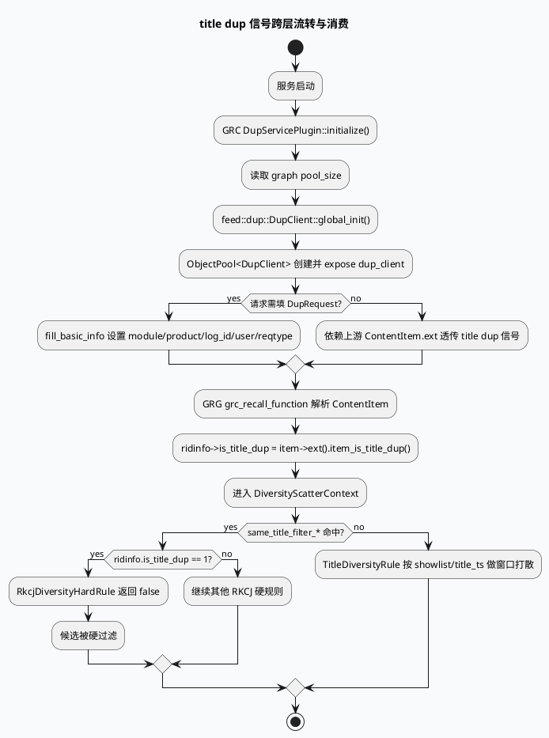

# 2026-06-10 业务库代码理解：Dup Service 去重与 title dup 信号跨层流转

> 今日主题来源：`daily-plan-20260529.json` 只覆盖 2026-06-01 周，本次按周三推荐主题 fallback：`Dup Service 去重与 title dup 信号跨层流转`。内网 KU 未参与检索，业务策略背景需人工补充；本笔记以 GRC/GRG 代码检索结果为主。

## 架构全景图

<style>.arch-dup{font-family:-apple-system,BlinkMacSystemFont,"Segoe UI",sans-serif;border:1px solid #d9e2d0;border-radius:18px;padding:18px;background:#f7faf5;color:#1f2937}.arch-dup .title{font-size:22px;font-weight:900;margin-bottom:6px}.arch-dup .sub{font-size:13px;color:#5f6f52;margin-bottom:16px}.arch-dup .cols{display:grid;grid-template-columns:1fr 1fr 1fr;gap:12px}.arch-dup .col{background:#fff;border:1px solid #d9ead3;border-radius:14px;padding:12px}.arch-dup .col h3{margin:0 0 10px;font-size:15px;color:#2d6a4f}.arch-dup .box{border-radius:12px;background:#f8fafc;border:1px solid #e5e7eb;padding:10px;margin:8px 0}.arch-dup .box b{display:block;font-size:13px;margin-bottom:4px}.arch-dup .box span{font-size:12px;color:#64748b}.arch-dup .hot{background:#ecfdf5;border-color:#86efac}.arch-dup .ribbon{margin-top:12px;padding:10px;border-radius:10px;background:#eef7e9;border-left:4px solid #2d6a4f;font-size:13px;color:#334155}</style><div class="arch-dup"><div class="title">GRC 去重信号 → GRG 打散消费全景</div><div class="sub">Dup Service 更像信号生产/透传侧，GRG 的 title hard rule 是消费侧；二者通过 `item_is_title_dup` / `is_title_dup` 字段形成跨层闭环。</div><div class="cols"><div class="col"><h3>GRC 插件侧</h3><div class="box hot"><b>DupServicePlugin</b><span>初始化 DupClient 全局状态与 ObjectPool</span></div><div class="box"><b>fill_basic_info</b><span>设置 MODULE_GRC、PRODUCT_MICRO_VIDEO、log_id、user</span></div><div class="box"><b>pool expose</b><span>`_pool->expose("dup_client")` 便于观测池状态</span></div></div><div class="col"><h3>召回结果承载</h3><div class="box hot"><b>ContentItem.ext</b><span>`item_is_title_dup()` 是跨服务输入字段</span></div><div class="box"><b>RidTmpInfo</b><span>`is_title_dup` 默认 0，作为融合/打散运行时字段</span></div><div class="box"><b>grc_recall_function</b><span>把 ext 字段落到 `ridinfo->is_title_dup`</span></div></div><div class="col"><h3>GRG 消费侧</h3><div class="box hot"><b>RkcjDiversityHardRule</b><span>命中 `same_title_filter_*` 且 `is_title_dup==1` 直接过滤</span></div><div class="box"><b>TitleDiversityRule</b><span>基于 showlist 的 title 展现历史做首刷硬打散</span></div><div class="box"><b>ScatterContext</b><span>保留 same_title_filter 日志排查注释点</span></div></div></div><div class="ribbon">核心链路：GRC/Dup 侧产出或透传去重信号 → GRG 召回解析 `item_is_title_dup` → `RidTmpInfo::is_title_dup` → RKCJ/Title hard rule 决策。</div></div>

## 核心流程图



## 配置/字段信息图

```infographic compare-binary-horizontal-underline-text-vs
data
  title 两类 title 去重消费方式
  desc 一个依赖外部 dup 信号，一个依赖本地 showlist 历史窗口
  left
    label RkcjDiversityHardRule
    desc `same_title_filter_1..4` + `ridinfo.is_title_dup==1`，面向外部 title dup 信号的硬过滤
  right
    label TitleDiversityRule
    desc 首刷场景读取 showlist 中 `is_title_show/title_ts`，把近期 title 展现 nid 放入 `_nid_set`
  items
    - label 输入来源
      desc ext 字段 vs showlist 历史
    - label 生效条件
      desc sid 实验命中 vs 首刷/位置条件
    - label 过滤粒度
      desc dup 标记候选 vs 近期已展现 nid
```

## 关键结论

- `DupServicePlugin` 的核心职责不是规则判断，而是 DupClient 初始化、池化与基础请求填充；它为 GRC 侧访问 dup 服务提供稳定客户端池。
- GRG 实际消费的 title dup 信号落在 `RidTmpInfo::is_title_dup`，由 `grc_recall_function` 从 `ContentItem.ext().item_is_title_dup()` 复制。
- `RkcjDiversityHardRule` 是最直接的消费点：只要 `same_title_filter_1..4` 命中且 `is_title_dup==1`，候选返回 false 被硬过滤。
- `TitleDiversityRule` 是另一条本地 title 多样性路径，不依赖 `is_title_dup`，而是从 showlist 中构建近期 title 展现 nid 集合，对首刷前几个位置做过滤。
- 配置检索未命中直接类名或实验名，需人工补充实验平台/KU 中 `same_title_filter_*`、`title_div` 的策略背景与生效范围。

## Pitfalls 卡片

<style>.pit-dup{font-family:-apple-system,BlinkMacSystemFont,"Segoe UI",sans-serif;max-width:980px;border-radius:20px;background:#f4f3f0;border:1px solid #d6d3ce;padding:20px;color:#243126}.pit-dup .meta{font-size:12px;letter-spacing:.08em;text-transform:uppercase;color:#2d6a4f;font-weight:900}.pit-dup .headline{font-size:28px;line-height:1.15;font-weight:900;margin:8px 0 12px}.pit-dup .grid{display:grid;grid-template-columns:1fr 1fr;gap:14px}.pit-dup .panel{background:#fff;border-top:4px solid #2d6a4f;border-radius:12px;padding:12px}.pit-dup .panel b{display:block;margin-bottom:6px}.pit-dup .panel p{margin:0;font-size:14px;line-height:1.65;color:#3f4f43}.pit-dup .end{margin-top:12px;font-weight:900;color:#2d6a4f}</style><div class="pit-dup"><div class="meta">pitfall · dup signal</div><div class="headline">不要把“Dup 服务接入”误读成“GRG 一定实时查 Dup”</div><div class="grid"><div class="panel"><b>信号可能已经在召回结果里</b><p>GRG 侧看到的是 `item_is_title_dup()` 透传后的字段，排查时应先确认召回 item ext 是否携带，而不是只追 DupClient 调用。</p></div><div class="panel"><b>两条 title 规则来源不同</b><p>`RkcjDiversityHardRule` 消费外部 dup 标记；`TitleDiversityRule` 消费 showlist 历史。二者都可能过滤 title 相似内容，但定位方向完全不同。</p></div></div><div class="end">∎ 线上排查先问：字段没来、实验没开、还是 hard rule 过滤了？</div></div>

## 调试 checklist

```infographic list-column-done-list
data
  title title dup 排查清单
  desc 从信号生产、字段透传、实验命中到 hard rule 返回值逐层确认
  items
    - label 检查 DupClient 池
      desc 关注 `dup_client` pool expose 指标、初始化失败日志与 pool_size
      done true
    - label 确认基础请求
      desc `MODULE_GRC`、`PRODUCT_MICRO_VIDEO`、cuid/uid/baiduid 是否填充
      done true
    - label 检查 ext 字段
      desc 确认 `item->ext().item_is_title_dup()` 是否为 1
      done true
    - label 检查 RidTmpInfo
      desc 确认 `ridinfo->is_title_dup` 是否被召回解析覆盖
      done true
    - label 检查实验开关
      desc 重点看 `same_title_filter_1..4` 与首刷 title 相关实验
      done false
    - label 区分过滤来源
      desc 对比 RKCJ hard rule 与 TitleDiversityRule 的命中日志/条件
      done false
```

## 证据来源

- `src/plugin/dup_service.cpp:13-43`：加载 graph 配置、初始化 `DupClient`、构造 `ObjectPool` 并 expose `dup_client`。
- `src/plugin/dup_service.cpp:46-57`：`fill_basic_info` 设置 module/product/log_id/user/reqtype。
- `src/plugin/dup_service.cpp:60-61`：对外提供池化 `DupClient`。
- `src/data/rid_tmp_info.h:113-116`：`RidTmpInfo` 中定义 `is_title_dup` 运行时字段。
- `src/process/grc_recall_function.cpp:488-500`：从 `ContentItem.ext().item_is_title_dup()` 写入 `ridinfo->is_title_dup`。
- `src/operator/diversity/Rkcj_diversity_hard_rule.cpp:41-49`：`same_title_filter_*` 命中且 `is_title_dup==1` 时硬过滤。
- `src/operator/diversity/title_diversity_rule.cpp:31-46`：首刷时从 showlist 的 `title_ts/is_title_show` 构建 `_nid_set`。
- `src/operator/diversity/title_diversity_rule.cpp:63-139`：基于场景、豁免、有效性和 `_nid_set` 执行 title hard rule。
- `src/operator/diversity/scatter_context.cpp:2064-2078`：保留 same_title_filter 与 `is_title_dup` 的排查日志注释点。