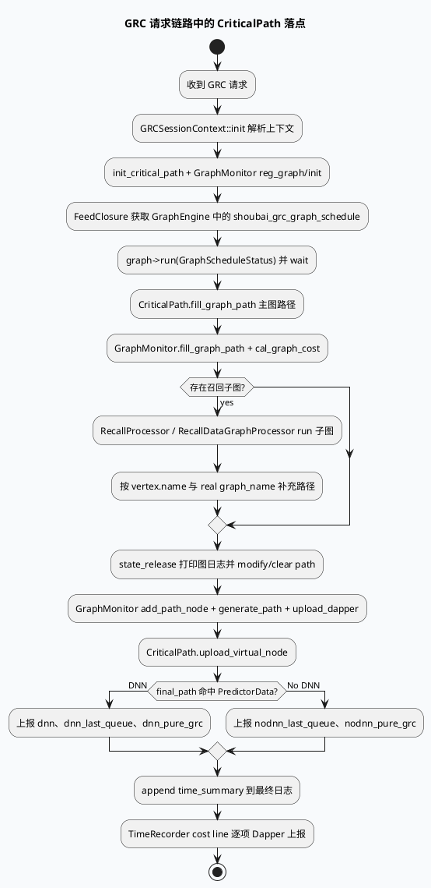

# 2026-06-11 业务库代码理解：GRC 关键路径观测在主请求链路中的落点

> 今日主题来源：未发现可用 daily-plan 文件，本次按周四 fallback 选择 `GRC 主链路 CriticalPath 观测与延迟归因`。内网 KU 未参与检索，业务场景与看板规范需人工补充；本笔记以代码库检索结果为准。

## 架构全景图

<style>.arch-grc-cp{font-family:-apple-system,BlinkMacSystemFont,"Segoe UI",sans-serif;border:1px solid #d9e2d0;border-radius:18px;padding:18px;background:#f7faf5;color:#1f2937}.arch-grc-cp .title{font-size:22px;font-weight:900;margin-bottom:6px}.arch-grc-cp .sub{font-size:13px;color:#5f6f52;margin-bottom:16px}.arch-grc-cp .cols{display:grid;grid-template-columns:1fr 1fr 1fr;gap:12px}.arch-grc-cp .col{background:#fff;border:1px solid #d9ead3;border-radius:14px;padding:12px}.arch-grc-cp .col h3{margin:0 0 10px;font-size:15px;color:#2d6a4f}.arch-grc-cp .box{border-radius:12px;background:#f8fafc;border:1px solid #e5e7eb;padding:10px;margin:8px 0}.arch-grc-cp .box b{display:block;font-size:13px;margin-bottom:4px}.arch-grc-cp .box span{font-size:12px;color:#64748b;line-height:1.45}.arch-grc-cp .hot{background:#ecfdf5;border-color:#86efac}.arch-grc-cp .ribbon{margin-top:12px;padding:10px;border-radius:10px;background:#eef7e9;border-left:4px solid #2d6a4f;font-size:13px;color:#334155}</style><div class="arch-grc-cp"><div class="title">GRC 主链路延迟归因全景</div><div class="sub">业务请求从 session init、GraphSchedule、召回子图到 release 统一收口，CriticalPath 把这些阶段压缩成 Dapper 虚拟节点与可拼接日志字段。</div><div class="cols"><div class="col"><h3>请求入口</h3><div class="box hot"><b>Session Init</b><span>解析 common/strategy/feature，初始化 CriticalPath 与 GraphMonitor</span></div><div class="box"><b>Graph 注册</b><span>注册主图、Recall 节点、Predictor 节点、GRG stage graph</span></div><div class="box"><b>TimeRecorder</b><span>为后续 cost_to_string 与 Dapper without IO 打点提供阶段耗时</span></div></div><div class="col"><h3>图执行阶段</h3><div class="box hot"><b>GraphSchedule</b><span>执行 `shoubai_grc_graph_schedule`，完成后写 graph path</span></div><div class="box"><b>RecallProcessor</b><span>每个召回 vertex 完成后填充 CriticalPath 路径</span></div><div class="box"><b>RecallDataGraphProcessor</b><span>RecallData 子图完成后补齐路径和真实 graph_name</span></div></div><div class="col"><h3>释放与观测</h3><div class="box hot"><b>state_release</b><span>生成 final_path，上传 GraphMonitor 与 CriticalPath 虚拟节点</span></div><div class="box"><b>Dapper/bvar</b><span>输出 last_queue、pure_grc、dnn/nodnn、feed latency</span></div><div class="box"><b>Trace Log</b><span>在 cost_ms 后追加 CriticalPath TimeSummary 字段</span></div></div></div><div class="ribbon">定位线上慢请求时，优先把 `final_path`、`time_summary`、Dapper 虚拟节点和普通 TimeRecorder cost line 放在同一 logid 下对齐。</div></div>

## 核心流程图



## 配置/结构信息图

```infographic compare-binary-horizontal-underline-text-vs
data
  title GRC 延迟归因的两条观测线
  desc CriticalPath 给出关键路径语义，TimeRecorder 给出普通阶段耗时；二者需要按 logid 对齐
  left
    label CriticalPath 关键路径
    desc 基于 GraphMonitor final_path，输出 last_queue、dnn、pure_grc、dnn/nodnn 分流与 TimeSummary
  right
    label TimeRecorder cost line
    desc release 阶段逐项 `DAPPER_DIRECT_COLLECT_WITHOUT_IO`，覆盖状态机和业务阶段耗时
  items
    - label 输入来源
      desc Graph path vs record() 阶段埋点
    - label 业务语义
      desc 队列/预测/纯 GRC vs 状态机/函数阶段
    - label 输出位置
      desc Dapper 虚拟节点与 trace 字段 vs Dapper without IO 明细
```

## 关键结论

- 业务排查入口不应只看 `cost_ms`：`state_release` 同时输出 GraphMonitor final path、CriticalPath 虚拟节点、TimeRecorder cost line 和最终 trace 字段。
- `CriticalPath` 适合回答“慢在最后队列、预测、纯 GRC 还是 dnn/nodnn 分支”，而不适合替代完整函数级 profiler。
- 主图和召回子图都在执行完成后调用 `fill_graph_path`，因此某个 vertex 的路径缺失更可能是子图执行/命名/真实 graph_name 透传问题。
- `open_print_graph_json` 是业务排障利器但不是常开路径；它会把 graph edge JSON 写入 `feed_meta_info` 的 `graph_dynamic_json` 维度。
- 内网检索不可用，需人工补充线上看板链接、Dapper command 命名规范和 `sid_smfw` 与慢请求抽样策略。

## Pitfalls 卡片

<style>.pit-grc-cp{font-family:-apple-system,BlinkMacSystemFont,"Segoe UI",sans-serif;max-width:980px;border-radius:20px;background:#f4f3f0;border:1px solid #d6d3ce;padding:20px;color:#243126}.pit-grc-cp .meta{font-size:12px;letter-spacing:.08em;text-transform:uppercase;color:#2d6a4f;font-weight:900}.pit-grc-cp .headline{font-size:28px;line-height:1.15;font-weight:900;margin:8px 0 12px}.pit-grc-cp .grid{display:grid;grid-template-columns:1fr 1fr;gap:14px}.pit-grc-cp .panel{background:#fff;border-top:4px solid #2d6a4f;border-radius:12px;padding:12px}.pit-grc-cp .panel b{display:block;margin-bottom:6px}.pit-grc-cp .panel p{margin:0;font-size:14px;line-height:1.65;color:#3f4f43}.pit-grc-cp .end{margin-top:12px;font-weight:900;color:#2d6a4f}</style><div class="pit-grc-cp"><div class="meta">pitfall · grc latency</div><div class="headline">只看一个耗时字段，很容易把队列慢尾误判成模型或业务逻辑慢</div><div class="grid"><div class="panel"><b>last_queue 是剥离点</b><p>`pure_grc_cost_ms` 使用 total cost 减 last_queue cost。若 last_queue 识别错误，后续 pure_grc、dnn/nodnn 口径都会跟着偏移。</p></div><div class="panel"><b>dnn 判断是经验规则</b><p>代码注释明确说明 dnn 判断“不准确”，只能基于是否有相关 last_emit_data 判断。长尾路径里没有 dnn 数据时，不能把 nodnn 口径等同于无模型调用。</p></div></div><div class="end">∎ 慢请求对账顺序：final_path → virtual nodes → time_summary → cost line。</div></div>

## 调试 checklist

```infographic list-column-done-list
data
  title GRC 慢请求 CriticalPath 排查清单
  desc 面向线上 logid 的定位顺序
  items
    - label 找到 final_path
      desc 搜索 `CRITICAL_PATH` 日志中的 `final_path` 与 sid
      done true
    - label 对齐总耗时
      desc 对比 `total_cost`、`cost_ms` 与 feed handle latency
      done true
    - label 看 last_queue
      desc 找出最后一个 `Fork`/`UniQueIONode` IO_NODE 是否符合预期
      done true
    - label 看 predictor
      desc 检查 PredictorData/CVRPredictorData/DppData/LiveCVRPredictorData 节点耗时
      done true
    - label 区分 dnn/nodnn
      desc 核对是否命中 `SlowRecallFunnelDone`，不要单凭指标名下结论
      done false
    - label 必要时打开 graph json
      desc 使用 `open_print_graph_json` 查看 graph edge，但注意只按 graph/channel 首次上传
      done false
```

## 证据来源

- `src/common/session_context.cc:259-273`：初始化 CriticalPath，并注册主图、Recall 节点、Predictor 节点和 GRG stage graph。
- `src/service/feed.cc:642-670`：从 GraphEngine 获取主图，执行 `run(GraphScheduleStatus)`，再填充 CriticalPath 与 GraphMonitor 路径。
- `src/graph_schedule/recall_processor.cpp:120-128`：召回子图执行完成后填充 graph path。
- `src/graph_schedule/recall_data_processor.cpp:116-118`：RecallData 子图完成后填充 graph path。
- `src/service/feed.cc:1555-1574`：release 阶段打印图日志、生成 final_path、上传 Dapper 和 CriticalPath 虚拟节点。
- `src/service/feed.cc:1927-1948`：最终日志追加 `time_summary`，并逐项上报 TimeRecorder cost line。
- `src/processor/critical_path/critical_path.cc:71-113`：遍历 final_path，提取 total、dnn、last_queue 和 CPU_NODE 累加。
- `src/processor/critical_path/critical_path.cc:114-180`：按 dnn/nodnn 分支上报 Dapper 与 feed latency，并生成 TimeSummary。
- `src/processor/critical_path/critical_path.cc:142`：代码注释说明 dnn 判断逻辑不准确，是排障时必须保留的前提。
