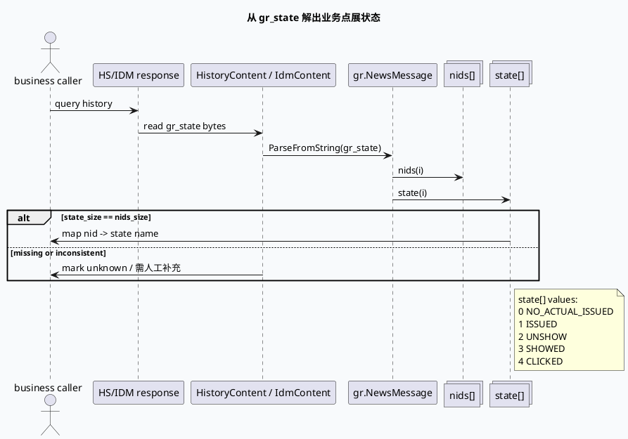

# 2026-06-14 业务库代码理解：HS state[] 点展状态语义与 IssuedItem 字段误区

> 今日主题来源：未发现本机 daily-plan 文件；按周日 fallback 选择 History Service 点展状态业务语义。内网 KU 未提供 URL/doc-id，状态口径需人工补充；本篇以代码库与已沉淀的 gr_state 透传机制为准。

## 架构全景图

<style>.arch-state{font-family:-apple-system,BlinkMacSystemFont,"Segoe UI",sans-serif;border:1px solid #cbd5e1;border-radius:18px;padding:18px;background:#f8fafc;color:#1f2937}.arch-state .title{font-size:22px;font-weight:900;margin-bottom:6px}.arch-state .sub{font-size:13px;color:#64748b;margin-bottom:16px}.arch-state .grid{display:grid;grid-template-columns:1fr 1.1fr 1fr;gap:12px}.arch-state .lane{background:#fff;border:1px solid #dbeafe;border-radius:14px;padding:12px}.arch-state h3{margin:0 0 10px;font-size:15px;color:#1d4ed8}.arch-state .box{border-radius:12px;padding:10px;margin:8px 0;border:1px solid #e5e7eb;background:#f9fafb}.arch-state .box b{display:block;font-size:13px;margin-bottom:4px}.arch-state .box span{font-size:12px;color:#64748b;line-height:1.45}.arch-state .hot{background:#eff6ff;border-color:#93c5fd}.arch-state .note{margin-top:12px;padding:10px;border-radius:10px;background:#eef6ff;border-left:4px solid #3b82f6;font-size:13px;color:#334155}</style><div class="arch-state"><div class="title">点展状态业务语义全景</div><div class="sub">业务侧应以 NewsMessage.state[] 作为状态来源；IssuedItem 中的 show_tss/click_tss 更像透传/临时字段，不应被当成查询响应中的状态事实。</div><div class="grid"><div class="lane"><h3>容易误读的字段</h3><div class="box"><b>IssuedItem.show_tss</b><span>字段存在于 item proto，但语义是展现时间，不能直接表示 state。</span></div><div class="box"><b>IssuedItem.click_tss</b><span>注释明确为“好看业务架构透传字段，不存储”。</span></div><div class="box"><b>ShowClkState enum</b><span>UNKNOWN/UNSEND/CLICKED/SHOWED 是 history_service 层枚举，不等同于 NewsMessage.state[] 注释中的五值状态。</span></div></div><div class="lane"><h3>实际状态来源</h3><div class="box hot"><b>NewsMessage.nids[]</b><span>状态数组的主键序列，state[i] 必须对应 nids[i]。</span></div><div class="box hot"><b>NewsMessage.state[]</b><span>字段 129：NO_ACTUAL_ISSUED=0、ISSUED=1、UNSHOW=2、SHOWED=3、CLICKED=4。</span></div><div class="box"><b>HistoryContent.gr_state</b><span>封装序列化后的 NewsMessage，通过 HS/IDM 透传。</span></div></div><div class="lane"><h3>业务消费边界</h3><div class="box hot"><b>状态判断</b><span>先 ParseFromString(gr_state)，再按下标读取 state[]。</span></div><div class="box"><b>缺失处理</b><span>state_size 与 nids_size 不一致时，应降级为未知/需补充，而不是用 tss 猜测。</span></div><div class="box"><b>跨枚举映射</b><span>不要把 ShowClkState 的 CLICKED=2 套到 NewsMessage.state[] 的 CLICKED=4。</span></div></div></div><div class="note">业务结论：state 是 gr_state 中的数组事实，不是 IssuedItem 字段事实；排查曝光/点击状态时优先抓 gr_state bytes。</div></div>

## 核心流程图



## 状态结构信息图

```infographic compare-binary-horizontal-underline-text-vs
data
  title 两套“点展状态”不要混用
  desc history_service 的 ShowClkState 与 redisprotocol 的 NewsMessage.state[] 枚举值不同，业务判断应绑定具体字段来源
  items
    - label ShowClkState
      desc `UNKNOWN=0 / UNSEND=1 / CLICKED=2 / SHOWED=3`，位于 `history_service.proto`，不是 gr_state 数组注释
      value 4
    - label NewsMessage.state[]
      desc `NO_ACTUAL_ISSUED=0 / ISSUED=1 / UNSHOW=2 / SHOWED=3 / CLICKED=4`，字段号 129，是 gr_state 的实际点展状态
      value 5
```

## 业务语义表

| gr_state `state[]` 值 | 名称 | 业务含义 | 排查提示 |
|---:|---|---|---|
| 0 | NO_ACTUAL_ISSUED | 未实际下发 | 常见于候选进入链路但未真实触达 |
| 1 | ISSUED | 已下发 | 已进入下发历史，但不代表曝光 |
| 2 | UNSHOW | 下发但未曝光 | 排查曝光链路或端上反馈缺失 |
| 3 | SHOWED | 已曝光 | 可用于曝光去重/频控语义 |
| 4 | CLICKED | 已点击 | 点击态不是 `ShowClkState.CLICKED=2` |

## 关键结论

- `IssuedItem` 的字段很多，但点展状态的稳定业务来源不是 `show_tss/click_tss`，而是 `gr_state` 中序列化的 `NewsMessage.state[]`。
- `click_tss` 注释明确为“透传字段，不存储”，`issued_tss` 也标注“小视频业务架构透传字段，不存储”；用它们做历史查询状态会出现空值或口径漂移。
- `ShowClkState` 与 `NewsMessage.state[]` 的枚举不是同一套值域：`CLICKED` 在前者是 2，在后者是 4，跨字段硬编码会导致状态错判。
- `NewsMessage.state[]` 与 `nids[]` 是并行数组；消费时必须校验下标对齐，不能只按数组长度或最后一个状态推断全量资源。
- 如果业务接口只返回 `IssuedItem` 而没有 `gr_state`，应标注“需人工补充/缺状态来源”，不要从 `pos/channel/ts` 等字段反推曝光点击。

## Pitfalls 卡片

<style>.pit-state{font-family:-apple-system,BlinkMacSystemFont,"Segoe UI",sans-serif;max-width:980px;border-radius:20px;background:#f5f7fa;border:1px solid #c7d2fe;padding:20px;color:#1e293b}.pit-state .meta{font-size:12px;letter-spacing:.08em;text-transform:uppercase;color:#1d4ed8;font-weight:900}.pit-state .headline{font-size:28px;line-height:1.15;font-weight:900;margin:8px 0 12px}.pit-state .grid{display:grid;grid-template-columns:1.2fr .95fr;gap:14px}.pit-state .panel{background:#fff;border-top:4px solid #3b82f6;border-radius:12px;padding:12px}.pit-state .panel b{display:block;margin-bottom:6px}.pit-state .panel p{margin:0;font-size:14px;line-height:1.65;color:#334155}.pit-state .end{margin-top:12px;font-weight:900;color:#1d4ed8}</style><div class="pit-state"><div class="meta">pitfall · state semantics</div><div class="headline">看到 show_tss/click_tss，不代表你拿到了点展状态</div><div class="grid"><div class="panel"><b>字段存在 ≠ 查询可用</b><p>`IssuedItem` 中存在 `show_tss` 与 `click_tss`，但注释显示它们属于透传/不存储口径；线上查询响应可能没有稳定值。</p></div><div class="panel"><b>枚举同名 ≠ 值相同</b><p>`CLICKED` 在 `ShowClkState` 是 2，在 `NewsMessage.state[]` 注释中是 4。必须绑定字段来源解释。</p></div></div><div class="end">∎ 状态判断只认 gr_state → NewsMessage.state[]。</div></div>

## 调试 checklist

```infographic list-column-done-list
data
  title 点展状态业务排查清单
  desc 避免把 IssuedItem 透传字段、ShowClkState 枚举和 NewsMessage.state[] 混为一谈
  items
    - label 检查是否有 gr_state
      desc 响应中需存在 `HistoryContent.gr_state`、`HSResponse.gr_state` 或 `IdmContent.gr_state`
      done true
    - label 解码 NewsMessage
      desc 用 `NewsMessage.ParseFromString(gr_state)`，不要直接读取 IssuedItem 字段
      done true
    - label 校验数组对齐
      desc `nids_size()` 与 `state_size()` 应一致，按同一 index 建立 nid->state
      done false
    - label 校验枚举来源
      desc `ShowClkState` 不能直接映射 `NewsMessage.state[]` 的数值
      done false
    - label 校验透传字段
      desc `click_tss`、`issued_tss` 标注“不存储”时，不可作为查询态事实
      done false
    - label 标注缺失口径
      desc 内网业务文档不可用时，在结论中写明“需人工补充”
      done true
```

## 证据来源

- `gr-proto/proto/history_service.proto:22-28`：`ShowClkState` 定义为 UNKNOWN/UNSEND/CLICKED/SHOWED 四值。
- `gr-proto/proto/history_service.proto:31-154`：`IssuedItem` 包含 `show_tss`、`click_tss`、`issued_tss` 等字段，其中 `click_tss` 与 `issued_tss` 注释为透传/不存储。
- `gr-proto/proto/history_service.proto:165-175`：`HistoryContent.gr_state` 表示用户状态数据。
- `gr-proto/proto/history_service.proto:195-219`：`HSRequest` 支持 `gr_state_read_sndb`，`HSResponse` 支持响应级 `gr_state`。
- `gr-proto/proto/redisprotocol.proto:168-320`：`NewsMessage.nids[]` 与 `state[]` 位于同一消息；`state = 129` 注释给出五值状态。
- `gr-proto/proto/idm_service.proto:11-27`：IDM 响应也以 `gr_state = 15` 透传 HS 用户状态。
- `src/history/redis_history.cc:86-145`：Redis 读回时只查 hash field `gr_state` 并写入 `redis_history.gr_state`。
- `src/dao/sndb_dao.cc:234-273`：SNDB 读回后同样写入 `_gr_state_result_hc[news_idx].redis_history.gr_state`。
