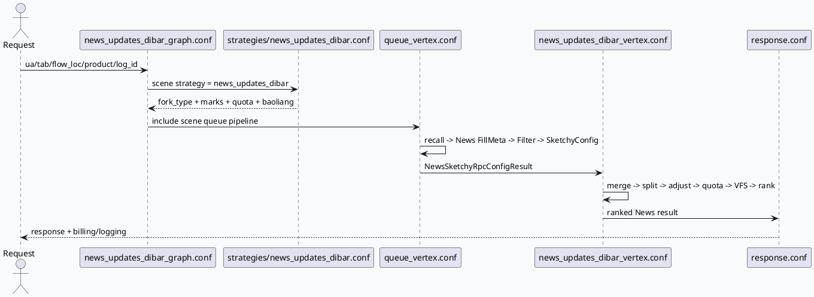

# news_updates_dibar：图文速读底 bar 的召回、正排与排序闭环

> 日期：2026-06-18  
> 今日主题来源：未发现显式 `daily-plan-20260618.json`；按近期双 Markdown 工作流 fallback 到业务库 `news_updates_dibar` 图文速读场景，和今日基础库 GCMS/IFCS FillMeta 主题配对。已按要求设置 `BAIDU_CC_USERNAME=hujiyang`；未提供 KU URL/doc-id，产品策略口径需人工补充。  
> 范围：`news_updates_dibar_graph.conf` include 拓扑、场景队列配置、图文正排补全、过滤、粗排、merge、保量、VFS 与精排准备。

<style>.arch{font-family:-apple-system,BlinkMacSystemFont,"Segoe UI",sans-serif;background:#f8fafc;border:1px solid #dbe4ef;border-radius:18px;padding:18px;margin:16px 0;color:#1f2937}.arch-title{font-weight:800;font-size:22px;margin-bottom:12px}.arch-sub{color:#64748b;font-size:13px;margin-bottom:14px}.arch-grid{display:grid;grid-template-columns:1fr 1fr 1fr;gap:12px}.arch-box{background:white;border:1px solid #e5e7eb;border-radius:14px;padding:12px}.arch-box h3{font-size:15px;margin:0 0 8px;color:#334155}.arch-box p{font-size:13px;line-height:1.55;margin:0;color:#475569}.arch-flow{display:flex;gap:8px;align-items:stretch;margin-top:12px}.arch-step{flex:1;background:#eef6ff;border-left:4px solid #3d5a80;border-radius:12px;padding:10px;font-size:13px}.card-frame{font-family:-apple-system,BlinkMacSystemFont,"Segoe UI",sans-serif;margin:18px 0}.card{background:#f5f7fa;border:1px solid #dbe4ef;border-radius:18px;padding:20px;color:#1f2937}.card-meta{font-size:12px;font-weight:800;letter-spacing:.08em;text-transform:uppercase;color:#3d5a80}.card-title{font-size:28px;line-height:1.15;font-weight:850;margin:6px 0 12px}.card-grid{display:grid;grid-template-columns:2fr 1fr;gap:14px}.card-panel{background:white;border-top:5px solid #3d5a80;border-radius:12px;padding:12px;font-size:14px;line-height:1.65}.card-panel b{color:#1e3a5f}.card-endmark{font-weight:900;color:#3d5a80}</style>
<div class="arch"><div class="arch-title">架构全景图：news_updates_dibar 业务链路</div><div class="arch-sub">该场景复用通用 graph/UMS/dynamic recall，又在本目录覆盖 queue、baoliang、diversity、response，形成图文速读专用闭环。</div><div class="arch-grid"><div class="arch-box"><h3>全局入口</h3><p>`news_updates_dibar_graph.conf` 注册图名、pool、global depend，并 include 通用 `graph.conf`、`request_handle.conf`、`dynamic_recall_graph.conf`。</p></div><div class="arch-box"><h3>图文主干</h3><p>专属 `queue_vertex.conf` 从召回结果拆出 `NewsQueueRecallResult`，经 `NewsFillMetaPipelineFunction` 补 `NewsInfo`。</p></div><div class="arch-box"><h3>策略闭环</h3><p>`news_updates_dibar_vertex.conf` 执行 Merge、Lookalike、调权、保量、VFS、CTR Rank 与精排初始化。</p></div></div><div class="arch-flow"><div class="arch-step">Recall: news_recall + video fallback</div><div class="arch-step">FillMeta: query_news → NewsInfo</div><div class="arch-step">Filter/Sketchy: news_filter + rank config</div><div class="arch-step">Merge/Baoliang/VFS/Rank</div></div></div>

## 核心流程图

```plantuml
@startuml
skinparam handwritten false
skinparam backgroundColor #f8fafc
left to right direction
rectangle "news_updates_dibar graph" {
  [DsToRidInfoPipelineVertex_news] as ds
  [NewsFillMetaPipelineFunction] as fm
  [NewsFilterPipelineFunction] as filter
  [SketchyRpcConfigFunction_news] as sketchy
  [MergePipelineFunction_news_updates_dibar] as merge
  [NewsCheckPointLookalikeFunction] as lookalike
  [MoveDownResultSplitFunction] as split
  [news_sketchy_adjust] as adjust
  [NewsLimitQuotaFunction] as quota
  [VfsRpcFunction_news] as vfs
  [CtrRankFunction] as ctr
}
ds --> fm : NewsQueueRecallResult
fm --> filter : FillMetaPipelineResult
filter --> sketchy : FilterPipelineResult
sketchy --> merge : NewsSketchyRpcConfigResult
sketchy --> lookalike : checkpoint lookalike
merge --> split : NewsMergeResult
split --> adjust : NewsMergeResultWithoutMoveDown
adjust --> quota : NewsSketchyAdjustResult
quota --> vfs : NewsBaoliangResult
vfs --> ctr : NewsVfsResult
@enduml
```



## 配置/结构信息图

```infographic compare-hierarchy-left-right-circle-node-pill-badge
data
  title news_updates_dibar 配置骨架
  desc 左侧是召回来源，右侧是图执行阶段；关键是图文队列在策略文件里 quota_ratio 为 0/400，但保量阶段再用 max_len 拉回曝光机会
  items
    - label Recall sources
      desc short_micro_default_uniq_ucf_icf / video_micro_rec_new / news_recall / guanzhu_recent_ertiao
      value 4
      children
        - label news marks
          desc 421, 34, 662, 490
        - label video marks
          desc 50518, 50904, 50090, 50274, 50020, 50011, 50301
    - label Execution stages
      desc fill_meta / filter / sketchy config / merge / baoliang / dup_vfs / rank
      value 7
      children
        - label baoliang
          desc marks 421/34/662/301 max_len 30
        - label rank
          desc CTR_RERANK_NEWS_SKETCHY token kuaixun_news_dibar

theme
  palette #3D5A80 #98C1D9 #E0FBFC
```

## 业务解读

1. 图入口不是纯新图：`news_updates_dibar_graph.conf` 先 include 大量通用配置，再叠加本场景 `expression/queue_vertex/ums_handle/news_updates_dibar_vertex/baoliang/diversity/response/billing_info`。这意味着排查时要同时看“通用节点是否产出依赖”和“场景覆盖是否改名”。  
2. 召回侧混合视频与图文：策略文件里 `short_micro_default_uniq_ucf_icf`、`video_micro_rec_new` 仍在，同时新增 `news_recall` marks 421/34/662/490；业务上像是底 bar 图文速读在视频沉浸生态里拿曝光槽。  
3. `NewsFillMetaPipelineFunction` 在该场景中输入 `NewsQueueRecallResult`，但输出数据名是 `FillMetaPipelineResult`。这个命名复用降低了下游配置改造成本，也提高了“按名字误判为视频正排”的风险。  
4. 保量阶段对 marks 421/34/662/301 设置 `max_len: 30`，即使 recall quota_ratio 为 0 的图文队列，也可能通过后续保量策略进入候选池；排查“为什么有图文出来”不能只看 recall quota。

## 数据/配置流



## Pitfalls 卡片

<div class="card-frame"><div class="card"><div class="card-meta">Pitfalls · news_updates_dibar</div><div class="card-title">看错文件，比看错代码更容易误判图文链路</div><div class="card-grid"><div class="card-panel"><b>同名不同义：</b>场景目录下的 `queue_vertex.conf` 输出 `FillMetaPipelineResult`，但其内容来自 `NewsFillMetaPipelineFunction` 和 `NewsInfo`。排查字段缺失时先确认数据类型。</div><div class="card-panel"><b>quota 陷阱：</b>`news_recall` 中部分 marks `quota_ratio: 0` 不等于不会出现在最终候选；后面的 baoliang/VFS/rank 仍可能改变保留路径。</div></div><div class="card-endmark">∎</div></div></div>

## 调试 checklist

```infographic list-column-done-list
data
  title news_updates_dibar 排障清单
  items
    - label 从 graph include 开始定位
      desc 先读 news_updates_dibar_graph.conf:42-57，确认当前场景覆盖了哪些通用配置
      done true
    - label 对齐数据名和真实类型
      desc NewsQueueRecallResult → NewsFillMetaPipelineFunction → FillMetaPipelineResult
      done true
    - label 同时检查 recall quota 与 baoliang max_len
      desc marks 421/34/662 在 recall 中 quota_ratio 为 0，但保量 max_len 为 30
      done true
    - label 粗排看 SketchyRpcConfigFunction_news
      desc 当前 merge 依赖 NewsSketchyRpcConfigResult，而不是注释掉的 SketchyRpcPipelineResult
      done true
    - label VFS 前确认 showlist/readlist fill meta done
      desc VfsRpcFunction_news 依赖 ShowItemList、AuthorHomePageReadListInfo 与 NewsShowlistFillMetaDone
      done true
```

## 证据来源

- `output/conf/plugins/graph/news_updates_dibar/news_updates_dibar_graph.conf:1-57`：场景图名、global depend 与 include 列表。  
- `output/conf/plugins/graph/news_updates_dibar/queue_vertex.conf:1-37`：召回结果拆分与 `NewsFillMetaPipelineFunction` 节点。  
- `output/conf/plugins/graph/news_updates_dibar/queue_vertex.conf:58-160`：图文过滤、粗排 pipeline/config 节点。  
- `output/conf/plugins/graph/news_updates_dibar/news_updates_dibar_vertex.conf:6-23`：Merge 依赖 `NewsSketchyRpcConfigResult`。  
- `output/conf/plugins/graph/news_updates_dibar/news_updates_dibar_vertex.conf:24-99`：Lookalike、MoveDown split、sketchy adjust、limit quota。  
- `output/conf/plugins/graph/news_updates_dibar/news_updates_dibar_vertex.conf:106-173`：VFS 与 CTR Rank 阶段。  
- `output/conf/plugins/strategies/news_updates_dibar.conf:1-69`：召回 fork_type、marks 与 quota。  
- `output/conf/plugins/strategies/news_updates_dibar.conf:70-126`：converge quota、baoliang 与 merge callback。  
- `output/conf/plugins/strategies/news_updates_dibar.conf:127-160`：dup_vfs 策略与 news_rank/sketchy 模型配置。  
- `src/processor/video_launch/news_fill_meta_pipeline.cpp:33-158`：图文正排补全与 publish 行为。

## 需人工补充

- `news_updates_dibar` 的产品目标、实验 sid、线上桶配置、图文底 bar 展示口径需要从 KU/周报/实验平台补齐；本次未提供可检索 URL/doc-id。
