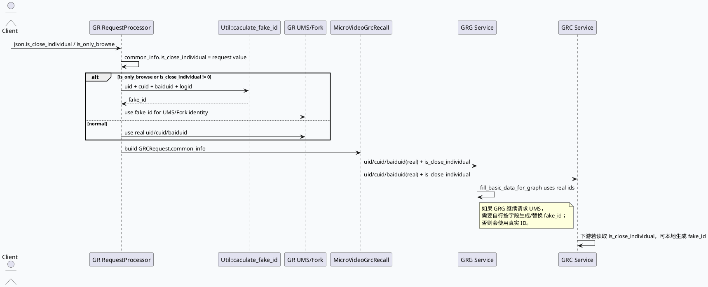

# 2026-06-20 业务库代码理解：关闭个性化 is_close_individual 与 fake_id 传递链路

> 日期：2026-06-20  
> 今日主题来源：本机未发现可用 `daily-plan` 文件；按近期双 Markdown 工作流周六 fallback，选择“关闭个性化推荐”业务链路，聚焦 GR/GRG/GRC 间 `is_close_individual` 与 `fake_id` 的传递边界。已按要求设置 `BAIDU_CC_USERNAME=hujiyang`；未提供 KU URL/doc-id，产品口径需人工补充。  
> 范围：GR 请求解析与 fake_id 生成、GR→GRC/GRG 请求透传、UMS/Fork/GRC 下游身份替换、GRG 中间层缺口、动态超时 scene 映射的旁路影响。

## 架构全景图
<style>.arch{font-family:-apple-system,BlinkMacSystemFont,"Segoe UI",sans-serif;background:#f8fafc;border:1px solid #dbe4ef;border-radius:18px;padding:18px;margin:16px 0;color:#1f2937}.arch-title{font-size:22px;font-weight:800;margin-bottom:12px}.lane{display:grid;grid-template-columns:repeat(4,1fr);gap:12px}.box{background:#fff;border:1px solid #e5e7eb;border-radius:14px;padding:12px;min-height:132px}.box h3{font-size:15px;margin:0 0 8px;color:#334155}.ok{border-left:5px solid #2d6a4f}.warn{border-left:5px solid #b45309}.risk{border-left:5px solid #b91c1c}.muted{font-size:12px;color:#64748b;line-height:1.5}.tag{display:inline-block;background:#e2e8f0;border-radius:999px;padding:2px 8px;font-size:12px;margin-top:6px}</style><div class="arch"><div class="arch-title">关闭个性化：字段透传与身份替换责任边界</div><div class="lane"><div class="box ok"><h3>GR 入口解析</h3><div class="muted">读取 `is_close_individual`；`is_only_browse` 强制置 1；非 0 时用 uid/cuid/baiduid/logid 计算 fake_id。</div><span class="tag">已生成 fake_id</span></div><div class="box ok"><h3>GR 内部下游</h3><div class="muted">UMS / UMS Cache / Fork 请求在关闭个性化时使用 fake_id 或覆盖身份字段。</div><span class="tag">多数路径生效</span></div><div class="box warn"><h3>GR → GRC/GRG</h3><div class="muted">GRCRequest 透传 is_close_individual，但 uid/cuid/baiduid 仍保持真实 ID；下游必须自行生成/替换。</div><span class="tag">字段透传而非身份替换</span></div><div class="box risk"><h3>GRG 中间层</h3><div class="muted">服务入口把 request common_info 的真实 uid/cuid/baiduid 注入 Graph；历史分析未发现 GRG 自行使用 fake_id 请求 UMS。</div><span class="tag">需重点确认</span></div></div></div>

## 核心调用链


## 字段与责任分工信息图
```infographic
infographic compare-hierarchy-left-right-circle-node-pill-badge
data
  title 关闭个性化链路：字段透传 vs 身份替换
  desc 不同层的责任不是相同的：GR 负责入口生成，跨服务请求只透传字段
  items
    - label GR 层
      desc 解析字段、生成 fake_id、对自身 UMS/Fork 生效
      value 80
      icon mdi/check-circle
      children
        - label RequestProcessor
          desc is_close_individual + is_only_browse
        - label Util::caculate_fake_id
          desc uid_cuid_baiduid_logid hash
        - label UMS/Fork
          desc 用 fake_id 覆盖身份
    - label GRG/GRC 下游层
      desc 接收真实 ID + is_close_individual，需自行完成替换
      value 60
      icon mdi/alert-circle
      children
        - label GRCRequest
          desc common_info 透传字段
        - label GRG Service
          desc Graph 全局 uid/cuid/baiduid 仍来自请求真实值
        - label UMS 调用
          desc 若未替换则存在真实 ID 调用风险
```

## 业务结论

1. **代码语义以非 0 表示关闭个性化**：入口字段 `is_close_individual` 只要非 0，或 `is_only_browse` 为真，GR 就进入 fake_id 路径。若产品文档存在“0/1 含义”相反描述，需要以代码和线上协议联合确认。
2. **GR 内部多数关键下游已替换身份**：`ums_plugin.cpp` 在 `fake_id` 非空时使用 fake_id；`ums_plugin_cache.cpp` 在关闭个性化时覆盖 uid/cuid/baiduid；Fork/UFS 相关路径也有使用 fake_id 的逻辑。
3. **GR→GRC/GRG 是“透传标志”，不是“透传 fake_id”**：`micro_grc_recall.cpp` 构造请求时设置真实 baiduid/cuid/uid，并额外设置 `is_close_individual`。因此下游不能假设收到的身份已经匿名化。
4. **GRG 是重点风险边界**：GRG 服务入口 `fill_basic_data_for_graph()` 把请求里的真实 uid/cuid/baiduid 注入 Graph 全局数据；如果 GRG 内部请求 UMS 或其他个性化服务，没有再次按 `is_close_individual` 替换，会绕过关闭个性化语义。
5. **动态超时 scene 映射是旁路但会影响排障**：GRG 中 `news_updates_dibar` 会映射成 `short_micro_video` scene 后再调用 `set_request_timeout()`；业务排查 `news_updates_dibar` 延迟时，不要只搜同名 dynamic_timeout scene。

## Debug checklist
```infographic
infographic list-column-done-list
data
  title is_close_individual 生效性排查
  desc 从入口字段到每条下游 RPC 逐段验证
  items
    - label 入口字段解析
      desc request.cpp 是否读取 is_close_individual；is_only_browse/cmode 是否强制置 1
      done true
      icon mdi/form-textbox
    - label fake_id 生成
      desc fake_id 是否由 uid/cuid/baiduid/logid 计算，并写入 CommonInfo / FakeUser
      done true
      icon mdi/fingerprint
    - label GR 本地 UMS
      desc ums_plugin 和 ums_plugin_cache 是否使用 fake_id 覆盖请求身份
      done true
      icon mdi/account-switch
    - label GR 到 GRC/GRG 请求
      desc micro_grc_recall 是否只透传 is_close_individual，uid/cuid/baiduid 是否仍是真实值
      done true
      icon mdi/transit-connection-variant
    - label GRG 内部 RPC
      desc 搜 GRG UMS/recall/model 请求是否读取 is_close_individual 并替换身份
      done false
      icon mdi/alert-octagon
    - label 线上日志与 SIA
      desc 对齐 is_close_individual、fake_id、下游 request uid/cuid 打点
      done false
      icon mdi/chart-timeline-variant
```

## Pitfalls 卡片
<style>.card{font-family:-apple-system,BlinkMacSystemFont,"Segoe UI",sans-serif;background:#f4f3f0;border:1px solid #ded8cf;border-radius:18px;padding:18px;margin:16px 0;color:#1f2937}.meta{font-size:12px;letter-spacing:.08em;text-transform:uppercase;color:#7c4a1d;font-weight:800}.title{font-size:26px;font-weight:850;letter-spacing:-.02em;margin:6px 0 10px}.grid{display:grid;grid-template-columns:1fr 1fr;gap:12px}.panel{background:#fff;border-top:4px solid #b45309;border-radius:12px;padding:12px;font-size:14px;line-height:1.65}.panel strong{color:#7c2d12}.end{font-weight:800;color:#7c4a1d;margin-top:10px}</style><div class="card"><div class="meta">Pitfall / Privacy Semantics</div><div class="title">看到 `is_close_individual` 不代表下游身份已匿名</div><div class="grid"><div class="panel"><strong>误区：</strong>GR 已经生成 fake_id，因此 GRG/GRC 收到的请求也一定是 fake_id。实际 `GRCRequest.common_info` 仍写真实 uid/cuid/baiduid，只多带一个关闭个性化标志。</div><div class="panel"><strong>正确做法：</strong>每个下游服务都必须明确自己的责任：读取标志、计算或接收 fake_id、覆盖对个性化依赖的请求身份，并用日志证明覆盖生效。</div></div><div class="end">∎ 隐私语义不能靠“上游应该处理过”传递。</div></div>

## 证据来源
- `feeda-mv-gr/src/processor/request.cpp:302-304`：读取 `is_close_individual`。
- `feeda-mv-gr/src/processor/request.cpp:357-365`：`is_only_browse` 强制关闭个性化并生成 fake_id。
- `feeda-mv-gr/src/util/util.cpp:563-569`：fake_id 由 `uid/cuid/baiduid/logid` hash 生成。
- `feeda-mv-gr/src/processor/ums_plugin.cpp:102-113`：UMS 非空 fake_id 时使用 fake_id，否则使用真实身份。
- `feeda-mv-gr/src/processor/ums_plugin_cache.cpp:67-80`：UMS cache 默认真实身份，关闭个性化时覆盖成 fake_id。
- `feeda-mv-gr/src/processor/micro_grc_recall.cpp:547-559`：GR→GRC/GRG 请求写入真实 baiduid/cuid/uid。
- `feeda-mv-gr/src/processor/micro_grc_recall.cpp:578`：GR→GRC/GRG 请求透传 `is_close_individual`。
- `feeda-mv-grg/src/service/grg_service.cpp:127-140`：GRG 入口把 request 与真实 uid/cuid/baiduid 注入 Graph。
- `feeda-mv-grg/src/service/grg_service.cpp:177-190`：动态超时绑定，`news_updates_dibar` scene 映射为 `short_micro_video`。
- `user_doc/is_close_individual_full_chain_analysis.md:13-24`：历史分析结论与语义差异提示。

## 需人工补充
- KU 文档中“关闭/开启个性化”的 0/1 口径，以免与代码非 0 语义冲突。
- GRG 内部 UMS/模型请求是否已经在未检索到的分支中补齐 fake_id 覆盖；建议用线上请求日志进一步确认。
