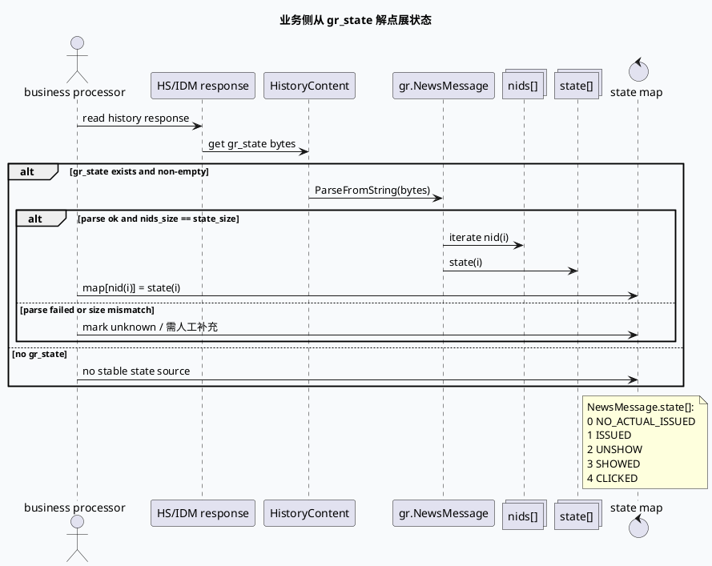

# 2026-06-21 业务库代码理解：点展状态消费口径与 gr_state 防误用指南

> 今日主题来源：本机未发现可用 `daily-plan` 文件；按周日 fallback 选择 History Service 点展状态业务语义，与今日基础库 `gr_state` Redis/SNDB 双通道主题配对。  
> 内网 KU：本次任务未提供 KU URL/doc-id；业务产品口径、实验策略与线上看板需人工补充。本文以代码库证据和基础库机制为准。  
> 范围：业务侧如何解释 `NewsMessage.state[]`、如何避免把 `IssuedItem.show_tss/click_tss` 或 `ShowClkState` 误当成同一套状态、以及调试时如何从 HS/IDM 响应 bytes 还原状态。

## 架构全景图

<style>.arch-bizstate{font-family:-apple-system,BlinkMacSystemFont,"Segoe UI",sans-serif;background:#f8fafc;border:1px solid #cbd5e1;border-radius:20px;padding:18px;color:#1e293b}.arch-bizstate .title{font-size:24px;font-weight:900;margin-bottom:6px}.arch-bizstate .sub{font-size:13px;color:#64748b;margin-bottom:16px}.arch-bizstate .grid{display:grid;grid-template-columns:1fr 1.15fr 1fr;gap:12px}.arch-bizstate .lane{background:#fff;border:1px solid #dbeafe;border-radius:16px;padding:12px}.arch-bizstate h3{font-size:15px;margin:0 0 10px;color:#1d4ed8}.arch-bizstate .box{background:#f9fafb;border:1px solid #e5e7eb;border-radius:12px;padding:10px;margin:8px 0}.arch-bizstate .box b{display:block;font-size:13px;margin-bottom:4px}.arch-bizstate .box span{font-size:12px;color:#64748b;line-height:1.5}.arch-bizstate .hot{background:#eff6ff;border-color:#93c5fd}.arch-bizstate .note{margin-top:12px;border-left:4px solid #3b82f6;background:#eef6ff;border-radius:10px;padding:10px;font-size:13px;color:#334155}</style><div class="arch-bizstate"><div class="title">点展状态业务消费全景</div><div class="sub">业务判断应从 gr_state bytes 解析 NewsMessage，再用 nids[] 与 state[] 下标对齐；不要从普通下发字段或同名枚举反推状态。</div><div class="grid"><div class="lane"><h3>状态来源</h3><div class="box hot"><b>HistoryContent.gr_state</b><span>HS/IDM 响应中的 bytes 载体；基础库负责 Redis/SNDB 读回并透出。</span></div><div class="box hot"><b>NewsMessage.nids[]</b><span>资源序列，业务消费时作为 map key。</span></div><div class="box hot"><b>NewsMessage.state[]</b><span>字段 129：0 未实际下发，1 已下发，2 未曝光，3 已曝光，4 已点击。</span></div></div><div class="lane"><h3>不要混用</h3><div class="box"><b>ShowClkState</b><span>`history_service.proto` 中是 UNKNOWN/UNSEND/CLICKED/SHOWED 四值枚举，值域不同。</span></div><div class="box"><b>IssuedItem.show_tss</b><span>展现/时间类字段，不是最终状态数组。</span></div><div class="box"><b>IssuedItem.click_tss</b><span>注释为“好看业务架构透传字段，不存储”，查询稳定性不足。</span></div></div><div class="lane"><h3>消费姿势</h3><div class="box hot"><b>ParseFromString</b><span>先解析 gr_state 为 NewsMessage；解析失败即标注未知。</span></div><div class="box"><b>长度校验</b><span>`state_size` 应与 `nids_size` 对齐；不一致时不能按最后一个状态推断。</span></div><div class="box"><b>降级口径</b><span>没有 gr_state 时写“需人工补充/缺状态来源”，不要用 pos、ts、channel 反推。</span></div></div></div><div class="note">业务结论：状态语义绑定字段来源，字段名相似或枚举名相同都不能跨协议硬编码。</div></div>

## 核心流程图



## 状态结构信息图

```infographic compare-binary-horizontal-underline-text-vs
data
  title 两套“点展状态”值域不要混用
  desc ShowClkState 是 history_service 层四值枚举；NewsMessage.state[] 是 gr_state 中的五值业务状态数组
  items
    - label ShowClkState
      desc `UNKNOWN=0 / UNSEND=1 / CLICKED=2 / SHOWED=3`，字段来源是 `history_service.proto`
      value 4
    - label NewsMessage.state[]
      desc `NO_ACTUAL_ISSUED=0 / ISSUED=1 / UNSHOW=2 / SHOWED=3 / CLICKED=4`，字段来源是 `redisprotocol.proto` 字段 129
      value 5
```

## 业务语义表

| `NewsMessage.state[]` 值 | 名称 | 业务解释 | 排查提示 |
|---:|---|---|---|
| 0 | NO_ACTUAL_ISSUED | 未实际下发 | 候选或中间状态，不可当曝光 |
| 1 | ISSUED | 已下发 | 进入下发历史，但不代表端上曝光 |
| 2 | UNSHOW | 下发但未曝光 | 关注端上反馈、展现回传或状态更新链路 |
| 3 | SHOWED | 已曝光 | 可作为曝光去重/频控依据 |
| 4 | CLICKED | 已点击 | 注意不是 `ShowClkState.CLICKED=2` |

## 关键结论

- 业务侧应把 `gr_state -> NewsMessage -> nids[]/state[]` 作为点展状态的唯一稳定解释链路。
- `IssuedItem.show_tss`、`click_tss`、`issued_tss` 更像时间/透传/不存储字段；存在字段定义不代表查询响应中有稳定状态事实。
- `ShowClkState` 与 `NewsMessage.state[]` 值域不同：同名 `CLICKED` 在前者为 2，在后者为 4；跨字段硬编码会造成点击态错判。
- `show_state/show_tss` 在 `NewsMessage` 中也有“不存 redis”注释，业务调试时要确认拿到的是 gr_state field 的 bytes，而不是普通 redis protocol 中的临时透传字段。
- 如果响应只给普通 `IssuedItem` 或 `issued_items_str`，没有 `gr_state`，文档与排查结论应标注“需人工补充/缺状态来源”，不要从 `pos/channel/ts` 组合猜状态。

## Pitfalls 卡片

<style>.pit-bizstate{font-family:-apple-system,BlinkMacSystemFont,"Segoe UI",sans-serif;max-width:1000px;border-radius:20px;background:#f5f7fa;border:1px solid #c7d2fe;padding:20px;color:#1e293b}.pit-bizstate .meta{font-size:12px;letter-spacing:.08em;text-transform:uppercase;color:#1d4ed8;font-weight:900}.pit-bizstate .headline{font-size:28px;line-height:1.15;font-weight:900;margin:8px 0 12px}.pit-bizstate .grid{display:grid;grid-template-columns:1.15fr .95fr;gap:14px}.pit-bizstate .panel{background:#fff;border-top:4px solid #3b82f6;border-radius:12px;padding:12px}.pit-bizstate .panel b{display:block;margin-bottom:6px}.pit-bizstate .panel p{margin:0;font-size:14px;line-height:1.65;color:#334155}.pit-bizstate .end{margin-top:12px;font-weight:900;color:#1d4ed8}</style><div class="pit-bizstate"><div class="meta">pitfall · business semantics</div><div class="headline">看到 CLICKED，先问它来自哪一个 proto</div><div class="grid"><div class="panel"><b>同名枚举不等值</b><p>`ShowClkState.CLICKED=2`，但 `NewsMessage.state[]` 中 CLICKED=4。业务规则必须绑定字段来源，不能只比较名字。</p></div><div class="panel"><b>时间戳不等状态</b><p>`show_tss/click_tss/issued_tss` 是时间或透传字段，不能替代点展状态数组；缺 gr_state 时应显式标注未知。</p></div></div><div class="end">∎ 先解析 gr_state，再解释 state[]。</div></div>

## 调试 checklist

```infographic list-column-done-list
data
  title 点展状态业务排查清单
  items
    - label 响应是否包含 gr_state
      desc 检查 `HistoryContent.gr_state` bytes 是否存在且非空
      done false
    - label bytes 是否可解析
      desc 使用 `NewsMessage.ParseFromString(gr_state)`，失败则不要猜状态
      done false
    - label nids/state 是否对齐
      desc `nids_size == state_size` 后才能构造 nid 到 state 的映射
      done false
    - label 枚举是否绑错来源
      desc 不要把 `ShowClkState` 的 2 当成 `NewsMessage.state[]` 的点击态
      done false
    - label 是否误用透传字段
      desc `click_tss/issued_tss` 注释为不存储或透传字段，不能当查询事实
      done false
    - label 是否需要人工补充
      desc 无 KU/产品口径或无 gr_state 时，在结论中明确“需人工补充”
      done true
```

## 证据来源

- `proto/history_service.proto:22-28`：`ShowClkState` 四值枚举，`CLICKED=2`。
- `proto/history_service.proto:31-57`：`IssuedItem.show_tss/click_tss` 字段，其中 `click_tss` 注释为透传、不存储。
- `proto/history_service.proto:93-103`：`issued_tss` 与 `fetch_back_flag` 等字段包含“不存储/透传”语义。
- `proto/history_service.proto:165-175`：`HistoryContent.gr_state` bytes 字段。
- `proto/redisprotocol.proto:238-240`：`show_state/show_tss` 注释“给 grc 传递……不存 redis”。
- `proto/redisprotocol.proto:307-320`：`NewsMessage.state[]` 字段 129 与五值点展状态注释。
- `src/history/redis_history.cc:86-143`：Redis 读回只从 hash field `gr_state` 设置 `redis_history.gr_state`。
- `src/dao/sndb_dao.cc:234-273`：SNDB 读回写 `_gr_state_result_hc[news_idx].redis_history.gr_state`。
