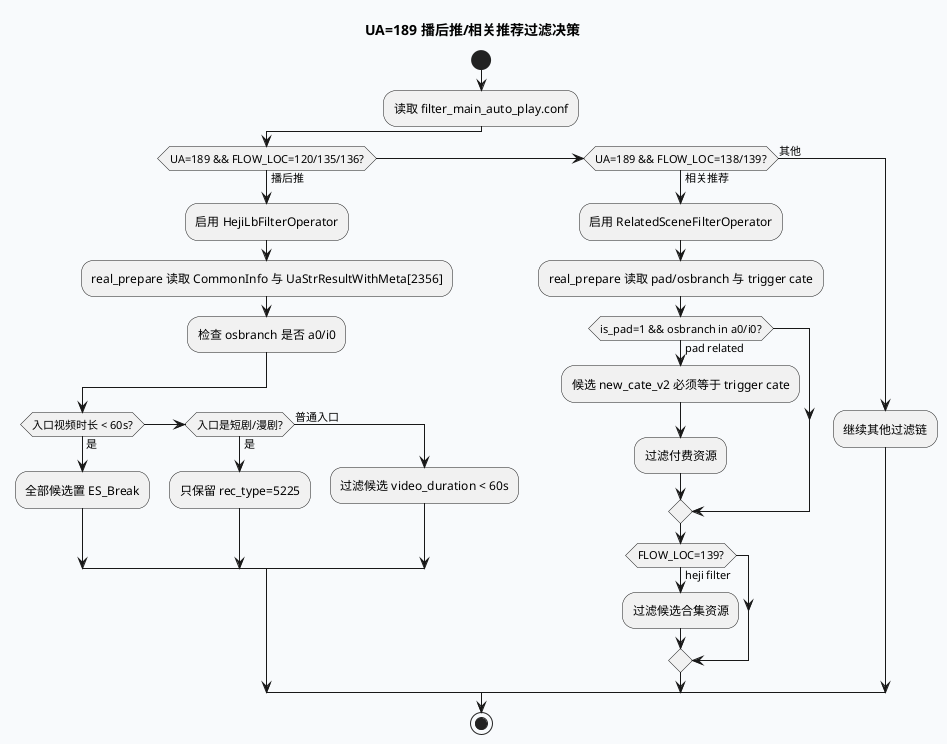

# UA=189 播后推/相关推荐：入口资源驱动的过滤业务链路（2026-06-23）

> 今日主题来源：本机未发现可用 `daily-plan` 文件；按周二 fallback 选择 lite-grc UA=189 业务过滤主题，聚焦播后推与相关推荐如何用入口资源队列 2356 约束候选集合。已按要求设置 `BAIDU_CC_USERNAME=hujiyang`；当前环境 `ku` 不在 PATH 且未提供 KU URL/doc-id，产品策略口径需人工补充；本文以代码库检索结果为准。

<style>.bizarch230623{font-family:-apple-system,BlinkMacSystemFont,"Segoe UI",sans-serif;background:#f8fafc;border:1px solid #d7dee8;border-radius:18px;padding:18px;margin:16px 0;color:#1f2937}.bizarch230623 .title{font-size:22px;font-weight:850;margin-bottom:5px}.bizarch230623 .sub{font-size:13px;color:#64748b;margin-bottom:14px}.bizarch230623 .cols{display:grid;grid-template-columns:1fr 1fr 1fr;gap:12px}.bizarch230623 .panel{background:white;border:1px solid #dbe4ef;border-radius:14px;padding:14px}.bizarch230623 h3{margin:0 0 10px;font-size:15px;color:#315072}.bizarch230623 .item{background:#eef6ff;border:1px solid #bfdbfe;border-radius:10px;padding:9px;margin:8px 0;font-size:13px;line-height:1.45}.bizarch230623 .hot{background:#fff7ed;border-color:#f59e0b}.bizarch230623 .warn{background:#fff1f2;border-color:#fda4af}.bizarch230623 .flow{text-align:center;color:#64748b;font-size:12px;font-weight:800;margin:8px 0}</style><div class="bizarch230623"><div class="title">架构全景：UA=189 的过滤策略从 trigger item 开始，而不是从候选 item 开始</div><div class="sub">播后推和相关推荐都读取 UaStrResultWithMeta[2356] 作为入口资源，再把入口时长、类目、合集标记投射到候选过滤规则。</div><div class="cols"><div class="panel"><h3>场景入口</h3><div class="item hot">UA=189</div><div class="item">FLOW_LOC=120/135/136：播后推 HejiLb</div><div class="item">FLOW_LOC=138/139：RelatedScene</div><div class="item warn">设备条件：osbranch=a0/i0；Related 还要求 is_pad=1</div></div><div class="panel"><h3>入口资源</h3><div class="item hot">UaStrResultWithMeta 队列 2356</div><div class="flow">↓ real_prepare 读取</div><div class="item">video_duration</div><div class="item">new_cate_v2</div><div class="item">is_duanju / is_unhuman_duanju</div></div><div class="panel"><h3>候选动作</h3><div class="item hot">HejiLb：短入口全过滤；合集只保 5225；普通过滤短时长</div><div class="item hot">Related：类目一致；付费过滤；FLOW_LOC=139 过滤合集</div><div class="item">ContentQuality：多层质量与豁免补充</div></div></div></div>

## 核心结论

- `filter_main_auto_play.conf:70-94` 把 UA=189 分成两条业务分支：播后推 `HejiLbFilterOperator` 命中 `FLOW_LOC=120/135/136`；相关推荐 `RelatedSceneFilterOperator` 命中 `FLOW_LOC=138/139`。
- 两个算子都依赖 `CommonInfo`、`SidInfo`、`UaStrResultWithMeta`，代码按下标 0/1/2 读取：`heji_lb_filter_operator.cc:11-16`、`related_scene_filter_operator.cc:11-16`。
- 入口队列固定是 `2356`：HejiLb 读取入口 `video_duration`、`is_duanju`、`is_unhuman_duanju`；Related 读取入口 `new_cate_v2`：`heji_lb_filter_operator.cc:26-50`、`related_scene_filter_operator.cc:33-48`。
- 候选侧不是简单黑白名单：HejiLb 按入口时长、入口是否合集、候选时长/rec_type 三段判断；Related 按 pad 场景、类目一致、付费、合集过滤分层判断：`heji_lb_filter_operator.cc:61-93`、`related_scene_filter_operator.cc:59-93`。

## 业务流程图



## 配置结构信息图

```infographic
infographic compare-hierarchy-left-right-circle-node-pill-badge
data
  title UA=189 两条过滤分支对比
  desc 两者都依赖入口队列 2356，但业务动作不同
  items
    - label HejiLbFilterOperator
      desc 播后推 FLOW_LOC=120/135/136
      children
        - label 场景条件
          desc UA=189 且 osbranch=a0/i0
        - label 入口字段
          desc video_duration、is_duanju、is_unhuman_duanju
        - label 候选动作
          desc 短入口全过滤；短剧/漫剧只保 rec_type=5225；普通入口过滤短候选
    - label RelatedSceneFilterOperator
      desc 相关推荐 FLOW_LOC=138/139
      children
        - label 场景条件
          desc UA=189、is_pad=1、osbranch=a0/i0
        - label 入口字段
          desc trigger_id_cate=new_cate_v2
        - label 候选动作
          desc 类目不一致过滤；付费过滤；FLOW_LOC=139 过滤合集
theme
  palette #3D5A80 #F59E0B #2D6A4F
```

## 关键链路拆解

### 1. 业务分支由 `FLOW_LOC` 明确拆开

`filter_main_auto_play.conf:70-82` 配置 `HejiLbFilterOperator`，只覆盖 `FLOW_LOC=120/135/136`；`filter_main_auto_play.conf:83-94` 配置 `RelatedSceneFilterOperator`，只覆盖 `FLOW_LOC=138/139`。如果线上反馈“UA=189 过滤不符合预期”，第一步必须确认请求实际 `FLOW_LOC`，否则容易把播后推和相关推荐混为一谈。

### 2. HejiLb 是“入口资源决定候选保留范围”

`heji_lb_filter_operator.cc:19-56` 在 `real_prepare()` 中读取入口队列 2356，并计算三个请求级状态：`is_hit_main_scene`、`is_lianbo_vid_heji`、`is_hit_lianbo_vid_duration_filter`。候选侧 `heji_lb_filter_operator.cc:75-88` 的动作是：入口过短则全过滤；入口是短剧/漫剧时只保留 `type == 5225`；否则过滤候选物理时长小于阈值的资源。

### 3. RelatedScene 复用播后推入口，但更强调 pad 与类目一致

`related_scene_filter_operator.cc:25-31` 仅在 UA=189 且 `FLOW_LOC=138/139` 时进入相关场景；其中 pad 类目过滤还要求 `is_pad == "1"` 且 `osbranch == "i0" || "a0"`。`related_scene_filter_operator.cc:70-85` 对候选执行三类动作：类目必须等于入口 trigger cate；付费资源过滤；`FLOW_LOC=139` 时过滤合集。

### 4. ContentQuality 是横向补充，不是 UA=189 专属

`content_quality_score_filter_operator.cc:17-74` 在请求级读取实验、用户质量状态和开关；候选侧存在 storymode/deeplink/新热等豁免（`content_quality_score_filter_operator.cc:86-99`），也存在高质量用户、质量档位、质量分过滤（`content_quality_score_filter_operator.cc:227-323`）。排查 UA=189 误杀时，不能只看 HejiLb/RelatedScene，仍要看后续质量过滤是否把候选继续 Break。

<style>.bizcard230623{font-family:-apple-system,BlinkMacSystemFont,"Segoe UI",sans-serif;background:#F4F3F0;border-radius:18px;padding:20px;margin:18px 0;border-top:8px solid #2D6A4F;color:#1f2937;box-shadow:0 10px 26px rgba(31,41,55,.08)}.bizcard230623 .meta{font-size:12px;letter-spacing:.08em;text-transform:uppercase;color:#64748b;font-weight:800}.bizcard230623 h3{font-size:24px;line-height:1.18;margin:8px 0 12px}.bizcard230623 .grid{display:grid;grid-template-columns:2fr 1fr;gap:14px}.bizcard230623 li{font-size:14px;line-height:1.65}.bizcard230623 ul{margin:0 0 0 18px}.bizcard230623 .side{border-left:3px solid #2D6A4F;padding-left:12px;color:#374151;font-size:14px;line-height:1.65}.bizcard230623 code{background:#e8edf3;border-radius:5px;padding:1px 5px}</style><div class="bizcard230623"><div class="meta">Pitfalls / UA=189 Filter</div><h3>最常见误判：只看候选字段，却忘了候选边界是由入口资源 2356 决定的。</h3><div class="grid"><div><ul><li><b>FLOW_LOC 混淆：</b>120/135/136 是 HejiLb，138/139 是 RelatedScene。</li><li><b>设备条件漏看：</b>HejiLb 仅 a0/i0 生效；Related 的类目过滤还要求 pad。</li><li><b>入口队列缺失：</b>2356 不存在时，算子多为降级 Continue，表现为“规则未生效”。</li><li><b>后续质量过滤：</b>即使通过 HejiLb/Related，也可能被 ContentQuality 后续过滤。</li></ul></div><div class="side">定位建议：先打印 `ua/flow_loc/osbranch/is_pad`，再打印入口 2356 的 `cate/duration/is_duanju/is_unhuman_duanju`，最后对齐候选 `rec_type/cate/duration/is_heji/paylet/filter_log`。</div></div></div>

## 调试 checklist

```infographic
infographic list-column-done-list
data
  title UA=189 过滤链排障 checklist
  desc 适用于播后推、相关推荐误杀/漏放/条数不足
  items
    - label 确认 FLOW_LOC 分支
      desc 120/135/136 看 HejiLb；138/139 看 RelatedScene
      done true
    - label 确认设备条件
      desc osbranch 是否 a0/i0；RelatedScene 还要 is_pad=1
      done true
    - label 确认入口队列 2356
      desc UaStrResultWithMeta 是否存在，入口 gcms_data 是否为空
      done true
    - label 记录入口字段
      desc video_duration、new_cate_v2、is_duanju、is_unhuman_duanju
      done true
    - label 对齐候选字段
      desc rec_type/type、new_cate_v2、video_duration、is_heji、paylet
      done true
    - label 检查 filter_log 首因
      desc 已 ES_Break item 不会再运行后续算子，需找首个 Break
      done true
    - label 复核 ContentQuality
      desc storymode/deeplink/新热/高质量用户/质量档位是否影响结果
      done true
theme
  palette #3D5A80 #F59E0B #2D6A4F
```

## 证据来源

- `conf/plugins/graph/micro_frame/filter_main_auto_play.conf:70-82`：`HejiLbFilterOperator` 的 UA/FLOW_LOC 条件与依赖。
- `conf/plugins/graph/micro_frame/filter_main_auto_play.conf:83-94`：`RelatedSceneFilterOperator` 的 UA/FLOW_LOC 条件与依赖。
- `src/processor/filter/heji_lb_filter_operator.cc:11-16`：按下标读取 `CommonInfo`、`SidInfo`、`UaStrResultWithMeta`。
- `src/processor/filter/heji_lb_filter_operator.cc:19-56`：入口资源与请求级状态计算。
- `src/processor/filter/heji_lb_filter_operator.cc:61-93`：播后推候选过滤动作。
- `src/processor/filter/related_scene_filter_operator.cc:11-16`：按下标读取同一组三个依赖。
- `src/processor/filter/related_scene_filter_operator.cc:25-54`：相关推荐场景、pad 条件与入口类目提取。
- `src/processor/filter/related_scene_filter_operator.cc:70-93`：类目一致、付费与合集过滤。
- `src/processor/filter/content_quality_score_filter_operator.cc:17-74`：质量过滤请求级开关与用户状态。
- `src/processor/filter/content_quality_score_filter_operator.cc:86-99`：storymode、deeplink、新热队列豁免。
- `src/processor/filter/content_quality_score_filter_operator.cc:227-323`：高质量用户豁免、质量阈值与档位过滤。
